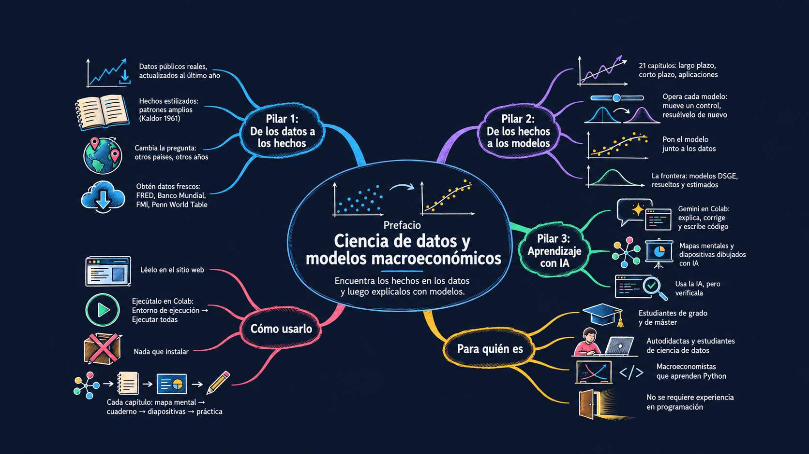

# Prefacio {.unnumbered}

<!-- The Spanish Preface mind map (drawn with /draw-mindmap from mindmaps/preface-...-es.md) -->
<a class="chapter-mindmap" href="../images/mindmaps/preface-data-science-and-macroeconomic-models-es-v1.png"></a>

**¡Bienvenido a *Ciencia de datos y modelos macroeconómicos*!** Este es un libro interactivo de macroeconomía
intermedia, con Python e impulsado por IA. Reúne datos económicos reales y modelos macroeconómicos, con código en
Python que puedes ejecutar y modificar, y un asistente de IA que te ayuda en el camino. Su objetivo es que *hagas*
macroeconomía, no solo que leas sobre ella: tú mismo encuentras los grandes hechos en los datos, y luego construyes,
manejas y cuestionas los modelos que los explican.

[Escucha el pódcast en Spotify (en inglés)](https://open.spotify.com/show/5MpdN8gos8te393uEr4ooK){target="_blank" rel="noopener noreferrer"}

La macroeconomía empieza con hechos. ¿Qué tan rápido ha mejorado el nivel de vida? ¿Por qué algunos países son
mucho más ricos que otros? ¿Cómo se mueven la producción, el desempleo y la inflación cuando la economía cae?
Necesitamos respuestas de los datos antes de poder construir un modelo. Los modelos son nuestro mejor intento de
explicar los hechos, y los hechos nos dicen qué modelos merecen nuestra atención. Mi deseo es sencillo: que al
terminar este libro te sientas tan cómodo haciéndole una pregunta a los datos como dibujando un diagrama, y que
disfrutes ambas cosas.

## Por qué este libro

El libro se apoya en tres pilares:

1. **Ciencia de datos: encuentra los hechos.** Descargas, graficas y exploras datos macroeconómicos reales, y
   decides por ti mismo qué patrón muestran los datos.
2. **Modelos macroeconómicos: explica los hechos.** Mueves deslizadores, cambias parámetros y editas el código en
   Python de cada modelo, y compruebas qué tan bien explica los hechos que encontraste.
3. **Aprendizaje impulsado por IA: aprende más rápido y compruébalo todo.** Un asistente de IA te ayuda a escribir
   y entender el código, y los mapas mentales y las diapositivas hechos con IA te dan la visión de conjunto de
   cada capítulo.

Cada capítulo es un cuaderno (notebook) interactivo. Puedes leerlo en este sitio web o ejecutarlo en Google Colab,
sin instalar nada.

> **Nota:** solo esta página de inicio está traducida al español. Los capítulos, los apéndices, las diapositivas y
> las aplicaciones están en inglés. Puedes usar el traductor de Google de la parte superior de cada página.

## Hechos estilizados: donde empiezan los modelos

Un **hecho estilizado** es un patrón amplio de los datos que se cumple en muchos países o durante periodos largos.
Se llama "estilizado" porque deja de lado los detalles y las excepciones. No todos los años ni todos los países
encajan exactamente, pero el patrón es lo bastante fuerte como para que una buena teoría deba explicarlo.

El término viene del economista Nicholas Kaldor. En Kaldor (1961) sostuvo que la teoría debe partir de un resumen
de los hechos, no de supuestos convenientes. Luego enumeró seis hechos estilizados del crecimiento económico:

1. La producción por trabajador crece a una tasa aproximadamente constante durante periodos largos.
2. El capital por trabajador también crece con el tiempo.
3. La tasa de rendimiento del capital es aproximadamente constante.
4. La relación entre capital y producción es aproximadamente constante.
5. Las participaciones del trabajo y del capital en el ingreso nacional son aproximadamente constantes.
6. La tasa de crecimiento de la producción por trabajador difiere mucho entre países.

Estos seis hechos marcaron la agenda de la teoría del crecimiento. Con progreso tecnológico, el modelo de Solow
(capítulos 5 y 6) reproduce los cinco primeros. El sexto planteó una pregunta nueva, por qué los países difieren
tanto, que abordan los capítulos 3 a 6.

Los hechos estilizados no están grabados en piedra. Resumen los datos, así que datos nuevos pueden revisarlos.
Piensa en la participación del trabajo en el ingreso, descrita durante mucho tiempo como "cerca de dos tercios".
Jones (2024, capítulo 2) señala que ha ido bajando desde alrededor de 1970. En el cuaderno del capítulo 2 lo
compruebas tú mismo con las cuentas nacionales más recientes de Estados Unidos. El trabajo recibió en promedio 0.65
del ingreso entre 1950 y 2025, cerca de dos tercios, pero su participación ha estado por debajo de 0.60 desde 2022.
¿Sigue siendo un hecho el viejo hecho? Los datos por sí solos no lo resuelven, pero te dicen exactamente qué
pregunta hacer.

## Pilar 1: De los datos a los hechos

Jones (2024) da a los datos un papel central. Sus capítulos están llenos de gráficos de economías reales, y sus
modelos se juzgan por qué tan bien explican lo que muestran esos gráficos. Este libro da un paso más. En lugar de
leer los hechos en un gráfico impreso, **los obtienes tú mismo**.

Todos los gráficos de datos de este libro son interactivos. Cada uno se construye con datos públicos, por lo
general actualizados hasta el último año disponible. Puedes:

- **Explorar los gráficos.** Pasa el cursor sobre cualquier punto para leer su valor, haz zoom en un periodo o
  pulsa *play* para ver cómo se mueven los países en el tiempo.
- **Cambiar la pregunta.** Cambia de países, años y variables con controles sencillos o con un cambio de una línea
  en el código. ¿El hecho que ves para Estados Unidos también se cumple para Japón, Brasil o Nigeria? ¿Sobrevive
  si la muestra empieza en 1990 en lugar de 1960?
- **Obtener datos nuevos.** El [apéndice B](../notebooks/appB-accessing-macroeconomic-data-with-python.ipynb)
  muestra cómo descargar datos directamente de FRED, el Banco Mundial, el FMI, el BCE, Eurostat, la OCDE, la Penn
  World Table, el Proyecto Maddison y Our World in Data. Tus hechos pueden estar tan al día como los datos.

El objetivo no es reemplazar los hechos de Jones (2024). Es que te sientas cómodo haciéndole una pregunta a los
datos y juzgando la respuesta, que es lo que los macroeconomistas hacen todos los días.

## Pilar 2: De los hechos a los modelos

Cuando tienes un hecho, quieres saber por qué se cumple. Ese es el trabajo de un modelo. Los modelos de este libro
siguen a los de Jones (2024):

- **El largo plazo:** el modelo de producción, el modelo de Solow y el modelo de ideas de Romer.
  El [apéndice D](../notebooks/appD-growth-and-development-accounting.ipynb) los lleva a la Penn World Table: la
  contabilidad del crecimiento divide el crecimiento del PIB de cada economía en capital, trabajo y PTF, y la
  contabilidad del desarrollo divide de la misma forma su brecha de ingreso con Estados Unidos, para las economías
  que elijas. El [apéndice E](../notebooks/appE-growth-and-convergence-across-countries.ipynb) se pregunta si los
  países pobres alcanzan a los ricos: deriva la velocidad de convergencia a partir del modelo de Solow y mide la
  convergencia β y σ en 84 países desde 1960. El
  [apéndice F](../notebooks/appF-augmented-solow-growth-model.ipynb) añade capital humano al modelo de Solow y
  replica a Mankiw, Romer y Weil (1992): el ahorro, la escolaridad y el crecimiento de la población explican la
  mayor parte de las diferencias de ingreso entre países, entonces y con la Penn World Table 11.0.
  El [apéndice G](../notebooks/appG-growth-and-institutions.ipynb) se pregunta de dónde vienen las brechas de
  productividad: replica a Acemoglu, Johnson y Robinson (2001), que usan la mortalidad de los primeros colonos
  europeos como instrumento para estimar el efecto de las instituciones sobre el ingreso, con pyfixest y
  linearmodels.
- **El corto plazo:** la curva IS, la política monetaria, la curva de Phillips y el marco OA/DA (AS/AD).
- **Aplicaciones:** consumo, inversión, presupuesto público, comercio y tipos de cambio.
- **La frontera:** los modelos de equilibrio general dinámico estocástico (DSGE) del capítulo 15, que los bancos
  centrales usan para el análisis de políticas y los pronósticos. El
  [apéndice H](../notebooks/appH-dsge-modeling-with-python.ipynb) muestra cómo escribirlos, resolverlos con
  expectativas racionales y estimarlos con Snowdrop, un paquete de Python gratuito desarrollado en el FMI. El
  [apéndice I](../notebooks/appI-the-dsge-model-of-smets-and-wouters.ipynb) es la versión avanzada del capítulo
  15: resuelve el modelo estimado de Smets–Wouters y vuelve a calcular las respuestas al impulso del capítulo.

Aquí, sin embargo, puedes **manejar** cada modelo:

- **En este sitio web**, cada gráfico de modelo de los capítulos tiene un deslizador. Muévelo para ver cómo cambia
  el resultado con un parámetro.
- **En Colab**, cada gráfico de modelo tiene deslizadores y botones en vivo que vuelven a resolver el modelo
  mientras los mueves.
- **En el código**, cada modelo son unas pocas líneas de Python sencillo, justo al lado de su gráfico. Cambia un
  parámetro, añade un choque o reemplaza una ecuación, y mira qué pasa. Aquí es donde puedes ir más allá del libro
  de texto.

Luego cierras el ciclo poniendo el modelo junto a los datos. ¿Qué hechos explica el modelo? ¿Cuáles no? Un modelo
que no explica un hecho importante no es un fracaso; es la razón del siguiente capítulo. Por ejemplo, el modelo de
Solow explica buena parte de por qué algunos países son ricos y otros pobres. Por sí solo, sin embargo, no puede
explicar por qué el crecimiento continúa década tras década. La economía de las ideas del capítulo 6 llena ese
vacío.

Los capítulos comparan los modelos con los datos a simple vista. El apéndice H da el último paso que da la
investigación: **estima** un modelo. Los datos eligen los valores de los parámetros que los hacen más probables,
por máxima verosimilitud o por métodos bayesianos, y la estimación muestra qué parámetros pueden fijar los datos y
cuáles no. Allí estimas el modelo neokeynesiano de Ireland (2004) con datos de Estados Unidos de 1948 a 2002 y
reproduces sus estimaciones publicadas.

## Pilar 3: Aprendizaje impulsado por IA

Las herramientas de IA están cambiando cómo aprendemos, escribimos código e investigamos. Este libro las pone a
trabajar para ti de tres maneras:

- **Un asistente de IA a tu lado.** Colab incluye Gemini, un asistente de IA que puede explicar una línea de
  código, corregir un error o escribir un gráfico nuevo a partir de una petición en lenguaje sencillo. Otros
  asistentes, como Claude o ChatGPT, funcionan igual de bien. Pídele a uno que te explique con palabras sencillas
  las ecuaciones de un modelo, que te sugiera otro país para comparar o que convierta tu propia idea en código.
  La [sección A.5](../notebooks/appA-google-colab-and-ai-powered-python.ipynb#a.5-ai-powered-coding-in-colab) del
  apéndice A muestra cómo usar las herramientas de IA de Colab, cómo escribir buenas instrucciones (prompts) y cómo
  comprobar las respuestas.
- **Mapas mentales dibujados con IA.** Cada capítulo y cada apéndice empieza con un mapa mental: un resumen visual,
  dibujado a mano, de sus preguntas, sus hechos y sus modelos. Los mapas se dibujaron con generación de imágenes
  por IA, y yo comprobé cada etiqueta, ecuación y número con el capítulo. Mira el mapa antes de empezar un capítulo
  y vuelve a él cuando termines.
- **Diapositivas de clase.** Cada capítulo y cada apéndice tiene una presentación de clase, hecha con ayuda de IA
  a partir del propio capítulo, con gráficos en vivo que puedes explorar con el cursor. La insignia *Open Lecture
  Slides* de la parte superior de cada capítulo la abre.

**Usa la IA, pero compruébala.** Un asistente de IA puede escribir código que funciona y aun así responde a la
pregunta equivocada. Lee lo que escribe, ejecútalo y compara el resultado con lo que sabes. Trátalo como un
compañero de estudio rápido e incansable, no como un oráculo.

**Cómo ayudó la IA a construir este libro.** Escribí este libro con ayuda de herramientas de IA, y quiero ser
transparente al respecto. Claude (Anthropic) me ayudó a escribir el código, el texto y las diapositivas. Codex
(OpenAI) dibujó los mapas mentales. Gemini (Google) es el asistente integrado en Colab, donde se ejecuta cada
cuaderno. Yo comprobé cada resultado: el código se ejecuta y se prueba, los números se calculan a partir de los
datos y cada gráfico indica sus fuentes.

> **Recursos clave para aprender**
>
> **Este libro**
>
> - **El sitio web**, <https://quarcs-lab.github.io/macro102-site/>: todos los capítulos, con sus gráficos
>   interactivos y los deslizadores de los modelos.
> - **El repositorio de GitHub**, [quarcs-lab/macro102-site](https://github.com/quarcs-lab/macro102-site): los
>   cuadernos, sus fuentes y los archivos de datos detrás de cada gráfico.
>
> **Las insignias de la parte superior de cada capítulo**
>
> - **Open AI Notebook:** ejecuta el cuaderno del capítulo en Google Colab, con deslizadores y botones en vivo, y
>   pídele ayuda con el código a Gemini, el asistente de IA de Colab.
> - **Open Lecture Slides:** la presentación de clase del capítulo, con gráficos en vivo.
> - **Open Data Apps:** una página sin código que reúne los gráficos de datos interactivos del capítulo, en los
>   capítulos que la tienen.
> - **Model Apps** *(próximamente)*: páginas sin código con los modelos interactivos del capítulo.

## El ciclo del libro

```{mermaid}
%%| fig-align: center
flowchart LR
  A["Datos"] --> B["Explorar"] --> C["Hechos estilizados"] --> D["Modelo"] --> E["Comparar con los datos"] --> F["Revisar"]
  F -- "una pregunta más precisa" --> A
  F -- "una idea mejor" --> D
  %% Colors live in the theme files (_includes/theme-*.scss), so the diagram follows the light/dark toggle
  classDef data stroke-width:1.5px;
  classDef model stroke-width:1.5px;
  class A,B,C data;
  class D,E,F model;
```

Cada capítulo recorre este ciclo al menos una vez. Los pasos azules son ciencia de datos; los verdes son modelación
macroeconómica. Empiezas con los datos y los exploras hasta que un patrón destaca. El patrón se convierte en un
hecho estilizado. Un modelo propone una explicación, y comparas sus predicciones con los datos. La comparación te
devuelve a los datos con una pregunta más precisa, o al modelo con una idea mejor. En el apéndice H la comparación
se vuelve formal: los datos estiman los parámetros del modelo y la verosimilitud mide el ajuste.

## Un complemento de Jones (2024), no un sustituto

Este libro es un complemento interactivo de ciencia de datos para
[Jones (2024)](https://wwnorton.com/books/9781324063612). Sus 21 capítulos tienen los mismos títulos y siguen el
mismo orden, así que puedes trabajar con los dos libros en paralelo. Te recomiendo leer primero un capítulo de
Jones (2024), para el razonamiento económico y la discusión completa. Luego abre el cuaderno correspondiente para
trabajar con los datos y los modelos. Los cuadernos no repiten las explicaciones del libro de texto ni lo
reemplazan.

Este libro es independiente. No está afiliado al autor ni a la editorial del libro de texto, ni cuenta con su
respaldo. Cada gráfico es una adaptación original, dibujada con el propio código de este libro:

- **Los gráficos de datos** están *inspirados en* gráficos de Jones (2024). Se reconstruyen con datos públicos, por
  lo general actualizados hasta el último año y ampliados a otros países.
- **Los gráficos de modelos** están *adaptados de* sus diagramas, con sus propios valores de parámetros, su propio
  diseño y sus propios controles interactivos.

Una nota de **Sources** (fuentes) debajo de cada gráfico indica el gráfico de Jones (2024) que lo inspiró y enlaza
a las fuentes de datos, para que puedas abrirlas y explorar los datos por tu cuenta.

## Para quién es este libro

Escribí este libro para cualquiera que quiera ver la macroeconomía en acción con datos reales:

- **Estudiantes de licenciatura o grado** de macroeconomía intermedia, que quieren ver las ideas del curso en
  acción con datos reales y aprender Python práctico en el camino.
- **Estudiantes de maestría o máster** en programas de negocios, políticas públicas y desarrollo, que necesitan
  una comprensión práctica y basada en datos de la macroeconomía para el análisis y el trabajo en políticas.
- **Autodidactas**, que quieren un camino práctico por la macroeconomía a su propio ritmo, sin instalar ningún
  programa.
- **Quienes aprenden ciencia de datos**, que saben algo de Python y buscan preguntas económicas con sentido donde
  aplicarlo.
- **Macroeconomistas**, que conocen la teoría y quieren aprender Python para ciencia de datos con modelos que ya
  conocen, y que buscan una alternativa gratuita en Python a Dynare e IRIS para resolver y estimar modelos DSGE
  (apéndices H e I).

No se supone experiencia previa en programación.
El [apéndice A](../notebooks/appA-google-colab-and-ai-powered-python.ipynb) es una visita guiada por Colab,
Python, las herramientas de IA de Colab para programar y aprender, y las bibliotecas de ciencia de datos que usa el
libro. El [apéndice C](../notebooks/appC-math-review-for-macroeconomics.ipynb) repasa las matemáticas, con código
en Python para cada cálculo.

## Cómo está organizado el libro

Como Jones (2024), este libro gira en torno a un gráfico famoso: el PIB por persona de Estados Unidos desde 1870.
El gráfico muestra una tendencia ascendente de largo plazo y fluctuaciones de corto plazo a su alrededor, y plantea
la pregunta de qué nos depara el futuro. Los capítulos se agrupan en cuatro partes, como en la barra lateral:

- **Preliminares (capítulos 1–2):** qué estudia la macroeconomía y cómo medimos la macroeconomía.
- **El largo plazo (capítulos 3–8):** crecimiento económico, producción, el modelo de Solow, las ideas, el mercado
  de trabajo y la inflación.
- **El corto plazo (capítulos 9–15):** las fluctuaciones económicas, la Gran Recesión y la pandemia de Covid-19, la
  curva IS, la política monetaria y la curva de Phillips, el marco OA/DA, las crisis financieras y los modelos
  DSGE.
- **Aplicaciones (capítulos 16–21):** consumo, inversión, el gobierno, el comercio internacional y los tipos de
  cambio, y unas reflexiones finales sobre lo que la macroeconomía ha aprendido y lo que sigue abierto.
- **Apéndices A–I:** primero las herramientas (A–C): Colab y Python, acceso en vivo a datos macroeconómicos y un
  repaso de matemáticas. Luego el crecimiento económico (D–G): contabilidad del crecimiento y del desarrollo,
  crecimiento y convergencia entre países, el modelo de Solow aumentado, y crecimiento e instituciones. Por último,
  los modelos DSGE (H–I): modelación DSGE con Python, y el modelo de Smets–Wouters del capítulo 15 resuelto en
  Python.

Todos los capítulos tienen la misma estructura:

- Un **mapa mental** y las insignias del capítulo (Colab, diapositivas y, cuando existen, aplicaciones de datos)
  abren el capítulo.
- Una **visión general del modelo** (*Model overview*) construye paso a paso el modelo principal del capítulo,
  desde los supuestos hasta la solución y las predicciones, y termina con el modelo en código.
- Las **secciones temáticas** recorren los gráficos del capítulo (**Fig. 1**, **Fig. 2**, …). Cada gráfico viene
  con un objetivo, el código que lo dibuja y un resumen de "qué observar" (*What to notice*).
- Las tareas **Your turn** (tu turno), con pistas, te piden cambiar los datos o el modelo e interpretar el
  resultado.
- Las **conclusiones** (*Concluding remarks*) resumen lo que mostraron los datos y lo que explicaron los modelos.
- Los **problemas de práctica** (conceptuales, con datos y de modelación), con pistas y soluciones completas,
  cierran los capítulos 1 a 20.

## Cómo usar este libro

### Primeros pasos

- **En este sitio web** puedes leer todos los capítulos, ver todos los gráficos, pasar el cursor sobre los datos y
  mover los deslizadores precalculados debajo de cada gráfico de modelo.
- **En Google Colab** puedes ejecutar el código tú mismo. Haz clic en la insignia *Open AI Notebook* de la parte
  superior de un capítulo y elige *Runtime → Run all* (Entorno de ejecución → Ejecutar todas). Cada gráfico de
  modelo obtiene deslizadores y botones en vivo, y puedes probar cada tarea "Your turn" en una celda de código
  vacía.
- **No hace falta instalar nada.** Colab ya tiene `numpy`, `pandas`, `plotly` e `ipywidgets`, y los datos se leen
  directamente del repositorio de GitHub de este libro. Los apéndices que necesitan paquetes adicionales los
  instalan en su primera celda de código: el apéndice B sus bibliotecas de datos, y los apéndices H e I el paquete
  Snowdrop (unos 20 segundos).
- **¿Eres nuevo en Python o en Colab?** Empieza por el
  [apéndice A](../notebooks/appA-google-colab-and-ai-powered-python.ipynb).

### En cada capítulo

**Lee primero el capítulo de Jones (2024).** El libro de texto te da el razonamiento económico y la discusión
completa. Después, el cuaderno te permite trabajar con los datos y los modelos que hay detrás.

**Mira el mapa mental.** El mapa de la parte superior del capítulo muestra de un vistazo sus preguntas, sus hechos
y sus modelos. Haz clic en él para abrir la imagen a tamaño completo.

**Abre el cuaderno.** Léelo en este sitio web, o haz clic en *Open AI Notebook* y elige *Runtime → Run all* para
dar vida a cada gráfico y cada deslizador.

**Explora los gráficos de datos.** Pasa el cursor, haz zoom, pulsa *play* y cambia de país. Pregúntate si el hecho
se cumple en otros países y otros años.

**Maneja los modelos.** Antes de mover un deslizador, predice qué va a pasar. Luego muévelo y compara tu
predicción con el gráfico.

**Haz las tareas "Your turn".** Cada una te pide cambiar los datos o el modelo e interpretar el resultado.
Inténtalo por tu cuenta antes de abrir la pista.

**Pregúntale a un asistente de IA cuando te atasques.** Pídele a Gemini en Colab que te explique una línea de
código o una ecuación, o que te ayude con una tarea "Your turn". Luego comprueba su respuesta.

**Estudia las diapositivas.** La insignia *Open Lecture Slides* abre la presentación del capítulo, un repaso
compacto de sus hechos y modelos con gráficos en vivo.

**Abre las aplicaciones de datos.** Cuando el capítulo las tiene, la insignia *Open Data Apps* abre una página sin
código con todos sus gráficos de datos interactivos en un solo lugar.

**Intenta los problemas de práctica.** Los problemas conceptuales, con datos y de modelación cierran el capítulo.
Trabaja en cada uno antes de mirar las pistas y la solución completa.

## Capítulos

<!-- TABLE:chapters (copied from ../index.qmd by scripts/check_home_translations.py --sync-tables) -->

| Capítulo | Cuaderno | AI Notebook |
|---|---|---|
| 1 | [Introduction to Macroeconomics](../notebooks/ch01-introduction-to-macroeconomics.ipynb) | [](https://colab.research.google.com/github/quarcs-lab/macro102-site/blob/main/notebooks/ch01-introduction-to-macroeconomics.ipynb) |
| 2 | [Measuring the Macroeconomy](../notebooks/ch02-measuring-the-macroeconomy.ipynb) | [](https://colab.research.google.com/github/quarcs-lab/macro102-site/blob/main/notebooks/ch02-measuring-the-macroeconomy.ipynb) |
| 3 | [An Overview of Long-Run Economic Growth](../notebooks/ch03-an-overview-of-long-run-economic-growth.ipynb) | [](https://colab.research.google.com/github/quarcs-lab/macro102-site/blob/main/notebooks/ch03-an-overview-of-long-run-economic-growth.ipynb) |
| 4 | [A Model of Production](../notebooks/ch04-a-model-of-production.ipynb) | [](https://colab.research.google.com/github/quarcs-lab/macro102-site/blob/main/notebooks/ch04-a-model-of-production.ipynb) |
| 5 | [The Solow Growth Model](../notebooks/ch05-the-solow-growth-model.ipynb) | [](https://colab.research.google.com/github/quarcs-lab/macro102-site/blob/main/notebooks/ch05-the-solow-growth-model.ipynb) |
| 6 | [Growth and Ideas](../notebooks/ch06-growth-and-ideas.ipynb) | [](https://colab.research.google.com/github/quarcs-lab/macro102-site/blob/main/notebooks/ch06-growth-and-ideas.ipynb) |
| 7 | [The Labor Market, Wages, and Unemployment](../notebooks/ch07-the-labor-market-wages-and-unemployment.ipynb) | [](https://colab.research.google.com/github/quarcs-lab/macro102-site/blob/main/notebooks/ch07-the-labor-market-wages-and-unemployment.ipynb) |
| 8 | [Inflation](../notebooks/ch08-inflation.ipynb) | [](https://colab.research.google.com/github/quarcs-lab/macro102-site/blob/main/notebooks/ch08-inflation.ipynb) |
| 9 | [An Introduction to the Short Run](../notebooks/ch09-an-introduction-to-the-short-run.ipynb) | [](https://colab.research.google.com/github/quarcs-lab/macro102-site/blob/main/notebooks/ch09-an-introduction-to-the-short-run.ipynb) |
| 10 | [The Great Recession and the Covid-19 Pandemic: A First Look](../notebooks/ch10-the-great-recession-and-the-covid-19-pandemic-a-first-look.ipynb) | [](https://colab.research.google.com/github/quarcs-lab/macro102-site/blob/main/notebooks/ch10-the-great-recession-and-the-covid-19-pandemic-a-first-look.ipynb) |
| 11 | [The IS Curve](../notebooks/ch11-the-is-curve.ipynb) | [](https://colab.research.google.com/github/quarcs-lab/macro102-site/blob/main/notebooks/ch11-the-is-curve.ipynb) |
| 12 | [Monetary Policy and the Phillips Curve](../notebooks/ch12-monetary-policy-and-the-phillips-curve.ipynb) | [](https://colab.research.google.com/github/quarcs-lab/macro102-site/blob/main/notebooks/ch12-monetary-policy-and-the-phillips-curve.ipynb) |
| 13 | [Stabilization Policy and the AS/AD Framework](../notebooks/ch13-stabilization-policy-and-the-as-ad-framework.ipynb) | [](https://colab.research.google.com/github/quarcs-lab/macro102-site/blob/main/notebooks/ch13-stabilization-policy-and-the-as-ad-framework.ipynb) |
| 14 | [Financial Crises and the Short-Run Model](../notebooks/ch14-financial-crises-and-the-short-run-model.ipynb) | [](https://colab.research.google.com/github/quarcs-lab/macro102-site/blob/main/notebooks/ch14-financial-crises-and-the-short-run-model.ipynb) |
| 15 | [DSGE Models: The Frontier of Business Cycle Research](../notebooks/ch15-dsge-models-the-frontier-of-business-cycle-research.ipynb) | [](https://colab.research.google.com/github/quarcs-lab/macro102-site/blob/main/notebooks/ch15-dsge-models-the-frontier-of-business-cycle-research.ipynb) |
| 16 | [Consumption](../notebooks/ch16-consumption.ipynb) | [](https://colab.research.google.com/github/quarcs-lab/macro102-site/blob/main/notebooks/ch16-consumption.ipynb) |
| 17 | [Investment](../notebooks/ch17-investment.ipynb) | [](https://colab.research.google.com/github/quarcs-lab/macro102-site/blob/main/notebooks/ch17-investment.ipynb) |
| 18 | [The Government and the Macroeconomy](../notebooks/ch18-the-government-and-the-macroeconomy.ipynb) | [](https://colab.research.google.com/github/quarcs-lab/macro102-site/blob/main/notebooks/ch18-the-government-and-the-macroeconomy.ipynb) |
| 19 | [International Trade](../notebooks/ch19-international-trade.ipynb) | [](https://colab.research.google.com/github/quarcs-lab/macro102-site/blob/main/notebooks/ch19-international-trade.ipynb) |
| 20 | [Exchange Rates and International Finance](../notebooks/ch20-exchange-rates-and-international-finance.ipynb) | [](https://colab.research.google.com/github/quarcs-lab/macro102-site/blob/main/notebooks/ch20-exchange-rates-and-international-finance.ipynb) |
| 21 | [Parting Thoughts](../notebooks/ch21-parting-thoughts.ipynb) | [](https://colab.research.google.com/github/quarcs-lab/macro102-site/blob/main/notebooks/ch21-parting-thoughts.ipynb) |

## Apéndices

<!-- TABLE:appendices (copied from ../index.qmd by scripts/check_home_translations.py --sync-tables) -->

| Apéndice | Cuaderno | AI Notebook |
|---|---|---|
| A | [Google Colab and AI-powered Python](../notebooks/appA-google-colab-and-ai-powered-python.ipynb) | [](https://colab.research.google.com/github/quarcs-lab/macro102-site/blob/main/notebooks/appA-google-colab-and-ai-powered-python.ipynb) |
| B | [Accessing Macroeconomic Data with Python](../notebooks/appB-accessing-macroeconomic-data-with-python.ipynb) | [](https://colab.research.google.com/github/quarcs-lab/macro102-site/blob/main/notebooks/appB-accessing-macroeconomic-data-with-python.ipynb) |
| C | [Math Review for Macroeconomics](../notebooks/appC-math-review-for-macroeconomics.ipynb) | [](https://colab.research.google.com/github/quarcs-lab/macro102-site/blob/main/notebooks/appC-math-review-for-macroeconomics.ipynb) |
| D | [Growth and Development Accounting](../notebooks/appD-growth-and-development-accounting.ipynb) | [](https://colab.research.google.com/github/quarcs-lab/macro102-site/blob/main/notebooks/appD-growth-and-development-accounting.ipynb) |
| E | [Growth and Convergence Across Countries](../notebooks/appE-growth-and-convergence-across-countries.ipynb) | [](https://colab.research.google.com/github/quarcs-lab/macro102-site/blob/main/notebooks/appE-growth-and-convergence-across-countries.ipynb) |
| F | [Augmented Solow Growth Model](../notebooks/appF-augmented-solow-growth-model.ipynb) | [](https://colab.research.google.com/github/quarcs-lab/macro102-site/blob/main/notebooks/appF-augmented-solow-growth-model.ipynb) |
| G | [Growth and Institutions](../notebooks/appG-growth-and-institutions.ipynb) | [](https://colab.research.google.com/github/quarcs-lab/macro102-site/blob/main/notebooks/appG-growth-and-institutions.ipynb) |
| H | [DSGE Modeling with Python](../notebooks/appH-dsge-modeling-with-python.ipynb) | [](https://colab.research.google.com/github/quarcs-lab/macro102-site/blob/main/notebooks/appH-dsge-modeling-with-python.ipynb) |
| I | [The DSGE Model of Smets and Wouters](../notebooks/appI-the-dsge-model-of-smets-and-wouters.ipynb) | [](https://colab.research.google.com/github/quarcs-lab/macro102-site/blob/main/notebooks/appI-the-dsge-model-of-smets-and-wouters.ipynb) |

## Agradecimientos

Este libro se apoya en los hombros de muchas personas, instituciones y proyectos.

**Jones (2024).** [*Macroeconomics*](https://wwnorton.com/books/9781324063612) es el libro de texto al que acompaña
este libro. Sus modelos claros y su uso de datos en cada capítulo inspiraron las preguntas, los gráficos y el orden
de este libro. Este libro es independiente de él, y cualquier error aquí es mío.

**Los productores de datos.** Cada gráfico se construye con datos que instituciones públicas recopilan y comparten
libremente: el Banco de la Reserva Federal de St. Louis (FRED), la Oficina de Análisis Económico de Estados Unidos
(BEA), la Oficina de Estadísticas Laborales (BLS) y la Oficina de Presupuesto del Congreso (CBO), el Banco Mundial,
el FMI, la OCDE, Eurostat, el Banco Central Europeo, el Banco de Pagos Internacionales, la Penn World Table, el
Proyecto Maddison, Our World in Data y muchos otros. La nota de fuentes (*Sources*) debajo de cada gráfico los
menciona.

**La comunidad de código abierto.** Python, NumPy, pandas, Plotly, ipywidgets, SciPy, SymPy, statsmodels, Jupyter
y Quarto hacen posible este libro, y Snowdrop, desarrollado en el FMI, lleva los modelos DSGE a Python. Agradezco
a todas las personas que escriben, mantienen y documentan estas herramientas.

**Google Colab y Gemini.** Colab da a cada lector un entorno de Python gratuito en el navegador, y Gemini un
asistente de IA justo al lado del código.

Ahora, empecemos. Abre el capítulo 1, ejecuta la primera celda y empieza a hacerle tus propias preguntas a los
datos.

---

© 2026 Carlos Mendez. Con licencia [CC BY-NC 4.0](https://creativecommons.org/licenses/by-nc/4.0/deed.es).

Puedes compartir y adaptar este material con fines no comerciales, siempre que cites la fuente. La licencia cubre
el texto, el código y los gráficos escritos para este libro. No cubre Jones (2024), *Macroeconomics*, cuyos
gráficos y ecuaciones adaptan estos cuadernos con atribución, ni los datos de terceros, que mantienen las
condiciones de sus productores (consulta las notas de fuentes de cada capítulo).
