## One line of Python shows that 2 percent growth doubles income in 35 years

```python
1.02 ** 35
```

::: {.output}
```
1.9998895526624565
```
:::

[An economy growing 2% a year, after 35 years: twice as large. That is the rule of 70, computed rather than memorized. By the end of today you will write lines like this, load real data and draw live charts, all in a web browser.]{.comment .fragment}

::: {.notes}
Open by typing the line in a live Colab cell if you can. The output is the notebook's own: 1.9998895526624565, almost exactly 2.

Why it matters: the book asks students to run economics, not only to read it. Every chapter is a notebook. This appendix is the toolkit: the place where the notebooks run (Colab), the language (Python), and four libraries (NumPy, pandas, Plotly, ipywidgets).

Ask the room: who has written any code before? Who has used Excel formulas? Reassure them: Excel formulas are code too. Nothing here needs installation.
:::

## Today: five steps from zero to a small data project

::: {.incremental}
- **Colab.** Where do the book's notebooks run, and how do you use one?
- **Python building blocks.** Numbers, variables, lists, loops, `if`, functions, errors.
- **AI-powered coding.** Gemini in Colab: ask, generate, fix, the agent, Learn Mode, and checking its work.
- **The data science libraries.** NumPy and pandas for numbers and tables; Plotly and ipywidgets for charts and sliders.
- **A mini project.** Which economies grew fastest after 1990? By hand, then with AI.
:::

::: {.notes}
These are the five acts of the deck and the five branches of the mind map on the title slide. The appendix is technical, so unlike the chapter decks this one shows code. Every code block and every output on the slides is the appendix notebook's own.

The arc: first the room (Colab), then the vocabulary (Python), then the assistant (Gemini) and how to check it, then the tools (libraries and charts), then one project that uses everything, by hand and with AI.
:::

## Five kinds of cards guide you through the code

::: {.columns}
::: {.column width="50%"}
```python
x = 10
x * 2
```

::: {.output}
```
20
```
:::
:::
::: {.column width="50%"}
[What does this cell show?]{.predict}

[Open a notebook and run it.]{.tryit}
:::
:::

[Code in a dark box, its **output** with a green rule, a **Predict** card before an output is revealed, a **Try it in Colab** exercise, and a **Common mistake** card.]{.comment}

::: {.notes}
Explain the conventions once, so students know how to read the deck.

- Dark box: the code, exactly as in the appendix notebook (sometimes with a comment trimmed).
- Green rule labelled OUTPUT: what the cell printed when the notebook was executed.
- Predict: stop, write down your guess, then reveal. Predicting before seeing is what makes the output stick.
- Try it in Colab: a short exercise to do in the notebook, in class or at home.
- Common mistake (red) and In fact (green): the errors beginners make most often.

Each act ends with a cheat sheet: one slide to photograph.
:::

# Colab: notebooks in the browser {.divider background-color="#3498db"}

[Act I]{.act}

## A notebook mixes text, code and results on one page

::: {.columns}
::: {.column width="33%"}
### Text
Explanations, headings and equations such as $y = \bar{A}k^{1/3}$.
:::
::: {.column width="33%"}
### Code
Short Python cells that compute, load data and draw.
:::
::: {.column width="33%"}
### Results
Numbers, tables and charts, right below the code that made them.
:::
:::

[Change the code, run it again, and the result below it updates.]{.takeaway .fragment}

::: {.notes}
A notebook is read from top to bottom, like a document. The difference from a textbook is that the evidence is live: change a number in a code cell, run it, and the result changes in place.

That is why the book is a set of notebooks: the explanation, the computation and the evidence sit side by side. The file format is Jupyter (.ipynb), the standard in data science; Colab is one place that runs it.
:::

## Colab runs your notebook on Google's computers, not on your laptop

::: {.flow}
[Your web browser]{.node .n1} [code →<br>← results]{.arrow} [Colab runtime]{.node .n2} [← CSV files]{.arrow} [The book's GitHub data]{.node .n3}
:::

[The computer that runs the code is called the **runtime**. It lives in a Google data centre.]{.comment}

::: {.notes}
Google Colab (short for Colaboratory) is a free service that runs Jupyter notebooks inside a web browser. When you press run, your browser sends the code to a computer in one of Google's data centres, the runtime. The runtime computes and sends the results back.

The data never touch your laptop either: each notebook reads its files over the internet from the book's GitHub repository.

Consequence for students: a Chromebook or a library computer is enough. Consequence for instructors: everyone runs exactly the same setup.
:::

## Five reasons the book uses Colab

::: {.incremental}
- **Nothing to install:** Python, NumPy, pandas, Plotly and ipywidgets are already there.
- **The same setup for everyone:** Windows, macOS, Linux or a Chromebook.
- **Live models:** the model figures get sliders; move one and the model is solved again.
- **Easy to save and share:** a copy in Google Drive, shared with a link.
- **Data straight from the source:** files are read from the book's GitHub repository.
:::

::: {.notes}
All you need is a browser and a Google account.

The second point matters more than it seems: code that works for the author works for every reader, because the versions are the same. Most of the pain of learning to code on your own laptop is installation and version conflicts. Colab removes it.

The fifth point: no downloading or uploading data files. The setup cell stores the web address of the chapter's data folder in DATA_URL (Act III).
:::

## Four limits to keep in mind

::: {.incremental}
- **The runtime is temporary.** Close the notebook or leave it idle, and every variable is forgotten. *Runtime → Run all* rebuilds everything in seconds.
- **Edits are not saved automatically** in a notebook opened from GitHub: save your own copy first.
- **Free resources are shared:** only a few runtimes at a time. Close yours properly.
- **You need to be online:** the runtime and the data live on the internet.
:::

::: {.notes}
Free sessions also have a maximum length of several hours (the Colab FAQ gives the details, and Google changes them from time to time). For this book that is not a problem, because every notebook runs from the top in a few seconds.

The two habits that avoid all four problems: save a copy in Drive before you edit, and delete the runtime when you are done. Both are steps of the guided tour that follows.
:::

## Closing the tab is not the same as closing the runtime

[I closed the browser tab, so my work is saved and the runtime has stopped.]{.myth}

[Neither is true. A notebook opened from GitHub is read-only: edits are lost unless you saved a copy in Drive. And the runtime keeps running for a while after the tab closes, using one of your few free slots.]{.fact .fragment}

::: {.notes}
This is the most common source of "Colab won't start" complaints: too many sessions. The cure is Runtime → Manage sessions, then end the ones you no longer need. The good habit is Runtime → Disconnect and delete runtime before closing the tab.
:::

## A whole session takes seven steps

::: {.cheat}
| Step | What you do | Where |
|:---:|-----------------------------------------------|---------------------------------|
| 1 | Open the notebook | the *Open in Colab* badge |
| 2 | Find your way around | menus, toolbar, contents, cells |
| 3 | Run the whole notebook | *Runtime → Run all* (Ctrl+F9) |
| 4 | Accept the warning | *Run anyway* |
| 5 | Read the cells, move the sliders | the model figures |
| 6 | Save your own copy | *File → Save a copy in Drive* |
| 7 | Close the runtime | *Runtime → Disconnect and delete runtime* |
:::

::: {.notes}
We walk through these steps with the Chapter 1 notebook, Introduction to Macroeconomics, which is the one in the screenshots. The screenshots were taken in a 1366 × 768 window (a typical 11-inch laptop), from a paid Colab account (only the PRO label and the list of Gemini models differ from a free account). They use Colab's light theme; a dark Colab can be switched under Tools → Settings → Theme. Google updates Colab now and then, so the menus may look slightly different.

On a Mac, Ctrl+F9 is ⌘+F9.
:::

## Step 1: every chapter page has an Open in Colab badge under its mind map

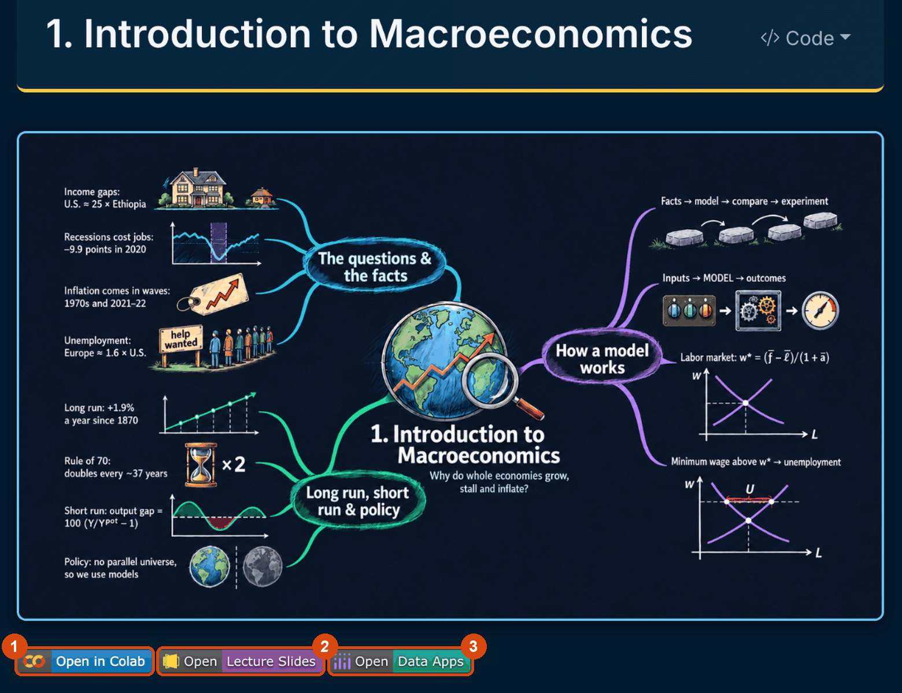{.shot}

[1 *Open in Colab* · 2 *Open Lecture Slides* · 3 *Open Data Apps* (some chapters). Sign in with a Google account to run the notebook.]{.comment}

::: {.notes}
Screenshot A.1 of the appendix: the top of the Chapter 1 page on the book website, in its default dark theme. The badges sit under the mind map: Open in Colab (1), Open Lecture Slides (2), which leads to decks like this one, and, for chapters that have one, Open Data Apps (3), a code-free page of the chapter's data charts.

Without the badge: go to colab.research.google.com, choose File → Open notebook, pick the GitHub tab and paste the notebook's GitHub address.
:::

## Step 2: the Colab window has six parts to know

::: {.columns}
::: {.column width="64%"}
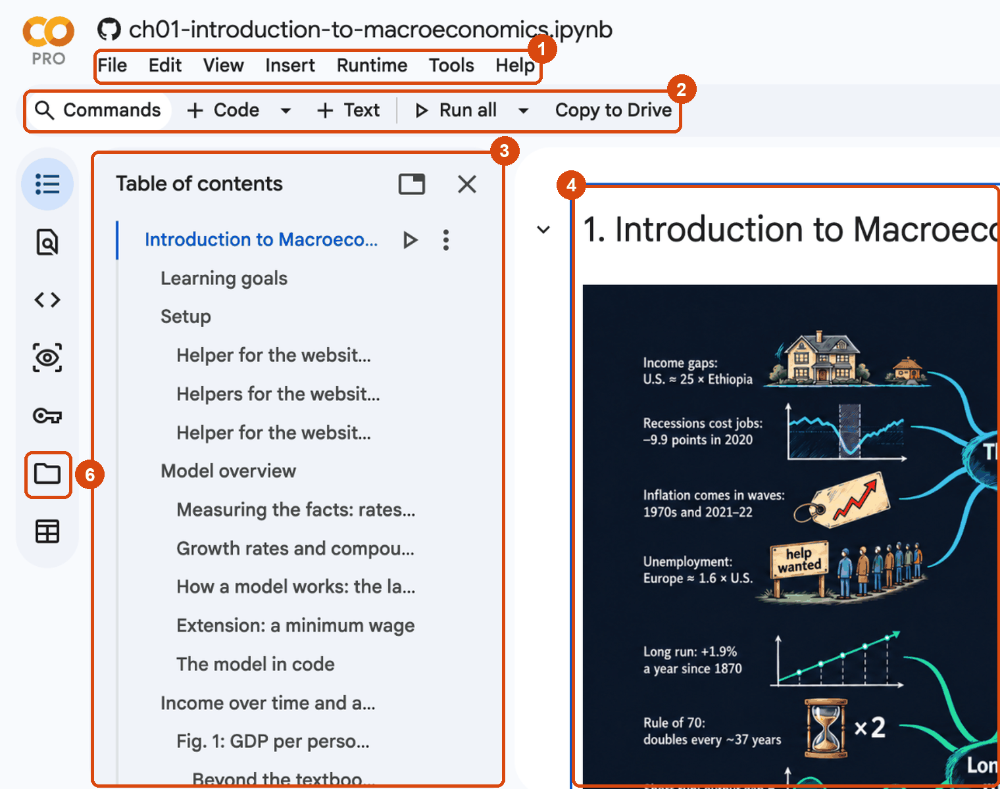{.shot .tall}
:::
::: {.column width="36%"}
{.shot}

[1 menus · 2 toolbar (*+ Code*, *+ Text*, *Run all*) · 3 table of contents · 4 a text cell (title and mind map) · 5 *Connect* · 6 files]{.comment}
:::
:::

::: {.notes}
Walk the numbers of Screenshot A.2:

1. The menus. File saves and downloads; Runtime runs the code; Tools holds the settings and keyboard shortcuts.
2. The toolbar. + Code and + Text add a new cell below the selected one; Run all runs the whole notebook.
3. The table of contents. Click a heading to jump to it. If it is hidden, click the list icon at the top of the narrow bar on the far left.
4. A text cell: here the first one, with the chapter title and the mind map. Double-click to see and edit the Markdown behind it.
5. Connect: shows whether a runtime is attached. After you run a cell it turns into small RAM and Disk bars.
6. Files: the folder icon opens the runtime's files. We rarely need it, because the data come from GitHub.

Click the screenshot to zoom in.
:::

## Step 3: *Runtime → Run all* runs every cell from top to bottom

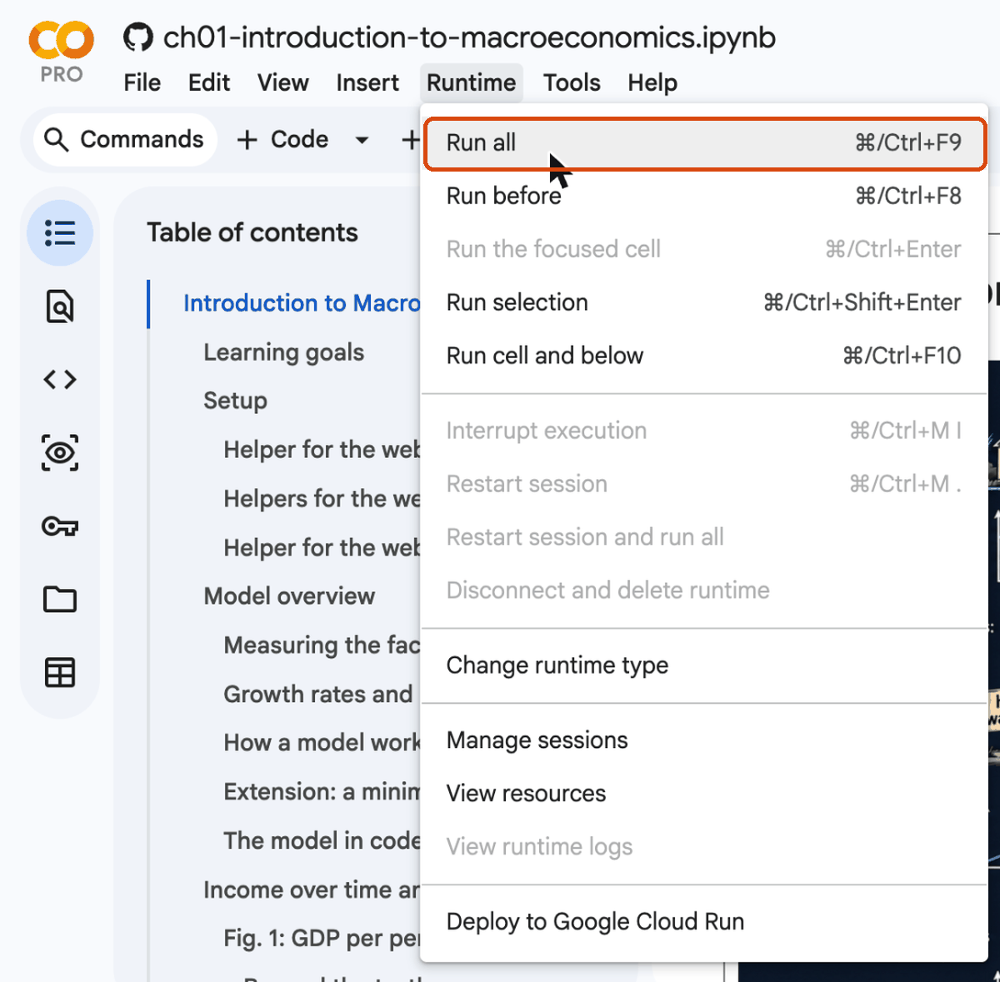{.shot}

[Shortcut: Ctrl+F9 (⌘+F9 on a Mac). Colab connects to a runtime first.]{.comment}

::: {.notes}
Screenshot A.3. Run all is the single most useful command in Colab: it connects to a runtime and runs every code cell in order, so every variable exists before it is used.

Whenever a notebook behaves strangely, Run all is the first cure.
:::

## Step 4: a warning reminds you to run only code you trust

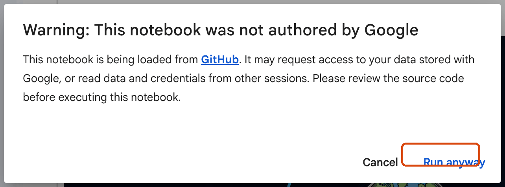{.shot .short}

[The book's notebooks only read public data files and draw charts: click *Run anyway*.]{.comment}

::: {.notes}
Screenshot A.4. Colab shows this warning because the notebook comes from GitHub, not from Google. It is a sensible reminder: code can do things on the runtime and with your Google account's permissions if you grant them. Make it a habit to run notebooks only from sources you trust.

It appears the first time you run a notebook from GitHub in a session.
:::

## Step 5: the number in brackets counts the runs

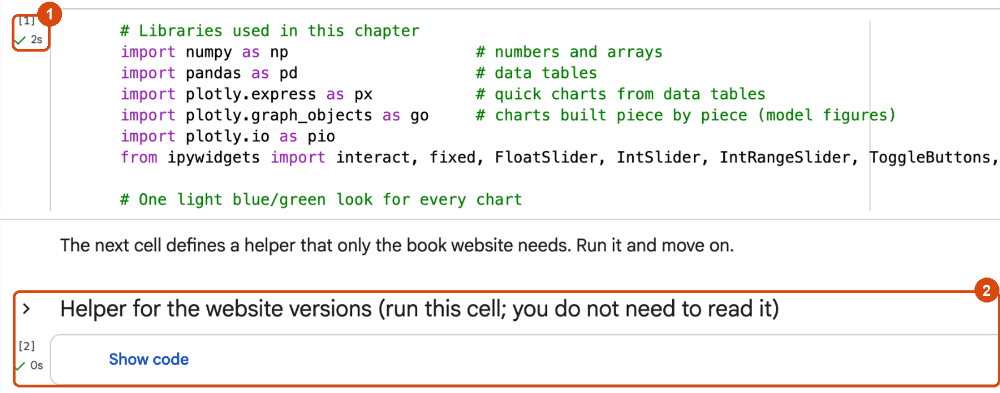{.shot}

[1: the run number, a tick and the time. 2: a folded helper cell. Run it; you need not read it.]{.comment}

::: {.notes}
Screenshot A.5 shows the setup cell of Chapter 1 after running. The number in square brackets counts runs in the session, so it tells you the ORDER in which cells were run. That order matters (next slides).

Folded cells (Show code) are helper cells and website versions of the figures. They must run, but they are not part of what students need to read.
:::

## In Colab, moving a slider solves the model again

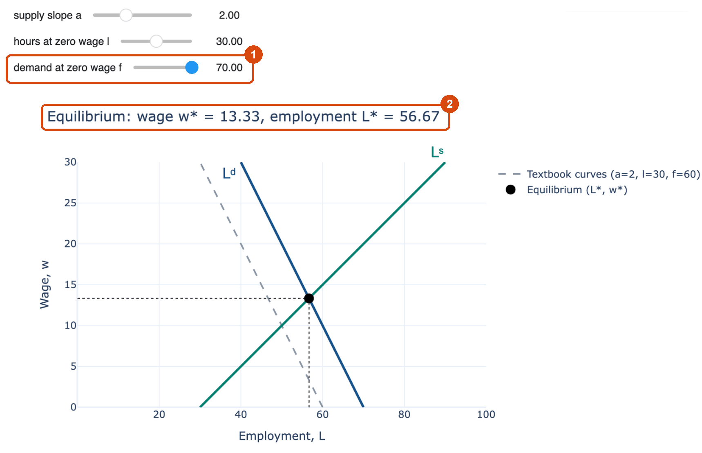{.shot}

[Chapter 1, Fig. 8: labor demand at a zero wage $\bar{f}$ from 60 to 70 (1). The equilibrium moves to $w^* = 13.33$, $L^* = 56.67$ (2).]{.comment}

::: {.notes}
Screenshot A.6: the labor market of Chapter 1 (Fig. 8) with its three live sliders. Each time a slider moves, Python solves the model again and redraws the chart. Moving f from 60 to 70 shifts labor demand right: the wage rises from 10 to 13.33 and employment from 50 to 56.67, as w* = (f − l)/(1 + a) and L* = a w* + l give. The dashed gray line is the textbook's demand curve.

This is the main reason the book uses Colab: the models become something to play with.
:::

## The book website shows a precomputed version of each live figure

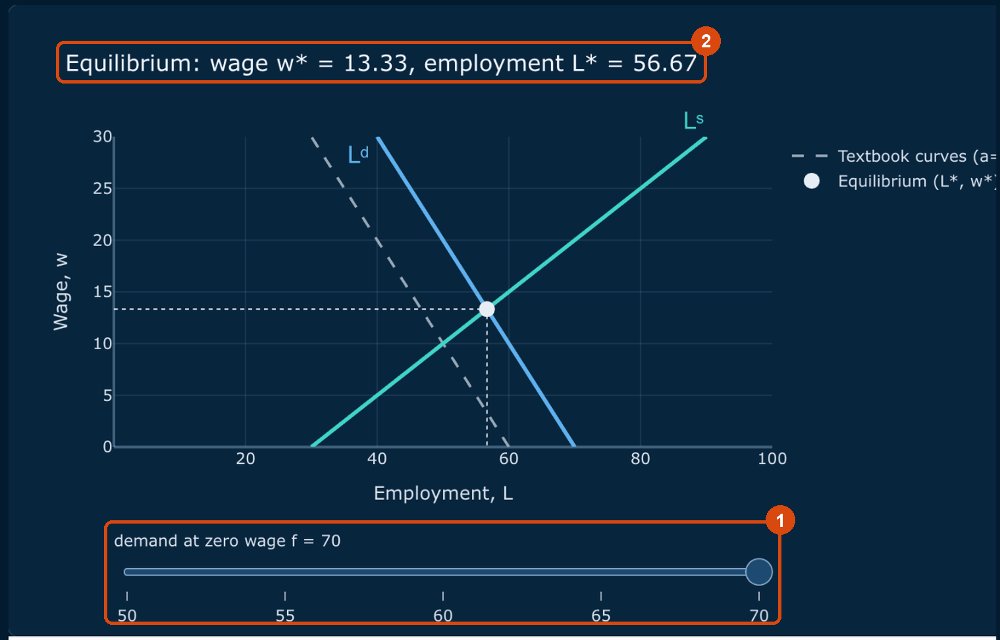{.shot}

[The website cannot run Python: the same chart is computed in advance for a few values and joined by one slider.]{.comment}

::: {.notes}
Screenshot A.7: the website version of the same Fig. 8, in the site's dark theme. One parameter (f), five precomputed values, a Plotly slider under the chart. On a laptop the legend runs off the right edge: the chart scrolls sideways.

On the website you can move that slider, hover over points and click legend entries. Only Colab lets you move every slider freely and change the code. The live figures in these lecture decks are those website versions.
:::

## The website is for reading; Colab is for doing

| | Book website | Colab |
|-----------------------------------|:---------------:|:----------:|
| Read the text and the charts | ✓ | ✓ |
| Hover, zoom, click legends | ✓ | ✓ |
| Move one precomputed slider | ✓ | ✓ |
| Move **every** slider freely | | [✓]{.key} |
| Change and rerun the code | | [✓]{.key} |

::: {.notes}
A simple rule for students: read on the website, practise in Colab. The exercises ("Your turn") and the practice problems need Colab, because they ask you to change code.
:::

## Step 6: save your own copy before you edit

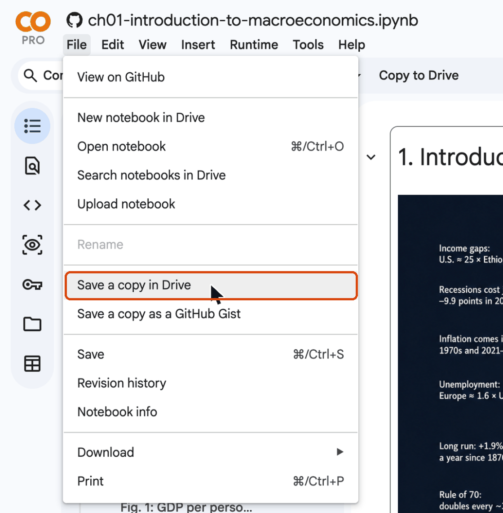{.shot}

[*File → Save a copy in Drive*. The copy goes to a "Colab Notebooks" folder and saves as you work.]{.comment}

::: {.notes}
Screenshot A.8. A notebook opened from GitHub is read-only: Colab says "Save in GitHub to keep changes" next to its name, and edits are lost when you close it. The Copy to Drive button in the toolbar does the same as the menu item.

How to tell that you are in your copy: its name starts with "Copy of", and Colab says it is saved.
:::

## Step 7: delete the runtime when you are done

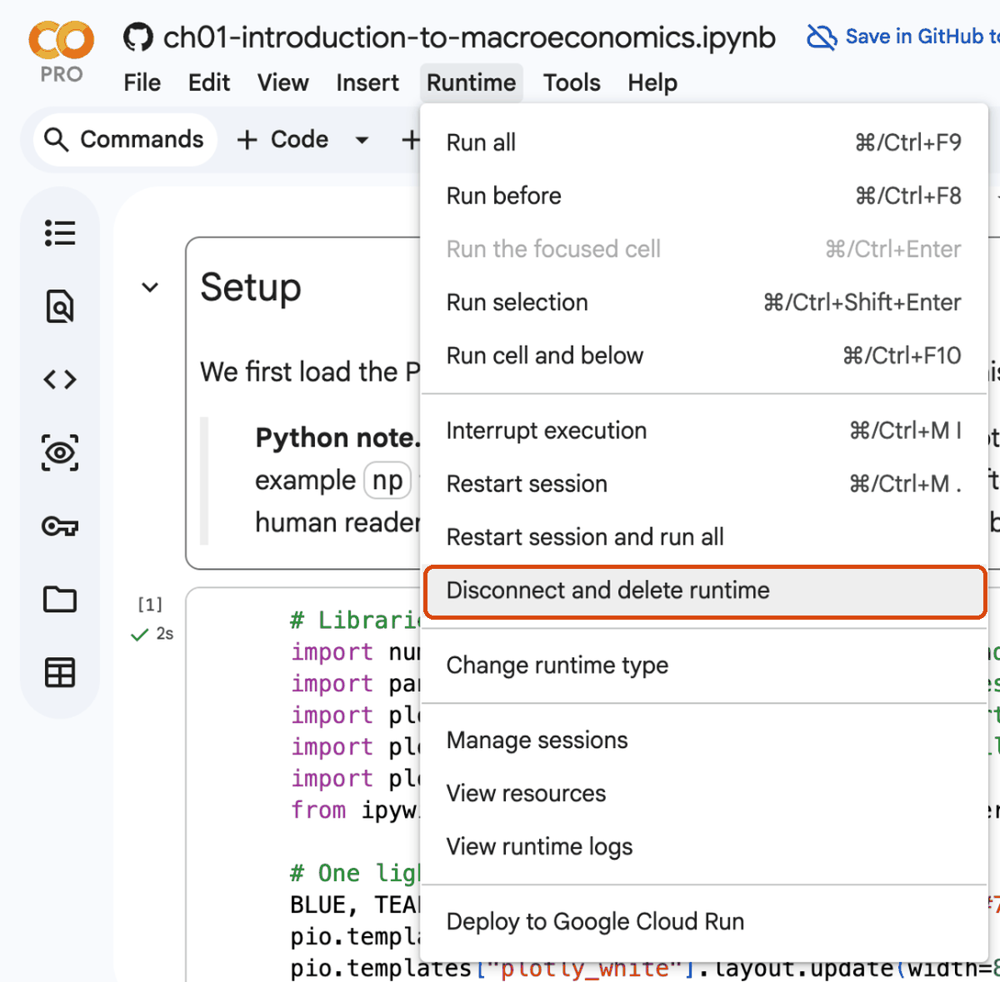{.shot}

[*Runtime → Disconnect and delete runtime*, then close the tab. "Too many sessions"? *Runtime → Manage sessions*.]{.comment}

::: {.notes}
Screenshot A.9. Closing the tab does not stop the runtime right away, and the free tier allows only a few runtimes at the same time. So disconnect first.

If Colab refuses to start because of too many sessions, Manage sessions lists them; end the ones you no longer need.
:::

## Your first session in Colab

[Open the Chapter 1 notebook with its badge, run it, and move the *demand at zero wage f* slider of Fig. 8. Then save a copy in your Drive and delete the runtime.]{.tryit}

::: {.notes}
This is the appendix's first Your turn. Give students five minutes in class.

Hint from the appendix: the badge is under the chapter title on the book website. In the Drive copy the notebook name starts with "Copy of", and Colab says the notebook is saved instead of showing "Save in GitHub to keep changes".

Walk around and check three things: the Run anyway warning was accepted, the slider redraws the chart, and the copy is in Drive.
:::

## Code cells run with Shift+Enter; text cells are written in Markdown

::: {.columns}
::: {.column width="50%"}
### Text cells
Markdown: `**bold**`, `*italic*`, `# Heading`, and equations like $y = \bar{A}k^{1/3}$.
:::
::: {.column width="50%"}
### Code cells
Python. Click inside and press **Shift+Enter**, or click the round ▶ button.
:::
:::

```python
# A code cell: Python works out the expression and shows the result of the last line
2 + 3
```

::: {.output .fragment}
```
5
```
:::

::: {.notes}
Section A.3 of the appendix. The first cell is as simple as it gets: Python evaluates 2 + 3 and shows 5 below the cell.

Lines that start with # are comments: Python ignores them; they are for human readers.
:::

## Only the last line of a cell is shown automatically

```python
print("Hello, Colab!")
x = 10
x * 2          # the last line: its value is shown below the cell
```

[What appears below this cell: one line, or two? Which ones?]{.predict}

::: {.output .fragment}
```
Hello, Colab!
20
```
:::

::: {.notes}
Ask for predictions. Common answers: "only 20" (people forget that print always shows), or "Hello, Colab!, 10 and 20" (people expect the assignment x = 10 to show something).

The rule: print shows anything, anywhere in the cell. Without print, only the value of the LAST line is shown. An assignment (x = 10) shows nothing.

In Colab, the run number appears in brackets at the left (Screenshot A.10 of the appendix shows the first cell of a session computing 1.02 ** 35).
:::

## Cells run in the order you run them, not the order on the page

::: {.columns}
::: {.column width="50%"}
```python
interest_rate = 0.05     # create a variable...
```

```python
interest_rate * 100      # ...and use it later
```

::: {.output .fragment}
```
5.0
```
:::
:::
::: {.column width="50%"}
::: {.incremental}
- The notebook remembers every variable you created, **in the order you ran the cells**.
- Run the second cell first: `NameError`.
- The cure: *Runtime → Run all*, or *Run before*.
:::
:::
:::

::: {.notes}
This is the single most important idea about notebooks. The page order is a suggestion; the run order is what Python sees. The run numbers in brackets record it.

If you open a notebook and run a cell in the middle, a variable it needs may not exist yet, and Python stops with NameError. Run all, or Runtime → Run before followed by the cell itself, fixes it.

Ask: why is the output 5.0 and not 5? (0.05 is a decimal number, a float, so the product is a float too. Act II returns to types.)
:::

## "Run the cell I need" is how most notebook errors start

[I opened the notebook and ran the cell with the chart. It says `NameError`, so the notebook is broken.]{.myth}

[The notebook is fine: a cell above it has not run yet, so a variable or a library does not exist. *Runtime → Run all* fixes it almost every time.]{.fact .fragment}

::: {.notes}
The same applies after Colab disconnects an idle runtime: every variable is forgotten, and the next cell you run fails. Run all again.

The setup cell is the usual missing piece: it loads the libraries (np, pd, px, go) and DATA_URL. Without it, nothing else works.
:::

## Six keyboard shortcuts cover most of your work

::: {.cheat}
| Action | Windows / Linux | Mac |
|------------------------------------------|:-------------:|:-------------:|
| Run the cell and move to the next one | Shift+Enter | Shift+Enter |
| Run the cell and stay on it | Ctrl+Enter | ⌘+Enter |
| Run all cells | Ctrl+F9 | ⌘+F9 |
| Run all cells above | Ctrl+F8 | ⌘+F8 |
| Interrupt a running cell | Ctrl+M I | ⌘+M I |
| Show all shortcuts | Ctrl+M H | ⌘+M H |
:::

[*Runtime → Restart session* clears every variable. Then run the cells again from the top.]{.takeaway .fragment}

::: {.notes}
The table is the appendix's. Shift+Enter is the one to practise until it is automatic.

Restart session is useful when a notebook gets into a confusing state, for example after running cells out of order many times. It clears everything; then Run all.
:::

## `help(...)` prints the documentation of any function

```python
help(round)
```

::: {.output .fragment}
```
Help on built-in function round in module builtins:

round(number, ndigits=None)
    Round a number to a given precision in decimal digits.

    The return value is an integer if ndigits is omitted or None.  Otherwise
    the return value has the same type as the number.  ndigits may be negative.
```
:::

[In a code cell, type a function name and `(` and wait: Colab shows the arguments it takes.]{.comment}

::: {.notes}
Read the signature line with the students: round takes a number and an optional ndigits, whose default is None. "Default" will come back when we write our own functions: an argument with a default can be left out.

So round(1.4427, 2) gives 1.44, and round(1.4427) gives 1.
:::

## Your first code cell

[Add a new code cell (*+ Code*), compute how many hours there are in a year, and run it with Shift+Enter. Then change it to compute the hours in a leap year and run it again.]{.tryit}

::: {.notes}
The appendix's second Your turn. Hint: multiply the number of days by the number of hours in a day; the star * multiplies.

Answers: 365 * 24 = 8760 hours; 366 * 24 = 8784 hours.

The point of the exercise is the workflow, not the arithmetic: add a cell, run it, edit it, run it again, and watch the run number in brackets go up.
:::

## Act I cheat sheet: Colab

::: {.cheat}
| You want to … | Do this |
|-----------------------------------|------------------------------------------------------|
| open a chapter | click its *Open in Colab* badge |
| run everything | *Runtime → Run all* (Ctrl+F9) |
| run one cell | Shift+Enter |
| fix a `NameError` after a jump | *Runtime → Run before*, or *Run all* |
| start clean | *Runtime → Restart session*, then *Run all* |
| keep your edits | *File → Save a copy in Drive* |
| finish | *Runtime → Disconnect and delete runtime* |
| read a function's manual | `help(name)` |
:::

::: {.notes}
One slide to photograph. Everything in Act I fits on it.

Transition: we can now run cells. Next, what to write in them.
:::

# Python building blocks {.divider background-color="#8e44ad"}

[Act II]{.act}

## Python works like a calculator

```python
print(7 + 3, 7 - 3, 7 * 3, 7 / 3)     # add, subtract, multiply, divide
print(7 // 3, 7 % 3)                 # whole-number division and its remainder
print(2 ** 10)                       # a power: 2 to the 10th
```

[What do `7 // 3` and `7 % 3` give? And `2 ** 10`?]{.predict}

::: {.output .fragment}
```
10 4 21 2.3333333333333335
2 1
1024
```
:::

::: {.notes}
Section A.4.1. Collect guesses for the second line first.

7 // 3 is whole-number division: 3 goes into 7 twice, so 2. 7 % 3 is the remainder: 1. The star-star ** is a power.

Point at 2.3333333333333335: the last digit is not a typo. Computers store decimals in binary, so a tiny rounding error appears in the 16th digit. It never matters for economics, but it surprises people the first time (it comes back with NumPy in Act III).

print with several values separated by commas prints them on one line with spaces.
:::

## `**` is all you need for compound growth

$$\text{after } t \text{ years at growth rate } g:\qquad y_t = y_0\,(1+g)^t$$

```python
1.02 ** 35
```

::: {.output .fragment}
```
1.9998895526624565
```
:::

[At 2% a year a variable doubles in about 70/2 = 35 years: the rule of 70 of Chapter 3.]{.takeaway .fragment}

::: {.notes}
An economy that grows at 2 percent a year is multiplied by 1.02 every year. After 35 years it is 1.02 to the 35th power times as large: almost exactly twice as large.

This is the hook of the deck. The rule of 70 says that something growing at g percent a year doubles in about 70/g years. Here the computer confirms it in one line. Later in this act we turn the rule into a function and compare it with the exact doubling time.
:::

## In Python, `^` is not a power

[To compute 2 to the 10th, I write `2 ^ 10`, like in Excel.]{.myth}

[In Python the power is `**`: `2 ** 10` gives 1024. The caret `^` is a different operation on the bits of whole numbers, and `2 ^ 10` quietly gives 8, with no error message.]{.fact .fragment}

::: {.notes}
This is one of the most common mistakes for students who come from Excel or from writing math by hand, and it is dangerous because Python does not complain: the result is just wrong.

For the curious: ^ is bitwise "exclusive or". In binary, 2 is 0010 and 10 is 1010; the bits that differ give 1000, which is 8.
:::

## A variable is a name for a value

```python
y_1990 = 47713      # U.S. GDP per person in 1990, 2022 dollars (Maddison data, Section A.6)
y_2022 = 75459      # the same in 2022
growth_factor = y_2022 / y_1990
growth_factor
```

::: {.output .fragment}
```
1.5815186636765661
```
:::

::: {.incremental}
- `=` means "store the value on the right under the name on the left".
- Names: letters, digits and underscores; no spaces; `GDP` and `gdp` are different.
- The book follows the textbook's notation: `s`, `d`, `A`, `k_star`, `y_star`.
:::

::: {.notes}
Section A.4.2. U.S. GDP per person rose from 47,713 to 75,459 dollars (2022 dollars, Maddison data) between 1990 and 2022: a growth factor of about 1.58.

The = sign is not the equals of algebra. It is an instruction: compute the right-hand side, then attach the name on the left to the result. That is why x = x + 1 makes sense in Python: take the current x, add one, store the result under x again.
:::

## From the growth factor to the average annual growth rate

::: {.eqpanel}
$$y_{2022} = y_{1990}\,(1+g)^{32} \quad\Longrightarrow\quad g = \left(\frac{y_{2022}}{y_{1990}}\right)^{1/32} - 1$$
:::

```python
g = growth_factor ** (1 / 32) - 1
g
```

::: {.output .fragment}
```
0.014427636896671148
```
:::

[U.S. GDP per person grew about 1.44% a year on average from 1990 to 2022.]{.takeaway .fragment}

::: {.notes}
The average annual growth rate is the constant rate g that turns the 1990 value into the 2022 value in 32 years. Solve the compound-growth equation for g: divide, take the 1/32 power, subtract 1.

Note the parentheses around 1 / 32. Without them, growth_factor ** 1 / 32 means (growth_factor ** 1) / 32, because powers are computed before divisions. Ask students what that wrong version would give (about 0.049, a nonsense growth rate).

This formula appears in almost every data chapter of the book.
:::

## `=` stores a value; `==` asks a question

[`if g = 0.02:` checks whether the growth rate is 2 percent.]{.myth}

[One `=` assigns, and inside an `if` it is a `SyntaxError`. Two `==` compare and give `True` or `False`: `g == 0.02`.]{.fact .fragment}

::: {.notes}
The appendix lists the comparisons in Section A.4.5 and warns about the double sign. This card puts the warning before the if statement, because students meet = first.

Comparisons: >, <, >=, <=, == (equal) and != (not equal). Each gives a bool, True or False.
:::

## Every value has a type

```python
country = "United States"           # a string
years = 2022 - 1990                 # an int
g = growth_factor ** (1 / years) - 1    # a float
is_rich = y_2022 > 50000            # a bool, the result of a comparison
print(type(country), type(years), type(g), type(is_rich))
```

::: {.output .fragment}
```
<class 'str'> <class 'int'> <class 'float'> <class 'bool'>
```
:::

::: {.cheat}
| `int` | `float` | `str` | `bool` |
|:---:|:---:|:---:|:---:|
| whole numbers: `32` | decimals: `0.0144` | text in quotes: `"Japan"` | `True` or `False` |
:::

::: {.notes}
Section A.4.3. The four types students meet most. type() tells you the type of any value.

Why it matters: Python treats them differently. "GDP in " + 2025 fails, because text plus a number is ambiguous (later in this act). And is_rich is a comparison stored in a variable: y_2022 > 50000 is True.
:::

## An f-string puts values into text, formatted

```python
print(f"{country}: GDP per person grew from {y_1990:,.0f} to {y_2022:,.0f} dollars,")
print(f"or {g:.2%} a year on average over {years} years.")
```

[What will `{g:.2%}` show for $g = 0.014427\ldots$? And `{y_1990:,.0f}` for 47713?]{.predict}

::: {.output .fragment}
```
United States: GDP per person grew from 47,713 to 75,459 dollars,
or 1.44% a year on average over 32 years.
```
:::

::: {.notes}
An f-string is a string with an f before the opening quote. Python replaces each {...} with the value of the expression inside. After a colon you set the format.

The two formats to remember:
- :.2% multiplies by 100 and shows 2 decimals with a percent sign: 0.014427... becomes 1.44%.
- :,.0f adds a thousands separator and no decimals: 47713 becomes 47,713.

Others: :.3f for three decimals, :.1f for one.
:::

## A list holds values in order, counted from 0

```python
countries = ["United States", "Japan", "China"]
print(countries[0], "|", countries[-1], "|", len(countries), "countries")
countries.append("India")        # add an element at the end
countries
```

[Which country is `countries[0]`? Which is `countries[-1]`?]{.predict}

::: {.output .fragment}
```
United States | China | 3 countries
['United States', 'Japan', 'China', 'India']
```
:::

::: {.notes}
Section A.4.4. Square brackets make a list. Positions start at 0, so countries[0] is the first element; negative positions count from the end, so countries[-1] is the last.

Common error: countries[3] on a three-element list gives IndexError, because the positions are 0, 1 and 2.

append adds one element at the end and changes the list in place. len counts the elements. Note that the print line ran BEFORE the append, so it saw three countries.
:::

## A `for` loop repeats the indented lines, once per value

```python
# Compound growth, year by year: income grows by 2 percent each year
y = 100.0
for year in range(1, 6):
    y = y * 1.02
    print(f"year {year}: {y:.2f}")
```

::: {.output .fragment}
```
year 1: 102.00
year 2: 104.04
year 3: 106.12
year 4: 108.24
year 5: 110.41
```
:::

[`range(1, 6)` gives 1, 2, 3, 4, 5. The colon and the four spaces mark the lines inside the loop.]{.comment}

::: {.notes}
The loop variable year takes each value in turn. Each time, the two indented lines run: y is multiplied by 1.02 and printed.

Notice that the gains grow: +2.00, +2.04, +2.08, +2.12, +2.17. That is compounding: 2 percent of a larger number.

range(1, 6) stops BEFORE 6. range(50) gives 0 to 49. Off-by-one errors with range are common; when in doubt, print the values.
:::

## Loops simulate models over time: the Solow model in one line

::: {.eqpanel}
$$k_{t+1} = k_t + s\,k_t^{1/3} - d\,k_t$$
:::

::: {.incremental}
- Each year, capital per person $k$ grows by investment $s\,k_t^{1/3}$ …
- … and shrinks by depreciation $d\,k_t$.
- With $s = 0.2$ and $d = 0.1$, the steady state is $k^* = (s/d)^{3/2}$.
:::

::: {.notes}
This is the capital accumulation equation of the Solow model of Chapter 5, per person, with output y = k^(1/3) and no population growth. Investment is a share s of output; depreciation is a share d of capital.

The steady state is where investment equals depreciation: s k^(1/3) = d k, so k^(2/3) = s/d and k* = (s/d)^(3/2). With s/d = 2, k* = 2^1.5 ≈ 2.83.

Next slide: the loop that runs this for 50 years.
:::

## The loop runs the model for 50 years

```python
s, d = 0.2, 0.1        # investment rate and depreciation rate
k = 1.0                # capital per person in year 0
path = [k]             # a list that will hold the whole path
for t in range(50):
    k = k + s * k ** (1 / 3) - d * k
    path.append(k)
k_star = (s / d) ** 1.5                 # the steady state of this model, (s/d)^(3/2)
print(f"k after 10 years: {path[10]:.3f}, after 50 years: {path[50]:.3f}")
print(f"steady state k* = {k_star:.3f}")
```

[Capital starts at 1, below the steady state of about 2.83. After 50 years, will it be above, below or at $k^*$?]{.predict}

::: {.notes}
Read the code line by line. s, d = 0.2, 0.1 assigns two variables at once. path = [k] starts a list with the year-0 value. Each pass through the loop computes next year's k from this year's and appends it to path. After the loop, path has 51 values: years 0 to 50, so path[10] is year 10.

Collect predictions before revealing. Many students say "at k*" or even "above". The principle of transition dynamics says: below the steady state capital rises, and it rises more slowly the closer it gets.
:::

## Capital rises fast at first, then slows as it nears the steady state

::: {.output}
```
k after 10 years: 1.828, after 50 years: 2.761
steady state k* = 2.828
```
:::

::: {.incremental}
- In the first 10 years $k$ rises from 1 to [1.828]{.key}; in the next 40, only to [2.761]{.key}.
- After 50 years it is still just **below** $k^* = 2.828$: it approaches, never overshoots.
- The *principle of transition dynamics* of Chapter 5, from a five-line loop.
:::

[A loop turns a model's equation into its whole time path.]{.takeaway .fragment}

::: {.notes}
The answer to the prediction: below, and close. Growth is fast when k is far below k* (investment is much larger than depreciation) and slows down as the gap closes.

Ask: what would you change to start ABOVE the steady state? (k = 4.0.) What happens then? (k falls toward 2.83.) Students can try it in Colab.

The chapters draw this path as a chart; here it is just numbers.
:::

## `if`, `elif` and `else` choose which lines run

```python
g_percent = 1.4                  # an average growth rate, in percent a year
if g_percent >= 3:
    label = "fast"
elif g_percent >= 1:
    label = "moderate"
else:
    label = "slow or negative"
print(f"Growth of {g_percent}% a year is {label}.")
```

[Which label does 1.4 get? What about 3.0, and −0.5?]{.predict}

::: {.output .fragment}
```
Growth of 1.4% a year is moderate.
```
:::

::: {.notes}
Section A.4.5. Python checks the conditions from the top and runs the block of the FIRST one that is True, then skips the rest. 1.4 is not >= 3, but it is >= 1, so "moderate".

3.0 gives "fast" (>= includes the boundary). −0.5 gives "slow or negative".

Same syntax rule as loops: a colon at the end of each condition line, and the block indented by four spaces. elif is short for "else if".
:::

## A dictionary stores values under names

```python
params = {"s": 0.2, "d": 0.1, "A": 1.0}
print(params["s"])               # look up a value by its key
params["s"] = 0.3                # change it
for key in params:
    print(key, "=", params[key])
```

[The first line prints 0.2. What does the loop print for `s`?]{.predict}

::: {.output .fragment}
```
0.2
s = 0.3
d = 0.1
A = 1.0
```
:::

::: {.notes}
Section A.4.6. Curly braces, key: value pairs. You look a value up by its key, not by a position. The book uses dictionaries for sets of model parameters and for colors.

The loop prints 0.3 for s, because the assignment changed it before the loop ran. A loop over a dictionary goes through its keys.

Looking up a key that does not exist gives KeyError, the same error pandas gives for a wrong column name (Act IV).
:::

## A function packs an equation under a name

```python
def output(k, A=1.0):
    """Output per person in the production model of Chapter 4: y = A k^(1/3)."""
    return A * k ** (1 / 3)
```

::: {.incremental}
- `def` starts the definition; `k` and `A` are its **arguments**.
- `A=1.0` is a **default**: leave `A` out and it is 1.
- The text in triple quotes, the **docstring**, says what the function does.
- `return` sends back the result.
:::

[In the chapters, each model equation becomes one short function like this one.]{.takeaway .fragment}

::: {.notes}
Section A.4.7. This is the production function of Chapter 4, y = A k^(1/3), as Python. The body of the function is indented, like the body of a loop.

Defining a function runs nothing yet: it only creates the name output. The next slide calls it.

help(output) would print the docstring. That is why the book writes one for every function.
:::

## Calling the function: change the arguments, get a new answer

```python
print(output(8))           # k = 8 and the default A = 1
print(output(8, A=2.0))    # the same capital with twice the productivity
```

[The cube root of 8 is 2. What do the two lines print?]{.predict}

::: {.output .fragment}
```
2.0
4.0
```
:::

[Twice the productivity, twice the output, with the same capital.]{.takeaway .fragment}

::: {.notes}
output(8) uses the default A = 1: 1 × 8^(1/3) = 2.0. output(8, A=2.0) doubles it: 4.0.

Naming the argument (A=2.0) makes the call readable. output(8, 2.0) would give the same result, because arguments are matched by position too.

This is the Chapter 4 lesson in two lines: productivity multiplies output at every level of capital. Act IV draws it.
:::

## The rule of 70 as a function, tried in a loop

```python
def years_to_double(g_percent):
    """Rule of 70 (Chapter 3): something growing at g percent a year doubles in about 70/g years."""
    return 70 / g_percent

for g_percent in [1, 2, 3.5, 7]:
    print(f"growth of {g_percent}% a year: doubles in about {years_to_double(g_percent):.0f} years")
```

::: {.output .fragment}
```
growth of 1% a year: doubles in about 70 years
growth of 2% a year: doubles in about 35 years
growth of 3.5% a year: doubles in about 20 years
growth of 7% a year: doubles in about 10 years
```
:::

::: {.notes}
A loop over a list of values, calling the function each time, is a pattern the book uses constantly: one function, many scenarios.

Economics: a country growing 7 percent a year doubles its income in about a decade; at 1 percent it takes a lifetime. Small differences in growth rates become huge differences in levels. The mini project in Act V reuses this function on real data.
:::

## `import` loads a library: the rule of 70 against the exact answer

```python
import math
for g_percent in [2, 7]:
    exact = math.log(2) / math.log(1 + g_percent / 100)
    rule = years_to_double(g_percent)
    print(f"At {g_percent}% a year: exactly {exact:.1f} years; rule of 70: {rule:.1f} years")
```

::: {.output .fragment}
```
At 2% a year: exactly 35.0 years; rule of 70: 35.0 years
At 7% a year: exactly 10.2 years; rule of 70: 10.0 years
```
:::

[The exact doubling time is $\ln 2 / \ln(1+g)$. The rule is very close at low growth and a little off at high growth.]{.comment}

::: {.notes}
Section A.4.8. A library is a collection of functions someone else wrote; import loads it. math is built into Python and has the natural logarithm, math.log.

Where the exact formula comes from: solve (1 + g)^T = 2 for T: T = ln 2 / ln(1 + g). Since ln 2 ≈ 0.693 and ln(1 + g) ≈ g for small g, T ≈ 69.3/g percent, rounded to 70.

Note the dot: math.log means "the log function from the math library". The same dot appears in np.log and pd.read_csv.
:::

## Read an error message from the bottom up

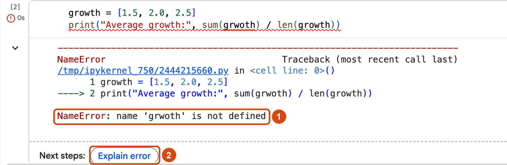{.shot .short}

::: {.incremental}
- The **last line** names the error and what went wrong: `name 'grwoth' is not defined`.
- The arrow `---->` points to the line that failed.
- *Explain error* asks Gemini for help (Act III). Read the message yourself first.
:::

::: {.notes}
Screenshot A.11: a typo, grwoth instead of growth, gives a NameError. The traceback looks scary because of the red lines and the file path at the top; none of that matters. Start at the bottom.

Everyone writes code with mistakes, including professionals every day. The skill is reading the message, not avoiding errors.
:::

## `try … except` catches an error instead of stopping

```python
try:
    "GDP in " + 2025          # text plus a number: Python refuses to guess what you mean
except TypeError as error:
    print("TypeError:", error)
print("GDP in " + str(2025))    # the fix: turn the number into text first
```

::: {.output .fragment}
```
TypeError: can only concatenate str (not "int") to str
GDP in 2025
```
:::

[The setup cell of every chapter uses `try … except` to run one line that only works in Colab.]{.comment}

::: {.notes}
Python tries the indented lines under try. If they fail with the named error, it runs the lines under except instead of stopping.

The error itself is instructive: + joins two strings or adds two numbers, but a string plus an int is ambiguous, so Python refuses. str(2025) turns the number into text. An f-string, f"GDP in {2025}", is the other fix.

Students will rarely write try themselves; the point is to recognize it in the setup cell (Act IV).
:::

## Indentation is part of the code, not decoration

[Spaces at the start of a line are just for looks; Python ignores them.]{.myth}

[Python uses the indentation to know which lines belong to a `for`, an `if` or a `def`. Forget it, or mix 3 and 4 spaces, and you get an `IndentationError`, or worse, a line that silently runs outside the loop.]{.fact .fragment}

::: {.notes}
The appendix's common-errors table: IndentationError means the spaces at the start of a line are wrong; indent the body of for, if and def by four spaces. Colab indents automatically after a colon.

The silent version is worse: if the print of the compound-growth loop were not indented, it would run once, after the loop, and print only year 5.
:::

## A function for the average growth rate

[Write a function `growth_rate(y_start, y_end, years)` that returns the average annual growth rate **in percent**. Check it with the U.S. numbers: 47713 in 1990, 75459 in 2022. You should get about 1.4.]{.tryit}

. . .

```python
def growth_rate(y_start, y_end, years):
    """Average annual growth rate, in percent."""
    return ((y_end / y_start) ** (1 / years) - 1) * 100

growth_rate(47713, 75459, 32)          # about 1.44
```

::: {.notes}
The appendix's third Your turn. Hint: start from g = (y_end / y_start)^(1/years) − 1, multiply by 100, and return the result; indent the body by four spaces.

Give students a few minutes before revealing the solution. The result is 1.44, the same g as before (0.014427...) times 100.

Typical mistakes to watch for: forgetting the parentheses around 1 / years; forgetting return (the function then gives None); forgetting the colon after the def line.
:::

## Act II cheat sheet: Python building blocks

::: {.cheat}
| Building block | Example from this act |
|---------------------------|----------------------------------------------------------|
| arithmetic and powers | `7 // 3`, `7 % 3`, `1.02 ** 35` |
| variables | `g = growth_factor ** (1 / 32) - 1` |
| f-strings | `f"{g:.2%}"`, `f"{y:,.0f}"` |
| lists | `countries[0]`, `countries[-1]`, `.append(...)` |
| loops | `for t in range(50):` (colon + 4 spaces) |
| conditions | `if … elif … else`, `==`, `!=`, `>=` |
| dictionaries | `params["s"]` |
| functions | `def output(k, A=1.0): return A * k ** (1 / 3)` |
| libraries and errors | `import math`, `try … except TypeError` |
:::

::: {.notes}
One slide to photograph. With these nine building blocks students can read almost every line of the book's notebooks. What is missing: the AI tools (Act III) and the libraries (Act IV).
:::

# AI-powered coding with Gemini {.divider background-color="#2d8659"}

[Act III]{.act}

## Gemini is built into Colab, and it can see your notebook

::: {.incremental}
- You ask in **plain language**, in English or in your own language.
- Gemini reads the notebook: its **text**, its **code** and the **results** of the cells you ran.
- So you can ask about "this cell" or "the table above", and it can **write and run** new cells.
:::

[Gemini needs a Google account of someone aged 18 or older in a supported country. Everything else in the book works without it.]{.comment .fragment}

::: {.notes}
Section A.5 of the appendix. Gemini is Google's large language model; in Colab it is one click away (the blue star at the bottom of the window).

What makes it different from a chat website: it has the notebook as context. It can refer to your variables, it reads the text cells (in the mini project it even quotes our own explanation of the Venezuela data), and it can insert cells and run them after you accept.

Access: the Colab FAQ says the AI features need an account aged 18+ in a supported locale; school accounts depend on the administrator. Students without access can follow the screenshots; nothing else in the book depends on Gemini.
:::

## Five ways to use Gemini in Colab

::: {.cheat}
| Tool | What you do |
|------------------|--------------------------------------------------------------|
| **Ask Gemini** | ask about Python, economics or a cell of the notebook |
| **Generate code** | describe the code you want; accept or reject the cell it writes |
| **Explain error** | click the button under an error; get an explanation and a fix |
| **The agent** | describe a whole analysis; Gemini plans, writes, runs and reports |
| **Learn Mode** | Gemini becomes a tutor that guides you step by step |
:::

[Then three skills that matter more than any button: good prompts, checking the output, responsible use.]{.takeaway .fragment}

::: {.notes}
The table of Section A.5. The act follows it in order, then ends with the three skills (A.5.7 to A.5.9).
:::

## Code that runs is not the same as code that is right

[If the AI's code runs without an error, the answer is right.]{.myth}

[A wrong formula, a wrong column or a wrong year range gives **no error message**: you get a number that looks fine. You only notice if you can read the code and know what the number should be.]{.fact .fragment}

::: {.notes}
Section A.5.1, the argument for learning Python first. This is the most important slide of the act: the AI does the typing, the student keeps the judgment.

The next two slides make it concrete with a mistake AI assistants (and people) make all the time.
:::

## What is the average growth rate of an income that rises 50% and then falls 50%?

```python
incomes = [100, 150, 75]     # income rises 50 percent, then falls 50 percent
yearly = []
for t in range(1, len(incomes)):
    yearly.append((incomes[t] / incomes[t - 1] - 1) * 100)
print("yearly growth rates (percent):", yearly)
print("average of the yearly rates:", sum(yearly) / len(yearly))

g_true = ((incomes[-1] / incomes[0]) ** (1 / 2) - 1) * 100     # the formula of Section A.4.2
print(f"true average annual growth rate: {g_true:.1f} percent")
```

[Predict both numbers before you look.]{.predict}

. . .

::: {.output}
```
yearly growth rates (percent): [50.0, -50.0]
average of the yearly rates: 0.0
true average annual growth rate: -13.4 percent
```
:::

::: {.notes}
Section A.5.1. Ask for "the average growth rate" and you often get the average of the yearly rates. Here it is 0, which suggests income is back where it started. In fact income fell from 100 to 75, a 25 percent loss, about −13.4 percent a year.

Only the loop and the list are new-ish; everything else is Act II.
:::

## The average of yearly rates says 0; income actually fell 25 percent

[Use the **compound** rate $g = (y_{end}/y_{start})^{1/n} - 1$, the formula of Act II, not the average of yearly rates.]{.takeaway}

[With real data the gap can flip the sign: the mini project finds a country that got poorer but "grows" 4.6 percent a year on the wrong formula.]{.comment .fragment}

::: {.notes}
Plant the Zimbabwe result of Act V here without revealing the country. When the agent's code appears in Act V, students will know what to look for.

Gemini makes this mistake less often when the prompt names the formula (A.5.7), but it can still make it, and it explains a wrong answer as confidently as a right one.
:::

## The blue star opens the Gemini panel

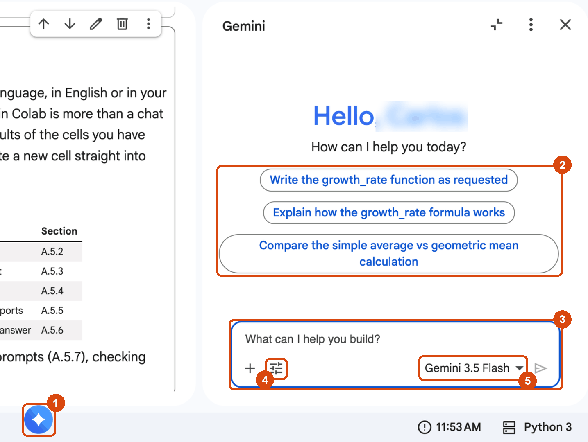{.shot .tall}

[1 the Gemini button · 2 suggested prompts · 3 the prompt box · 4 the mode menu · 5 the model menu]{.comment}

::: {.notes}
Screenshot A.12 (Section A.5.2). The panel opens on the right of the notebook.

- Suggested prompts change with the notebook.
- The mode menu: Default gives direct answers; Learn Mode makes Gemini a tutor; Visualization Mode prefers charts; Configure holds custom instructions.
- The model menu lists faster or more careful versions of Gemini; the list depends on the account. The default is fine for this book.

The greeting shows the user's first name; it is blurred in the book's screenshots, and the profile photo is replaced by a grey circle.
:::

## Ask Gemini to explain a cell, line by line

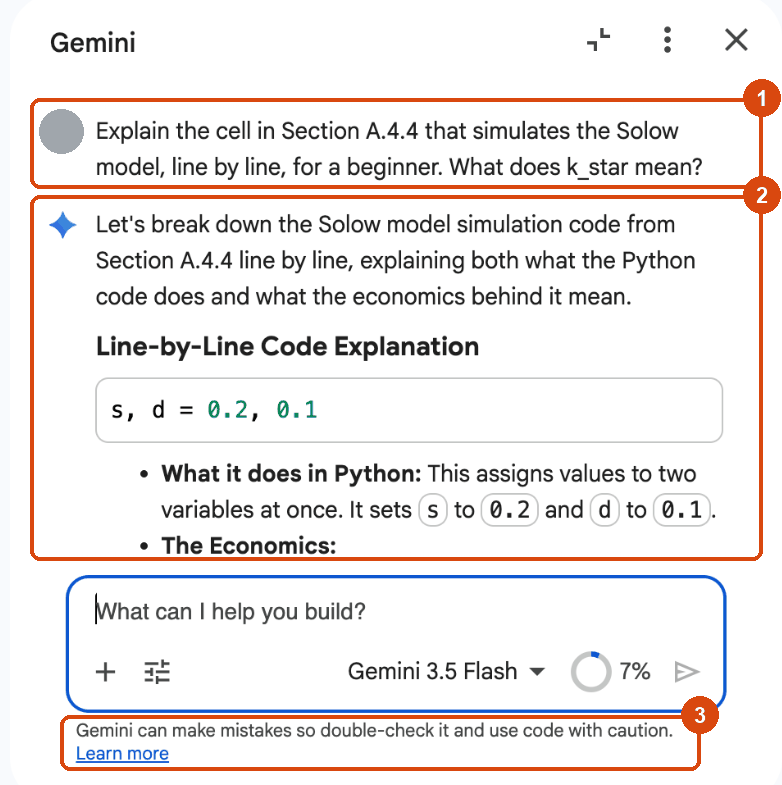{.shot .tall}

[1 the Solow loop of A.4.4 · 2 our prompt · 3 the line-by-line answer · 4 "Gemini can make mistakes"]{.comment}

::: {.notes}
Screenshot A.13. The prompt: "Explain the cell in Section A.4.4 that simulates the Solow model, line by line, for a beginner. What does k_star mean?" Gemini reads the whole notebook, so you can point to a cell by its section or by what it does.

The answer links code to economics: s is the investment rate, the loop adds investment and subtracts depreciation, k_star is the steady state. Even this good answer has a display glitch: one formula appears twice. The reminder under the prompt box is meant literally.

Good questions to model in class: What does .pivot do? Why are there NaN values in this table? What is the rule of 70?
:::

## Generate code: Gemini writes the cell, you decide

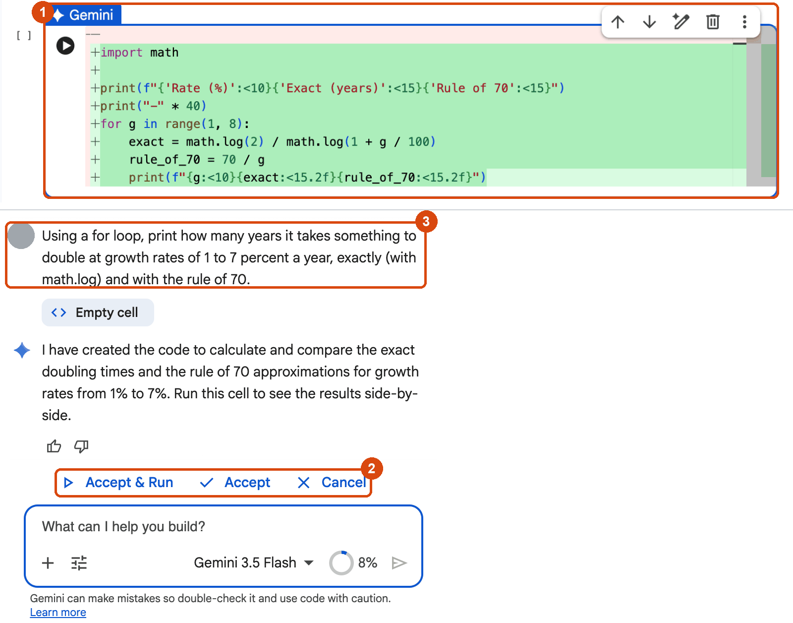{.shot .tall}

[1 the new cell, shown as a diff (green lines start with +) · 2 **Accept & Run**, **Accept** or **Cancel** · 3 our request]{.comment}

::: {.notes}
Screenshot A.14 (Section A.5.3). Every empty code cell says "Start coding or generate with AI." Clicking generate opens the panel with the empty cell attached.

Our request: "Using a for loop, print how many years it takes something to double at growth rates of 1 to 7 percent a year, exactly (with math.log) and with the rule of 70."

Nothing has run until you click. Accept keeps the cell without running it, so you can read or edit it first.
:::

## Read the cell before you accept it

::: {.incremental}
- **The formula:** `math.log(2) / math.log(1 + g / 100)` is the exact doubling time. Right.
- **The range:** `range(1, 8)` gives 1 to 7, because `range` stops before its end value. Right.
- **Your code:** it rewrote `70 / g` instead of calling `years_to_double` (A.4.7). Fine here; in a long notebook, duplicated code drifts apart.
- **Inline completions:** grey suggestions as you type; Tab accepts. Switch them off in *Tools → Settings → AI Assistance* while you learn.
:::

::: {.notes}
Section A.5.3. Model the reading habit aloud: formula, ranges, names. Ask the class to spot the range trap before revealing the second bullet.

Inline completions are a quieter AI feature than the panel. For learners, turning them off for a few weeks forces them to type, which is how the syntax sticks.
:::

## Explain error: an explanation and a fix to check

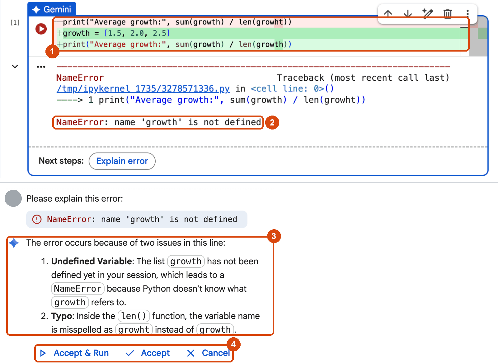{.shot .tall}

[1 the proposed fix, as a diff · 2 the error · 3 Gemini's explanation · 4 accept or cancel the fix]{.comment}

::: {.notes}
Screenshot A.15 (Section A.5.4). The cell was print("Average growth:", sum(growth) / len(growht)): the list growth was never created, and its name is misspelled.

Gemini found both problems. Its fix corrects the typo and adds growth = [1.5, 2.0, 2.5]: made-up example numbers that make the error disappear.
:::

## Accepting the fix makes the typo go away, not the problem

[Gemini fixed it, so I can click Accept & Run and move on.]{.myth}

[The fix adds `growth = [1.5, 2.0, 2.5]`: the cell now runs, on **invented numbers**, not your data. The real cure: run the cell that creates your data (*Runtime → Run before*).]{.fact .fragment}

::: {.notes}
Section A.5.4's checklist for any AI fix: does the explanation match the error message; does the fixed code still use your data and your variables; is there a real cure (usually running a cell above)?

AI fixes often make an error disappear without solving the problem.
:::

## The agent: one request, a whole analysis

> *Load …/data/appA/maddison_panel.csv with pandas. Plot GDP per person of every country since 1950 on a ratio scale, and tell me which country grew fastest since 1950.*

::: {.flow}
[A plan]{.node .n1} [→]{.arrow} [Cells, run after you accept]{.node .n2} [→]{.arrow} [A report on the results]{.node .n3}
:::

[Google first launched this as the *Data Science Agent*; it now lives in the same Gemini panel.]{.comment}

::: {.notes}
Section A.5.5. The full address in the prompt is https://raw.githubusercontent.com/quarcs-lab/macro102-site/main/data/appA/maddison_panel.csv.

The agent states a plan, writes the cells, waits for Accept & Run, looks at the output and writes a short report.
:::

## The agent at work

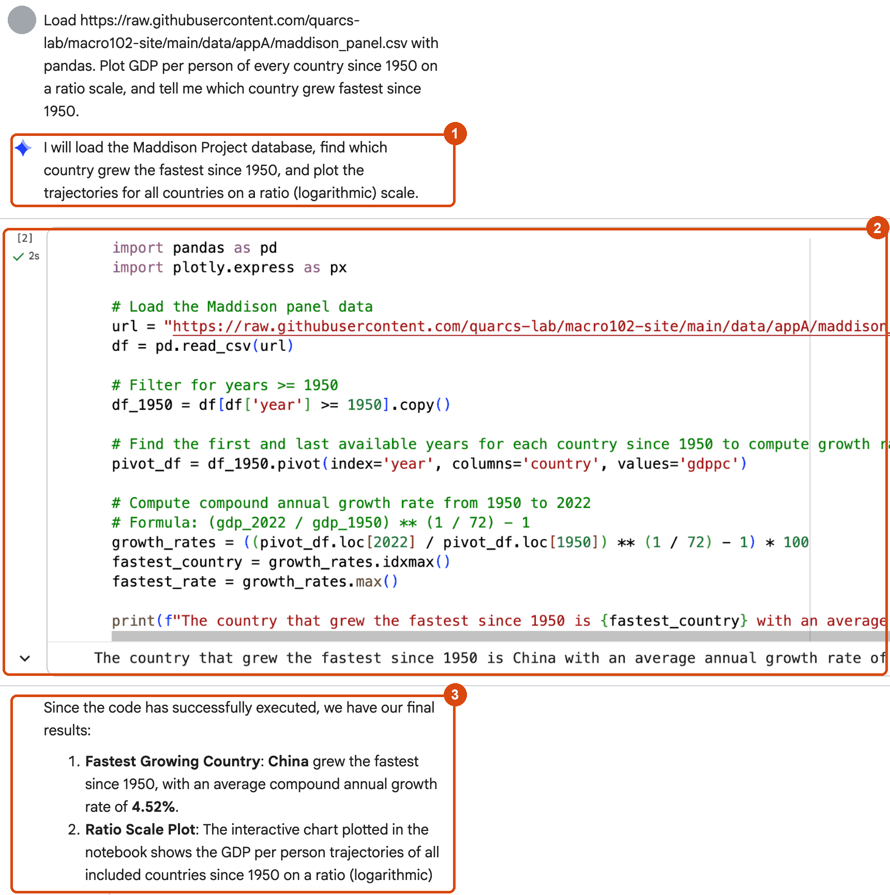{.shot .tall}

[1 the plan · 2 the first of two cells it wrote and ran · 3 its report: China, 4.52 percent a year since 1950]{.comment}

::: {.notes}
Screenshot A.16. The agent wrote two cells: one computes each country's compound growth rate from 1950 to 2022 with a pivot, one draws the chart. Its report: China grew fastest, at 4.52 percent a year.

That is exactly the number we compute by hand in Act IV (growth_since_1950, Section A.6.3). Note also where the agent put its cells: near the end of the notebook, not next to the section we were reading. Check the plan, the code and every number in the report.
:::

## Learn Mode: a tutor instead of an answer

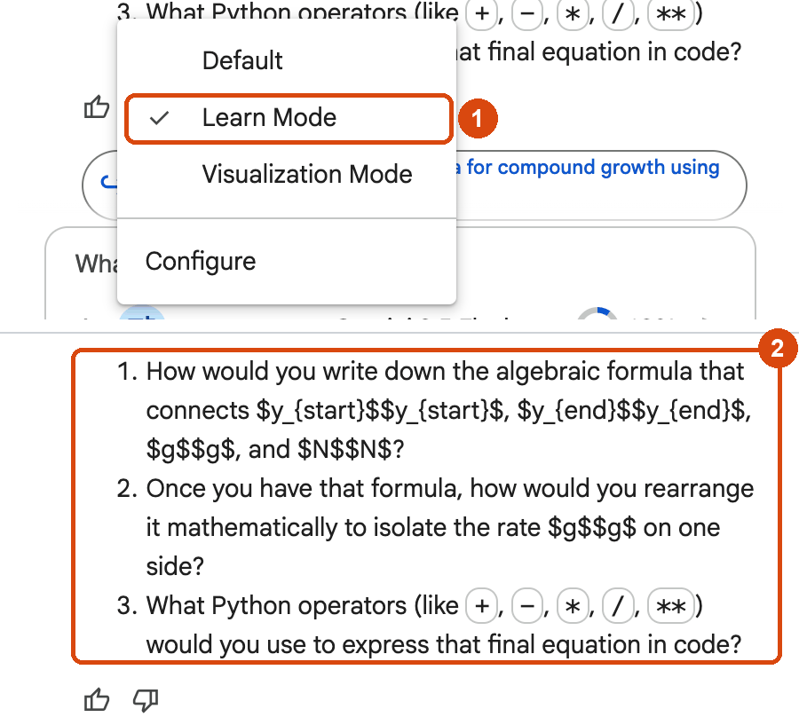{.shot .tall}

[1 Learn Mode in the mode menu · 2 instead of code, Gemini asks *you* three questions]{.comment}

::: {.notes}
Screenshot A.17 (Section A.5.6). The question: "How do I compute the average annual growth rate of GDP per person between two years in Python?" In Default mode Gemini would answer with code. In Learn Mode it explains why we use the compound growth formula rather than an average of yearly changes, and asks three questions: which formula connects y_start, y_end, g and N; how would you isolate g; and which Python operators would you need?

Switching mode starts a new chat. The panel sometimes shows math as raw LaTeX with the formula repeated (visible here); read past it or ask for plain text.

The same menu: Visualization Mode (prefers charts) and Configure (custom instructions saved in the notebook, e.g. "I am a beginner; explain every new Python idea").

Recommend Learn Mode for every Your turn task of the book.
:::

## Four habits make a good prompt

::: {.incremental}
1. **Name the data:** the file or DataFrame and the exact columns (`gdp_pc`, `year`).
2. **Define the calculation:** the formula, not only its name.
3. **Fix the scope:** which years, which countries, what units.
4. **Describe the result:** a sorted table? a line chart on a ratio scale, with labeled axes?
:::

[Not what you wanted? Reply in the same chat ("use 1990 as the start year"). Gemini remembers the conversation.]{.comment .fragment}

::: {.notes}
Section A.5.7. Point 2 is the defence against the trap of the act's opening: say "the compound average annual growth rate, (y_end/y_start)^(1/n) − 1".
:::

## Vague prompts get vague code

::: {.cheat}
| Vague | Better |
|----------------------|-------------------------------------------------------------------|
| *Plot GDP.* | *Plot `gdppc` from `panel` for China and the United States since 1950, Plotly Express, ratio scale, labeled axes.* |
| *Which countries grew fastest?* | *Using `pwt`, compute the compound average annual growth rate of `gdp_pc` from 1990 to 2023 for each country; show the ten fastest in a table.* |
| *Fix this.* | *This cell gives a KeyError for 'gdp'. The names are in `df.columns`. Fix the column name only.* |
| *Explain the Solow model.* | *Explain the cell above line by line for a beginner, and relate it to k(t+1) = k(t) + s k(t)^(1/3) − d k(t).* |
:::

::: {.notes}
The table of Section A.5.7. Ask students to improve one vague prompt of their own before showing the right column.
:::

## Check AI output before you use it

::: {.incremental}
- **Read every line.** Ask Gemini to explain any line you do not understand.
- **Check the formula.** Compound rate, not the average of yearly rates.
- **Check one number by hand** in a new cell.
- **Check the data:** file, columns, years, units, missing values.
- **Look at a chart** for jumps, impossible values, surprising countries.
- **Check the report:** every number must match an output.
- **Rerun from a clean start:** *Runtime → Restart session and run all*.
:::

::: {.notes}
The checklist of Section A.5.8. Treat AI code like code from a classmate: probably helpful, possibly wrong. Act V runs the whole checklist on the agent's answer to the mini project.
:::

## Use AI responsibly

::: {.incremental}
- **Follow your course's rules.** Policies differ; disclose AI help when asked (`# written with Gemini, checked by me`).
- **Protect private information.** Google stores prompts, code and answers, and people may read them. No personal data, passwords or API keys.
- **You are responsible for the result**, whoever typed the code.
- **Use it to learn, not to skip learning:** more *explain this*, less *write this for me*.
:::

::: {.notes}
Section A.5.9. The privacy facts come from the Colab FAQ: prompts, related code, generated output and feedback are collected, may be read by human reviewers, and kept up to 18 months. Appendix B shows Colab Secrets for API keys.

The instructor's own course policy belongs on this slide in class.
:::

## Try each AI tool once

[1. **Ask:** select the cell of A.4.8 that compares the exact doubling time with the rule of 70; ask Gemini why the rule works. 2. **Fix:** run `print(growth_factor ** (1 / yeras))` and click *Explain error*. Does the fix keep your variables? 3. **Generate and check:** ask for `growth_rate(y_start, y_end, years)`; compare with yours; test it on the U.S. numbers (about 1.4).]{.tryit}

::: {.notes}
The appendix's Your turn of Section A.5. Hints: click the cell first; yeras is a typo for years, which already exists (A.4.3), so the right fix changes only the spelling; a correct function computes ((y_end / y_start) ** (1 / years) - 1) * 100.

Students without Gemini can read the tasks and skip to Act IV.
:::

## Act III cheat sheet: AI-powered coding

::: {.cheat}
| Tool or habit | Where | Remember |
|-------------------|-------------------------|-------------------------------------------|
| Ask Gemini | the blue star | name the cell; read the reminder |
| Generate | *generate* in an empty cell | read the diff; then Accept & Run |
| Explain error | under a failed cell | the fix may hide the problem |
| The agent | the Gemini panel | check the plan, the code and the report |
| Learn Mode | the mode menu | a tutor: you write the code |
| Prompts | | data, formula, scope, result |
| Checking | | read, recompute one number, rerun all |
:::

::: {.notes}
One slide to photograph. Transition: the AI writes NumPy, pandas and Plotly code, so Act IV teaches those libraries, so that students can read what it writes.
:::

# The data science libraries {.divider background-color="#b45309"}

[Act IV]{.act}

## Four libraries do almost all the work in this book

::: {.cheat}
| Library | Nickname | What it does | Where you see it most |
|--------------|:----------:|---------------------------------------|--------------------------------------------|
| **NumPy** | `np` | fast math on whole arrays of numbers | model curves (`np.linspace`), logs, trend lines |
| **pandas** | `pd` | data tables: read, filter, reshape, combine | every data figure |
| **Plotly** | `px`, `go` | interactive charts | `px` for data figures, `go` for model figures |
| **ipywidgets** | | sliders, buttons and menus | the live model figures |
:::

[Every chapter uses all four.]{.takeaway .fragment}

::: {.notes}
The table follows the appendix's. Some counts from it: groupby appears in 19 chapters, merge in 12, pivot in 10; make_subplots for two-panel figures in 9 chapters; np.polyfit trend lines in Chapters 2, 9, 12, 19 and 21.

This act covers all four: NumPy and pandas first, then Plotly and ipywidgets.
:::

## Every chapter starts with a setup cell: first, the libraries

```python
# Libraries used in this appendix
import numpy as np                              # numbers and arrays
import pandas as pd                             # data tables
import plotly.express as px                     # quick charts from data tables
import plotly.graph_objects as go               # charts built piece by piece (model figures)
import plotly.io as pio
from plotly.subplots import make_subplots       # several panels in one figure
from ipywidgets import interact, FloatSlider, Dropdown, SelectMultiple
```

::: {.incremental}
- `import numpy as np`: load NumPy under the nickname `np`, so we write `np.log`.
- `from ipywidgets import interact`: load one function, so we write just `interact`.
:::

::: {.notes}
Section A.6.1. The setup cell must run before anything else; Run all takes care of it. You only need to run it once per session.

The nicknames np, pd, px and go are conventions used across the whole Python world, so code found online uses the same ones.
:::

## The rest of the setup cell: one look, Colab support and the data address

```python
# One light blue/green look for every chart
BLUE, TEAL, GREEN, GRAY = "#16528c", "#008070", "#7fb23a", "#8a96a3"
pio.templates.default = "plotly_white"
WIDE = {"description_width": "initial"}         # show the full widget labels

# Colab only: let Plotly charts appear inside the interactive widgets
try:
    import google.colab
    google.colab.output.enable_custom_widget_manager()
except ImportError:
    pass                                        # not running in Colab: nothing to do

# The data files of this appendix live in the book's GitHub repository
DATA_URL = "https://raw.githubusercontent.com/quarcs-lab/macro102-site/main/data/appA/"
```

::: {.notes}
Three lines of the appendix's setup cell are left out here for space: the chart size (860 by 480) and the default color sequence for Plotly Express.

Names in capital letters (BLUE, WIDE, DATA_URL) are a convention for constants: values set once and never changed.

The try ... except ImportError block is the one from Act II: import google.colab only works in Colab; anywhere else the import fails and pass does nothing.

DATA_URL is the web folder of the data files. Every read_csv adds a file name to it.
:::

## Folded helper cells build the website versions: run them, then move on

::: {.incremental}
- Most chapters have one or two folded **helper cells** right after the setup cell.
- They precompute the website version of each interactive figure: one chart per slider value, joined by a Plotly slider.
- You must run them; you do not need to read them.
:::

[Run all runs them for you.]{.takeaway .fragment}

::: {.notes}
The appendix's helper is slider_figure(make_figure, name, values, start, label): it calls make_figure once for each value, stacks all the traces in one figure, shows only those of the starting value, and builds one slider step per value that switches which traces are visible.

That is how the live figures in these decks work: they are those precomputed website versions. Curious students can open the cell; it uses only tools from Acts II–IV (a list comprehension, loops, dictionaries).
:::

## A NumPy array does math on every element at once

```python
k = np.linspace(0, 10, 6)        # 6 evenly spaced values from 0 to 10
print(k)
print(k ** (1 / 3))              # the cube root of every element at once
print(output(k))                 # our function from A.4.7 works on a whole array too
```

[What six numbers does `np.linspace(0, 10, 6)` make?]{.predict}

::: {.output .fragment}
```
[ 0.  2.  4.  6.  8. 10.]
[0.         1.25992105 1.58740105 1.81712059 2.         2.15443469]
[0.         1.25992105 1.58740105 1.81712059 2.         2.15443469]
```
:::

::: {.notes}
Section A.6.2. np.linspace(start, stop, n) makes n evenly spaced numbers INCLUDING both ends: 0, 2, 4, 6, 8, 10. A common wrong guess is 0 to 10 in steps of 6, or 1, 2, ..., 6.

The second line raises every element to the power 1/3 without a loop. The third line is the important one: the output function we wrote for one number works on a whole array, unchanged. That is how every model curve in the book is drawn: 200 values of k from linspace, one function call.

Note the 2. at k = 8: the cube root of 8.
:::

## NumPy has the usual math functions and summaries

```python
growth_rates = np.array([1.5, 2.0, 2.5, 3.0])
print(growth_rates.mean(), growth_rates.max())
print(np.log(100), np.exp(np.log(100)))      # exp undoes log
```

::: {.output .fragment}
```
2.25 3.0
4.605170185988092 100.00000000000004
```
:::

[Also `np.sqrt`, `.min()`, and many more. `np.log` is the natural log.]{.comment}

::: {.notes}
np.array turns a list into an array. .mean() and .max() are methods: functions attached to the array, called with a dot.

np.log(100) = 4.605..., the natural log. exp undoes log, so we should get 100 back, and we do, up to a rounding error in the 14th decimal (next slide).
:::

## Computers round decimals in the last digits

[`np.exp(np.log(100))` printed 100.00000000000004, so NumPy is broken.]{.myth}

[Computers store decimals in binary with about 16 significant digits, so tiny rounding errors appear in the last digits, as in `7 / 3` = 2.3333333333333335. They never matter for economics; round when you print.]{.fact .fragment}

::: {.notes}
Students see this and lose trust in the computer. It is normal floating-point arithmetic, in Python, Excel and every other tool (Excel hides it by rounding the display).

Practical consequence: never test decimals with ==. 0.1 + 0.2 == 0.3 is False in Python. Use round, or a tolerance.
:::

## pandas reads a data table with one line

```python
panel = pd.read_csv(DATA_URL + "maddison_panel.csv")
panel.head()
```

::: {.output .fragment}
| | iso3 | country | year | gdppc |
|---|---|---|---|---|
| 0 | ARG | Argentina | 1870 | 3019 |
| 1 | ARG | Argentina | 1875 | 3362 |
| 2 | ARG | Argentina | 1876 | 3369 |
| 3 | ARG | Argentina | 1877 | 3638 |
| 4 | ARG | Argentina | 1878 | 3379 |
:::

[A **DataFrame**: named columns, one row per observation. GDP per person for seven countries since 1870, Maddison Project Database.]{.comment}

::: {.notes}
Section A.6.3. pd.read_csv reads a CSV file (comma-separated values, the simplest spreadsheet format) from your computer or, as here, from a web address: DATA_URL plus the file name. .head() shows the first five rows.

The left column (0, 1, 2, ...) is the index, pandas' row labels.

In Colab the output is a formatted HTML table, as on the slide.
:::

## Long format: one row per country and year

::: {.columns}
::: {.column width="42%"}
::: {.output}
| iso3 | country | year | gdppc |
|---|---|---|---:|
| ARG | Argentina | 1870 | 3019 |
| ARG | Argentina | 1875 | 3362 |
| … | … | … | … |
| ZAF | South Africa | 2022 | 14728 |
:::
:::
::: {.column width="58%"}
::: {.incremental}
- `iso3`: a three-letter country code.
- `gdppc`: GDP per person in 2022 U.S. dollars.
- **Long** (or *tidy*) tables are what Plotly Express wants.
- Later, `pivot` turns it **wide**: one column per country.
:::
:::
:::

::: {.notes}
The table is in long or tidy format: each row is one observation (a country in a year), each column one variable. This is the format the book's data files use and the one Plotly Express expects: you name a column for x, one for y and one for the color.

The last row shown, South Africa in 2022, is in the sorted table two slides later (14,728 dollars).
:::

## Three quick ways to look at a new table

```python
print(panel.shape)                 # (number of rows, number of columns)
print(panel.columns.tolist())      # the column names
panel.describe()                   # count, mean, min, max ... of each numeric column
```

::: {.output .fragment}
```
(965, 4)
['iso3', 'country', 'year', 'gdppc']
```

| | year | gdppc |
|---|---:|---:|
| count | 965 | 965 |
| mean | 1951.1 | 13,743.5 |
| min | 1870 | 1,031 |
| max | 2022 | 75,459 |
:::

::: {.notes}
965 rows, 4 columns. describe summarizes every numeric column; the slide shows four of its eight rows (it also gives the standard deviation and the quartiles: the median GDP per person is 8,456 dollars), rounded.

The minimum, 1,031 dollars, and the maximum, 75,459 dollars, already tell a story: the richest country-year (the United States in 2022, as we will see) is more than 70 times the poorest.

Always look at shape, columns and describe before you analyze a new table: they catch wrong files, wrong units and missing data.
:::

## A condition inside the brackets keeps only the rows where it is True

```python
japan = panel[panel["country"] == "Japan"]           # keep only Japan's rows
japan.tail(3)                                        # .tail shows the last rows
```

::: {.output .fragment}
| | iso3 | country | year | gdppc |
|---|---|---|---|---|
| 668 | JPN | Japan | 2020 | 47513 |
| 669 | JPN | Japan | 2021 | 48611 |
| 670 | JPN | Japan | 2022 | 49373 |
:::

[`panel["country"]` picks one column; `panel[condition]` picks rows.]{.comment}

::: {.notes}
Read it from the inside out. panel["country"] is the country column. == "Japan" compares every element with "Japan" and gives a column of True and False. panel[...] keeps the rows where it is True.

The index numbers (668 to 670) are the original row labels: filtering keeps them.

Double == again, not =.
:::

## Combine conditions with `&` (and) or `|` (or), each in parentheses

```python
asia = panel[(panel["year"] >= 2018) & (panel["country"].isin(["China", "India"]))]
asia
```

[How many rows will `asia` have?]{.predict}

::: {.output .fragment}
| | iso3 | country | year | gdppc |
|---|---|---|---|---|
| 233 | CHN | China | 2018 | 20613 |
| … | … | … | … | … |
| 237 | CHN | China | 2022 | 24821 |
| 526 | IND | India | 2018 | 9091 |
| … | … | … | … | … |
| 530 | IND | India | 2022 | 10019 |
:::

::: {.notes}
Answer: 10 rows, two countries times five years (2018 to 2022). The slide shows the first and last rows of each country; the full output also has 2019–2021 (China 21,777, 22,224, 24,083; India 9,410, 8,684, 9,438). India's dip in 2020 is the pandemic.

isin checks membership in a list: a shorter way to write (country == "China") | (country == "India").
:::

## pandas wants `&`, not `and`, and parentheses around each condition

[`panel[panel["year"] >= 2018 and panel["country"] == "China"]` should work: `and` means and.]{.myth}

[Python's `and` works on one True or False, not on a whole column, so pandas stops with a `ValueError` ("the truth value of a Series is ambiguous"). Use `&` or `|`, and put each condition in its own parentheses.]{.fact .fragment}

::: {.notes}
Why the parentheses: & binds more tightly than >= and ==, so without them Python would try to compute 2018 & panel["country"] first and fail with a confusing error.

The rule to remember is the appendix's: combine conditions with & or |, each inside its own parentheses.
:::

## New columns, sorting, and the latest year

```python
panel["gdppc_thousands"] = panel["gdppc"] / 1000      # GDP per person in thousands of dollars
latest = panel[panel["year"] == 2022]
latest.sort_values("gdppc", ascending=False)
```

::: {.output .fragment}
| | iso3 | country | year | gdppc | gdppc_thousands |
|---|---|---|---|---:|---:|
| 823 | USA | United States | 2022 | 75459 | 75.459 |
| 390 | GBR | United Kingdom | 2022 | 49551 | 49.551 |
| 670 | JPN | Japan | 2022 | 49373 | 49.373 |
| 237 | CHN | China | 2022 | 24821 | 24.821 |
| 148 | ARG | Argentina | 2022 | 23600 | 23.600 |
| 964 | ZAF | South Africa | 2022 | 14728 | 14.728 |
| 530 | IND | India | 2022 | 10019 | 10.019 |
:::

::: {.notes}
Assigning to a column name that does not exist creates the column; the division applies to the whole column at once, like NumPy.

sort_values sorts by a column; ascending=False puts the largest first. In 2022 the United States leads at 75,459 dollars per person; India is at 10,019, about 13 percent of the U.S. level.
:::

## `groupby` summarizes each group: one row per country

```python
panel.groupby("country")["gdppc"].agg(["min", "max", "count"])
```

::: {.output .fragment}
| country | min | max | count |
|---|---:|---:|---:|
| Argentina | 3019 | 25807 | 149 |
| China | 1031 | 24821 | [89]{.key} |
| India | 1088 | 10019 | 140 |
| Japan | 2038 | 49547 | 140 |
| South Africa | 1559 | 15544 | 141 |
| United Kingdom | 7443 | 50462 | [153]{.key} |
| United States | 6197 | 75459 | [153]{.key} |
:::

[Split by country, take the `gdppc` column, apply three summaries to each group.]{.comment}

::: {.notes}
Read the chain left to right: group the rows by country; take gdppc; aggregate with min, max and count.

groupby is the most used pandas tool in the book: 19 of the chapters use it.
:::

## The `count` column is a story about the data

::: {.incremental}
- The United States and the United Kingdom have all [153]{.key} years from 1870 to 2022.
- China has only [89]{.key}: the historical estimates cover only some years before 1950.
- Japan's maximum (49,547) is not its 2022 value (49,373): income can fall.
:::

[Count before you compare: a missing year is not a zero.]{.takeaway .fragment}

::: {.notes}
The appendix's own reading of the table: counts reveal coverage. A growth rate computed "since 1870" for China would silently start from whichever year the data begin.

The third point is a small extra reading of the same output: the max column is the peak, not the latest value. Japan's peak (49,547) came before 2022.
:::

## `pivot` turns the long table wide: one column per country

```python
wide = panel.pivot(index="year", columns="country", values="gdppc")
print(wide.isna().sum())              # missing years in each column
```

::: {.output .fragment}
```
country
Argentina          4
China             64
India             13
Japan             13
South Africa      12
United Kingdom     0
United States      0
dtype: int64
```
:::

[Years with no estimate become `NaN`, pandas' marker for a missing value.]{.comment}

::: {.notes}
pivot: the years become the rows (index), the countries become the columns, and gdppc fills the cells. Where a country has no estimate for a year, the cell is NaN ("not a number").

isna() marks every missing cell True; .sum() counts them per column (True counts as 1). China has 64 missing years in the wide table: 153 years minus its 89 observations.
:::

## `.loc[...]` picks rows by their label

```python
wide.loc[[1870, 1950, 2022]]
```

::: {.output .fragment}
| year | Argentina | China | India | Japan | South Africa | U.K. | U.S. |
|---|---:|---:|---:|---:|---:|---:|---:|
| 1870 | 3019 | 1219 | 1097 | 2038 | 1659 | 7520 | 6197 |
| 1950 | 10256 | [1031]{.key} | 1273 | 3950 | 5214 | 14271 | 19662 |
| 2022 | 23600 | [24821]{.key} | 10019 | 49373 | 14728 | 49551 | 75459 |
:::

[Three snapshots of 150 years. China was poorer in 1950 than in 1870, then passed Argentina by 2022.]{.takeaway .fragment}

::: {.notes}
The output shows decimals (3019.0 and so on), because a column with NaN must be a float column; the slide drops the .0. The column names United Kingdom and United States are shortened.

Note the double brackets: wide.loc[1950] is one row; wide.loc[[1870, 1950, 2022]] is a list of rows.

Reading: China's 1,031 dollars in 1950 is below its 1,219 in 1870. By 2022 China (24,821) is just above Argentina (23,600). Japan went from 3,950 in 1950 to 49,373.
:::

## One line computes every country's growth rate since 1950

```python
growth_since_1950 = ((wide.loc[2022] / wide.loc[1950]) ** (1 / 72) - 1) * 100
growth_since_1950.sort_values().round(2)
```

[Which of the seven grew fastest from 1950 to 2022, and which most slowly?]{.predict}

::: {.output .fragment}
```
country
Argentina         1.16
South Africa      1.45
United Kingdom    1.74
United States     1.89
India             2.91
Japan             3.57
China             4.52
dtype: float64
```
:::

::: {.notes}
The growth formula of Act II applied to whole rows at once: the 2022 row divided by the 1950 row, element by element, country by country. 72 years.

China fastest at 4.52 percent a year; Argentina slowest at 1.16, below even the United States (1.89), the richest country. Japan's 3.57 comes largely from its fast catch-up in the decades after 1950.

Ask: by the rule of 70, how long does it take China to double at 4.5 percent? (About 15.5 years.)
:::

## `merge` joins two tables on a column they share

```python
growth60 = pd.read_csv(DATA_URL + "fig3-7.csv")
names = pd.read_csv(DATA_URL + "countries.csv")
growth60 = growth60.merge(names[["iso3", "region", "income"]], on="iso3", how="left")
```

::: {.incremental}
- `fig3-7.csv`: 111 countries, GDP per person relative to the U.S. and growth 1960–2023 (Penn World Table).
- `countries.csv`: each country's World Bank region and income group.
- `on="iso3"`: match rows by country code. `how="left"`: keep every row of `growth60`.
:::

::: {.notes}
Often the information you need sits in two tables. merge lines them up by a key column, here the three-letter code iso3, and adds the columns of the second table to the first.

names[["iso3", "region", "income"]] keeps only the three columns we need (double brackets again: a list of columns).

how="left" keeps every country of the left table, even one with no match in names (it would get NaN). how="inner" would keep only countries in both.
:::

## The merged table has a region and an income group for every country

::: {.output}
| | iso3 | country | gdppc_rel_us_2023 | growth_1960_2023_pct | region | income |
|--|---|---------|------:|------:|----------------------|--------------|
| 0 | ARG | Argentina | 0.3677 | 3.270 | Latin America & Caribbean | Upper middle |
| 1 | AUS | Australia | 0.8424 | 2.064 | East Asia & Pacific | High |
| 2 | AUT | Austria | 0.8436 | 2.772 | Europe & Central Asia | High |
| 3 | BDI | Burundi | 0.0124 | 0.245 | Sub-Saharan Africa | Low |
| 4 | BEL | Belgium | 0.8274 | 2.567 | Europe & Central Asia | High |
:::

[The output of `growth60.head()`, without the two 2019 columns of the file.]{.comment}

::: {.notes}
The real output also has gdppc_rel_us_2019 and growth_1960_2019_pct (the textbook's end year); the slide drops them and shortens the income labels ("Upper middle income" and so on).

Read one row: Burundi's GDP per person in 2023 is 1.24 percent of the U.S. level, and it grew 0.245 percent a year from 1960 to 2023.

:::

## Average growth since 1960 by region

```python
growth60.groupby("region")["growth_1960_2023_pct"].mean().sort_values().round(2)
```

::: {.output .fragment}
```
region
Sub-Saharan Africa            1.30
Latin America & Caribbean     1.72
North America                 1.98
South Asia                    2.61
Middle East & North Africa    2.63
Europe & Central Asia         2.89
East Asia & Pacific           3.89
Name: growth_1960_2023_pct, dtype: float64
```
:::

[`merge` gave us the region; `groupby` averages within it. East Asia grew three times as fast as Sub-Saharan Africa.]{.takeaway .fragment}

::: {.notes}
A simple average of countries' growth rates within each region (not weighted by population).

East Asia and the Pacific averaged 3.89 percent a year; Sub-Saharan Africa 1.30. Over 63 years that difference compounds into a huge gap in levels: the growth chapters (3 to 6) explain why.
:::

## Fastest and slowest since 1960

[Which country in `growth60` grew fastest from 1960 to 2023, and which most slowly? Use `sort_values`, or the methods `nlargest` and `nsmallest`.]{.tryit}

. . .

```python
growth60.nlargest(3, "growth_1960_2023_pct")      # the three largest values, with their rows
growth60.nsmallest(3, "growth_1960_2023_pct")
```

::: {.notes}
The appendix's Your turn for pandas. Hint: nlargest(3, column) shows the three largest values of that column, with their rows; look at the country column of the result.

Let students run it and report back. Expect a discussion: is the slowest grower a data problem (like Venezuela later in this act) or a real collapse? That question leads straight into Act V.
:::

## Act IV cheat sheet: NumPy and pandas

::: {.cheat}
| You want to … | Write |
|-------------------------------------|---------------------------------------------------------------|
| evenly spaced x-values | `np.linspace(0, 10, 200)` |
| math on a whole array or column | `k ** (1 / 3)`, `np.log(x)`, `x.mean()` |
| read a CSV file | `pd.read_csv(DATA_URL + "file.csv")` |
| look at a table | `.head()`, `.shape`, `.columns`, `.describe()` |
| keep rows | `df[df["year"] >= 2018]`, `(…) & (…)`, `.isin([...])` |
| add a column | `df["new"] = df["old"] / 1000` |
| sort | `.sort_values("col", ascending=False)`, `.nlargest(5, "col")` |
| summarize groups | `df.groupby("country")["gdppc"].agg(["min", "max"])` |
| reshape and join | `df.pivot(index=, columns=, values=)`, `a.merge(b, on="iso3")` |
:::

::: {.notes}
One slide to photograph. These verbs cover almost all the data work in the book.

Transition: numbers and tables are only half the story. The rest of this act turns them into pictures.
:::

## Plotly Express draws a whole chart from a table in one call

```python
fig = px.line(panel, x="year", y="gdppc", color="country", log_y=True,
              labels={"year": "Year", "gdppc": "GDP per person (2022 dollars, ratio scale)",
                      "country": ""},
              title="GDP per person in seven economies, 1870-2022")
fig.update_yaxes(tickvals=[1000, 2000, 5000, 10000, 20000, 50000, 100000])
fig.show()
```

::: {.incremental}
- Name the table, the column for each axis and the column for the colors.
- `log_y=True`: a **ratio scale**. `tickvals`: which numbers label the axis.
:::

::: {.notes}
Section A.6.4. This is why the long format matters: px.line needs one column for x (year), one for y (gdppc) and one that splits the lines (country).

labels renames columns on the chart; "country": "" removes the legend title. title sets the chart title. update_yaxes changes the axis after the chart is made.

On a ratio (log) scale, equal distances mean equal percentage changes, so a straight line means a constant growth rate. Chapter 3 explains why economists prefer it for long-run data.
:::

## Seven economies over 150 years

[On a ratio scale, a straight line means a constant growth rate. Which economies grew at a steady rate, and which sped up?]{.question}

::: {.notes}
Ask the room before showing the chart. Expect "the United States steady, China sped up recently, Japan sped up after the war". Those are the right guesses; the chart checks them.
:::

## On a ratio scale the U.S. line is nearly straight; Japan and China bend upward {.live-figure}

<script src="plots/plot1.js"></script>
<div class="live-plot" data-fig="plot1"></div>

[Data: [Maddison Project Database 2023](https://www.rug.nl/ggdc/historicaldevelopment/maddison/releases/maddison-project-database-2023) (Bolt and van Zanden 2024), GDP per person in 2022 dollars; file `data/appA/maddison_panel.csv`. Chart inspired by the discussion of long-run growth in Chapter 3 of Jones (2024), [*Macroeconomics*, 6th ed.](https://wwnorton.com/books/9781324063612)]{.source-line}

::: {.notes}
How to read it: years on the horizontal axis; GDP per person on a ratio scale, labelled at 1,000, 2,000, 5,000 and so on. Each doubling takes the same vertical distance.

Do live, to show what Plotly gives for free:
1. Hover over a line to read a country-year value.
2. Drag a box to zoom into 1950–2022; double-click to zoom back out.
3. Click "United States" in the legend to hide it; click again to show it. Double-click a legend entry to show only that country.

Point at: the U.S. line, close to straight for 150 years; Japan's steep climb after 1950; China flat or falling until about 1950 and steep after 1980.
:::

## A ratio scale turns constant growth into a straight line

::: {.incremental}
- The U.S. line is close to straight: its *percentage* growth has been fairly steady for 150 years.
- Japan's line is steepest after 1950: fast catch-up growth, then a slowdown.
- China's line bends sharply upward after 1980.
:::

[`px.line`, one call: hover, zoom and legend come for free.]{.takeaway .fragment}

::: {.notes}
The numbers behind it are the ones computed earlier in this act: China from 1,031 dollars in 1950 to 24,821 in 2022 (4.52 percent a year); Japan 3,950 to 49,373 (3.57 percent).

Ask: on a linear scale, what would the U.S. line look like? (Bending upward, curving more and more: the same percentage growth adds more dollars each year. Two slides on this later in the act.)
:::

## `px.scatter` shows how two variables relate

```python
plot_data = growth60[growth60["iso3"] != "VEN"]
labels = {"gdppc_rel_us_2023": "GDP per person in 2023 (U.S. = 1, ratio scale)",
          "growth_1960_2023_pct": "Average growth, 1960-2023 (percent a year)",
          "region": "Region"}
fig = px.scatter(plot_data, x="gdppc_rel_us_2023", y="growth_1960_2023_pct", color="region",
                 hover_name="country", log_x=True, labels=labels,
                 title="Countries that grew faster since 1960 are richer today")
fig.update_xaxes(tickvals=[0.01, 0.03, 0.1, 0.3, 1])
fig.show()
```

[`hover_name` puts the country's name in the hover box; `color="region"` gives each region a color. Venezuela is dropped first.]{.comment}

::: {.notes}
The first line drops Venezuela, whose PWT GDP per person after 2017 is not plausible: hyperinflation broke the price data (Chapter 3 discusses it). != means "not equal".

Storing the labels dictionary in a variable keeps the px.scatter call readable. log_x=True puts the horizontal axis on a ratio scale.
:::

## Growth since 1960 and income today

[Did the countries that grew faster since 1960 end up richer in 2023? How strong is the link?]{.question}

[Draw the cloud you expect: income relative to the U.S. on the horizontal axis, growth on the vertical axis.]{.predict}

::: {.notes}
Ask students to sketch it on paper. Most will draw an upward cloud. Ask them where the United States sits (at 1 on the horizontal axis, by construction) and where they expect the East Asian economies.
:::

## Countries that grew faster since 1960 are richer today {.live-figure}

<script src="plots/plot2.js"></script>
<div class="live-plot" data-fig="plot2"></div>

[Data: [Penn World Table 11.0](https://www.rug.nl/ggdc/productivity/pwt/) (Feenstra, Inklaar and Timmer 2015), real GDP per person (`rgdpe`/`pop`); regions from the [World Bank country classification](https://datahelpdesk.worldbank.org/knowledgebase/articles/906519); files `data/appA/fig3-7.csv`, `countries.csv`. Chart inspired by Fig. 3.7 in Jones (2024), [*Macroeconomics*, 6th ed.](https://wwnorton.com/books/9781324063612)]{.source-line}

::: {.notes}
How to read it: GDP per person in 2023 relative to the United States, on a ratio scale (0.01 = 1 percent of the U.S. level); average growth 1960–2023 on the vertical axis. One dot per country, colored by region.

Do live: hover over the top dots to find the fast growers; click a region in the legend to hide it; double-click "East Asia & Pacific" to show only that region.

Point at: the upward slope; the East Asian dots at the top; the Sub-Saharan African dots at the bottom left.
:::

## Faster growth since 1960 goes with higher income today

::: {.incremental}
- The cloud slopes up: growth over six decades shows up in today's income levels.
- East Asia & Pacific sits high (region average [3.89%]{.key}); Sub-Saharan Africa low ([1.30%]{.key}).
- Dropping Venezuela first is a data check, not cosmetics.
:::

[Three arguments of `px.scatter` (`hover_name`, `color`, `log_x`) make a chart you can explore.]{.takeaway .fragment}

::: {.notes}
The region averages are the groupby output computed earlier in this act.

Caveat for the economics: this is a correlation across countries, and it is partly mechanical (countries that grew faster are richer than they would otherwise be). Chapter 3 discusses it; Chapters 4–6 explain growth.
:::

## `animation_frame` adds a play button and a slider

```python
decades = panel[panel["year"].isin([1950, 1960, 1970, 1980, 1990, 2000, 2010, 2020])]
fig = px.bar(decades, x="country", y="gdppc", animation_frame="year", range_y=[0, 80000],
             labels={"country": "", "gdppc": "GDP per person (2022 dollars)", "year": "Year"},
             title="GDP per person by decade: press the play button")
fig.show()
```

::: {.incremental}
- Each frame shows the rows for one value of the `year` column.
- `range_y` fixes the y-axis, so the bars can visibly grow from frame to frame.
:::

::: {.notes}
isin keeps the eight decade years. px.bar makes a bar per country; animation_frame="year" makes one frame per year, with a play button and a slider under the chart.

Without range_y the axis would rescale in every frame and the bars would seem not to move.
:::

## GDP per person by decade

[Press play in your head: which country's bar changes most between 1950 and 2020?]{.question}

[Will China's bar pass Argentina's and South Africa's by 2020? When does it start to rise?]{.predict}

::: {.notes}
Collect guesses. The United States will have the tallest bar throughout; the interesting question is who climbs past whom.
:::

## China's bar barely moves until 1980, then rises faster than any other {.live-figure}

<script src="plots/plot3.js"></script>
<div class="live-plot" data-fig="plot3"></div>

[Data: [Maddison Project Database 2023](https://www.rug.nl/ggdc/historicaldevelopment/maddison/releases/maddison-project-database-2023) (Bolt and van Zanden 2024); file `data/appA/maddison_panel.csv`. Chart inspired by the discussion of long-run growth in Chapter 3 of Jones (2024), [*Macroeconomics*, 6th ed.](https://wwnorton.com/books/9781324063612)]{.source-line}

::: {.notes}
How to read it: one bar per country, GDP per person in 2022 dollars on a fixed axis from 0 to 80,000. The slider under the chart picks the decade; the play button runs through them.

Do live: press play once. Then drag the slider back to 1980 and step forward one decade at a time.

The appendix's "What to notice": China's bar barely moves until 1980 and then rises faster than any other; by 2020 it has passed Argentina and South Africa.
:::

## An animation shows the race; a ratio scale shows the growth rates

::: {.incremental}
- By 2020 China has passed **Argentina** and **South Africa**.
- On a linear axis the U.S. bar adds the most dollars each decade, even at steady growth.
- Animation is good for *who passes whom*; the ratio-scale line chart is better for *how fast*.
:::

[Pick the chart for the question.]{.takeaway .fragment}

::: {.notes}
A data-visualization lesson as much as a coding one. Bars on a linear scale emphasize dollar gaps; lines on a ratio scale emphasize growth rates. Both are true; they answer different questions.
:::

## Graph objects build a chart piece by piece: the model figures

```python
k = np.linspace(0, 10, 200)
fig = go.Figure()
fig.add_trace(go.Scatter(x=k, y=output(k), mode="lines", name="A = 1",
                         line=dict(color=BLUE, width=3)))
fig.add_trace(go.Scatter(x=k, y=output(k, A=1.5), mode="lines", name="A = 1.5",
                         line=dict(color=TEAL, width=3, dash="dash")))
fig.update_layout(title="Higher productivity A shifts the production function up",
                  xaxis=dict(title="Capital per person, k", range=[0, 10]),
                  yaxis=dict(title="Output per person, y", range=[0, 3.5]))
fig.show()
```

[`go.Figure()` starts an empty chart; each `add_trace` adds one curve; `update_layout` sets the title and axes.]{.comment}

::: {.notes}
Section A.6.5. For model figures we want full control over which curves, which colors and which labels. Graph objects (go) give it.

Every piece is from earlier in the deck: 200 values of k from linspace, the output function from Act II applied to the whole array, the color constants from the setup cell. dict(color=..., width=...) is another way to write a dictionary.

The appendix's cell also sets tickvals on the x-axis; it is left out here for space.
:::

## Two production functions

[What does raising productivity from $\bar{A} = 1$ to $\bar{A} = 1.5$ do to the curve $y = \bar{A}k^{1/3}$? A parallel shift, or something else?]{.predict}

::: {.notes}
Ask for a precise answer: is the gap between the two curves the same at every k? Students who answer "parallel shift up" are wrong in an instructive way.
:::

## Higher productivity scales the production function up at every $k$ {.live-figure}

<script src="plots/plot4.js"></script>
<div class="live-plot" data-fig="plot4"></div>

[Model figure: $y = \bar{A}k^{1/3}$ for $\bar{A} = 1$ and $\bar{A} = 1.5$. Adapted from the production model of Chapter 4 in Jones (2024), [*Macroeconomics*, 6th ed.](https://wwnorton.com/books/9781324063612)]{.source-line}

::: {.notes}
How to read it: capital per person k on the horizontal axis, output per person y on the vertical axis. Solid line A = 1, dashed line A = 1.5.

Do live: hover at k = 8 on both curves: 2.0 and 3.0. Hover at k = 1: 1.0 and 1.5. The gap grows with k.
:::

## A higher $\bar{A}$ multiplies output; it does not add a constant

::: {.incremental}
- The answer: not parallel. Output is multiplied by 1.5 at **every** $k$, so the gap widens as $k$ grows.
- Both curves bend: diminishing returns to capital, the exponent $1/3$.
- A model figure is a few `add_trace` calls on one function.
:::

[One function, two calls, two curves: that is how every model figure of the book is drawn.]{.takeaway .fragment}

::: {.notes}
The appendix's title says "shifts the production function up"; the precise statement is that it scales it up proportionally.

Chapter 4 calls A total factor productivity and shows that it explains most of the income differences across countries.
:::

## `make_subplots` puts panels side by side

```python
fig = make_subplots(rows=1, cols=2, subplot_titles=("Linear scale", "Ratio scale"))
for name, color in [("United States", BLUE), ("China", TEAL)]:
    one = panel[panel["country"] == name]
    fig.add_trace(go.Scatter(x=one["year"], y=one["gdppc"], mode="lines", name=name,
                             line=dict(color=color)), row=1, col=1)
    fig.add_trace(go.Scatter(x=one["year"], y=one["gdppc"], mode="lines", name=name,
                             line=dict(color=color), showlegend=False), row=1, col=2)
fig.update_yaxes(title_text="GDP per person (2022 dollars)", row=1, col=1)
fig.update_yaxes(type="log", tickvals=[1000, 3000, 10000, 30000, 100000], row=1, col=2)
fig.update_layout(title="The same two series on two scales")
```

[The loop runs once per `(name, color)` pair; `row=` and `col=` pick the panel; `showlegend=False` lists each country once.]{.comment}

::: {.notes}
Everything here is a combination of earlier pieces: a loop over a list of pairs (Act II), a filter (earlier in this act), add_trace (previous slides). The only new tool is make_subplots with row and col.

The second update_yaxes makes the right panel a ratio scale. (The appendix's cell ends with fig.show().)
:::

## Same data, two scales

[On the linear scale, does U.S. growth seem to speed up over time? And on the ratio scale?]{.question}

[Predict the shape of the U.S. line in each panel.]{.predict}

::: {.notes}
This is the key reading skill of the growth chapters. Let students commit before the reveal.
:::

## On a linear scale U.S. growth seems to speed up; on a ratio scale it is steady {.live-figure}

<script src="plots/plot5.js"></script>
<div class="live-plot" data-fig="plot5"></div>

[Data: [Maddison Project Database 2023](https://www.rug.nl/ggdc/historicaldevelopment/maddison/releases/maddison-project-database-2023) (Bolt and van Zanden 2024); file `data/appA/maddison_panel.csv`. Chart inspired by the discussion of ratio scales in Chapter 3 of Jones (2024), [*Macroeconomics*, 6th ed.](https://wwnorton.com/books/9781324063612)]{.source-line}

::: {.notes}
How to read it: the same two series, United States and China, GDP per person since 1870. Left panel linear dollars; right panel ratio scale.

Do live: hover the U.S. line in 1950 and 2022 in both panels. Zoom into China after 1980 on the right.
:::

## A line that curves up on a linear scale can be constant growth

[On the linear chart the U.S. curve gets steeper, so U.S. growth has been accelerating.]{.myth}

[A constant *percentage* growth adds more dollars each year as the base grows, so the linear curve bends up. On the ratio scale the U.S. line is close to straight: steady growth. China's line, by contrast, bends up on both scales after 1980.]{.fact .fragment}

::: {.notes}
The appendix's reading of the two panels. This is the single most common misreading of long-run data, and the reason the book puts long-run series on ratio scales.

Rule of thumb for students: when the question is about growth RATES, use a ratio scale.
:::

## ipywidgets turns a function's arguments into controls

::: {.flow}
[Move a slider: $\bar{A} = 1.5$]{.node .n1} [→]{.arrow} [`interact` calls `production_figure(A=1.5)`]{.node .n2} [→]{.arrow} [A new chart]{.node .n3}
:::

[`interact(f, ...)` draws one control per argument and calls `f` again every time you move one.]{.comment}

::: {.notes}
Section A.6.6. This is how every model figure in the book becomes interactive: write a function that returns a figure, hand it to interact. The widget does the rest: each time a slider moves, it calls the function with the new value and shows the new figure.

In Colab only: the website cannot run the function, which is why the helper precomputes a few values.
:::

## Step 1: a function that returns a figure

```python
def production_figure(A=1.0, alpha=1 / 3):
    """Production function y = A k^alpha (Chapter 4), with fixed axes so changes are visible."""
    k = np.linspace(0, 10, 200)
    fig = go.Figure()
    fig.add_trace(go.Scatter(x=k, y=k ** (1 / 3), mode="lines", name="Baseline: A = 1, α = 1/3",
                             line=dict(color=GRAY, dash="dash")))
    fig.add_trace(go.Scatter(x=k, y=A * k ** alpha, mode="lines", name="Your production function",
                             line=dict(color=TEAL, width=3)))
    fig.update_layout(title=f"Output per person at k = 8: y = {A * 8 ** alpha:.2f} (baseline 2.00)",
                      xaxis=dict(title="Capital per person, k", range=[0, 10]),
                      yaxis=dict(title="Output per person, y", range=[0, 7]))
    return fig
```

[A dashed baseline that never moves, the user's curve, and an f-string title that reports $y$ at $k = 8$.]{.comment}

::: {.notes}
Two arguments with defaults, A and alpha: these become the two controls. The baseline curve is fixed so that changes are visible; the axes are fixed for the same reason (otherwise Plotly would rescale them and the curve would seem not to move).

The title is an f-string: the model is solved at k = 8 and the answer printed in the title each time.

The appendix's version also sets tickvals on the x-axis; trimmed here.
:::

## Step 2: hand the function to `interact` with two controls

```python
A_slider = FloatSlider(value=1.0, min=0.5, max=2.0, step=0.1,
                       description="productivity A", style=WIDE)
alpha_menu = Dropdown(options=[("1/4", 0.25), ("1/3", 1 / 3), ("1/2", 0.5)], value=1 / 3,
                      description="capital exponent α", style=WIDE)
interact(production_figure, A=A_slider, alpha=alpha_menu);
```

::: {.incremental}
- `FloatSlider`: decimal numbers from `min` to `max` in steps of `step`, starting at `value`.
- `Dropdown`: a menu; each option is a pair `("label shown", value)`.
- `style=WIDE` shows the whole label; the final `;` hides an extra line of text.
:::

::: {.notes}
interact matches the controls to the function's arguments by name: A=A_slider, alpha=alpha_menu.

This cell runs only in Colab (it is tagged as a widget cell). The website shows instead the precomputed version, made by the helper: slider_figure(production_figure, "A", [0.5, 1.0, 1.5, 2.0], start=1.0, label="productivity A"). That is the version on the next slide.
:::

## Doubling productivity

[At $k = 8$ and $\bar{A} = 1$, output is $y = 2.00$. Move $\bar{A}$ to 2: what is $y$ now? And does the curve keep its shape?]{.predict}

::: {.notes}
Most students now answer 4.00 confidently (they saw output(8, A=2.0) in Act II). Push on the second part: does the curve bend more or less?
:::

## Doubling $\bar{A}$ doubles output at every level of capital {.live-figure}

<script src="plots/plot6.js"></script>
<div class="live-plot" data-fig="plot6"></div>

[Model figure: $y = \bar{A}k^{\alpha}$, website version with a precomputed slider for $\bar{A}$ (0.5 to 2). Adapted from the production model of Chapter 4 in Jones (2024), [*Macroeconomics*, 6th ed.](https://wwnorton.com/books/9781324063612)]{.source-line}

::: {.notes}
How to read it: the dashed gray line is the baseline (A = 1, α = 1/3), the solid line is "your" production function. The title reports output at k = 8. The slider under the chart picks A among 0.5, 1.0, 1.5 and 2.0.

Do live: move A to 2.0: the title reads y = 4.00. Move it to 0.5: y = 1.00. Each time the curve keeps its shape and is scaled.

The α menu exists only in Colab; on the website (and here) only A has a slider.
:::

## The website version precomputes; Colab solves on the spot

::: {.incremental}
- Doubling $\bar{A}$ doubles $y$: from 2.00 to [4.00]{.key} at $k = 8$.
- In Colab, a larger exponent $\alpha$ makes the curve bend less: diminishing returns set in more slowly.
- Website: 4 precomputed values of one parameter. Colab: any value of both.
:::

[`interact` + a function that returns a figure = a live model.]{.takeaway .fragment}

::: {.notes}
The appendix's What to notice: doubling A doubles output at every level of capital; a larger exponent α makes the curve bend less, so diminishing returns to capital set in more slowly.

Ask: what does α = 1 mean? (A straight line: constant returns to capital, no diminishing returns. That is the AK model idea students will meet in the growth chapters.)
:::

## Five kinds of controls appear in the chapters

::: {.cheat}
| Control | What it does | Example in the book |
|--------------------------|------------------------------------|------------------------------------------|
| `FloatSlider`, `IntSlider` | choose a number | the investment rate in the Solow model (Chapter 5) |
| `Dropdown` | choose one option from a menu | a country or a base year |
| `ToggleButtons` | switch between a few options | linear or ratio scale |
| `SelectMultiple` | choose several items from a list | the country pickers of the data figures |
| `interact_manual` | run only when you press a button | the "Earthquake!" button of Chapter 5 |
:::

::: {.notes}
The appendix's table. Students do not need to write these; they need to recognize them when they open a chapter.

SelectMultiple comes back in Act V: the country picker of the mini project.
:::

## A third production function

[Copy the production-function cell (the two `add_trace` curves) into an empty cell and add a third curve with $\bar{A} = 0.5$, in the color `GREEN` and with `dash="dot"`.]{.tryit}

. . .

```python
fig.add_trace(go.Scatter(x=k, y=output(k, A=0.5), mode="lines", name="A = 0.5",
                         line=dict(color=GREEN, width=3, dash="dot")))
```

::: {.notes}
The appendix's Your turn for Plotly. Hint: copy one fig.add_trace(...) line, then change its A=, its name, its color and its dash; put it before fig.show().

Common mistakes: putting the new line after fig.show() (the chart is already drawn); forgetting a closing parenthesis (SyntaxError); misspelling GREEN (NameError).
:::

## Act IV cheat sheet: Plotly and ipywidgets

::: {.cheat}
| You want to … | Write |
|------------------------------------|----------------------------------------------------------------|
| a line chart from a table | `px.line(df, x=, y=, color=, log_y=True)` |
| a scatter with hover names | `px.scatter(df, x=, y=, color=, hover_name="country")` |
| an animation | `px.bar(..., animation_frame="year", range_y=[...])` |
| a model curve | `go.Figure()`, `fig.add_trace(go.Scatter(x=k, y=f(k)))` |
| titles and axes | `fig.update_layout(title=, xaxis=dict(...))` |
| two panels | `make_subplots(rows=1, cols=2)`, `row=`, `col=` |
| a ratio scale | `log_y=True`, or `update_yaxes(type="log")` |
| a live model | `interact(f, A=FloatSlider(...))` |
:::

::: {.notes}
One slide to photograph. With Acts II and IV students can read every cell of a chapter, and with Act III they can ask for help. Act V puts it all together, by hand and with the agent.
:::

# A mini project {.divider background-color="#be123c"}

[Act V]{.act}

## Which economies grew fastest after 1990, and which fell behind?

[Which economies raised their GDP per person fastest between 1990 and 2023, and which fell behind?]{.question}

::: {.incremental}
- **Step 1.** Load and look.
- **Step 2.** One row per economy, with its 1990 and 2023 values.
- **Step 3.** Look at your data; list the fastest and slowest.
- **Step 4.** An interactive chart.
:::

::: {.notes}
Section A.7. The mini project uses every tool of the appendix: read_csv, filters, merge, column math, nlargest, our rule-of-70 function, an f-string, px.line, a widget and buttons.

The data: Penn World Table, one row per economy and year from 1950 to 2023.

Ask the room for guesses now and write them on the board: the fastest and the slowest grower of 1990–2023. We check them in step 3.
:::

## Step 1: load and look

```python
pwt = pd.read_csv(DATA_URL + "pwt_income.csv")
print(pwt.shape, "|", pwt["country"].nunique(), "economies")
print("years:", pwt["year"].min(), "to", pwt["year"].max())
pwt.head()
```

::: {.output .fragment}
```
(11201, 7) | 185 economies
years: 1950 to 2023
```

| | iso3 | country | year | gdp_pc | y_rel_us_2019 | pop_millions | in_sample |
|---|---|---|---|---:|---:|---:|---|
| 0 | ABW | Aruba | 1970 | 7535.1 | 0.10971 | 0.059 | False |
| 1 | ABW | Aruba | 1971 | 8244.4 | 0.12004 | 0.059 | False |
:::

::: {.notes}
11,201 rows, 7 columns, 185 economies, 1950 to 2023. nunique counts distinct values. The slide shows two of the five head rows.

Aruba starts in 1970, not 1950: not every economy has every year. That is why step 2 keeps only economies with data in both years.

gdp_pc is real GDP per person in 2021 dollars (PWT); pop_millions is the population.
:::

## Step 2: one row per economy with its 1990 and 2023 values

```python
start = pwt[pwt["year"] == 1990][["iso3", "country", "gdp_pc"]]
end = pwt[pwt["year"] == 2023][["iso3", "gdp_pc"]]
both = start.merge(end, on="iso3", suffixes=("_1990", "_2023"))
both["growth"] = ((both["gdp_pc_2023"] / both["gdp_pc_1990"]) ** (1 / 33) - 1) * 100
print(len(both), "economies have data in both years")
both.sort_values("growth").head(3)
```

::: {.incremental}
- Filter each year and keep the columns we need.
- `merge` on the country code; `suffixes` renames the two `gdp_pc` columns.
- The growth formula of Act II, on whole columns at once: 33 years.
:::

::: {.notes}
A filter followed by a column selection: pwt[pwt["year"] == 1990] keeps the 1990 rows, then [[...]] keeps three columns.

merge is the default "inner" join here: only economies that appear in both years survive. Both tables have a gdp_pc column; suffixes turns them into gdp_pc_1990 and gdp_pc_2023.

Then one line computes the average annual growth rate in percent for every economy.
:::

## The slowest "grower" is a warning sign

::: {.output}
```
182 economies have data in both years
```

| | iso3 | country | gdp_pc_1990 | gdp_pc_2023 | growth |
|---|---|---|---:|---:|---:|
| 175 | VEN | Venezuela (Bolivarian Republic of) | 10274.8 | 89.3 | [−13.39]{.key} |
| 181 | ZWE | Zimbabwe | 6168.5 | 3198.1 | −1.97 |
| 162 | TJK | Tajikistan | 7752.2 | 4069.4 | −1.93 |
:::

[What would you do with Venezuela's −13% a year?]{.predict}

::: {.notes}
182 economies have data in both 1990 and 2023. Sorting by growth puts the slowest first.

Venezuela: from 10,274.8 to 89.3 dollars per person, minus 13.4 percent a year for 33 years. Ask the room whether that is plausible: 89 dollars a year per person would be far below the poorest economies on earth.

Let students argue before the next slide.
:::

## Look at your data before you trust it

[The computer computed it, so Venezuela's −13% a year is a fact.]{.myth}

[It is not plausible: hyperinflation broke the PWT price data after 2017. The chapters drop it, and so do we. Code makes computing easy; judging the numbers is still your job.]{.fact .fragment}

::: {.notes}
This is step 3 of the project, "look at your data". Venezuela's economy did collapse after 2013, but a 99 percent fall in real income per person is an artifact of price data that could not keep up with hyperinflation.

The same data check was made in Act IV, before the scatter plot.

Generalize: extreme values are either the most interesting fact in the data or a data error. Find out which before you report them.
:::

## Step 3: drop Venezuela, then list the fastest and slowest five

```python
both = both[both["iso3"] != "VEN"]
fastest = both.nlargest(5, "growth")
slowest = both.nsmallest(5, "growth")
fastest["doubles_in_years"] = years_to_double(fastest["growth"]).round(0)
columns = ["country", "gdp_pc_1990", "gdp_pc_2023", "growth"]
print("Fastest growth, 1990-2023 (percent a year):")
print(fastest[columns + ["doubles_in_years"]].round(1).to_string(index=False))
print("\nSlowest growth:")
print(slowest[columns].round(1).to_string(index=False))
print(f"\n{(both['growth'] < 0).sum()} of {len(both)} economies were poorer in 2023 than in 1990.")
```

[Which economy grew fastest from 1990 to 2023? (Hint: it is not China.)]{.predict}

::: {.notes}
New pieces: nlargest and nsmallest; our years_to_double function from Act II, applied to a whole column; to_string(index=False) prints a table without the index; "\n" is a line break.

The last line counts negatives: both['growth'] < 0 is a column of True/False, and .sum() counts the Trues.

Collect predictions for the fastest grower. Almost everyone says China.
:::

## Guyana tops the list; China doubles its income about every nine years

::: {.output}
| country | gdp_pc_1990 | gdp_pc_2023 | growth | doubles_in_years |
|---|---:|---:|---:|---:|
| Guyana | 3206.9 | 46428.6 | [8.4]{.key} | 8.0 |
| China | 1934.8 | 21503.3 | [7.6]{.key} | 9.0 |
| Bosnia and Herzegovina | 1790.2 | 19403.8 | 7.5 | 9.0 |
| Equatorial Guinea | 2083.1 | 18792.9 | 6.9 | 10.0 |
| Myanmar | 836.7 | 7229.3 | 6.8 | 10.0 |
:::

[Fastest growth, 1990–2023, percent a year.]{.comment}

::: {.notes}
The fastest five. Guyana at 8.4 percent a year, then China at 7.6, Bosnia and Herzegovina 7.5, Equatorial Guinea 6.9, Myanmar 6.8.

China's income rose from 1,934.8 to 21,503.3 dollars: more than tenfold in 33 years. At 7.6 percent a year, the rule of 70 says it doubles about every nine years.

Note that two of the five are oil economies (Guyana, Equatorial Guinea).
:::

## Twelve economies were poorer in 2023 than in 1990

::: {.output}
| country | gdp_pc_1990 | gdp_pc_2023 | growth |
|---|---:|---:|---:|
| Zimbabwe | 6168.5 | 3198.1 | −2.0 |
| Tajikistan | 7752.2 | 4069.4 | −1.9 |
| United Arab Emirates | 130299.6 | 84881.8 | −1.3 |
| Kyrgyzstan | 9090.1 | 7199.4 | −0.7 |
| Central African Republic | 1294.6 | 1069.6 | −0.6 |

```
12 of 181 economies were poorer in 2023 than in 1990.
```
:::

::: {.notes}
The slowest five, after dropping Venezuela. Zimbabwe and Tajikistan lost about 2 percent a year; Tajikistan and Kyrgyzstan include the collapse after the end of the Soviet Union.

The surprising one is the United Arab Emirates, next slide.

181 = 182 minus Venezuela.
:::

## Fast growth can come from oil; falling income per person from fast population growth

::: {.incremental}
- **China:** [7.6%]{.key} a year; income rose more than tenfold in 33 years.
- **Guyana:** [8.4%]{.key} a year: offshore oil production began in 2019. Growth can come from a resource boom, not only capital and ideas.
- **United Arab Emirates:** total GDP grew about 3.7 times, but the population grew 5.6 times, from 1.9 to 10.6 million: GDP *per person* fell.
:::

[Ask what a number measures (total or per person) before you explain it.]{.takeaway .fragment}

::: {.notes}
The appendix's What to notice, in three points.

For the UAE: 3.7 / 5.6 ≈ 0.66, so GDP per person fell by about a third, consistent with 130,300 to 84,900 dollars (−1.3 percent a year). The population growth came mostly from migrant workers.

This is a good moment to connect to the growth chapters: China fits the story of capital accumulation and catch-up (Chapters 4–6); Guyana fits none of them.
:::

## Step 4: a function that draws any economies you pick

```python
def growth_figure(names=("China", "United States", "Zimbabwe")):
    """GDP per person since 1950 for the chosen economies, on a ratio scale."""
    chosen = pwt[pwt["country"].isin(names)]
    fig = px.line(chosen, x="year", y="gdp_pc", color="country", log_y=True,
                  range_x=[1950, 2023], range_y=[80, 400000],     # every value fits
                  labels={"year": "Year", "gdp_pc": "GDP per person (2021 dollars, ratio scale)",
                          "country": ""},
                  title=f"GDP per person since 1950: {len(names)} economies")
    fig.update_yaxes(tickvals=[100, 300, 1000, 3000, 10000, 30000, 100000, 300000])
    return fig
```

[A default tuple of three names, a filter with `isin`, `px.line` on a ratio scale, fixed ranges.]{.comment}

::: {.notes}
The same pattern as production_figure: a function that returns a figure, with an argument that a widget can control. Here the argument is a collection of country names.

The fixed ranges (range_x, range_y) keep the axes still when the selection changes, so the lines can be compared.
:::

## In Colab, a `SelectMultiple` picker; on the website, buttons

```python
all_names = sorted(pwt["country"].unique())
picker = SelectMultiple(options=all_names, value=("China", "United States", "Zimbabwe"),
                        rows=8, description="economies", style=WIDE)
interact(growth_figure, names=picker);
```

::: {.incremental}
- In Colab, hold Ctrl (⌘ on a Mac) and click names to choose several.
- The website version draws the fastest five, the slowest five and the United States, with three buttons that switch which lines are visible.
:::

::: {.notes}
sorted(pwt["country"].unique()) is the list of all 185 names in alphabetical order. rows=8 shows eight names at a time.

The website version (a folded cell) calls growth_figure with eleven names and adds an updatemenus row of buttons: "Fastest five", "Slowest five" and "All eleven". Each button sets which traces are visible; the United States stays visible in all three, as a benchmark.
:::

## The fastest and slowest growers of 1990–2023

[Where did the fastest growers start in 1990, relative to the United States? Did the slowest five start poor or rich?]{.question}

::: {.notes}
Before showing the chart, remind students of the tables: Guyana started at 3,206.9 dollars, China at 1,934.8; the UAE started at 130,299.6, far above the United States.
:::

## The fastest growers started poor; the slowest five include one of the richest {.live-figure}

<script src="plots/plot7.js"></script>
<div class="live-plot" data-fig="plot7"></div>

[Data: [Penn World Table 11.0](https://www.rug.nl/ggdc/productivity/pwt/) (Feenstra, Inklaar and Timmer 2015), real GDP per person (`rgdpe`/`pop`) in 2021 dollars; file `data/appA/pwt_income.csv`. Chart inspired by the growth comparisons in Chapter 3 of Jones (2024), [*Macroeconomics*, 6th ed.](https://wwnorton.com/books/9781324063612)]{.source-line}

::: {.notes}
How to read it: GDP per person since 1950 on a ratio scale, 2021 dollars. The buttons above the chart switch between the fastest five, the slowest five and all eleven; the United States is always shown.

Do live:
1. "Fastest five": all start far below the U.S. line in 1990 and climb steeply; Guyana's jump at the end is the oil.
2. "Slowest five": the UAE line starts above the United States and falls toward it; Zimbabwe and Tajikistan fall.
3. Click a legend entry to hide one economy.
:::

## Steep lines on a ratio scale mean fast growth, from wherever they start

::: {.incremental}
- The fastest five all started far below the United States: catch-up, oil, and recovery after war.
- The slowest five are a mix: collapse (Zimbabwe), post-Soviet transitions (Tajikistan, Kyrgyzstan), and the UAE, rich but outgrown by its population.
- One project used every tool: `read_csv`, filters, `merge`, column math, `nlargest`, a function, `px.line`, a widget.
:::

[Load, reshape, check, chart: the workflow of every data figure in the book.]{.takeaway .fragment}

::: {.notes}
The labels "catch-up", "collapse" and "transition" are interpretations for discussion, not outputs of the code; the growth chapters develop the theory.

Ask: what would change if we started in 2000 instead? That is the exercise on the next slide.
:::

## Repeat the project for 2000–2023

[Repeat the project for the years 2000 to 2023. Which economies are in the top five now? Remember to change the number of years in the growth formula.]{.tryit}

. . .

```python
start = pwt[pwt["year"] == 2000][["iso3", "country", "gdp_pc"]]           # was 1990
# ... the merge line stays as it is ...
both["growth"] = ((both["gdp_pc_2023"] / both["gdp_pc_1990"]) ** (1 / 23) - 1) * 100   # was 1 / 33
```

::: {.notes}
The appendix's last Your turn. Hint: change 1990 to 2000 in the start line, and 1 / 33 to 1 / 23. The rest of the code can stay as it is.

Careful: with suffixes=("_1990", "_2023") unchanged, the start column is still called gdp_pc_1990 even though it now holds the 2000 values. The code runs, but the name misleads; changing the suffix to "_2000" (and the column names that use it) is cleaner. A nice discussion of why names matter.

Let students find the new top five themselves.
:::

## Step 5: the same project, given to Gemini's agent

> *Load …/data/appA/pwt_income.csv with pandas. Compute the average annual growth rate of real GDP per person from 1990 to 2023 for each country, and show the 10 fastest-growing countries in a bar chart.*

[The prompt names the file, the variable, the years and the result (Act III's four habits).]{.comment}

::: {.notes}
Section A.7, Step 5. The full address in the prompt is https://raw.githubusercontent.com/quarcs-lab/macro102-site/main/data/appA/pwt_income.csv.

Ask the room first: what could go wrong? (The formula; Venezuela; the years.) Then show the agent's answer.
:::

## The agent's answer, in under a minute

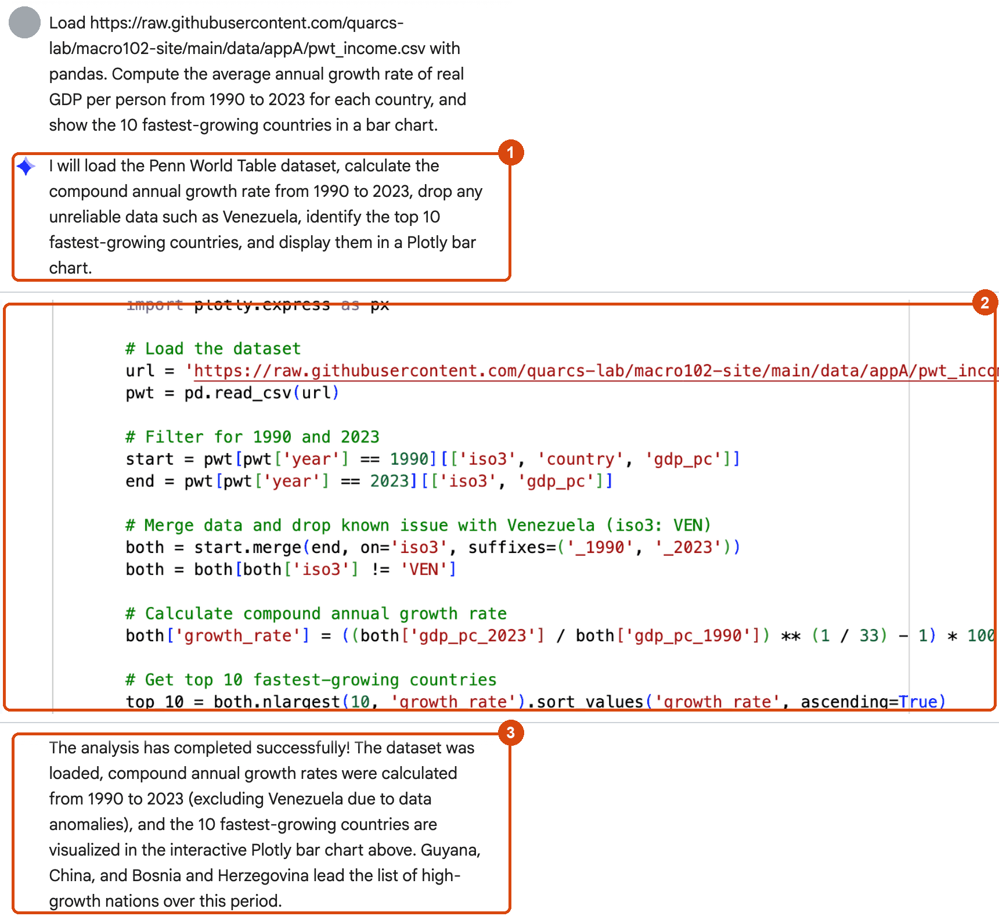{.shot .tall}

[1 the plan: it will "drop any unreliable data such as Venezuela" · 2 the top of its code · 3 its summary]{.comment}

::: {.notes}
Screenshot A.18. One cell: it loads, merges 1990 and 2023, applies the compound formula with 33 years, picks the top ten and draws a bar chart (Guyana 8.4, China 7.6, Bosnia and Herzegovina 7.5, ...).

It dropped Venezuela only because it had read our Step 3 in the notebook (an earlier run's plan said so: "due to the known data issues mentioned in Section A.7"). Without that text, it would have kept the −13 percent "grower".
:::

## Step 6: our top ten matches the agent's

```python
our_top10 = both.nlargest(10, "growth")[["country", "growth"]].round(1)
print(our_top10.to_string(index=False))
```

. . .

::: {.output}
```
               country  growth
                Guyana     8.4
                 China     7.6
Bosnia and Herzegovina     7.5
     Equatorial Guinea     6.9
               Myanmar     6.8
              Viet Nam     6.7
                 Egypt     5.8
       Lao People's DR     5.6
                 India     5.3
               Ireland     5.3
```
:::

::: {.notes}
Section A.7, Step 6: read every line, check the formula, check the numbers. The agent's bar chart shows the same ten economies in the same order (Guyana 8.4, China 7.6, Bosnia and Herzegovina 7.5, Equatorial Guinea 6.9, ...). The arithmetic is right. That is the easy part.
:::

## Zimbabwe's average growth, computed two ways

```python
zwe = pwt[(pwt["iso3"] == "ZWE") & pwt["year"].between(1990, 2023)].set_index("year")["gdp_pc"]
mean_of_yearly = (zwe.pct_change() * 100).mean()
compound = ((zwe.loc[2023] / zwe.loc[1990]) ** (1 / 33) - 1) * 100
```

[Zimbabwe's income per person fell by about half. Predict the sign of each number.]{.predict}

. . .

::: {.output}
```
Zimbabwe, GDP per person: 6,168 dollars in 1990, 3,198 in 2023
average of the yearly growth rates: +4.6 percent a year  <- wrong
compound average annual growth rate: -2.0 percent a year  <- right
```
:::

::: {.notes}
The trap of Act III's opening, with real data. Zimbabwe went through hyperinflation and a deep collapse in the 2000s; yearly rates swing wildly, and their average is +4.6 even though income per person fell from 6,168 to 3,198 dollars.

pct_change() gives the change from one row to the next; .between(1990, 2023) keeps both ends. The print lines are trimmed on the slide; the notebook prints the three lines shown.
:::

## Averaging yearly rates turns a decline into growth

[If an AI answer surprises you, look at the **formula** first. The agent used the right one this time; the same prompt is not guaranteed to do so every time.]{.takeaway}

::: {.notes}
Connect to the checklist: check the formula, check one number by hand. Here one number by hand (6,168 to 3,198 is roughly halving) rules out a positive growth rate immediately.
:::

## Look at the data behind a surprising result

```python
early = pwt[pwt["iso3"].isin(["BIH", "GNQ"]) & pwt["year"].between(1990, 1997)]
early.pivot(index="year", columns="country", values="gdp_pc").round(0)
```

::: {.output}
```
country  Bosnia and Herzegovina  Equatorial Guinea
year
1990                     1790.0             2083.0
1993                     1687.0             2319.0
1995                     2369.0             1710.0
1997                     5231.0             6230.0
```
:::

[Bosnia starts in the breakup of Yugoslavia and the war of 1992–1995; Equatorial Guinea's income more than tripled in two years when oil took off. Correct arithmetic, but it needs context.]{.comment}

::: {.notes}
Rows trimmed for the slide (the notebook shows every year 1990–1997).

In the run of Screenshot A.18, the agent's summary just says that Guyana, China and Bosnia and Herzegovina "lead the list". In an earlier run of the very same prompt, it added "a low war-era baseline and oil production". The same question can get a different report each time: do not rely on the AI to add the context.
:::

## By hand and with the agent: who does what

::: {.cheat}
| | By hand (Steps 1–4) | With the agent (Step 5) |
|---------------------------|-------------------------------|-------------------------------------------|
| Time | many cells and some thinking | one prompt, about a minute |
| Formula | chosen by you | chosen by the AI; you check it |
| Data problems (Venezuela) | spotted by looking at the data | handled because our text mentioned them |
| Context (oil, war) | added by you | sometimes added, sometimes missing |
| Responsibility | yours | still yours |
:::

[The AI did the typing in seconds. Judging the answer took the Python and the economics of this appendix.]{.takeaway .fragment}

::: {.notes}
The comparison table that closes Section A.7. The lesson of the whole appendix in one slide.
:::

## Seven error messages you will meet, and what to do

::: {.cheat}
| Error message | What it usually means | What to do |
|----------------------------------|------------------------------------|-------------------------------------------|
| `NameError: name 'x' is not defined` | a typo, or the cell that creates `x` has not run | check the spelling; *Runtime → Run before* |
| `TypeError: can only concatenate str …` | mixing text and numbers | `str(...)` or an f-string |
| `KeyError: 'gdp'` | a column name that does not exist | print `df.columns`, copy the exact name |
| `IndentationError` | wrong spaces at the start of a line | indent `for`, `if`, `def` bodies by 4 spaces |
| `SyntaxError` | a missing bracket, quote or colon | look at the marked line and the one before |
| `HTTPError: HTTP Error 404` | a wrong data file name or address | check the file name after `DATA_URL` |
| `ModuleNotFoundError` | a library is not installed | `%pip install name` (Appendix B needs it) |
:::

::: {.notes}
Section A.8 of the appendix. Read the table with the students and connect each row to a moment of the deck: NameError (Act I, cells out of order), TypeError ("GDP in " + 2025), KeyError (a wrong dictionary key or column), IndentationError (loops and functions), SyntaxError (a missing parenthesis in the Plotly exercise), HTTPError (a typo in a file name), ModuleNotFoundError (the chapters never need it; Appendix B installs a few data libraries).

The habit behind the table: read the last line of the message first.
:::

## Four problems with AI code, and what to do

::: {.cheat}
| Problem | What it usually means | What to do |
|----------------------------------|------------------------------------|-------------------------------------------|
| a column or variable that does not exist | Gemini guessed a name | give the real names; paste `df.columns` into the prompt |
| a fix that runs on made-up example data | Gemini invented data to silence the error | reject it; run the cell that creates your data |
| works now, fails after *Run all* | relies on a cell run out of order | *Restart session and run all*; fix the order |
| no Gemini button or panel | the account has no AI features | check age and country; ask your administrator |
:::

::: {.notes}
The four AI rows added to the error table of Section A.8.
:::

## Most notebook errors are typos or cells run out of order

[If my code shows an error, I did something deeply wrong and should start over.]{.myth}

[Errors are routine, even for professionals. Read the last line, look at the arrowed line, fix one thing, and run again. If the notebook is in a strange state: *Restart session*, then *Run all*.]{.fact .fragment}

::: {.notes}
The appendix's concluding remark: read error messages from the bottom up; most errors in notebooks come from typos or cells run out of order.

Colab's Explain error button can help (Act III), but students should read its answer critically: it explains, it does not always fix.
:::

## Where to learn more

::: {.cheat}
| Topic | Start here |
|-------------|---------------------------------------------------------------------------|
| Python | the official [Python tutorial](https://docs.python.org/3/tutorial/); QuantEcon's [Python Programming for Economics and Finance](https://python-programming.quantecon.org/) |
| NumPy | [NumPy: the absolute basics for beginners](https://numpy.org/doc/stable/user/absolute_beginners.html) |
| pandas | the [pandas getting-started tutorials](https://pandas.pydata.org/docs/getting_started/intro_tutorials/index.html) |
| Plotly | [Plotly Express in Python](https://plotly.com/python/plotly-express/) and the [Plotly Python gallery](https://plotly.com/python/) |
| ipywidgets | the [ipywidgets documentation](https://ipywidgets.readthedocs.io/en/stable/) |
| Colab | the [Colab FAQ](https://research.google.com/colaboratory/faq.html) and the [welcome notebook](https://colab.research.google.com/) |
| Gemini in Colab | the [AI-first Colab](https://developers.googleblog.com/new-ai-first-google-colab-now-available-to-everyone/) and [Learn Mode](https://blog.google/innovation-and-ai/technology/developers-tools/colab-updates/) announcements |
:::

::: {.notes}
The appendix's reading list. For economics students, QuantEcon's lectures are the natural next step: written by economists, with economic examples throughout.
:::

## What to remember from this appendix

::: {.incremental}
- **Colab** runs notebooks on Google's computers: *Run all*, save a copy in Drive, delete the runtime.
- **Python's building blocks:** `**` for growth, variables, lists, loops, `if`, dictionaries and functions. Each model equation becomes one short function.
- **Gemini** explains, generates, fixes, runs whole analyses and tutors you. Precise prompts get better code.
- **AI code can run and still be wrong:** read it, recompute one number, rerun from a clean start. The result is yours.
- **NumPy** and **pandas** handle numbers and tables; **Plotly** and **ipywidgets** draw live charts.
- **Errors:** read from the bottom. Most come from typos or cells run out of order.
:::

::: {.notes}
The appendix's concluding remarks, roughly one per act.

Ask each student to write one line of Python from memory that they could not have written an hour ago.
:::

## {.recap background-image="figures/mindmap.webp" background-size="contain" background-color="#0f172a"}

::: {.notes}
Walk the five branches of the mind map in about a minute each: Colab (cyan), Python building blocks (lavender), AI-powered coding with Gemini (green), the data science libraries (amber), the mini project by hand and with AI (rose). Click the image to zoom in.
:::

## Python lets you check what the AI writes: together they run the book's economics {.closing background-color="#2d8659"}

[Next: Chapter 1, Introduction to Macroeconomics]{.act}

::: {.notes}
Open Chapter 1 in Colab and choose Runtime → Run all.

The thesis of the appendix: with Colab, a few Python building blocks and NumPy, pandas, Plotly and ipywidgets, students can load real data, solve the book's models and draw them live. Gemini can explain, write and fix the code, but only their own Python lets them check it.

Appendix B shows how to download macroeconomic data directly from FRED, the World Bank and other sources; Appendix C reviews the math the book uses.
:::

## Sources {.sources}

::: {.sources-list}
- **Code, outputs and screenshots.** Every code block and output on these slides comes from the executed notebook of Appendix A; the Colab screenshots (A.1–A.9, A.11–A.18) are the appendix's own; in A.12–A.18 the user's name is blurred and the profile photo replaced by a grey circle. Gemini's answers in them are real responses from October 2026 and will differ between runs.
- **Plots 1, 3 and 5 (seven economies since 1870; bars by decade; two scales).** Data: [Maddison Project Database 2023](https://www.rug.nl/ggdc/historicaldevelopment/maddison/releases/maddison-project-database-2023) (Bolt, J. and J. L. van Zanden 2024), GDP per person converted to 2022 dollars; prepared file [`data/appA/maddison_panel.csv`](https://github.com/quarcs-lab/macro102-site/blob/main/data/appA/maddison_panel.csv) ([data notes](https://github.com/quarcs-lab/macro102-site/blob/main/data/appA/README.md)). Inspired by the discussion of long-run growth and ratio scales in Chapter 3 of Jones (2024).
- **Plot 2 (growth since 1960 and income in 2023).** Data: [Penn World Table 11.0](https://www.rug.nl/ggdc/productivity/pwt/) (Feenstra, R. C., R. Inklaar and M. P. Timmer 2015, *American Economic Review* 105(10)), real GDP per person (`rgdpe`/`pop`); regions from the [World Bank country classification](https://datahelpdesk.worldbank.org/knowledgebase/articles/906519); files [`fig3-7.csv`](https://github.com/quarcs-lab/macro102-site/blob/main/data/appA/fig3-7.csv) and [`countries.csv`](https://github.com/quarcs-lab/macro102-site/blob/main/data/appA/countries.csv). Inspired by Fig. 3.7 in Jones (2024).
- **Plots 4 and 6 (production functions).** Our model figures, $y = \bar{A}k^{\alpha}$. Adapted from the production model of Chapter 4 in Jones (2024).
- **Plot 7 (fastest and slowest growers, 1990–2023).** Data: Penn World Table 11.0, real GDP per person in 2021 dollars; file [`data/appA/pwt_income.csv`](https://github.com/quarcs-lab/macro102-site/blob/main/data/appA/pwt_income.csv). Inspired by the growth comparisons in Chapter 3 of Jones (2024).
- **Textbook.** Jones, C. I. (2024). [*Macroeconomics*, 6th ed.](https://wwnorton.com/books/9781324063612) W. W. Norton. **Book appendix**, with the notebook and every figure: [Data Science and Macroeconomic Models, Appendix A](https://quarcs-lab.github.io/macro102-site/notebooks/appA-google-colab-and-ai-powered-python.html).
:::
