## Same model, same data, same code: two different estimates

[$\omega = 0.19$ or $\omega = 0.06$?]{.bignum}
[One parameter of Ireland's (2004) New Keynesian model, estimated twice by maximum likelihood on the same U.S. data]{.bignum-label}

. . .

[The two runs differ only in where the search started. The second run fits the data better (log-likelihood 2648.47 against 2646.66) and reproduces Ireland's published 0.0617. By the end of this deck you will know why, and what to do about it.]{.comment}

::: {.notes}
Open with the puzzle. Both numbers come from the appendix notebook (Section D.11). The first run starts the optimizer from the rough values in Snowdrop's model file and stops at ω = 0.193 with a log-likelihood of 2646.66. The second run starts from Ireland's published estimates and stays there: ω = 0.062, log-likelihood 2648.47, Ireland's Table 1 to four decimals.

Worse: the first run is machine-dependent. In our Colab test it stopped at ω ≈ 0.16 instead, with yet another log-likelihood. Same code, same data.

Ask the room: which number would you report? How would you know which one is right? Most students say "the computer's answer". The deck builds the tools to give a better answer: what the likelihood is (Act IV), why it can be flat in some directions, and how priors help (Act V).

The habit this deck teaches, from the first slide to the last: check every result. Against a case you can solve by hand, against the residuals of the equations, against a second starting point, against the published numbers.
:::

## Five questions, from equations to estimates

::: {.incremental}
- **I. Ideas and tools:** what is a DSGE model, and what is Snowdrop?
- **II. Solving with expectations:** how do we solve a model in which the future matters today?
- **III. Simulating three models:** how do we write, run and check a model in Python?
- **IV. From model to data:** how does a model turn data into a likelihood?
- **V. Estimating Ireland (2004):** what do U.S. data say, and how much do priors matter?
:::

[Each idea: intuition → equation → a small version by hand → the Snowdrop version → a check.]{.takeaway .fragment}

::: {.notes}
These are the five acts of the deck and the five branches of the mind map on the title slide. A closing block follows: where to go next, the common errors, and the takeaways.

How the deck works. Most ideas appear twice: first as a tiny model built by hand with NumPy (one equation, one variable), then in Snowdrop at full size. The small version shows what the package does inside; the big one shows how to use it.

The cards:
- PREDICT (blue): write down a guess before the chart appears.
- CHECK IT (teal): a test that a result is right.
- COMMON MISTAKE (red) and IN FACT (green): a typical error and its correction.
- Code panels show the notebook's own code; OUTPUT panels show what it printed. Students who want to run it open the Appendix D notebook in Colab.
- Six charts are live: move their sliders.

Each act ends with a formula sheet to photograph.

Prerequisites: Chapters 12, 13 and 15 (the short-run model, AS/AD, DSGE models), and Appendices A (Python) and C (math). Everything else is built up from zero.
:::

# Ideas and tools {.divider background-color="#3498db"}

[Act I]{.act}

## Each word of "DSGE" names one feature of the model

::: {.cards}
::: {.card}
**Dynamic**

Decisions link the periods: households save today to consume tomorrow, firms invest today to produce tomorrow, and **expectations** about the future change what people do today.
:::
::: {.card .violet}
**Stochastic**

Random **shocks** hit the economy: to productivity, preferences, firms' costs, monetary policy. Without them, the economy would sit at its steady state.
:::
::: {.card .green}
**General equilibrium**

All markets clear **at once**, and every household's and firm's plans are consistent with each other and with the economy's resources.
:::
:::

[A DSGE model is a business cycle model in which every equation comes from someone's choice or a market's balance.]{.takeaway .fragment}

::: {.notes}
Link back to Chapter 15, which showed what DSGE models say about business cycles; this appendix opens the machine.

Contrast with the short-run model of Chapters 11–13. There, the IS curve, the Phillips curve and the policy rule were simply assumed, and expectations were adaptive (last year's inflation). A DSGE model derives such curves from optimization, and lets people look forward.

Ask: which of the three words does the AS/AD model of Chapter 13 lack? (It is dynamic through past inflation, and shocks hit it, but nobody looks forward and nothing is derived from optimization. Act III still solves it with Snowdrop, because the tools are the same.)
:::

## A DSGE model is a list of equations from five ingredients

::: {.incremental}
- **Optimizing households and firms:** the Euler equation (Ch. 16), the demand for capital (Ch. 17), price setting
- **Expectations:** rational, so people's forecasts are the model's own forecasts
- **Constraints and market clearing:** output is consumed or invested; capital carries over
- **Shocks:** each one an AR(1), $z_t = \rho\, z_{t-1} + \varepsilon_t$
- **Policy rules:** the central bank's interest-rate rule (Ch. 13)
:::

::: {.notes}
Every equation in the three models of this deck comes from one of these five ingredients. Point back to them as each model appears.

AR(1) means "autoregressive of order one": today's shock is a fraction ρ of yesterday's plus a new random surprise ε. With ρ = 0.8 a shock loses a fifth of its size each period. Appendix C's difference equations (x_{t+1} = a x_t + b) are the same object.

Rational expectations: people know the model and the odds of each shock, so they make no systematic mistakes. They do not know future shocks (a misconception we come back to in Act II).
:::

## To solve a model is to find its decision rules

[A **decision rule** gives every variable today as a function of the **state** (what the past left behind) and of today's **shocks**.]{.comment}

$$\underset{\text{today's choice}}{x_t} \;=\; f\big(\underset{\text{state}}{s_{t-1}},\ \underset{\text{shocks}}{\varepsilon_t}\big)$$

. . .

[With the decision rules in hand, we can simulate the economy for any sequence of shocks: one shock (an impulse response), a scenario, or thousands of random histories.]{.takeaway}

::: {.notes}
This is the single most important definition of the deck. The model's equations hold expectations of the future; the decision rule has none: it is a plain formula in things known today. Turning one into the other is what "solving" means.

Example to come in Act II: in a one-equation model, the rule is x_t = φ z_t, with φ = 0.5 for the teaching values.

For a nonlinear model there may be no formula. Then "solving" means finding the whole path of every variable after a shock, by Newton's method (Act II and III).
:::

## Seven steps take a model from equations to estimates

::: {.mid-table}
| Step | What happens | In this deck |
|------------------|-----------------------------------------------------------------------|---------------|
| 1. Write | equations, variables, shocks and parameters go into a **model file** | Acts II, III |
| 2. Calibrate | choose parameter values from long-run facts and other studies | Act III |
| 3. Steady state | the values the model settles at when no shocks hit | Act III (RBC) |
| 4. Solve | decision rules (linear models) or whole paths (nonlinear models) | Act II |
| 5. Simulate | impulse responses, scenarios, contribution charts | Act III |
| 6. Take to data | the solution in **state-space form**; the **Kalman filter** gives the likelihood | Act IV |
| 7. Estimate | the parameters that make the data most likely, with or without priors | Acts IV, V |
:::

::: {.notes}
The workflow of every DSGE study, and the map of the deck. Students often think "estimating a DSGE model" is a single command. It is the last step of seven, and each earlier step can break it.

Steps 1–5 are the "solve and simulate" half (Acts II and III). Steps 6–7 are the "estimate" half (Acts IV and V).
:::

## Calibration borrows parameter values; estimation lets the data choose

::: {.columns}
::: {.column width="50%"}
### Calibration
- each value from **outside evidence**
- capital share from the national accounts, discount factor from average interest rates
- the real business cycle school (Ch. 15)
:::
::: {.column width="50%"}
### Estimation
- the model's own **time series** pick the values
- **maximum likelihood:** the values that make the observed data most probable
- **Bayesian:** outside evidence enters as a **prior**, and the data update it
:::
:::

[Bayesian estimation combines the two, and it is how most central banks estimate their DSGE models.]{.takeaway .fragment}

::: {.notes}
Calibration and estimation are not enemies. A calibrated model is a prior with no uncertainty; maximum likelihood is Bayesian estimation with a flat prior. Bayesian estimation sits in between: it says how sure we are about each parameter before seeing the data.

The appendix uses all three: calibration in Act III (AS/AD, JLMP98, RBC), maximum likelihood in Acts IV and V, Bayesian posterior mode in Act V.

Smets and Wouters (2007) is the reference Bayesian DSGE study; the New York Fed's DSGE model (Del Negro et al., 2013) is estimated the same way.
:::

## Central banks use estimated DSGE models to forecast and to test policies

::: {.mid-table}
| Institution | Model | Used for |
|----------------------------|---------------------------------|------------------------------------------------------------|
| Federal Reserve Bank of New York | FRBNY DSGE model (Del Negro et al., 2013) | forecasts, published regularly, and policy analysis |
| European Central Bank | New Area-Wide Model, NAWM (Christoffel, Coenen and Warne, 2008) | staff projections and policy analysis for the euro area |
| Bank of England | COMPASS (Burgess et al., 2013) | built as the central model of its forecasting platform |
| International Monetary Fund | GIMF (Kumhof et al., 2010) | fiscal and monetary policy analysis across countries |
:::

[Each of these is a larger cousin of the models in this deck: the same ingredients, more shocks and frictions.]{.takeaway .fragment}

::: {.notes}
All four are documented in public working papers (Sources slide). Sizes differ: the FRBNY model builds on Smets and Wouters (2007) with financial frictions added; the NAWM and GIMF are open-economy models with many sectors.

The Snowdrop paper's statement of need cites DSGE work at the IMF, the ECB, the Federal Reserve Bank of New York and the Japanese Ministry of Finance.

For the public-policy students: when a central bank publishes "the forecast says inflation returns to target in two years because the energy shock fades", that sentence is often read off a DSGE model's shock decomposition.

Note the variety: central banks also use large semi-structural models (the Federal Reserve Board's FRB/US) and purely statistical forecasting models. DSGE models are one tool among several.
:::

## A DSGE model answers "what if" questions that data alone cannot

[If the central bank followed a different rule, what would inflation and output have done?]{.policy}

::: {.columns}
::: {.column width="50%"}
### What the models are good for
- **counterfactuals:** change the policy rule, keep households' and firms' preferences and technology
- forecasts told as a **story of shocks**
- reading history: which shocks drove a recession
:::
::: {.column width="50%"}
### What they leave out, or struggle with
- financial crises, in the models used before 2008
- large nonlinear events: a rate stuck at zero, a pandemic
- differences between households (inequality)
:::
:::

::: {.notes}
Why not just regress inflation on the interest rate? The Lucas (1976) critique: the relationships seen in past data depend on the policy in place. Change the policy and people change their behavior, so the old correlation breaks. A DSGE model separates the policy rule from preferences and technology, which (the hope goes) do not change when policy does. That is what makes counterfactuals meaningful.

The right column is honest about limits, and it is contested how serious they are: we return to it with the Devil's advocate near the end. Christiano, Eichenbaum and Trabandt (2018) describe how post-2008 models added financial frictions and the zero lower bound; Blanchard (2018) argues for using several kinds of models side by side. Heterogeneous-agent New Keynesian (HANK) models are the current frontier for inequality.

Ask the policy students: which question in your field is a "what if" question that past data cannot answer directly?
:::

## Economists rarely write solvers: three toolboxes dominate, and Snowdrop joins them

::: {.mid-table}
| Toolbox | Cost | Strength | Limit |
|-------------|-----------------------------------|----------------------------------------|----------------------------------------|
| **Dynare** | free; runs on MATLAB (commercial) or the free Octave | easy to use; the standard in research | **stationary** models only: growing variables must be rewritten as ratios |
| **IRIS** | free; runs on MATLAB | **non-stationary** models; forecasting | needs a MATLAB license |
| **TROLL** | commercial | very **large** systems | paid software |
| **Snowdrop** | free (GNU GPL), Python | wide range of models; linked to Python's data tools | young; a small user base |
:::

[A free Python toolbox removes the license cost and connects DSGE modeling to the data tools of Appendices A and B.]{.takeaway .fragment}

::: {.notes}
The table summarizes the Snowdrop paper's statement of need (Goumilevski and Otterson, 2025). Dynare is the research standard, and it is free, but MATLAB costs money (Octave is a free alternative that runs most Dynare code). IRIS was developed for central-bank forecasting.

"Stationary": a variable whose average and variance do not drift over time. GDP grows, so Dynare users model GDP growth or GDP relative to trend. Snowdrop, like IRIS, can handle growing levels directly.

The "limit" in Snowdrop's row is our assessment, not the paper's: a new package has fewer users finding its bugs. That is why this deck keeps checking results.
:::

## Snowdrop is a free Python package for DSGE models, written at the IMF

::: {.columns}
::: {.column width="58%"}
::: {.eqpanel}
Goumilevski, A., and Otterson, J. (2025). **Snowdrop: Python Package for DSGE Modeling.** *Journal of Open Source Software* 10(112), 8197.
:::

- code: [github.com/gumilevskij/Framework](https://github.com/gumilevskij/Framework)
- license: GNU General Public License
- documentation: a 56-page User Guide and notes on the numerical algorithms
:::
::: {.column width="42%"}
### What JOSS reviews
- the paper is a **short summary**
- the **software** itself is peer-reviewed: installation, documentation, tests
- the details live in the package, not the paper
:::
:::

::: {.notes}
Both authors work at the International Monetary Fund. The doi is 10.21105/joss.08197.

The Journal of Open Source Software (JOSS) is unusual: its papers are two or three pages long, and the reviewers install and test the software. So "reading the paper" is only the start; the real documentation is the User Guide that ships with the code (supplements/docs/UserGuide.pdf) and the code itself.

We install a fixed version: the GitHub commit of 3 October 2026, which corrected the standard errors of estimated parameters (Act I setup slides).
:::

## The paper's case: central banks need DSGE tools, and Python lacked one

::: {.incremental}
- DSGE models are a **basic tool** of central banks for monetary policy and forecasting
- Python, for all its scientific libraries, lacked an **integrated** DSGE toolbox
- each existing toolbox has a strength, but all are **commercial or run on commercial software**
- Snowdrop is **free**, handles a **wide range** of models, and in the paper's benchmarks on models with several hundred equations runs **about as fast as Dynare and IRIS, with less memory**
:::

::: {.notes}
This is the statement of need of the paper, in our words. The benchmark claim is the authors'; we have not re-run it.

"A wide range of models": New Keynesian, real business cycle, gap models, overlapping-generations models, and non-stationary ones.
:::

## One model file, many solvers, filters and estimators

::: {.mid-table}
| Feature | In Snowdrop | In this deck |
|------------------------|--------------------------------------------------------------------|---------------|
| Model files | human-readable **YAML**; also Python, Dynare, IRIS and Sirius XML files | Acts II, III, V |
| Nonlinear models | perfect-foresight paths by **Newton's method**: stacked **ABLR**, forward–backward **LBJ** | Acts II, III |
| Linear models | Binder–Pesaran, Anderson–Moore, two **generalized Schur** methods (match Dynare and IRIS) | Acts III, V |
| Time-varying parameters | a parameter can follow a path | Act II |
| Estimation | maximum likelihood; **Bayesian** with priors | Act V |
| Sampling | MCMC: the **emcee** ensemble sampler; adaptive Metropolis–Hastings | closing |
| Filters | Kalman (several), unscented Kalman, particle, Hodrick–Prescott, band-pass | Acts IV, V |
| Output | plots, contribution charts, Excel and SQLite files | throughout |
:::

::: {.notes}
Do not read the table aloud. Point at the right column: this deck touches almost every row.

Two families of solution method, which Act II explains from scratch:
- Nonlinear models are solved along the whole path after a shock, by Newton's method. ABLR stacks all periods into one large system; LBJ (after Juillard, Laxton, McAdam and Pioro, 1998) solves the same system period by period, forward and then backward.
- Linear models are solved once, for decision rules. Generalized Schur ("Klein", Klein 2000) is the method of IRIS; Dynare uses a close relative.

It runs on Windows, macOS and Linux, on CPUs and, through the CuPy library, on GPUs.
:::

## The paper shows three examples; this deck runs two of them

::: {.cards}
::: {.card}
**A monetary policy model**

Four equations: Phillips curve, real rate, policy rule, IS curve. Its Fig. 1: a 2% output shock in period 1 and a 3-point policy-rate revision in period 4.

*Act III replicates Fig. 1.*
:::
::: {.card .violet}
**Ireland (2004)**

A New Keynesian model estimated on U.S. data, 1948–2002.

*Acts IV and V estimate it, by maximum likelihood and with priors.*
:::
::: {.card .rose}
**Eichenbaum–Rebelo–Trabandt (2020)**

The macroeconomics of epidemics: 64 equations, highly nonlinear, solved by **homotopy**.

*Too big for an introduction: a pointer in the closing.*
:::
:::

::: {.notes}
The paper runs a model in three steps: write or edit a YAML model file, open the test script tests/test_toy_models.py and set fname to the file's name, then run the script. In a notebook, two functions do the same: importModel reads the file, run solves and simulates.

Homotopy: to solve a very nonlinear model, start from a version that is easy to solve and move the parameters step by step toward the real values, using each solution as the starting guess for the next. The paper's Figs. 2 and 3 forecast infections, deaths and the economy for 2020–2022 this way.

The epidemic model is published as Eichenbaum, Rebelo and Trabandt (2021) in the Review of Financial Studies; the paper cites its 2020 working-paper version.
:::

## Research software needs checking: five gaps the appendix found

::: {.incremental}
- the paper's model listing has a **layout slip** and other names than the package's file
- the ABLR solver **silently drops** an exogenous path
- the RBC steady-state search **stops 0.3% short** for capital
- the Ireland file **labels its shocks wrongly**
- two of three **inverse-gamma priors** build the wrong distribution
:::

[None of these is serious, and each one was caught by a check: a hand solution, a residual, a plot.]{.check .fragment}

::: {.notes}
Preview of the appendix's running theme. Each gap gets its own slide later, at the moment it matters: the listing in Act III (JLMP98), ABLR in Act III, the steady state in Act III (RBC), the labels and the priors in Act V.

The point is not that Snowdrop is bad. All research software has such gaps, and a short paper cannot document everything. The point is the habit: compare with a case you can solve by hand, look at the residuals of the equations, try more than one starting point, plot what you feed in.
:::

## Snowdrop installs in Colab in 20 seconds, without its old version pins

```python
# Snowdrop at the commit of 3 October 2026, without its old NumPy/SciPy pins, plus three small libraries
%pip install -q --no-deps "https://github.com/gumilevskij/Framework/archive/47a63b2b780e1876898229c09f7f1e8644462692.tar.gz"
%pip install -q --no-deps particles==0.4 "ruamel.yaml==0.17.21" ruamel.yaml.clib
```

::: {.incremental}
- Snowdrop asks for NumPy 1.26 and SciPy 1.11, which **do not exist** for Colab's Python 3.13
- everything the appendix uses runs on Colab's newer versions, so `--no-deps` installs **only the packages named**
- `particles` (distributions), `ruamel.yaml` (reads YAML) and its C helper are the three libraries Colab lacks
:::

::: {.notes}
`%pip install` is a notebook command that installs packages into the computer running the notebook. -q keeps it quiet. A GitHub address ending in .tar.gz is a compressed copy of the code at one commit: pinning the commit means the notebook keeps working when the package changes.

pip then prints "you may need to restart the kernel". You do not: the install changes nothing Colab has already loaded.

The 20 seconds were measured in Colab. The appendix's Colab "Run all" passed with this recipe.
:::

## Work in one folder: Snowdrop writes files and moves Python into its own folder

```python
sys.modules["cupy"] = None                  # no GPU library: Snowdrop uses the CPU
WORK = os.path.abspath("dsge")              # our work folder: model files, data, Snowdrop's output
os.makedirs(WORK, exist_ok=True)
os.environ["PLATFORM_OUTPUT_FOLDER"] = os.path.join(WORK, "output")

import snowdrop.src                         # importing Snowdrop moves Python into its own folder ...
from snowdrop.src import driver             # driver: importModel, run, estimate, ...
from snowdrop.src.graphs.util import plot, plotDecomposition
os.chdir(WORK)                              # ... so we move back to ours

for name in ["JLMP98.yaml", "RBC.yaml", "RBC1.yaml", "Ireland2004.yaml"]:
    shutil.copy(os.path.join(SUPP, "models", "TOY", name), WORK)   # the example models ...
shutil.copy(os.path.join(SUPP, "data", "gpr_1948.csv"), WORK)      # ... and Ireland's data
```

[Snowdrop caches every model file it reads next to the file, so we copy the examples into our own folder first.]{.takeaway .fragment}

::: {.notes}
Three quirks, three lines:
1. Snowdrop first tries CuPy, a GPU library; Colab has CuPy installed, which breaks a CPU runtime. Setting sys.modules["cupy"] = None tells Python that CuPy is not available.
2. Importing Snowdrop (and, later, its estimation module) changes Python's working folder. os.chdir(WORK) moves back. If you later see FileNotFoundError for a file you just wrote, this is why.
3. importModel writes a cache (.bin and .yaml.txt files) next to each model file. Copying the examples into WORK keeps the package's own folder clean.

SUPP is the package's supplements folder, found from snowdrop.src.__file__. It holds the example models (TOY: Ireland2004, JLMP98, MVF_US, RBC, RBC1) and data.
:::

## Four small helpers keep Snowdrop quiet and its tables readable

::: {.mid-table}
| Helper | What it does | Built on |
|--------------------------------------------|----------------------------------------------------------------|-----------------------------|
| `load_model(file)` | reads a model file; `verbose=True` prints Snowdrop's report | `driver.importModel` |
| `simulate(model)` | solves and simulates; returns a table, one row per period | `driver.run` |
| `set_values(model, "parameters", {...})` | changes parameters or starting values without editing the file | `model.calibration` |
| `estimate(model, ...)` | runs an estimation; returns the results table | `driver.estimate` |
:::

[The code on the next slides uses these four names; everything else is plain Snowdrop.]{.takeaway .fragment}

::: {.notes}
Snowdrop prints a lot: reports, progress, colored tables. The helpers capture the printout (contextlib.redirect_stdout) and keep what matters.

Two of them fix real quirks:
- set_values: Snowdrop's calibration arrays are read-only, so the helper changes a copy and puts it back.
- estimate: Snowdrop keeps a list of shock names between estimation runs (est_shocks_names); a second run in the same session would list the std_ parameters twice. The helper clears it first. It also reads the standard errors, which Snowdrop only prints, into a pandas table.

The appendix also has helpers that restyle Snowdrop's charts in the book's colors; they do not matter for the economics, and the deck skips them.
:::

## Act I in one table: the words to know {.formula-sheet}

| Term | Meaning |
|------------------------|-------------------------------------------------------------------------------|
| DSGE | dynamic, stochastic, general equilibrium: optimizing agents, shocks, all markets clearing |
| Steady state | the values the model settles at when no shocks hit |
| Decision rule | today's variables as a function of the state and today's shocks |
| Calibration | parameter values taken from outside evidence |
| Estimation | parameter values chosen by the data: maximum likelihood, or Bayesian with priors |
| Model file | a YAML text file with the model's symbols, equations, values and options |
| Snowdrop | a free Python package (IMF, 2025): `importModel`, `run`, `estimate` |
| Check it | compare with a hand solution, the residuals, a second start, the published numbers |

::: {.notes}
A summary to photograph. Quick round before Act II: ask a student to define "decision rule" in one sentence, and another to name one ingredient of a DSGE model and the chapter where it appeared.
:::

# Solving with expectations {.divider background-color="#8e44ad"}

[Act II]{.act}

## Today's inflation depends on the inflation people expect tomorrow

::: {.eqpanel}
$$x_t = a\,\mathbb{E}_t[x_{t+1}] + b\,z_t \qquad\qquad z_t = \rho\, z_{t-1} + \varepsilon_t$$
:::

::: {.incremental}
- $x_t$: inflation; $z_t$: a **cost shock** that fades at rate $\rho$
- $a$: close to 1, the discount factor of price setters; $b$: the slope of the curve
- $\mathbb{E}_t[x_{t+1}]$: what people **expect today** for tomorrow's inflation
:::

[The problem: tomorrow's inflation depends on the day after, and so on forever.]{.takeaway .fragment}

::: {.notes}
This is the New Keynesian Phillips curve of Ireland's model (Act V), stripped to its core: equations (D.1) and (D.2) of the appendix.

Why expectations? Firms that cannot change prices every period set today's price with an eye on the costs they expect while the price is stuck. If they expect high inflation tomorrow, they raise prices today.

Contrast with Chapter 12–13's Phillips curve, π_t = π_{t−1} + ν Ỹ_t: there, last year's inflation enters (adaptive expectations). Here, next year's expected inflation enters. That one change makes the model forward-looking, and solving it needs new tools.
:::

## Expectations chain forever: today's inflation sums every expected future shock

[Step 1. Write the equation for tomorrow and take expectations today:]{.step}
$$\mathbb{E}_t[x_{t+1}] = a\,\mathbb{E}_t[x_{t+2}] + b\,\mathbb{E}_t[z_{t+1}]$$

. . .

[Step 2. Substitute into today's equation, again and again:]{.step}
$$x_t = b\,z_t + a\,b\,\mathbb{E}_t[z_{t+1}] + a^2 b\,\mathbb{E}_t[z_{t+2}] + \dots$$

. . .

[Step 3. The shock fades at rate $\rho$, so $\mathbb{E}_t[z_{t+j}] = \rho^j z_t$, and the sum is a geometric series:]{.step}
$$x_t = b\,\big(1 + a\rho + (a\rho)^2 + \dots\big)\,z_t = \frac{b}{1-a\rho}\,z_t \qquad \text{if } a\rho < 1$$

::: {.notes}
This derivation is not in the appendix notebook, which goes straight to guess and verify (next slide). It shows WHY the answer has the form it has: inflation today is the discounted sum of all the cost shocks price setters expect, with discount a.

Step 3 uses the AR(1): with no new surprises expected, the shock j periods ahead is ρ^j times today's. The geometric series 1 + q + q² + … = 1/(1 − q) for |q| < 1 (Appendix C, present value).

Notice what it needs: aρ < 1, so the sum converges. A shock that is expected to last forever (ρ = 1) with a = 1 would make inflation infinite.
:::

## Guess and verify reaches the same decision rule in three lines

[Step 1. Only $z_t$ moves the economy, so guess that inflation is proportional to it:]{.step}
$$x_t = \phi\, z_t$$

. . .

[Step 2. Then tomorrow's expected inflation is]{.step}
$$\mathbb{E}_t[x_{t+1}] = \phi\,\mathbb{E}_t[z_{t+1}] = \phi\rho\, z_t$$

. . .

[Step 3. Put both into the equation: $\phi z_t = a\phi\rho\, z_t + b\, z_t$ must hold for every $z_t$, so]{.step}
$$\phi = \frac{b}{1-a\rho}$$

[The guess works: $x_t = \phi z_t$ is the **decision rule**, a formula in today's shock with no expectations left.]{.takeaway .fragment}

::: {.notes}
Guess and verify is the workhorse for linear rational-expectations models: guess the form of the solution, plug it in, and solve for the unknown coefficients. "For every z_t" means the coefficients on z_t must match on both sides.

Same answer as the previous slide, by a shorter road. Snowdrop's linear solvers do a matrix version of this for many variables at once.

Interpretation of φ: a shock that lasts longer (larger ρ) moves inflation more, because price setters expect it to raise their costs for longer. The live chart in three slides lets you check it.
:::

## With teaching values, inflation moves by half the cost shock

```python
a, b, rho = 0.9, 0.14, 0.8           # discount factor, slope, persistence of the cost shock
phi = b / (1 - a * rho)              # the decision rule
T = 30
z = np.zeros(T + 1)                  # periods 0, 1, ..., 30
z[1] = 1.0                           # a cost shock of 1 in period 1
for t in range(2, T + 1):
    z[t] = rho * z[t - 1]            # the shock fades, no new shocks
x = phi * z                          # inflation from the decision rule

residual = x[1:T] - a * x[2:T + 1] - b * z[1:T]   # the model's equation, period by period
print(f"phi = b / (1 - a rho) = {phi:.3f}")
print(f"largest error in equation (D.1): {np.abs(residual).max():.1e}")
```

::: {.output}
```text
phi = b / (1 - a rho) = 0.500
largest error in equation (D.1): 5.6e-17
```
:::

[After the shock, nothing new happens, so tomorrow's expected inflation is simply tomorrow's inflation: the code checks the equation period by period.]{.check .fragment}

::: {.notes}
φ = 0.14/(1 − 0.9 × 0.8) = 0.14/0.28 = 0.5.

The check: once the shock has hit, there are no more surprises, so E_t[x_{t+1}] = x_{t+1} and the equation can be tested with the simulated path itself. The largest error is 5.6e−17, which is zero up to the computer's rounding (about 1e−16 for numbers near 1). This is the first "check it" of the deck.
:::

## A cost shock of 1 hits in period 1. What does inflation do?

[How high does inflation jump, and how fast does it return to normal?]{.question}

[With $a = 0.9$, $b = 0.14$ and $\rho = 0.8$: does inflation jump by more or less than the shock? Does it fade faster than the shock, at the same rate, or more slowly?]{.predict}

::: {.notes}
Give the room 30 seconds. A common guess: inflation keeps rising for a while as expectations build up. In this model it cannot: the decision rule ties inflation to the shock in every period.
:::

## Inflation follows the cost shock at half its size {.chart-figure}

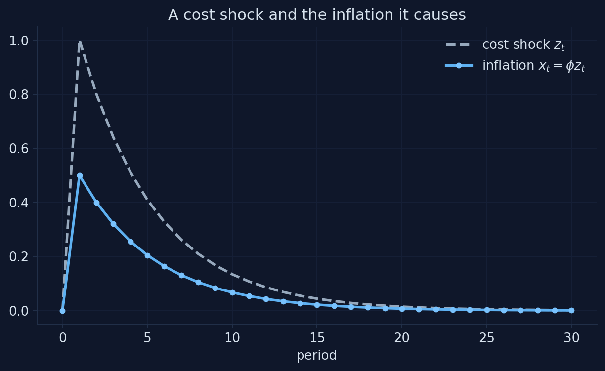

[Chart: our simulation of equations (D.1)–(D.3), $a = 0.9$, $b = 0.14$, $\rho = 0.8$; Appendix D, Section D.4.]{.source-line}

::: {.notes}
How to read it: periods on the horizontal axis. Dashed gray: the cost shock, 1 in period 1, then 0.8, 0.64, … Blue dots: inflation from the decision rule.

Point at period 1: the shock is 1, inflation 0.5. Then both fade at the same rate 0.8, and inflation is always half the shock.

Click the chart to zoom.
:::

## The decision rule turns a forward-looking equation into a formula

::: {.incremental}
- inflation jumps by $\phi =$ [0.5]{.key} in period 1: half the shock
- it then fades at the shock's own rate, $\rho = 0.8$: [0.5, 0.4, 0.32, …]{.key}
- nothing else moves inflation: no momentum, no delay
:::

[Solving a model means finding this kind of rule; everything else (charts, forecasts, likelihoods) is computed from it.]{.takeaway .fragment}

::: {.notes}
Answer to the prediction: half the shock, and the same rate of decay. No build-up: inflation has no memory of its own here, because the model has no lagged inflation. Ireland's model adds a backward-looking term (α_π), and the paper's model (Act III) mixes past and expected inflation; then inflation does have momentum.

0.5 × 0.8 = 0.4, 0.4 × 0.8 = 0.32.
:::

## If the shock lasts longer, does inflation respond more or less?

[Persistence $\rho$ rises from 0.8 to 0.95. What happens to the jump of inflation in period 1?]{.question}

[Write down your guess for $\phi = b/(1 - a\rho)$ at $\rho = 0.95$ before moving the slider. Bigger or smaller than 0.5? By how much?]{.predict}

::: {.notes}
The formula answers it, but ask for intuition first: a firm that expects its costs to stay high for years raises its price more today than one that expects a blip.
:::

## A longer-lasting shock moves inflation more on impact {.live-figure}

<script src="plots/plot1.js"></script>
<div class="live-plot" data-fig="plot1"></div>

[Mini-model built for this deck from equations (D.1)–(D.3) of [Appendix D](https://quarcs-lab.github.io/macro102-site/notebooks/appD-dsge-modeling-with-python.html) ($a = 0.9$, $b = 0.14$, a cost shock of 1 in period 1).]{.source-line}

::: {.notes}
How to read it: periods on the horizontal axis; dashed gray is the cost shock z, blue is inflation x = φ z. The slider sets the persistence ρ; the title reports φ.

Do live:
1. Start at ρ = 0.8: φ = 0.50.
2. Move to 0.95: φ = 0.97, almost one for one, and the shock fades slowly.
3. Move to 0.5: φ = 0.25, and both lines die out within a few periods.

Point at the denominator 1 − aρ: as aρ approaches 1, φ grows without bound. That is the geometric sum of expected future costs from two slides ago.
:::

## Persistence multiplies the response: φ almost doubles from ρ = 0.8 to 0.95

::: {.mid-table}
| Persistence $\rho$ | 0.5 | 0.6 | 0.7 | 0.8 | 0.9 | 0.95 |
|-------------------------------|:-----:|:-----:|:-----:|:-----:|:-----:|:-----:|
| Jump of inflation $\phi = b/(1-a\rho)$ | 0.25 | 0.30 | 0.38 | 0.50 | 0.74 | [0.97]{.key} |
:::

[What people expect about a shock's duration matters as much as its size: a cost shock expected to last moves prices far more today.]{.takeaway .fragment}

::: {.notes}
Answer to the prediction: bigger, 0.97 instead of 0.50.

This is why central banks watch inflation expectations and talk about whether an energy shock is "transitory" or "persistent": the same shock moves prices very differently depending on how long firms expect it to last.

The numbers are the live chart's titles: 0.14/(1 − 0.9ρ).
:::

## The equation has many solutions; only one stays bounded

[Step 1. After the shock there are no surprises, so solve the equation for next period's inflation:]{.step}
$$x_{t+1} = \frac{x_t - b\,z_t}{a}$$

. . .

[Step 2. Start inflation off the rule by a gap $d_t = x_t - \phi z_t$, and subtract the rule from both sides:]{.step}
$$d_{t+1} = \frac{1}{a}\, d_t$$

. . .

[Step 3. With $a = 0.9$, the factor $1/a = 1.11 > 1$: any gap grows by 11% a period and **explodes**.]{.step}

[Every starting value of inflation satisfies the equation each period; only the one with no gap keeps inflation bounded.]{.takeaway .fragment}

::: {.notes}
This is equation (D.4) of the appendix. The algebra of step 2: the rule satisfies φ z_{t+1} = (φ z_t − b z_t)/a (it solves the same equation), so subtracting gives d_{t+1} = d_t / a.

The key idea: the equation alone does not pin down inflation. It says how inflation today and tomorrow must relate, and many paths satisfy it. We pick the one that does not explode, because an explosive inflation path is not an equilibrium anyone would expect (prices would have to rise or fall without limit for no reason).
:::

## Inflation starts 0.05 above the decision rule. What happens next?

[Follow the gap over 30 periods. Does it shrink, stay, or grow? How large is it at the end?]{.question}

[Use $d_{t+1} = d_t / a$ with $a = 0.9$: after 29 more periods the gap has been multiplied by $1.11^{29}$. Roughly how big is that?]{.predict}

::: {.notes}
Let them compute: 1.111^29 ≈ 21. So a gap of 0.05 becomes about 1.06, larger than the whole response to the shock.
:::

## Only one path stays bounded: every other path explodes {.chart-figure}

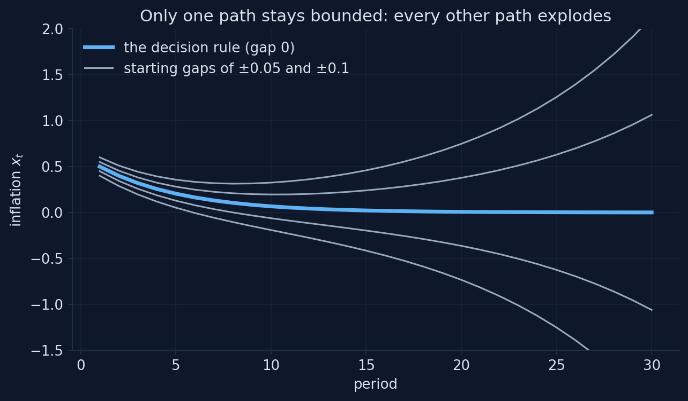

[Chart: our simulation of equation (D.1) from starting gaps of ±0.05 and ±0.1, $a = 0.9$; Appendix D, Section D.4.]{.source-line}

::: {.notes}
How to read it: thick blue is the decision rule (gap 0). The four gray paths start 0.05 and 0.1 above and below it. All five satisfy the model's equation in every period.

Point: the gray paths fan out, slowly at first, then fast; they leave the chart (cut at −1.5 and 2.0) before period 30.
:::

## The jump variable picks the one bounded path

::: {.incremental}
- a starting gap is multiplied by $1/a =$ [1.11]{.key} every period: about 21 times in 29 periods
- inflation is a **jump variable**: nothing from the past ties it down, so it can jump in period 1
- it jumps to the **one** value that puts the economy on the stable path: $x_1 = \phi z_1 = 0.5$
:::

[Rational expectations plus "no explosions" pin down a unique solution.]{.takeaway .fragment}

::: {.notes}
Answer to the prediction: the gap grows, to about 21 × 0.05 ≈ 1.06 by period 30 (1.111^29 ≈ 21.2).

Jump variables vs predetermined variables: capital is predetermined (this period's stock was decided last period), so it cannot jump; prices, inflation, consumption and asset prices can jump when news arrives. The distinction matters for the Blanchard–Kahn count on the next slide.
:::

## Blanchard–Kahn: a unique solution needs as many unstable roots as jump variables

::: {.mid-table}
| Unstable roots (absolute value > 1) vs jump variables | Solutions that stay bounded | Name |
|--------------------------------------|-------------------------------|---------------------|
| **equal** | exactly one | [determinate]{.key} |
| **fewer** unstable roots | infinitely many | indeterminate |
| **more** unstable roots | none | no stable solution |
:::

[Our model: one unstable root ($1/a = 1.11$) and one jump variable ($x_t$): exactly one stable solution.]{.takeaway .fragment}

::: {.notes}
Blanchard and Kahn (1980) is the classic statement for linear models. Intuition: each unstable root is a direction in which deviations explode, and each jump variable is one free choice in period 1. Each free choice can kill one explosive direction. Equal numbers: every explosive direction is killed, uniquely. Fewer explosive directions than free choices: some choices are left free, so many paths are fine. More: some explosive direction cannot be killed.

Snowdrop counts both for every model it solves; the last slides of this act show the count for the paper's model.
:::

## What if price setters weighed tomorrow more than today?

[Set $a = 1.1$. What happens to the paths that start off the decision rule?]{.question}

[The factor is now $1/a = 0.91 < 1$. Do the gaps still explode? How many stable solutions does the model have now?]{.predict}

::: {.notes}
This is the appendix's "Your turn" for Section D.4. Give the room a minute to reason with d_{t+1} = d_t / a.
:::

## When a > 1 every path is bounded: the model cannot pin down inflation {.live-figure}

<script src="plots/plot2.js"></script>
<div class="live-plot" data-fig="plot2"></div>

[Mini-model built for this deck from equations (D.1)–(D.4) of [Appendix D](https://quarcs-lab.github.io/macro102-site/notebooks/appD-dsge-modeling-with-python.html) ($b = 0.14$, $\rho = 0.8$; starting gaps of ±0.05 and ±0.1).]{.source-line}

::: {.notes}
How to read it: the same chart as before, live. The slider sets a; the title reports the root 1/a and what it means.

Do live:
1. Start at a = 0.90: the gray paths explode.
2. Move to 0.80: they explode faster (1/a = 1.25).
3. Move to 0.95: slower (1.05), but still away from the rule.
4. Move to 1.05 and 1.10: now every gray path converges back toward the blue one.
:::

## Too few unstable roots: indeterminacy, and room for self-fulfilling expectations

::: {.incremental}
- with $a = 1.1$ the root is $1/a =$ [0.91 < 1]{.key}: no unstable root, but still one jump variable
- every gap **shrinks**, so every starting value of inflation gives a bounded path
- the model is **indeterminate**: it cannot say what inflation will be, and expectations alone (*sunspots*) can move it
- in New Keynesian models, a central bank that raises the rate **more than one for one** with inflation (the Taylor principle, Ch. 13) rules this out
:::

::: {.notes}
Answer to the prediction: the gaps shrink, and every path is a valid equilibrium. Blanchard–Kahn fails with fewer unstable roots than jump variables.

Why it matters for policy: in the 1970s, some economists argue, the Fed raised rates less than one for one with inflation, which in New Keynesian models allows self-fulfilling inflation (Clarida, Galí and Gertler, 2000, is the classic study; the interpretation is debated). The Taylor principle restores determinacy.

In the full Ireland model of Act V, determinacy depends on the policy rule's coefficients; Snowdrop checks the root count each time it solves the model.
:::

## "Rational expectations" does not mean that people know the future

["Rational expectations means everyone knows what will happen."]{.myth}

[People know the model and the odds of each shock, not the shocks themselves. Their forecasts are right **on average**; each new shock is a surprise.]{.fact .fragment}

::: {.notes}
A frequent confusion. In the one-equation model, before period 1 nobody expects the cost shock; when it hits, people revise their forecasts at once to φρ z_t, the model's own forecast. Forecast errors are unpredictable, not zero.

Act III shows a concrete trap: Snowdrop's stochastic simulations, by default, let households know all future shocks at once, which is perfect foresight, not rational expectations. The option anticipate=False fixes it.
:::

## Perfect foresight: write every period's equation and solve them all together

[After the shock is known, (D.1) for periods $1, \dots, T$ is $T$ equations in $T$ unknowns, once we add a **terminal condition**: $x_{T+1} = 0$ (back at the steady state).]{.comment}

$$\begin{pmatrix} 1 & -a & 0 & 0 \\ 0 & 1 & -a & 0 \\ 0 & 0 & 1 & -a \\ 0 & 0 & 0 & 1 \end{pmatrix}
\begin{pmatrix} x_1 \\ x_2 \\ x_3 \\ x_4 \end{pmatrix} = b \begin{pmatrix} z_1 \\ z_2 \\ z_3 \\ z_4 \end{pmatrix}
\qquad (T = 4)$$

[This is the second way to solve a model, and the one Snowdrop uses for nonlinear models: find the whole path at once.]{.takeaway .fragment}

::: {.notes}
Each row is one period's equation, x_t − a x_{t+1} = b z_t. The last row uses the terminal condition x_5 = 0.

Why "perfect foresight": once the shock has hit, the whole future path of z is known (it just fades), so expectations equal the actual future. There is no randomness left to average over.

The terminal condition is an approximation: the economy is assumed back at its steady state at T + 1. With a long horizon the error is negligible (two slides on).
:::

## Newton's method: guess the path, measure the residuals, correct with the Jacobian

[Step 1. Guess a path $x$ (e.g., "nothing happens": $x = 0$).]{.step}

. . .

[Step 2. Compute the **residuals** $r(x)$: how far each period's equation is from holding.]{.step}

. . .

[Step 3. Correct the guess with the matrix of derivatives $J$, the **Jacobian**, and repeat until the residuals vanish:]{.step}
$$x \;\leftarrow\; x - J^{-1}\, r(x)$$

[In one dimension this is "follow the tangent line to zero"; with $T$ periods it does the same for all of them at once.]{.takeaway .fragment}

::: {.notes}
Appendix C's root finders search for x with f(x) = 0. Newton's method uses the slope: from a guess x, the tangent line f(x) + f'(x)(y − x) hits zero at y = x − f(x)/f'(x). In many dimensions, f'(x) becomes the Jacobian matrix J, and dividing becomes solving a linear system.

For a linear model the tangent IS the function, so one step lands exactly on the solution. A nonlinear model needs a few steps, each one closer (Act III shows five steps on the paper's model, live).
:::

## For a linear model, Newton's method converges in one step

```python
T_long = 80                                     # a long horizon, so that x_81 = 0 does no harm
z_long = rho ** np.arange(T_long)               # the cost shock in periods 1, ..., 80

def residuals(x_path):
    """Equation (D.1) for t = 1, ..., 80, with the terminal condition x_81 = 0."""
    x_next = np.append(x_path[1:], 0.0)
    return x_path - a * x_next - b * z_long

J = np.eye(T_long) - a * np.eye(T_long, k=1)    # the Jacobian of the residuals
guess = np.zeros(T_long)                        # start from "nothing happens"
for step in range(1, 4):
    guess = guess - np.linalg.solve(J, residuals(guess))
    print(f"Newton step {step}: largest residual {np.abs(residuals(guess)).max():.1e}")
print(f"Largest gap to the decision rule in periods 1-{T}: {np.abs(guess[:T] - x[1:T + 1]).max():.1e}")
```

::: {.output}
```text
Newton step 1: largest residual 2.8e-17
Newton step 2: largest residual 2.8e-17
Newton step 3: largest residual 2.8e-17
Largest gap to the decision rule in periods 1-30: 4.1e-11
```
:::

[Two methods, one answer: the stacked path matches the decision rule of guess and verify.]{.check .fragment}

::: {.notes}
np.eye(T) is the identity matrix and np.eye(T, k=1) has ones just above the diagonal, so J @ x gives x_t − a x_{t+1} for every t: exactly the matrix of the previous slide, 80 × 80.

Newton's first step already solves it (residual 2.8e−17, rounding error); steps 2 and 3 change nothing. The last line compares the path with the decision rule: 4.1e−11.

The gap of 4.1e−11 is the terminal condition's doing: the true value of x_81 is 0.5 × 0.8^80 ≈ 9e−9, not 0. Eighty periods back, that error has shrunk to almost nothing.
:::

## Snowdrop's two Newton methods: ABLR stacks all periods, LBJ sweeps forward and back

::: {.cards}
::: {.card .violet}
**ABLR: one big system**

Stack every equation of every period into one large, sparse system, as on the previous slides, and apply Newton's method to the whole of it.
:::
::: {.card}
**LBJ: period by period**

Solve the same system by working through the periods, forward and then backward (Juillard, Laxton, McAdam and Pioro, 1998). Cheaper for long horizons.
:::
::: {.card .green}
**Both: the same answer**

They solve the same equations, so they must agree. On the paper's model they do, to 1.3e−17, until an exogenous path enters (Act III).
:::
:::

::: {.notes}
Both are Newton methods for perfect-foresight paths. They differ in how they solve the linear system J Δx = −r at each Newton step: ABLR builds the whole sparse Jacobian; LBJ exploits its block structure (each period's equations involve only the previous, current and next period), which is much faster for long horizons and many equations.

Teaser for Act III: on the paper's Fig. 1 experiment the two methods disagree, and only a residual check reveals which one is wrong.
:::

## YAML: four rules cover almost every model file

::: {.columns}
::: {.column width="45%"}
- `key: value` pairs, one per line
- nesting by **indentation with spaces** (never tabs)
- lists in brackets `[x, z]` or one item per line after `- `
- `#` starts a comment
:::
::: {.column width="55%"}
```python
import yaml
text = """
name: A tiny example          # the model's name
symbols:
   variables: [x, z]
   parameters: [a, b, rho]
calibration:
   a: 0.9
   b: 0.14
"""
print(yaml.safe_load(text))
```
:::
:::

::: {.output}
```text
{'name': 'A tiny example', 'symbols': {'variables': ['x', 'z'], 'parameters': ['a', 'b', 'rho']}, 'calibration': {'a': 0.9, 'b': 0.14}}
```
:::

::: {.notes}
YAML ("YAML Ain't Markup Language") is a plain-text format for structured data, widely used for configuration files. Python reads it into dictionaries and lists, as the output shows: symbols is a dictionary whose values are lists.

The most common error: a tab instead of spaces, or one space too many. YAML reads the structure from the indentation.
:::

## A Snowdrop model file: the paper's monetary model as the package ships it

```yaml
name:  Monetary policy model example

symbols:
   variables: [PDOT,RR,RS,Y]
   exogenous: [exo]
   shocks: [ey,err,ers,epdot]
   parameters: [g,p_pdot1,p_pdot2,p_pdot3,p_rs1,p_y1,p_y2,p_y3]

equations:
      - PDOT = p_pdot1*PDOT(+1) + (1-p_pdot1)*PDOT(-1) + p_pdot2*(g^2/(g-Y) - g) + p_pdot3*(g^2/(g-Y(-1)) - g) + epdot
      - RR = RS - p_pdot1*PDOT(+1) - (1-p_pdot1)*PDOT(-1) + err
      - RS = p_rs1*PDOT + Y + ers + exo
      - Y = p_y1*Y(-1) - p_y2*RR - p_y3*RR(-1) + ey
```

[Four variables, four equations: one equation per endogenous variable, written as you would on paper.]{.takeaway .fragment}

::: {.notes}
The file is JLMP98.yaml from Snowdrop's examples (supplements/models/TOY). JLMP98 refers to Juillard, Laxton, McAdam and Pioro (1998), the paper behind the LBJ method. Act III reads these equations as economics.

symbols has four lists: variables (endogenous: the model determines them), exogenous (paths set from outside), shocks (random disturbances) and parameters.

The ^ means "to the power of", as in g^2.
:::

## The file's last blocks hold the numbers, the labels and the experiment

```yaml
calibration:
    g: 0.049
    p_pdot1: 0.414
    p_pdot2 : 0.196
    p_pdot3: 0.276
    p_rs1: 3
    p_y1: 0.304
    p_y2: 0.098
    p_y3: 0.315
    PDOT: 0                  # starting values of the variables
    std: 0.02
labels:
   PDOT: "Inflation"
   PDOT(-1): "Lag of Inflation"
options:
    T : 14
    periods: [1]
    shock_values: [std]
```

::: {.notes}
Shortened from the file (it has more labels and a few commented-out lines, such as a time-varying p_pdot1: [0.4,0.5,0.6,0.7]).

- calibration: parameter values, and starting values of the variables (all zero: the model is written in deviations from the steady state). std is a helper value used in options.
- labels: readable names for charts, also for leads and lags such as PDOT(-1).
- options: T is the number of periods; periods: [1] and shock_values: [std] mean "in period 1 the shocks take these values", in the order of the shock list: the first shock, ey, equals 0.02. Shocks not given are zero.

So a model file has six blocks: name, symbols, equations, calibration, labels, options. Models that are estimated have four more (measurement_variables, measurement_shocks, measurement_equations, estimated_parameters); Act V reads them in Ireland's file.
:::

## Timing is written in brackets: x(−1) is a lag, x(+1) an expectation

::: {.incremental}
- `PDOT(-1)` is last period's value, a **lag**; `PDOT(+1)` is the value expected for next period, a **lead**: an equation with a lead is forward-looking
- **shocks** hit in the periods of `options: periods`, with the sizes in `shock_values`, in the order of the shock list
- **exogenous variables** follow a path set from outside, period by period (Act III uses one for a policy-rate revision)
- a parameter can **change over time**: `p_pdot1: [0.4, 0.5, 0.6]` means 0.4 in period 1, 0.5 in period 2, and 0.6 from period 3 on
:::

::: {.notes}
Leads are the "E_t[x_{t+1}]" of the equations on paper: Snowdrop treats PDOT(+1) as the rational expectation of next period's inflation (under perfect foresight, the actual value).

Exogenous variables vs shocks: a shock is a one-off random disturbance in the equations; an exogenous variable is a whole path that we choose, like a planned policy change. In the paper's Fig. 1, the policy-rate revision is an exogenous path: 0.03 in period 4, zero after.

Time-varying parameters are one of Snowdrop's features that Dynare lacks in this simple form.
:::

## importModel reads the file and reports each equation's residual

```python
jlmp = load_model("JLMP98.yaml", verbose=True)
```

::: {.output}
```text
Non-Linear Model

Transition Equations:
---------------------

 1 	 0.000 :  PDOT = p_pdot1*PDOT(+1) + (1-p_pdot1)*PDOT(-1) + p_pdot2*(g**2/(g-Y) - g) + p_pdot3*(g**2/(g-Y(-1)) - g) + epdot
 2 	 0.000 :  RR = RS - p_pdot1*PDOT(+1) - (1-p_pdot1)*PDOT(-1) + err
 3 	 0.000 :  RS = p_rs1*PDOT + Y + ers + exo
 4 	 0.000 :  Y = p_y1*Y(-1) - p_y2*RR - p_y3*RR(-1) + ey
```
:::

[The number before each equation is its residual at the starting values: 0.000 everywhere means you start from a steady state.]{.check .fragment}

::: {.notes}
importModel parses the file, checks its syntax, and writes Python functions for the equations and their derivatives (that is the cache it saves next to the file). "Non-Linear Model" because of the g^2/(g − Y) term.

The residual column is a free check. If a residual is not 0.000, your starting values are not a steady state, and a simulation will drift even with no shock (Act III shows this with the RBC model).
:::

## The model object holds everything the file defined

```python
print("Variables: ", jlmp.symbols["variables"])
print("Shocks:    ", jlmp.symbols["shocks"])
print("Exogenous: ", jlmp.symbols["exogenous"])
print("Options:   ", jlmp.options)
```

::: {.output}
```text
Variables:  ['PDOT', 'RR', 'RS', 'Y']
Shocks:     ['ey', 'err', 'ers', 'epdot']
Exogenous:  ['exo']
Options:    {'T': 14, 'periods': [1], 'shock_values': [0.02]}
```
:::

[`model.symbols`, `model.calibration` and `model.options` are ordinary Python dictionaries: change them in code instead of editing the file.]{.takeaway .fragment}

::: {.notes}
The notebook also prints the parameters as a dictionary (zip of names and values). Notice that shock_values is now [0.02]: Snowdrop replaced std by its value from the calibration block.

Act III changes options (periods, shock_values) and calibration (with set_values) to run experiments without touching the file.
:::

## Snowdrop counts the roots: one unstable root, one forward-looking variable

```python
roots, text = quietly(driver.findEigenValues, model=jlmp)
roots = np.sort(np.abs(roots))
print("Absolute values of the roots:", np.round(roots, 3))
print("Roots larger than 1:", int(np.sum(roots > 1)), "| forward-looking variables: 1")
```

::: {.output}
```text
Absolute values of the roots: [0.    0.015 0.015 0.995 1.42 ]
Roots larger than 1: 1 | forward-looking variables: 1
```
:::

[One unstable root (1.42) and one jump variable (inflation, `PDOT(+1)`): Blanchard–Kahn holds, and the paper's model has a unique stable solution.]{.takeaway .fragment}

::: {.notes}
findEigenValues linearizes the model around its steady state and computes the roots of its dynamics: the same count we did by hand with 1/a = 1.11. Here the roots are 0, 0.015, 0.015, 0.995 and 1.42. Only 1.42 exceeds 1 in absolute value.

The one forward-looking variable is inflation, which appears with a lead in two equations. One unstable root, one jump variable: determinate.

The root 0.995 is close to 1: some deviations die out very slowly in this model.
:::

## Act II formula sheet: solving with expectations {.formula-sheet}

| Idea | Formula | In code / Snowdrop |
|-------------------------|-------------------------------------------------|----------------------------------------|
| Model with expectations | $x_t = a\,\mathbb{E}_t x_{t+1} + b z_t$, $z_t = \rho z_{t-1} + \varepsilon_t$ | `PDOT(+1)` in a model file |
| Decision rule | $x_t = \phi z_t$, $\phi = b/(1 - a\rho)$ | `phi = b / (1 - a * rho)` |
| Gap from the rule | $d_{t+1} = d_t / a$: explodes if $1/a > 1$ | the root count |
| Blanchard–Kahn | unstable roots = jump variables ⇒ unique solution | `driver.findEigenValues` |
| Perfect foresight | stack $T$ periods + terminal condition $x_{T+1} = 0$ | `options: T` |
| Newton's method | $x \leftarrow x - J^{-1} r(x)$ | `np.linalg.solve(J, r)`; ABLR, LBJ |
| Model file | `symbols`, `equations`, `calibration`, `labels`, `options` | `importModel` / `load_model` |
| Timing | `x(-1)` lag, `x(+1)` lead (expectation) | |

::: {.notes}
A summary to photograph. Quick check before Act III: "a = 1.1 — unique solution or not?" (No: no unstable root, one jump variable, indeterminate.) "What does a residual of 0.000 in importModel's report tell you?" (The starting values satisfy that equation: you start from a steady state.)
:::

# Simulating three models {.divider background-color="#2d8659"}

[Act III]{.act}

## Start with a model you know: the AS/AD model of Chapter 13

::: {.eqpanel}
$$\widetilde{Y}\!_t = \bar{a}_t - \bar{b}\bar{m}\,(\pi_t - \bar{\pi}) \qquad \text{(AD: the IS curve plus the policy rule)}$$
$$\pi_t = \pi_{t-1} + \bar{\nu}\,\widetilde{Y}\!_t + \bar{o}_t \qquad \text{(AS: the Phillips curve)}$$
:::

::: {.incremental}
- $\widetilde{Y}\!_t$: output gap; $\pi_t$: inflation, both in percent; $\bar{a}_t$: demand shock; $\bar{o}_t$: inflation shock
- Chapter 13's baseline: $\bar{\pi} = 2$, $\bar{m} = 0.5$, $\bar{b} = 2$, $\bar{\nu} = 1$
- no expected future values, only the past $\pi_{t-1}$: not a DSGE model, but written, solved and simulated with **the same tools**
:::

::: {.notes}
Equations (D.5) and (D.6) of the appendix, which are Chapter 13's AD curve (the IS curve with the central bank's rule R_t − r̄ = m̄(π_t − π̄) substituted in) and AS curve (the Phillips curve with adaptive expectations).

Why start here: students know the answers from Chapter 13, so they can focus on the tool. If Snowdrop reproduces Chapter 13 exactly, we trust the workflow before moving to models we cannot solve by hand.
:::

## The whole model fits in one short model file

::: {.small-code}
```yaml
name: The AS/AD model of Chapter 13

symbols:
   variables: [Ytil, infl]           # output gap and inflation, in percent
   shocks: [a, o]                    # demand shock and inflation shock
   parameters: [b, m, nu, infl_bar]  # IS slope, policy response, Phillips slope, inflation target

equations:
   - Ytil = a - b*m*(infl - infl_bar)        # the AD curve
   - infl = infl(-1) + nu*Ytil + o           # the AS curve

calibration:
   b: 2.0
   m: 0.5
   nu: 1.0
   infl_bar: 2.0
   Ytil: 0.0                         # starting values: the steady state
   infl: 2.0

options:
   T: 20
   periods: [1]
   shock_values: [[0.0, 2.0]]        # Event 1: an inflation shock o = 2 in period 1
```
:::

[Don't call a variable `pi`: in the algebra library Snowdrop uses, `pi` is the constant 3.14159…]{.takeaway .fragment}

::: {.notes}
The notebook writes this file from a cell with the %%writefile asad.yaml command, which saves the rest of the cell as a file. The deck leaves out the labels block (readable chart names).

Read it block by block with the room: two variables, two shocks, four parameters; two equations; the baseline values; and the experiment in options. shock_values: [[0.0, 2.0]] lists one row per shock period, one value per shock in the order [a, o]: a = 0, o = 2.

The pi trap is real: Snowdrop parses equations with SymPy, where pi is the number π. A variable named pi would silently become 3.14159.
:::

## An inflation shock of 2 points hits in period 1. What happens?

[How far does output fall, and how fast does inflation return to its 2% target?]{.question}

[Use what you know from Chapter 13: does output fall by more or less than 1%? Does the inflation gap close in one period, halve each period, or close more slowly?]{.predict}

::: {.notes}
Students who remember Chapter 13 will say: inflation jumps less than 2 points because the central bank raises the real rate and opens a recession, and the gap shrinks by a constant factor each period.
:::

## Snowdrop solves the model and returns one row per period

```python
asad = load_model("asad.yaml", verbose=True)
event1 = simulate(asad)
event1.head(6).round(3)
```

::: {.columns}
::: {.column width="40%"}
::: {.output}
```text
     Ytil   infl
0   0.000  2.000
1  -1.000  3.000
2  -0.500  2.500
3  -0.250  2.250
4  -0.125  2.125
5  -0.062  2.062
```
:::
:::
::: {.column width="60%"}
[Period 0 holds the starting values. `simulate` is our helper around Snowdrop's `run`: it solves the model and returns a pandas table.]{.comment}
:::
:::

::: {.notes}
importModel's report (verbose=True) says "Linear Model" this time and lists both equations with residual 0.000 at the starting values (the steady state: gap 0, inflation 2).

Answer to the prediction: output falls 1 percent in period 1, inflation rises to 3 (not 4): the central bank's reaction absorbs half the shock. Then each period both gaps halve.
:::

## Snowdrop's chart of the inflation shock {.chart-figure}

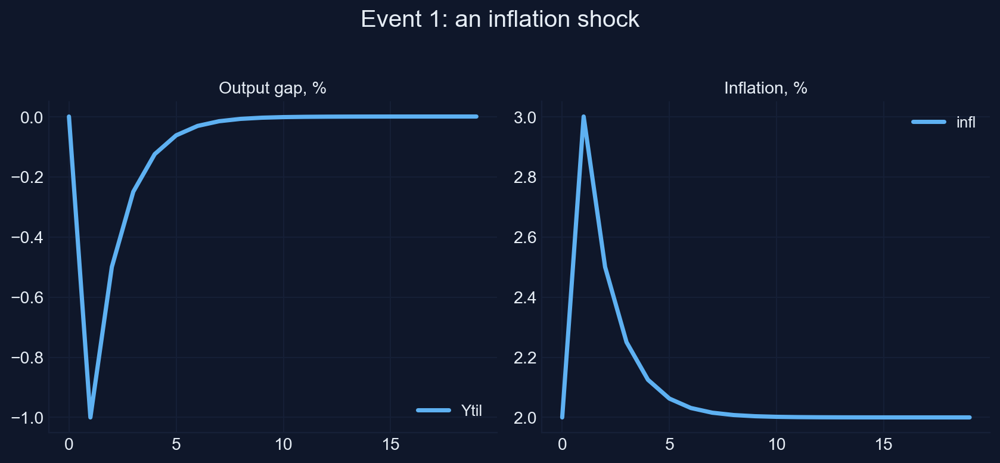

[Chart: Snowdrop's `plot` (restyled) of our AS/AD model file, equations (D.5)–(D.6); Appendix D, Section D.6.]{.source-line}

::: {.notes}
plot(...) draws every variable of a simulation in its own panel. In the notebook we ask it to return the figure (show=False, save=False) and restyle it in the book's colors.

Point at the shape: a jump in period 1 and a smooth return, exactly Chapter 13's Event 1 chart.
:::

## The inflation gap halves every period, exactly as in Chapter 13

::: {.incremental}
- output falls [1%]{.key} and inflation rises to [3%]{.key} in period 1
- each period the gaps shrink by $\lambda = 1/(1 + \bar{b}\bar{m}\bar{\nu}) = 1/2$
- Chapter 13's formula: $\widetilde{Y}\!_t = \big[\bar{a}_t - \bar{b}\bar{m}(\pi_{t-1} + \bar{o}_t - \bar{\pi})\big] / (1 + \bar{b}\bar{m}\bar{\nu})$
:::

[Largest difference between Snowdrop's path and Chapter 13's formula, over 20 periods: **0.0e+00**.]{.check .fragment}

::: {.notes}
The formula: given last period's inflation, the AD and AS equations are two linear equations in this period's Ỹ and π; solving them gives the line above. The notebook codes it as ch13_path(...) and subtracts it from Snowdrop's table.

Zero difference, not just a small one: both compute the same arithmetic. This is the strongest possible check, and it is why we started with a model we already know.

With b̄ = 2, m̄ = 0.5, ν̄ = 1: λ = 1/(1 + 1) = 1/2. Output in period 1: −b̄ m̄ λ ō = −2 × 0.5 × 0.5 × 2 = −1.
:::

## Change an experiment in code: new starting values, new shocks

```python
# Event 2: disinflation. Start at the old target, 4 percent; the new target is 2; no shock
asad = load_model("asad.yaml")
set_values(asad, "variables", {"infl": 4.0})          # inflation starts at the old target
asad.options["shock_values"] = [[0.0, 0.0]]           # no shock
event2 = simulate(asad)

# Event 3: a demand shock a = 2 in each of periods 1 to 9
asad = load_model("asad.yaml")
asad.options["periods"] = list(range(1, 10))          # periods 1, 2, ..., 9
asad.options["shock_values"] = [[2.0, 0.0]] * 9      # a = 2 and o = 0 in each of them
event3 = simulate(asad)
```

[The file stays the same; `set_values` and `options` set up each experiment.]{.takeaway .fragment}

::: {.notes}
Two ways to change a model without editing the file:
- set_values(model, "variables", {...}) changes starting values (or "parameters" for parameters). Our helper handles Snowdrop's read-only arrays.
- model.options is a dictionary: periods lists when shocks hit, and shock_values gives one row of shock values per period. [[2.0, 0.0]] * 9 repeats the row nine times.

Each experiment reloads the model first, so the previous experiment's changes do not leak into the next.
:::

## The central bank lowers its target from 4% to 2%. What does it cost?

[Inflation starts at the old target, 4%. The rule now aims at 2%. What happens to output?]{.question}

[Is there a recession? How deep is it in period 1, and how long does disinflation take?]{.predict}

::: {.notes}
This is Chapter 13's Event 2. Expect the answer "a recession", but ask for its depth: the formula gives Ỹ_1 = −b̄ m̄ (4 − 2)/(1 + b̄ m̄ ν̄) = −2 × 0.5 × 2 / 2 = −1.
:::

## Disinflation: a recession of 1% brings inflation from 4% to 2% {.chart-figure}

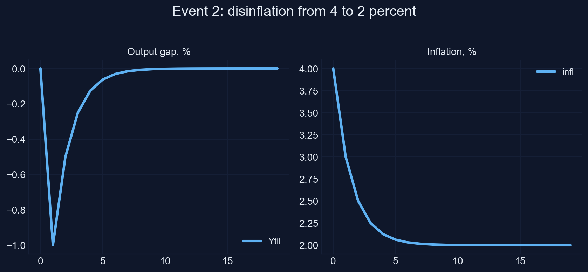

[Chart: Snowdrop's `plot` (restyled) of our AS/AD model file with inflation starting at 4% and a 2% target; Appendix D, Section D.6.]{.source-line}

::: {.notes}
How to read it: left panel output gap, right panel inflation; period 0 is the old steady state (inflation 4, gap 0).

Point at period 1: output falls 1 percent, inflation drops to 3. Then both gaps halve each period.
:::

## Disinflation costs a recession that halves every period

::: {.incremental}
- in period 1 output falls [1%]{.key}: $\widetilde{Y}\!_1 = -\bar{b}\bar{m}(4-2)/(1+\bar{b}\bar{m}\bar{\nu}) = -1$
- inflation falls to 3%, then 2.5%, 2.25%, …: the gap to the new target halves each period
- the same dynamics as Event 1, mirrored: the economy starts 2 points above target instead of being pushed there
:::

[Largest difference to Chapter 13's formula: **0.0e+00** again.]{.check .fragment}

::: {.notes}
Answer to the prediction: yes, a recession, deepest in period 1 (−1 percent) and halving each period. The cumulative output loss is 1 + 0.5 + 0.25 + … ≈ 2 percent of a period's output, for 2 points less inflation: a sacrifice ratio of 1 in Chapter 13's sense (output lost per point of disinflation).

A tougher central bank (m̄ = 1, the appendix's Your turn for D.6) would make λ = 1/3: faster disinflation, a deeper first recession (−1.33 percent with the inflation shock of Event 1).
:::

## A demand boom for nine periods. What happens during and after?

[Spending rises by 2% of potential output in periods 1 to 9, then returns to normal. Trace output and inflation.]{.question}

[During the boom, does output stay 2% above potential? Where does inflation go? And when the boom ends, does output simply return to potential?]{.predict}

::: {.notes}
Chapter 13's Event 3. The trap: many students expect output to fall straight back to potential when the shock ends. But inflation is now high, so the central bank keeps the real rate high.
:::

## A demand boom raises inflation; ending it takes a recession {.chart-figure}

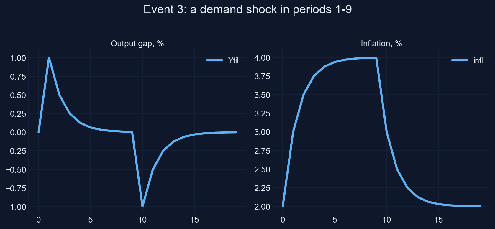

[Chart: Snowdrop's `plot` (restyled) of our AS/AD model file with a demand shock of 2 in periods 1–9; Appendix D, Section D.6.]{.source-line}

::: {.notes}
How to read it: left panel output gap, right panel inflation. Point at period 10, when the shock ends: output drops below potential, because inflation (near 4) is far above the target and the rule keeps the real rate high.
:::

## All three events match Chapter 13 exactly

::: {.incremental}
- during the boom, rising inflation makes the rule raise the real rate, which pulls output **back toward potential**
- inflation climbs toward [4%]{.key} and stays there while the shock lasts
- when the shock ends, a **recession** is needed to bring inflation back to 2%
- largest difference to Chapter 13 in each event: [0.0e+00]{.key}
:::

[The workflow works: write the file, load it, change the experiment in code, simulate, plot, check against a known answer.]{.takeaway .fragment}

::: {.notes}
Answer to the prediction: output does not stay 2 percent above potential; it is pulled back while the shock lasts. After the shock, a recession.

The economics is Chapter 13's: the central bank cannot offset a demand shock immediately because it reacts to inflation, not to the shock itself.

From here on, the models have expectations, and there is no Chapter 13 formula to check against. We will need other checks: residuals, two solvers, steady states by hand.
:::

## The paper's model: a Phillips curve that bends upward near full capacity

::: {.eqpanel}
$$\pi_t = p_1\,\pi_{t+1} + (1-p_1)\,\pi_{t-1} + p_2\Big(\frac{g^2}{g-y_t}-g\Big) + p_3\Big(\frac{g^2}{g-y_{t-1}}-g\Big) + \varepsilon^{\pi}_t$$
:::

::: {.incremental}
- inflation mixes **expected** inflation (weight $p_1 = 0.414$) and **past** inflation
- the output gap $y_t$ enters through $g^2/(g-y) - g$: close to $y$ for small gaps, but rising ever faster as $y$ approaches $g = 0.049$
- all variables are deviations from the steady state, in decimals (0.01 is one percentage point)
:::

::: {.notes}
Equation (D.7) of the appendix, with the paper's names p1…p7 (the package's file calls them p_pdot1 and so on).

A convex Phillips curve: an economy near full capacity sees inflation accelerate, because bottlenecks multiply. Booms raise inflation more than slumps of the same size lower it. Such curves were a feature of the IMF's models of the 1990s.

Because inflation depends on expected inflation, the model is forward-looking; because of the convex term, it is nonlinear. So: Newton's method on the whole path.
:::

## Three more equations: the real rate, the policy rule and the IS curve

::: {.eqpanel}
$$r_t = i_t - p_1\,\pi_{t+1} - (1-p_1)\,\pi_{t-1} + \varepsilon^{r}_t$$
$$i_t = p_4\,\pi_t + y_t + \varepsilon^{i}_t + \text{exo}_t$$
$$y_t = p_5\,y_{t-1} - p_6\,r_t - p_7\,r_{t-1} + \varepsilon^{y}_t$$
:::

::: {.incremental}
- **real rate:** the policy rate minus expected inflation (Ch. 8, 12)
- **policy rule:** $p_4 = 3$ points per point of inflation, one for one with the gap; $\text{exo}_t$ a deliberate change
- **IS curve:** a higher real rate, now or last period, lowers the gap (Ch. 11, 12)
:::

::: {.notes}
Equations (D.8)–(D.10). In the file: RR is the real rate r, RS the policy rate i, Y the output gap y, PDOT inflation π.

p4 = 3 is far above 1: the Taylor principle holds, consistent with the root count of Act II (determinacy).

exo is an exogenous variable: a path we set from outside. The paper's Fig. 1 uses it for a policy revision of 3 points in period 4.
:::

## A boom and a slump of the same size: do they move inflation equally?

[Compare an output gap of +3% with one of −3%. Does the convex term treat them symmetrically?]{.question}

[Sketch $g^2/(g-y) - g$ against $y$ for $g = 0.049$. Where does it bend, and which way?]{.predict}

::: {.notes}
Hint for the sketch: at y = 0 the term is 0; its slope at 0 is 1 (so it starts like y); as y approaches g from below, the denominator g − y goes to zero and the term shoots up.
:::

## The convex term matches the gap near zero but rises much faster in booms {.chart-figure}

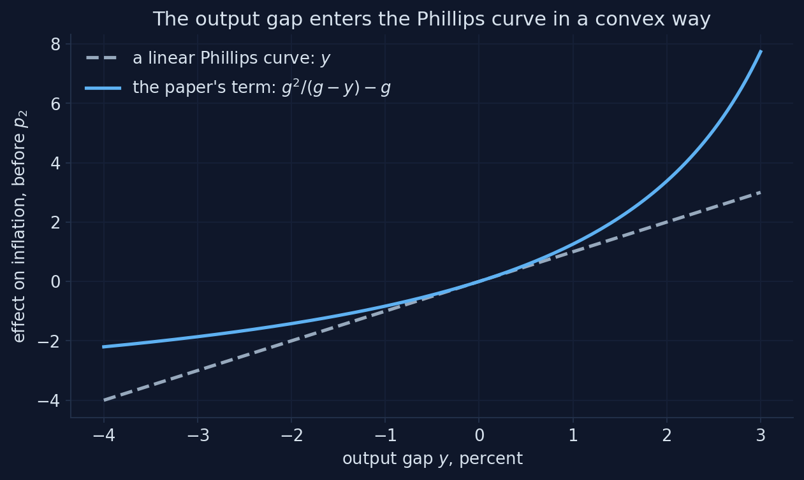

[Chart: the output-gap term of equation (D.7), $g = 0.049$, against a linear Phillips curve; Appendix D, Section D.7.]{.source-line}

::: {.notes}
How to read it: output gap in percent on the horizontal axis; dashed gray is a linear Phillips curve (the effect equals y); blue is the paper's convex term.

Point: near zero the two lines touch; at −4 percent the blue curve is above the dashed line (a slump lowers inflation by less); at +3 percent it is far above (a boom raises inflation by more).
:::

## Booms raise inflation by more than slumps of the same size lower it

::: {.incremental}
- simulate an output shock of +2% and one of −2%: inflation peaks at about [+1.2%]{.key} after the boom but falls only about [−0.55%]{.key} after the slump
- a **linear** model would give mirror images; the asymmetry is the nonlinearity
- the model's solution therefore depends on the **size and sign** of the shock, so it needs a nonlinear solver
:::

[Nonlinear models are where Newton's method on the whole path earns its keep.]{.takeaway .fragment}

::: {.notes}
The numbers are the appendix's "Your turn" for Section D.7 (simulate with shock_values [0.02] and [−0.02], no policy revision, and compare the largest movement of inflation).

Policy reading: in a convex world, letting the economy run hot is more inflationary than a slump is disinflationary, which argues for tightening early in a boom (Laxton, Meredith and Rose, 1995, made this case at the IMF; how convex the real-world Phillips curve is remains debated).
:::

## The paper's listing and the package's file differ in five small ways

::: {.mid-table}
| | The paper's listing | Snowdrop's `JLMP98.yaml` |
|--------------------------|----------------------------------------|----------------------------------------------|
| Parameter names | `p1`, …, `p7` | `p_pdot1`, `p_pdot2`, `p_pdot3`, `p_rs1`, `p_y1`, `p_y2`, `p_y3` |
| Shocks | one, `ey` (to output) | four: `ey`, `err`, `ers`, `epdot` |
| Layout | `equations` and `calibration` indented under `symbols`: Snowdrop would reject it | separate blocks |
| The policy revision | `exo: [0,0,0,0.03,0]` in `calibration` | not set: we set it in code |
| Shock | `periods: [1]`, `shock_values: [std]`, `std: 0.02` | the same |
:::

[Harmless, but you must know them to reproduce the paper's figure.]{.takeaway .fragment}

::: {.notes}
This is the first entry of the "five gaps" from Act I. A printed listing in a short paper is a summary; the package's own file is what runs. When you replicate a paper, always start from the authors' code and compare it with the printed equations.

The layout slip: in YAML, indentation is structure. Indenting equations under symbols makes them part of symbols, which Snowdrop does not accept.
:::

## Newton's method solves the nonlinear model in five iterations; LBJ and ABLR agree

```python
paths = {}
for method in ["LBJ", "ABLR"]:
    jlmp = load_model("JLMP98.yaml", Solver=method)
    jlmp.options["periods"] = [1]
    jlmp.options["shock_values"] = [0.02]             # ey = 0.02: a 2 percent output shock in period 1
    (y, dates), text = quietly(driver.run, model=jlmp, Plot=False)
    paths[method] = np.asarray(y)
    print(method, "|", " | ".join(text.strip().splitlines()[-2:]))
print(f"Largest difference between the two methods: {np.abs(paths['LBJ'] - paths['ABLR']).max():.1e}")
```

::: {.output}
```text
LBJ | Elapsed time: 0.01 (seconds) | Number of iterations: 5; error: 1.9e-11
ABLR | Elapsed time: 0.10 (seconds) | Number of iterations: 5; error: 1.9e-11
Largest difference between the two methods: 1.3e-17
```
:::

::: {.notes}
Solver="LBJ" or "ABLR" is set when the model is read. driver.run solves and simulates; quietly keeps Snowdrop's printout so we can show its last two lines.

Both methods take 5 Newton iterations and reach an error of 1.9e−11. LBJ is ten times faster here. The two paths differ by 1.3e−17: the same solution.

This is the output shock alone. The next slides add the policy revision, and the two methods will part ways.
:::

## How close is the first Newton step to the solution?

[Newton's first step from "nothing happens" is the solution of the **linearized** model. With the convex Phillips curve, will it over- or underestimate the rise of inflation after the boom?]{.question}

[Think of the convex term: the linear approximation replaces it by $y$. Is $y$ above or below $g^2/(g-y) - g$ for a positive gap?]{.predict}

::: {.notes}
The live chart that follows solves the paper's model (with the output shock and the policy revision of Fig. 1) by Newton's method in NumPy: 4 equations × 14 periods = 56 unknowns, stacked as in Act II. It reproduces the notebook's Fig. 1 table exactly, so it is Snowdrop's computation, opened up.
:::

## Each Newton step brings the path closer; the residuals collapse {.live-figure}

<script src="plots/plot3.js"></script>
<div class="live-plot" data-fig="plot3"></div>

[Mini-model built for this deck: equations (D.7)–(D.10) of [Appendix D](https://quarcs-lab.github.io/macro102-site/notebooks/appD-dsge-modeling-with-python.html), 14 periods stacked and solved by Newton's method in NumPy; it reproduces the notebook's Fig. 1 table.]{.source-line}

::: {.notes}
How to read it: left, the inflation path (percent) after k Newton steps (blue) and the final solution (dashed amber). Right, the largest residual of the 56 equations after each step, on a log scale; the current step is highlighted. The slider sets k.

Do live:
1. k = 0: the guess is "nothing happens"; the residual is 3.0e−2 (the shock itself).
2. k = 1: the linearized solution. Inflation in period 1 is 0.62 percent against the true 0.94: a third too low. Residual 2.6e−3.
3. k = 2: almost on the dashed line; residual 6.3e−5.
4. k = 3, 4, 5: 7.6e−8, 1.2e−13, 6.9e−18. The number of correct digits roughly doubles each step: quadratic convergence.
:::

## The linearized first step misses a third of the inflation; four more steps fix it

::: {.incremental}
- after one step, inflation in period 1 is [0.62%]{.key}; the solution is [0.94%]{.key}
- the linear approximation replaces the convex term by $y$, which is **smaller** for a positive gap
- the residuals fall from 3.0e−2 to 2.6e−3, 6.3e−5, 7.6e−8, 1.2e−13 and 6.9e−18: correct digits **double** each step
:::

[This is what Snowdrop's "Number of iterations: 5" means: five Newton steps on the stacked system.]{.takeaway .fragment}

::: {.notes}
Answer to the prediction: underestimate, because for y > 0 the convex term exceeds y. A model solved by linearization (Dynare's first-order perturbation, Snowdrop's Klein solver) would understate the inflation of a large boom in this model.

Quadratic convergence is the signature of Newton's method near a solution: the error after a step is roughly the square of the error before it (2.6e−3 → 6.3e−5 → 7.6e−8 …). Snowdrop stops at an error of about 1e−11.
:::

## The policy revision is an exogenous path: 3 points in period 4

```python
from snowdrop.src.utils.util import getExogenousSeries

jlmp = load_model("JLMP98.yaml", Solver="LBJ")
jlmp.options["periods"] = [1]
jlmp.options["shock_values"] = [0.02]                 # the 2 percent output shock in period 1
jlmp.symbolic.exog_data = {"exo": pd.Series([0.03, 0.0], index=[4, 5])}
jlmp.calibration["exogenous"] = getExogenousSeries(jlmp)
fig1 = simulate(jlmp)
(100 * fig1.iloc[:9]).round(2)                       # in percent, periods 0 to 8
```

[The policy rate is raised by 3 percentage points above what the rule says, in period 4 only.]{.takeaway .fragment}

::: {.notes}
pd.Series([0.03, 0.0], index=[4, 5]) is a column of two numbers labelled by the periods 4 and 5. Snowdrop keeps the last value (0) for all later periods. getExogenousSeries turns the path into the form Snowdrop uses internally.

Why an exogenous path rather than a shock? A shock in the policy rule (ers) would do the same arithmetic here; the paper models the revision as an exogenous variable, a planned deviation from the rule, and we follow it.
:::

## A 2% output shock, then a 3-point policy revision: sketch the response

[Output jumps 2% in period 1. In period 4 the central bank raises its rate 3 points more than its rule says. Sketch inflation and the output gap for eight periods.]{.question}

[When does inflation peak? When does the output gap turn negative? What does the revision in period 4 do to period 5?]{.predict}

::: {.notes}
Give two minutes. Most students get the first half (inflation up, then the rule raises rates). Few predict that the output gap turns negative already in period 2: the policy rate jumps by more than 4 points in period 1.
:::

## Our numbers match the paper's Fig. 1

::: {.columns}
::: {.column width="45%"}
::: {.output}
```text
   PDOT    RR    RS     Y
0  0.00  0.00  0.00  0.00
1  0.94  3.97  4.44  1.61
2  1.14  1.85  2.48 -0.94
3  0.19 -0.76 -0.22 -0.79
4 -0.30  1.97  1.89 -0.19
5 -0.46 -1.59 -1.91 -0.52
6 -0.33 -0.34 -0.63  0.38
7 -0.03  0.28  0.10  0.19
8  0.03  0.07  0.05 -0.04
```
:::
:::
::: {.column width="55%"}
### The paper's Fig. 1 shows
- inflation about [0.9%]{.key} in period 1, [1.1%]{.key} in period 2, a low of about [−0.45%]{.key} in period 5
- the real rate jumps to about [4%]{.key}
- the output gap [1.6%]{.key} in period 1, [−0.9%]{.key} in period 2
:::
:::

[The table has the same numbers: the replication works, with the LBJ solver.]{.takeaway .fragment}

::: {.notes}
Columns, in percent: PDOT inflation, RR the real rate, RS the policy rate, Y the output gap. Periods 0 to 8.

Answer to the prediction: inflation peaks in period 2 (1.14); the gap turns negative in period 2 (−0.94), because the policy rate jumps 4.44 points in period 1; the revision in period 4 raises the real rate to 1.97 and deepens the slump in period 5 (gap −0.52, inflation −0.46).
:::

## Check before you trust: LBJ satisfies the equations, ABLR misses the revision

```python
from snowdrop.src.numeric.solver.util import checkSolution

errors = checkSolution(jlmp, periods=jlmp.options["periods"], y=fig1.to_numpy())
print(f"LBJ: largest residual of the four equations: {np.abs(errors).max():.1e}")
# ... the same experiment solved with Solver="ABLR" ...
errors = checkSolution(jlmp_ablr, periods=jlmp_ablr.options["periods"], y=path_ablr.to_numpy())
print(f"ABLR: largest residual of the four equations: {np.abs(errors).max():.1e}")
```

::: {.output}
```text
LBJ: largest residual of the four equations: 3.5e-18
ABLR: largest residual of the four equations: 3.0e-02
```
:::

[ABLR leaves a residual of exactly 0.03 in the policy rule: in this version it ignores the exogenous path. Snowdrop's report gives no warning; only the residual check reveals it.]{.check .fragment}

::: {.notes}
checkSolution puts a path back into the model's equations and returns what is left over in each equation and period. A correct solution leaves only rounding errors (3.5e−18 for LBJ).

ABLR's residual is exactly 0.03, the size of the revision: its path is the solution of the model WITHOUT the revision, so the policy-rule equation is off by exo = 0.03 in period 4. It solved the output shock alone correctly (two slides back).

This is why the paper's model runs with LBJ, and why every nonlinear solution in your own work deserves a residual check.
:::

## Replication of the paper's Fig. 1: the contribution of every term {.chart-figure}

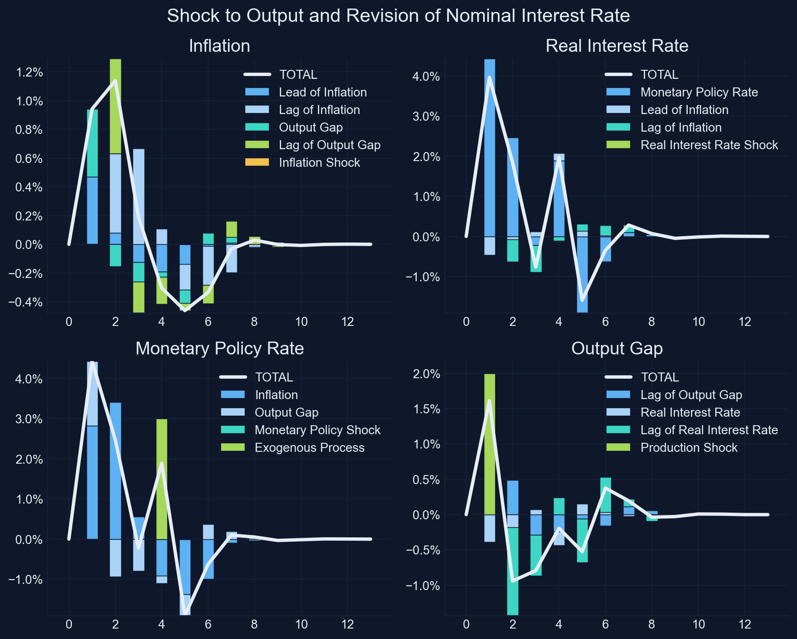

[Replication of Fig. 1 in Goumilevski and Otterson (2025), *JOSS* 10(112), 8197, with Snowdrop's `plotDecomposition` (restyled); Appendix D, Section D.7.]{.source-line}

::: {.notes}
Four panels, one per equation: inflation, the real interest rate, the policy rate, the output gap. In each period, the colored bars are the terms on the right-hand side of that variable's equation; positive above zero, negative below. The white line (TOTAL) is the variable itself, the sum of the bars.

Click to zoom, then read the inflation panel with the room (next slide gives the numbers).
:::

## A contribution chart splits each equation into its terms

::: {.mid-table}
| Period | Lead of inflation | Lag of inflation | Output gap | Lag of output gap | Sum = inflation |
|:------:|:-------:|:-------:|:-------:|:-------:|:-------:|
| 1 | 0.471 | 0.000 | 0.471 | 0.000 | [0.942]{.key} |
| 2 | 0.079 | 0.552 | −0.155 | 0.663 | [1.139]{.key} |
| 3 | −0.126 | 0.667 | −0.134 | −0.218 | 0.190 |
| 4 | −0.191 | 0.111 | −0.037 | −0.188 | −0.304 |
| 5 | −0.138 | −0.178 | −0.093 | −0.051 | [−0.461]{.key} |
| 6 | −0.013 | −0.270 | 0.080 | −0.131 | −0.334 |
:::

[The terms add up to inflation in every period: Snowdrop's `decompose` returns the numbers behind the bars.]{.check .fragment}

::: {.notes}
Inflation's equation (D.7) has five terms: the lead of inflation (p1 π_{t+1}), the lag ((1 − p1) π_{t−1}), the output-gap term, the lagged output-gap term and the inflation shock (zero throughout here, so not shown). In percent.

The check: the sum of the terms equals inflation in every row, to three decimals.
:::

## The paper's chart tells the whole story at a glance

::: {.incremental}
- **period 1:** the boom pushes inflation up through the output gap (0.471) and through expectations of more inflation (0.471)
- the policy rate jumps, the real rate reaches [4%]{.key}, and the output gap turns **negative from period 2**
- **period 2:** inflation peaks at [1.14%]{.key}, carried by its own lag and the lagged boom
- **periods 4–5:** the revision raises the real rate once more and deepens the slump; inflation reaches its low, [−0.46%]{.key}
:::

::: {.notes}
Walk the inflation panel of the chart with these four points. Then ask: which bar would disappear if people did not look forward (p1 = 0)? (The lead of inflation; inflation in period 1 would then rise only through the gap term.)

The point of contribution charts for policy: they answer "why" questions. "Why is inflation negative in period 5?" Because of its own lag (−0.178), the expected future (−0.138) and the slump (−0.093 and −0.051), all set off by the policy revision.
:::

## A real business cycle model: five equations, one household, no frictions

::: {.eqpanel}
$$\frac{1}{C_t}=\beta\,\frac{1+r_t}{C_{t+1}} \qquad\qquad Y_t = C_t + K_t-(1-\delta)K_{t-1}$$
$$Y_t = K_{t-1}^{\gamma}\,A_t^{1-\gamma} \qquad\qquad \gamma\,\frac{Y_{t+1}}{K_t}=r_t+\delta$$
$$\log A_t=\rho\log A_{t-1}+(1-\rho)\log a+\varepsilon_t$$
:::

[Calibration: $\beta = 0.99$, $\gamma = 0.5$, $\delta = 0.03$, $\rho = 0.8$, $a = 0.1$; one period is a quarter; labor is fixed at one.]{.comment}

::: {.notes}
Equations (D.11)–(D.15): Snowdrop's RBC.yaml, the simplest RBC model with a household that chooses how much to save. Chapter 15 described RBC models: an economy without frictions, hit by productivity shocks.

The next slide reads each equation. Note the timing: capital chosen in period t, K_t, produces in t + 1, so production uses K_{t−1}.
:::

## Each equation is a choice, a constraint or a shock

::: {.incremental}
- **Euler equation** (Ch. 16), log utility: give up a unit of consumption today if the return $1+r_t$, discounted by $\beta$, makes up for it
- **resource constraint:** output is consumed or invested; investment $K_t-(1-\delta)K_{t-1}$ builds capital, which depreciates at $\delta$ (Ch. 17)
- **production function** (Ch. 4) with labor-augmenting technology $A_t$
- **demand for capital:** rent capital until its marginal product equals its user cost $r_t+\delta$ (Ch. 17)
- **technology shock:** an AR(1) in logs around the level $a$
:::

::: {.notes}
Map each to the five ingredients of Act I: optimizing households (Euler) and firms (capital demand), constraints (resources, production), shocks (technology). No policy rule: an RBC economy has no money and no central bank.

Ask: which equations are forward-looking? (The Euler equation has C_{t+1}; the capital demand has Y_{t+1}.) Two leads: consumption is a jump variable; capital is predetermined.
:::

## In the steady state nothing moves: four formulas give every value

[Step 1. Euler equation with $C_{t+1} = C_t$: $1 = \beta(1+r)$, so]{.step}
$$r^* = \frac{1}{\beta} - 1$$

. . .

[Step 2. Capital demand with $Y_{t+1} = Y$: the capital–output ratio is]{.step}
$$\frac{K^*}{Y^*} = \frac{\gamma}{r^* + \delta}$$

. . .

[Step 3. Production, written as $Y = (K/Y)^{\gamma/(1-\gamma)} A$ with $A = a$; then the resource constraint:]{.step}
$$Y^* = a\Big(\frac{K^*}{Y^*}\Big)^{\gamma/(1-\gamma)} \qquad C^* = Y^* - \delta K^*$$

::: {.notes}
Equation (D.16) of the appendix. Step 3's rearrangement: Y = K^γ A^{1−γ}; divide both sides by Y^γ: Y^{1−γ} = (K/Y)^γ A^{1−γ}; raise to 1/(1 − γ): Y = (K/Y)^{γ/(1−γ)} A.

In the steady state, investment just replaces depreciation: K_t − (1 − δ)K_{t−1} = δK.
:::

## The steady state by hand: capital is about 12 times quarterly output

```python
beta, gamma, delta, a_level = 0.99, 0.5, 0.03, 0.1
r_star = 1 / beta - 1
KY = gamma / (r_star + delta)
Y_star = a_level * KY ** (gamma / (1 - gamma))
K_star = KY * Y_star
C_star = Y_star - delta * K_star
steady = {"K": K_star, "r": r_star, "A": a_level, "Y": Y_star, "C": C_star}
pd.Series(steady).round(5)
```

::: {.output}
```text
K    15.54638
r     0.01010
A     0.10000
Y     1.24685
C     0.78046
```
:::

::: {.notes}
r* = 1/0.99 − 1 = 0.0101 per quarter (about 4 percent a year). K/Y = 0.5/(0.0101 + 0.03) = 12.47 quarters of output, about 3 years: a plausible capital–output ratio. Y* = 0.1 × 12.47 = 1.247; K* = 15.55; C* = 1.247 − 0.03 × 15.55 = 0.780. Consumption is about 63 percent of output, investment 37 percent (high, because γ = 0.5 is a large capital share).
:::

## Snowdrop's steady-state search stops 0.3% short: use the formula

::: {.mid-table}
| | K | r | A | Y | C |
|----------------------------|:---:|:---:|:---:|:---:|:---:|
| by hand | 15.54638 | 0.01010 | 0.10000 | 1.24685 | 0.78046 |
| Snowdrop's search | 15.58878 | 0.01008 | 0.10000 | 1.24856 | 0.78090 |
| difference, % | [0.27]{.key} | −0.21 | 0.00 | 0.14 | 0.06 |
:::

::: {.incremental}
- the search stops at residuals of about 0.00003, which it treats as small enough
- a model that starts slightly off its steady state **drifts** even when no shock hits
- with the formula's values as starting values, the largest move with no shock is [2.2e−16]{.key}
:::

[When the steady state has a formula, use the formula; then check that a run with no shock stays put.]{.check .fragment}

::: {.notes}
driver.findSteadyStateSolution starts from the starting values in the file (C 0.78046, K 15.5546, Y 1.25, r 0.0101) and searches with Newton's method. It stops 0.27 percent too high for capital.

Why it matters: in a dynamic simulation, a start 0.3 percent off the steady state looks like a small shock, and the model moves back toward the true steady state. That movement would contaminate the impulse responses.

The fix in the notebook: set_values(rbc, "variables", steady); then findSteadyStateSolution returns the formula's values unchanged, and a no-shock run moves by 2.2e−16.
:::

## Technology jumps 10.5% and then fades. What do households do?

[Which jumps more on impact: output or consumption? Does capital jump? What does the interest rate do?]{.question}

[Remember Chapter 16: households smooth consumption, and they know this shock is temporary ($\rho = 0.8$).]{.predict}

::: {.notes}
The file's experiment: a technology shock ε_1 = 0.1 in period 1, so A jumps by e^{0.1} − 1 = 10.5 percent and then returns at the rate ρ = 0.8. After the shock the path is known: perfect foresight, solved by Newton's method.
:::

## Snowdrop's chart of the RBC model after a technology shock {.chart-figure}

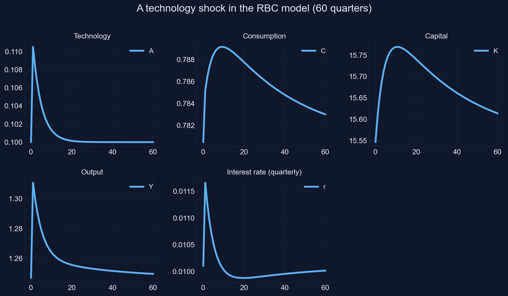

[Chart: Snowdrop's `plot` (restyled) of `RBC.yaml`, a technology shock of 0.1 in period 1, 60 quarters; Appendix D, Section D.8.]{.source-line}

::: {.notes}
Five panels, in levels: capital, the interest rate (quarterly), technology, output, consumption. Point at the shapes: technology and output spike and fade; capital and consumption rise slowly in humps.

Levels hide the sizes: capital around 15.5 and consumption around 0.78 are on different scales. Next: percent deviations.
:::

## Impulse responses: percent deviations from the steady state

::: {.mid-table}
| Quarter | 1 | 2 | 4 | 8 | 16 | 40 |
|-------------------------------------|---:|---:|---:|---:|---:|---:|
| Technology $A$ | 10.52 | 8.33 | 5.25 | 2.12 | 0.35 | 0.00 |
| Output $Y$ | [5.13]{.key} | 4.28 | 3.05 | 1.73 | 0.86 | 0.38 |
| Consumption $C$ | [0.61]{.key} | 0.76 | 0.96 | 1.11 | 1.02 | 0.55 |
| Capital $K$ | 0.38 | 0.67 | 1.07 | 1.39 | 1.35 | 0.74 |
| Interest rate $r$ (points, annual) | 0.62 | 0.47 | 0.25 | 0.02 | −0.09 | −0.06 |
:::

```python
irf = 100 * (tfp / pd.Series(steady) - 1)            # percent deviations from the steady state
irf["r"] = 400 * (tfp["r"] - r_star)                 # percentage points, annual rate
```

::: {.notes}
An impulse response is the path of a variable after one shock, measured relative to where it would have been (here the steady state). The interest rate is in percentage points at an annual rate (400 × the quarterly deviation).

Read across a row: output follows technology down; consumption keeps rising until quarter 8; capital peaks between quarters 8 and 16.
:::

## Output jumps with technology; consumption rises little but stays up {.chart-figure}

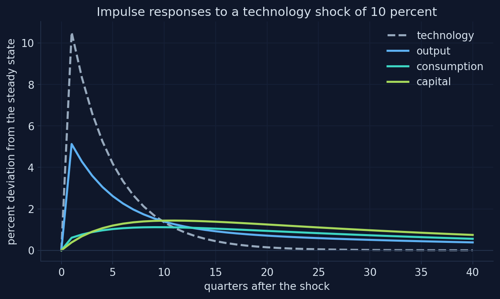

[Chart: impulse responses of our RBC simulation (`RBC.yaml`, steady state by formula); Appendix D, Section D.8.]{.source-line}

::: {.notes}
How to read it: quarters after the shock; percent deviation from the steady state. Dashed gray: technology. Blue: output. Teal: consumption. Green: capital.

Point at the crossing: after about a year and a half, output is below its peak but consumption and capital are still rising.
:::

## Households save most of a temporary windfall

::: {.incremental}
- output jumps [5.1%]{.key}, about half of technology's [10.5%]{.key}: the exponent $1-\gamma = 0.5$
- consumption rises only [0.6%]{.key}: the shock is temporary, so households **smooth** consumption (Ch. 16)
- the rest is **invested**: capital builds up for years (it peaks between quarters 8 and 16) and keeps output and consumption up after technology has returned
- the interest rate rises with the marginal product of capital, then falls **below** its steady state while the extra capital is run down
:::

[The propagation comes from capital: a one-quarter shock has effects for a decade.]{.takeaway .fragment}

::: {.notes}
Answer to the prediction: output jumps far more than consumption; capital does not jump (it is predetermined) but rises from period 1 through investment.

Connect to Chapter 15's critique of RBC models: in this calibration, output's response mostly mirrors technology, and the propagation through capital is modest. Ireland's estimation in Act V asks how important technology shocks really are once other shocks are allowed.
:::

## Twice the shock, twice the response?

[Scale each response of output to a shock of 1%. Do shocks of 1%, 10%, +30% and −30% give the same scaled response?]{.question}

[A linear model answers yes. The RBC model has a power and a ratio. Where would you expect the scaled responses to differ?]{.predict}

::: {.notes}
The experiment: simulate technology shocks ε_1 of 0.01, 0.1, 0.3 and −0.3, compute output's percent deviation, and divide by the shock size in percent. If the model were linear, all four lines would coincide.
:::

## Small shocks scale; large positive and negative shocks do not {.chart-figure}

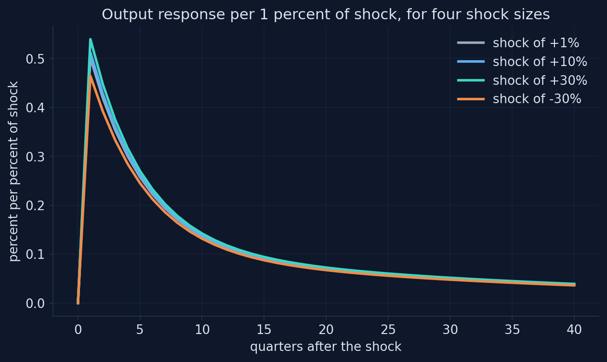

[Chart: output response per 1% of technology shock in `RBC.yaml`, four shock sizes; Appendix D, Section D.8.]{.source-line}

::: {.notes}
How to read it: quarters after the shock; output's percent response per percent of shock. Gray (1%) and blue (10%) lie on top of each other. Teal (+30%) is above them, rust (−30%) below.
:::

## Linear methods serve normal business cycles; big events need nonlinear ones

::: {.incremental}
- for small shocks the scaled responses **coincide**: a linear solution would be accurate
- for ±30% they come apart: technology enters in logs, so $\varepsilon = 0.3$ raises $A$ by [35%]{.key} ($e^{0.3}-1$), while $\varepsilon = -0.3$ lowers it by only [26%]{.key}
- normal business cycles are small, so linear methods serve well for **estimation** (Acts IV and V)
- pandemics, financial crises and the zero lower bound are where nonlinear methods earn their keep
:::

::: {.notes}
Linear solution methods, like Klein's and Dynare's first-order perturbation, replace the model by a straight-line approximation around the steady state. They are fast and they are what the Kalman filter needs (Act IV). The test on this slide is a cheap way to see whether linearization is safe for the shocks you care about.

1 − e^{−0.3} = 0.26.
:::

## Random shocks: one model, ten histories

```yaml
options:
    T : 51
    Npaths : 10
    distribution: !MvNormal
        mean: [0.0, 0.0]
        cov: [[std^2, cov],[cov, std^2]]
```

```python
rbc1 = load_model("RBC1_zero.yaml", anticipate=False)
set_values(rbc1, "variables", steady)
np.random.seed(2026)                                  # the same histories every run
(y, dates), text = quietly(driver.run, model=rbc1, Plot=False, anticipate=False)
print("Shape of the result (paths, periods, variables):", np.shape(y))
```

::: {.output}
```text
Shape of the result (paths, periods, variables): (10, 53, 5)
```
:::

::: {.notes}
RBC1.yaml adds a second shock (to output) and draws both every period from a multivariate normal distribution (!MvNormal), for ten histories (Npaths). The file gives the shocks means of −0.05 and 0.05; the notebook writes a copy, RBC1_zero.yaml, with means of zero, so the shocks only add noise around the steady state.

np.random.seed(2026) fixes the random numbers. The result has three dimensions: 10 paths, 53 periods, 5 variables.

anticipate=False is the subject of the next slide.
:::

## By default, Snowdrop's households know every future shock

["In a stochastic simulation, the model solves each period with the information people have."]{.myth}

[Snowdrop's default solves each history as **one perfect-foresight path**: all random shocks are known in period 1. `anticipate=False` reveals each shock only when it hits.]{.fact .fragment}

::: {.notes}
This connects to the rational-expectations misconception of Act II. With anticipate on, households "know" the whole sequence of future technology draws: consumption jumps once in period 1 to its new permanent level and then drifts, and capital wanders far from its steady state. That is not a business cycle; it is clairvoyance.

anticipate=False makes Snowdrop solve the model period by period and reveal each shock as a surprise. It takes a few seconds longer.
:::

## Ten simulated histories of the same economy {.chart-figure}

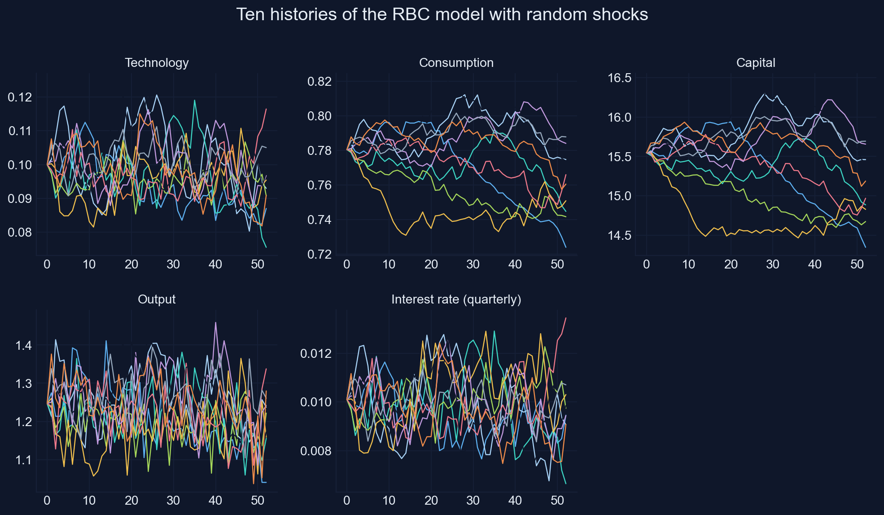

[Chart: Snowdrop's `plot` (restyled) of `RBC1` with zero-mean shocks, ten paths, `anticipate=False`, seed 2026; Appendix D, Section D.8.]{.source-line}

::: {.notes}
Five panels, ten colored lines in each: one per simulated history.

Point at consumption versus output: consumption's lines are much smoother. Capital moves slowly around its steady state.
:::

## A stable economy hit by small random shocks: the DSGE view of the cycle

::: {.incremental}
- the same model, parameters and distribution of shocks produce **ten different histories**
- consumption is much **smoother** than output in every history; capital moves slowly
- this is how DSGE models see business cycles: no cycle is built in; random shocks plus propagation make one
- estimation asks the **reverse question**: given the one history we observed, which parameters make it most likely?
:::

[That question is Acts IV and V.]{.takeaway .fragment}

::: {.notes}
Frisch's (1933) rocking-horse image, which he credited to Wicksell, fits: hit a rocking horse with a stick and it rocks; the shape of the rocking comes from the horse (the model), the timing from the blows (the shocks).

Transition: so far we chose parameters and simulated data. Now we turn it around: take data, and ask which parameters could have generated them.
:::

## Act III formula sheet: simulating three models {.formula-sheet}

| Idea | Formula | In Snowdrop / code |
|---------------------------|---------------------------------------------------|-------------------------------------------|
| AS/AD gap decay | $\lambda = 1/(1+\bar{b}\bar{m}\bar{\nu})$ | `simulate(asad)`; check vs Ch. 13: 0.0e+00 |
| Change an experiment | new starting values, shocks, periods | `set_values`, `model.options[...]` |
| Exogenous path | a planned path, e.g. 0.03 in period 4 | `exog_data` + `getExogenousSeries` |
| Residual check | put the path back into the equations | `checkSolution` (LBJ 3.5e−18, ABLR 0.03) |
| Contribution chart | variable = sum of its equation's terms | `plotDecomposition`, `decompose` |
| RBC steady state | $r^* = 1/\beta - 1$, $K^*/Y^* = \gamma/(r^*+\delta)$, $Y^* = a(K^*/Y^*)^{\gamma/(1-\gamma)}$ | by formula, then `set_values` |
| Impulse response | $100\,(X_t/X^* - 1)$ | `simulate` with one shock |
| Linearity test | response per unit of shock, several sizes | compare scaled paths |
| Random histories | shocks drawn each period, as surprises | `Npaths`, `!MvNormal`, `anticipate=False` |

::: {.notes}
A summary to photograph. Quick round: "Name the three checks we used in this act." (A known answer — Chapter 13; a residual check — checkSolution; a steady state by formula and a no-shock run.)
:::

# From model to data {.divider background-color="#b9770e"}

[Act IV]{.act}

## A solved linear model is a state-space model

::: {.eqpanel}
$$s_t = T\,s_{t-1} + R\,\varepsilon_t \qquad \text{(transition: the model)}$$
$$y_t = Z\,s_t + u_t \qquad \text{(measurement: what the data show)}$$
:::

::: {.incremental}
- $s_t$: the **state**, all the model's variables stacked in a vector; $T$ and $R$ come from the decision rules
- $y_t$: the **observed** data; $Z$ picks which combinations of the state we see
- $u_t$: **measurement errors** (Ireland sets them to zero)
:::

[The first line is the solved model; the second connects it to a spreadsheet of data.]{.takeaway .fragment}

::: {.notes}
Act II solved models for decision rules: variables today as functions of variables yesterday and today's shocks. Stack all variables into s_t and those rules are the transition equation. T is a matrix of coefficients from the solution (not the T of "number of periods"; the notation is standard, sorry).

The measurement equation is new: data are not the model's variables, but some of them, possibly transformed (e.g., output growth instead of the output level) and possibly measured with error.
:::

## In Ireland's model we observe 3 of 7 variables; the filter infers the rest

::: {.columns}
::: {.column width="50%"}
### Observed every quarter
- output growth $g_t$
- inflation $\pi_t$
- the interest rate $r_t$
:::
::: {.column width="50%"}
### Never observed
- the output gap $x_t$ and output $y_t$
- the preference shock $a_t$
- the cost-push shock $e_t$
:::
:::

[The **Kalman filter** does two jobs at once: it infers the unobserved states from the data, period by period, and it computes the **likelihood** of the data, the number that estimation maximizes.]{.takeaway .fragment}

::: {.notes}
Preview of Act V. Ireland's state has seven variables (y, x, r, g, π, a, e); the data have three columns. A central bank faces exactly this problem in real time: it sees GDP growth, inflation and interest rates, and must infer the output gap and the shocks hitting the economy.

We build the filter for the smallest possible case first: one state, one observation.
:::

## The smallest case: an AR(1) state seen through noise

::: {.eqpanel}
$$s_t=\rho\,s_{t-1}+e_t,\quad e_t\sim N(0,\sigma_e^2) \qquad\qquad y_t=s_t+u_t,\quad u_t\sim N(0,\sigma_u^2)$$
:::

```python
rho_true, sig_e, sig_u = 0.9, 1.0, 1.0
T_data = 200
rng = np.random.default_rng(2026)
s_true, y_obs = np.zeros(T_data), np.zeros(T_data)
s_prev = 0.0
for t in range(T_data):
    s_true[t] = rho_true * s_prev + sig_e * rng.normal()    # the state moves with the model
    y_obs[t] = s_true[t] + sig_u * rng.normal()             # we see it with noise
    s_prev = s_true[t]
```

::: {.output}
```text
Standard deviation of the state: 2.00, of the data: 2.25
```
:::

::: {.notes}
Equations (D.17) and (D.18). Think of s_t as the true output gap and y_t as a noisy first estimate of it. Because we simulate, we know the truth and can grade the filter.

np.random.default_rng(2026) creates a random number generator with a fixed seed, so the numbers are the same every time.

The data vary more than the state (2.25 vs 2.00) because noise adds variance: 2.00² + 1² ≈ 2.25².
:::

## Each period the filter predicts, compares and updates

[1. **Predict** the state with the model:]{.step}
$$\widehat{s}_{t|t-1}=\rho\,\widehat{s}_{t-1|t-1} \qquad P_{t|t-1}=\rho^2P_{t-1|t-1}+\sigma_e^2$$

. . .

[2. **Compare** with the data: the forecast error and its variance]{.step}
$$v_t=y_t-\widehat{s}_{t|t-1} \qquad F_t=P_{t|t-1}+\sigma_u^2$$

. . .

[3. **Update**: move toward the data by the Kalman gain $K_t = P_{t|t-1}/F_t$]{.step}
$$\widehat{s}_{t|t}=\widehat{s}_{t|t-1}+K_t\,v_t \qquad P_{t|t}=(1-K_t)\,P_{t|t-1}$$

::: {.notes}
Equations (D.19)–(D.21). Notation: ŝ_{t|t−1} is the best guess of the state before seeing y_t; ŝ_{t|t} after. P is the variance (the uncertainty) of each guess.

Read step 1: the model says the state shrinks by ρ, so the guess does too; uncertainty shrinks by ρ² but a new shock adds σ_e².
Step 2: the data's surprise relative to the guess; its variance is the guess's uncertainty plus the noise.
Step 3: move the guess part of the way toward the data. After updating, uncertainty is smaller: (1 − K) times.

Before the first observation we start from the state's long-run mean (0) and variance, σ_e²/(1 − ρ²). Snowdrop calls this choice Prior="Equilibrium".
:::

## Worked example: the first two periods by hand

::: {.mid-table}
| | Period 1 | Period 2 |
|---------------------------------|:--------:|:--------:|
| Predicted state $\widehat{s}_{t\mid t-1}$ | 0 | $0.9 \times (-0.464) = -0.418$ |
| Its variance $P_{t\mid t-1}$ | $0.81 \times 5.263 + 1 = 5.263$ | $0.81 \times 0.840 + 1 = 1.681$ |
| Data $y_t$ | −0.553 | −1.214 |
| Forecast error $v_t$, variance $F_t$ | −0.553, 6.263 | −0.796, 2.681 |
| Kalman gain $K_t = P_{t\mid t-1}/F_t$ | [0.840]{.key} | [0.627]{.key} |
| Updated state $\widehat{s}_{t\mid t}$ | $0 + 0.840 \times (-0.553) = -0.464$ | $-0.418 + 0.627 \times (-0.796) = -0.917$ |
| Updated variance $P_{t\mid t}$ | 0.840 | 0.627 |
:::

[At first the filter knows little and follows the data closely; as its uncertainty shrinks, the gain falls toward its long-run value of 0.60.]{.takeaway .fragment}

::: {.notes}
The numbers come from the notebook's own data (seed 2026), computed with the equations of the previous slide. The starting variance is the long-run variance 1/(1 − 0.81) = 5.263.

Period 1: before any data, the filter's guess is 0 with a large variance, so it trusts the data: gain 0.84. The true state was −0.793; the filter says −0.464, closer than 0 but cautious.

Period 2: the prediction is 0.9 times the last estimate, with variance 1.681 (much smaller). The gain falls to 0.63. True state −2.610: the filter moves toward it (−0.917) but is still behind; it will catch up over the next periods.

After a few periods the gain settles at 0.60 (with σ_u = 1): the variances stop changing.
:::

## The Kalman gain weighs the model against the data

$$K = \frac{P_{t|t-1}}{P_{t|t-1} + \sigma_u^2}$$

::: {.incremental}
- the model's prediction is **uncertain** ($P$ large) → $K$ near 1: trust the **data**
- the data are **noisy** ($\sigma_u$ large) → $K$ near 0: trust the **model**
- the gain does not depend on the data, only on the variances
:::

[The filter is a weighted average of what the model predicts and what the data say, with weights set by their precision.]{.takeaway .fragment}

::: {.notes}
Same logic as averaging two measurements of the same thing: weight each by its precision (one over its variance). The updated estimate is (1 − K) × prediction + K × data.

Because K depends only on variances, you can compute the whole path of gains before seeing any data (the appendix's Your turn for D.9 does exactly that). The live chart in a few slides changes σ_u and shows the gain fall.
:::

## The likelihood comes for free: one normal density per forecast error

[If the model is right, each forecast error $v_t$ is normal with mean 0 and variance $F_t$. The probability of the whole sample is the product of these densities, so its logarithm is a sum:]{.comment}

$$\log L=-\frac{1}{2}\sum_{t=1}^{T}\Big(\log 2\pi+\log F_t+\frac{v_t^2}{F_t}\Big)$$

::: {.incremental}
- **large surprises** $v_t^2$ relative to their variance lower the likelihood
- a model that claims too much **uncertainty** ($F_t$ large) is punished by $\log F_t$
- period 1 of the worked example adds $-\tfrac{1}{2}\big(\log 2\pi + \log 6.263 + 0.553^2/6.263\big) = -1.86$
:::

::: {.notes}
Equation (D.22). The forecast errors are independent over time (each is the new information of its period), so the joint density of the data is the product of the one-period densities. Logs turn the product into a sum, and keep the number in a range computers handle.

The two penalties pull in opposite directions: a model can avoid large standardized surprises by claiming huge variances, but then log F_t is large. The likelihood rewards a model that predicts well AND knows how well it predicts.

This is the number maximum likelihood maximizes, and the number Snowdrop's filter returns for Ireland's model.
:::

## The whole filter is one short loop in NumPy

```python
def kalman_filter(y, rho, sig_e, sig_u):
    """Filtered states and log-likelihood of the AR(1)-plus-noise model."""
    s_hat = 0.0                                    # the state's mean before any data
    P = sig_e**2 / (1 - rho**2)                    # and its long-run variance
    filtered, loglik = np.zeros(len(y)), 0.0
    for t in range(len(y)):
        s_pred = rho * s_hat                       # 1. predict
        P_pred = rho**2 * P + sig_e**2
        v = y[t] - s_pred                          # 2. compare
        F = P_pred + sig_u**2
        K = P_pred / F                             # 3. update with the Kalman gain
        s_hat = s_pred + K * v
        P = (1 - K) * P_pred
        filtered[t] = s_hat
        loglik = loglik - 0.5 * (np.log(2 * np.pi) + np.log(F) + v**2 / F)
    return filtered, loglik
```

::: {.output}
```text
Log-likelihood at the true parameters: -381.78
Typical error: data 1.07, filtered state 0.76
```
:::

::: {.notes}
Each line maps to one equation of the three steps; the last line of the loop is the likelihood sum. Run on the 200 simulated observations at the true parameters, the log-likelihood is −381.78.

The "typical error" is the standard deviation of (data − truth) and of (filtered − truth): 1.07 and 0.76.
:::

## Will the filtered state be closer to the truth than the data are?

[The data are the truth plus noise. The filter mixes the data with the model's prediction. Which one tracks the true state better?]{.question}

[The typical error of the data is 1.07. Guess the typical error of the filtered state.]{.predict}

::: {.notes}
Some students expect the filter to be worse, because it "lags" the data. It does lag a little, but it removes much of the noise.
:::

## The filter recovers the state from noisy data {.chart-figure}

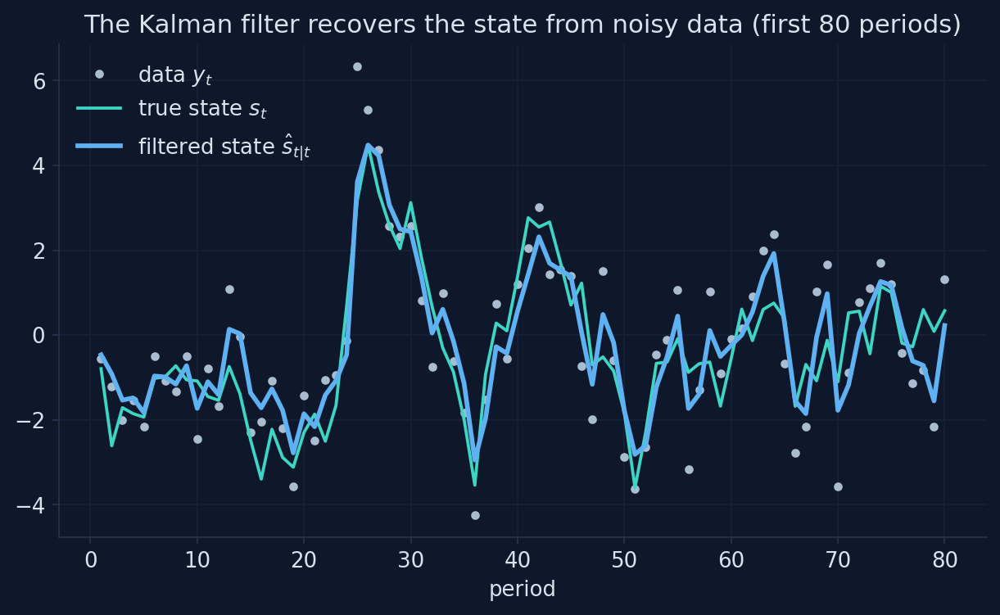

[Chart: our simulation of equations (D.17)–(D.21), $\rho = 0.9$, $\sigma_e = \sigma_u = 1$, first 80 of 200 periods; Appendix D, Section D.9.]{.source-line}

::: {.notes}
How to read it: gray dots are the data; the teal line is the true state (which in real life we never see); the blue line is the filtered state.

Point at a stretch where the dots jump around: the blue line stays close to the teal one.
:::

## Combining the model with the data cuts the error by almost a third

::: {.incremental}
- typical error of the data: [1.07]{.key}; of the filtered state: [0.76]{.key}
- the filter smooths out noise because the model says the state moves **gradually** ($\rho = 0.9$)
- it still reacts to the data, with a gain of about 0.60 per period
:::

[The filter is the best guess of the state given the model and the data so far.]{.takeaway .fragment}

::: {.notes}
Answer to the prediction: 0.76, against 1.07 for the raw data: (1.07 − 0.76)/1.07 ≈ 29 percent smaller.

"Best" in a precise sense: for a linear model with normal shocks, the Kalman filter gives the most accurate estimate (the smallest mean squared error) that uses only data up to period t. The smoother (closing block) also uses later data.
:::

## The data get noisier. How does the filter respond?

[Raise the measurement noise $\sigma_u$ from 1 to 3. What happens to the Kalman gain and to the filtered state?]{.question}

[Does the filter follow the data more closely or less? Does its error rise or fall, and by more or less than the data's error?]{.predict}

::: {.notes}
The appendix's Your turn for D.9. Let the room reason from K = P/(P + σ_u²).
:::

## Noisier data, smaller gain: the filter leans on the model {.live-figure}

<script src="plots/plot4.js"></script>
<div class="live-plot" data-fig="plot4"></div>

[Mini-model built for this deck from equations (D.17)–(D.21) of [Appendix D](https://quarcs-lab.github.io/macro102-site/notebooks/appD-dsge-modeling-with-python.html), with the notebook's simulated state ($\rho = 0.9$, seed 2026) and its measurement noise scaled by $\sigma_u$.]{.source-line}

::: {.notes}
How to read it: the same chart as before, live. The true state (green) never changes; the slider scales the noise in the data (gray dots); the blue line is the filter's estimate. The title reports the gain and the two typical errors.

Do live:
1. σ_u = 1: gain 0.60, errors 1.07 and 0.76 (the notebook's case).
2. σ_u = 3: gain 0.23; the blue line becomes smooth and slow; the dots scatter widely.
3. σ_u = 0.25: gain 0.94; the filter follows the dots, which are nearly the truth.
:::

## The gain falls from 0.94 to 0.23 as the noise rises

::: {.mid-table}
| Noise $\sigma_u$ | 0.25 | 0.5 | 1 | 2 | 3 |
|------------------------------------|:----:|:----:|:----:|:----:|:----:|
| Kalman gain | 0.94 | 0.82 | [0.60]{.key} | 0.35 | [0.23]{.key} |
| Typical error of the data | 0.27 | 0.54 | 1.07 | 2.14 | 3.21 |
| Typical error of the filtered state | 0.26 | 0.47 | 0.76 | 1.07 | 1.26 |
:::

[The noisier the data, the more the filter gains over them: at $\sigma_u = 3$ its error is 1.26 against the data's 3.21.]{.takeaway .fragment}

::: {.notes}
Answer to the prediction: the filter follows the data less (gain 0.23), its estimate becomes smoother, and its error rises (to 1.26) but much less than the data's (3.21).

Policy reading: real-time GDP and output-gap estimates are noisy and revised later. A central bank that knows this should react less to each new release, exactly what a small Kalman gain does.
:::

## With many variables, the scalars become matrices

$$P_{t|t-1}=T\,P_{t-1|t-1}\,T'+R\,Q\,R' \qquad F_t=Z\,P_{t|t-1}\,Z'+H \qquad K_t=P_{t|t-1}\,Z'\,F_t^{-1}$$

$$\log L = -\frac{1}{2}\sum_t\Big(n\log 2\pi+\log\det F_t+v_t'\,F_t^{-1}\,v_t\Big)$$

::: {.incremental}
- $Q$ and $H$ hold the variances of the shocks and of the measurement errors; $n$ is the number of observed series
- the logic is unchanged: predict, compare, update, add up the likelihood
- Snowdrop's `Filter="Durbin_Koopman"` does this, in a fast and numerically careful version
:::

::: {.notes}
Line by line: the predicted state's covariance matrix (the model moves it with T, shocks add R Q R'); the forecast errors' covariance (Z picks the observed part, H adds measurement noise); the gain (a matrix: how much each data surprise moves each state).

For Ireland's model: 7 states, 3 observed series, 4 shocks, H = 0.

Durbin and Koopman (2012) is the reference text. Hamilton (1994), Chapter 13, is a gentler introduction.
:::

## Maximum likelihood: choose the parameters that make the data most probable

$$\widehat{\theta} = \arg\max_{\theta}\ \log L(\theta)$$

::: {.incremental}
- every value of $\theta$ gives a log-likelihood: how probable the observed data would be **if** $\theta$ were the truth
- the **maximum likelihood estimate** is the value that makes the data most probable
- with one parameter we can simply try a grid of values and look
:::

[The recipe: model in state-space form → Kalman filter → log-likelihood → search for its peak.]{.takeaway .fragment}

::: {.notes}
Pretend we do not know ρ in our simulated data. For each candidate ρ, run the filter on the data and record log L. The candidate with the highest log L wins.

Careful with the words: the likelihood is a function of the parameters, with the data held fixed. It is not the probability that θ is true (that is the Bayesian posterior of Act V).
:::

## The true persistence is 0.9. Where does the likelihood peak?

[Run the filter for every $\rho$ between 0.5 and 0.99 on the 200 observations, and plot the log-likelihood.]{.question}

[Will the peak be exactly at 0.9? Above it or below it? How flat will the curve be around its peak?]{.predict}

::: {.notes}
Most students say "exactly 0.9". It cannot be exact: the data are one random sample. The question is how close, and how sure we can be.
:::

## The log-likelihood peaks near the true value {.chart-figure}

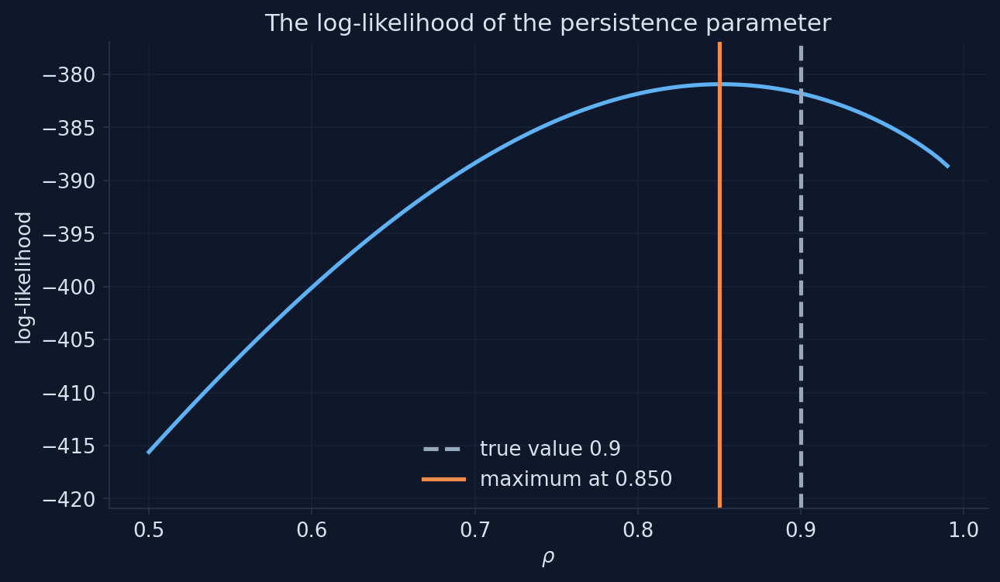

[Chart: log-likelihood (D.22) of our 200 simulated observations on a grid of $\rho$; Appendix D, Section D.10.]{.source-line}

::: {.notes}
How to read it: ρ on the horizontal axis; the log-likelihood on the vertical axis (only the top 40 units shown). Dashed gray: the true value 0.9. Rust: the grid's maximum, 0.85.

Point at the shape: a hill with a rounded top. How sharply it falls on each side tells how precise the estimate is: next slide.
:::

## Curvature measures precision: standard error = 1/√(−curvature)

```python
def negative_loglik_rho(rho):
    filtered_k, ll = kalman_filter(y_obs, rho, sig_e, sig_u)
    return -ll

result = optimize.minimize_scalar(negative_loglik_rho, bounds=(0.01, 0.999), method="bounded")
rho_hat = result.x
h = 1e-4
curvature = -(negative_loglik_rho(rho_hat + h) - 2 * negative_loglik_rho(rho_hat)
              + negative_loglik_rho(rho_hat - h)) / h**2
se = 1 / np.sqrt(-curvature)
```

::: {.output}
```text
Estimate 0.8512, standard error 0.0376
95 percent interval: 0.778 to 0.925 (true value 0.9)
```
:::

::: {.notes}
A steep peak means values away from it are much less likely: a precise estimate. A flat peak means many values fit almost as well. The curvature (second derivative) at the peak measures it, computed numerically from three nearby points (Appendix C's finite differences).

The estimate is 0.8512 with a standard error of 0.0376; the 95 percent interval (± 1.96 s.e.) is 0.778 to 0.925 and contains the true 0.9.

Snowdrop does exactly this for all its parameters at once.
:::

## With a quarter of the data, is the likelihood flatter or steeper?

[Estimate $\rho$ from the first 50 observations instead of 200. What happens to the curve and to the standard error?]{.question}

[Guess the standard error with 50 observations. Hint: precision usually grows with the square root of the sample size.]{.predict}

::: {.notes}
The appendix's Your turn for D.10. The square-root rule: four times the data, half the standard error.
:::

## More data, a sharper peak: the standard error shrinks {.live-figure}

<script src="plots/plot5.js"></script>
<div class="live-plot" data-fig="plot5"></div>

[Mini-model built for this deck from equation (D.22) of [Appendix D](https://quarcs-lab.github.io/macro102-site/notebooks/appD-dsge-modeling-with-python.html) and the notebook's 200 simulated observations (the first 25, 50, 100 or 200).]{.source-line}

::: {.notes}
How to read it: each curve is the log-likelihood minus its own peak, so every curve tops out at 0 and their widths compare directly. Dashed gray: the true 0.9. Rose: the estimate. The title reports the estimate and standard error.

Do live:
1. 200 observations: 0.851 (0.038), a narrow hill.
2. 50: 0.810 (0.081), wider.
3. 25: 0.825 (0.129), very flat: values from 0.6 to 1 are all plausible.
:::

## Four times the data, about half the standard error

::: {.mid-table}
| Observations | 25 | 50 | 100 | 200 |
|------------------------------|:-----:|:-----:|:-----:|:-----:|
| Estimate of $\rho$ (truth 0.9) | 0.825 | 0.810 | 0.830 | [0.851]{.key} |
| Standard error | 0.129 | [0.081]{.key} | 0.054 | [0.038]{.key} |
:::

[Precision grows with the square root of the sample: from 50 to 200 observations the standard error falls from 0.081 to 0.038.]{.takeaway .fragment}

::: {.notes}
Answer to the prediction: about twice as large with 50 observations (0.081 vs 0.038: a factor 2.2).

The estimates also move around (0.81 to 0.85): each sample is random. None is exactly 0.9, and all lie within two standard errors of it.

For DSGE estimation: Ireland's sample has 220 quarters, a long sample by macro standards and still short for many parameters.
:::

## An optimizer finds the peak for all parameters at once

```python
def negative_loglik(theta):
    filtered_k, ll = kalman_filter(y_obs, theta[0], theta[1], theta[2])
    return -ll

result = optimize.minimize(negative_loglik, x0=[0.5, 0.5, 0.5], method="L-BFGS-B",
                           bounds=[(0.01, 0.999), (0.01, 10.0), (0.01, 10.0)])
std_errors = np.sqrt(np.diag(np.linalg.inv(hessian(negative_loglik, result.x))))
```

::: {.columns}
::: {.column width="45%"}
::: {.output}
```text
         true  estimate  std. error
rho       0.9     0.747       0.080
sigma_e   1.0     1.455       0.243
sigma_u   1.0     0.546       0.417
```
:::
:::
::: {.column width="55%"}
- **L-BFGS-B**: SciPy's optimizer with **bounds**, the one Snowdrop uses
- standard errors: square roots of the diagonal of the inverse **Hessian** of $-\log L$
:::
:::

::: {.notes}
optimize.minimize finds a minimum, so we give it minus the log-likelihood. x0 is the starting point (0.5 for every parameter, far from the truth); bounds keep ρ between 0 and 1 and the standard deviations positive.

The Hessian is the matrix of second derivatives (the appendix computes it by central differences with a small helper). With one parameter it is the curvature of the previous slides; with several it also captures how parameters trade off against each other.
:::

## The data cannot tell shocks from noise apart: weak identification

::: {.incremental}
- all three estimates lie within about two standard errors of the truth, but not very close: $\widehat{\rho} = 0.747$, $\widehat{\sigma}_e = 1.455$, $\widehat{\sigma}_u = 0.546$
- the standard error of $\sigma_u$ ([0.417]{.key}) is almost as large as the estimate ([0.546]{.key})
- the data see $y_t = s_t + u_t$: more persistent, smaller shocks plus more noise fit them almost as well as the truth
:::

[A parameter whose standard error is as large as its estimate is **weakly identified**: don't build conclusions on it.]{.takeaway .fragment}

::: {.notes}
Why: with 200 observations, the data cannot tell well how much of the movement in y_t comes from shocks to the state (σ_e) and how much from measurement noise (σ_u). A lower ρ with bigger shocks and less noise produces similar-looking data.

This is a first taste of what Act V meets in Ireland's model: ω and α_x are weakly identified there, and the first optimizer run stops in a different place.
:::

## The maximum likelihood estimate is not the true value

["Maximum likelihood finds the true parameter."]{.myth}

[It finds the value that best fits **this sample**: 0.851 with a standard error of 0.038 when the truth is 0.9. The standard error says how far off it may be.]{.fact .fragment}

::: {.notes}
Another sample from the same model would give another estimate; the standard error measures how much estimates vary from sample to sample. Always report it.

With 50 observations, 0.810 (0.081); estimating all three parameters at once, ρ = 0.747 (0.080). Each is a reasonable estimate; none is 0.9.
:::

## Act IV formula sheet: from model to data {.formula-sheet}

| Idea | Formula | In code / Snowdrop |
|-------------------------|-----------------------------------------------------------|-----------------------------------------|
| State space | $s_t = T s_{t-1} + R\varepsilon_t$, $y_t = Z s_t + u_t$ | `measurement_equations` |
| Predict | $\widehat{s}_{t\mid t-1} = \rho\widehat{s}_{t-1\mid t-1}$, $P_{t\mid t-1} = \rho^2 P + \sigma_e^2$ | `kalman_filter` |
| Compare | $v_t = y_t - \widehat{s}_{t\mid t-1}$, $F_t = P_{t\mid t-1} + \sigma_u^2$ | |
| Update | $K_t = P_{t\mid t-1}/F_t$, $\widehat{s}_{t\mid t} = \widehat{s}_{t\mid t-1} + K_t v_t$ | `Filter="Durbin_Koopman"` |
| Starting point | mean 0, variance $\sigma_e^2/(1-\rho^2)$ | `Prior="Equilibrium"` |
| Log-likelihood | $-\tfrac12\sum(\log 2\pi + \log F_t + v_t^2/F_t)$ | |
| Estimate | $\widehat{\theta} = \arg\max \log L(\theta)$ | `optimize.minimize`, L-BFGS-B |
| Standard error | $1/\sqrt{-\text{curvature}}$; $\sqrt{\text{diag}(H^{-1})}$ for $-\log L$ | Snowdrop's table |

::: {.notes}
A summary to photograph. Quick check: "Data get noisier: does the gain rise or fall?" (Falls.) "Four times the data: what happens to the standard error?" (Roughly halves.)
:::

# Estimating Ireland (2004) {.divider background-color="#c0392b"}

[Act V]{.act}

## Ireland asked how much technology shocks matter once other shocks get a chance

[Real business cycle theory puts technology shocks at the heart of the cycle. In a New Keynesian model where four kinds of shocks compete, how much of the U.S. cycle do they explain?]{.question}

::: {.cards}
::: {.card}
**Preference shock** $a_t$

shifts demand (the IS curve)
:::
::: {.card .violet}
**Cost-push shock** $e_t$

shifts the Phillips curve
:::
::: {.card .green}
**Technology shock** $\varepsilon_{zt}$

moves output's level permanently
:::
::: {.card .rose}
**Policy shock** $\varepsilon_{rt}$

moves the interest-rate rule
:::
:::

::: {.notes}
Ireland, P. N. (2004), "Technology Shocks in the New Keynesian Model", Review of Economics and Statistics 86(4), 923–936. The Snowdrop paper uses this model as its estimation example, and the package ships its model file and data.

The answer, which we read off our estimates later: technology matters, but it is part of the story, not all of it.
:::

## Seven equations: two shocks, an IS curve, a Phillips curve, growth and a policy rule

::: {.eqpanel}
$$a_t=\rho_a\,a_{t-1}+\varepsilon_{at} \qquad\qquad e_t=\rho_e\,e_{t-1}+\varepsilon_{et}$$
$$x_t=\alpha_x\,x_{t-1}+(1-\alpha_x)\,\mathbb{E}_tx_{t+1}-(r_t-\mathbb{E}_t\pi_{t+1})+(1-\omega)(1-\rho_a)\,a_t$$
$$\pi_t=\beta\,[\alpha_\pi\,\pi_{t-1}+(1-\alpha_\pi)\,\mathbb{E}_t\pi_{t+1}]+\psi\,x_t-e_t$$
$$x_t=y_t-\omega\,a_t \qquad\qquad g_t=y_t-y_{t-1}+\varepsilon_{zt}$$
$$r_t-r_{t-1}=\rho_\pi\,\pi_t+\rho_g\,g_t+\rho_x\,x_t+\varepsilon_{rt}$$
:::

[All variables are quarterly deviations from the steady state, in decimals.]{.comment}

::: {.notes}
Equations (D.23)–(D.29) of the appendix. Next slide reads them one by one. Do not derive them here: Galí (2015) is the textbook derivation of the New Keynesian IS and Phillips curves.
:::

## Each equation, read as economics

::: {.incremental}
- **IS curve:** the output gap $x_t$ depends on the expected gap and the real rate (Ch. 11–12); $\alpha_x$ adds a backward-looking part; a preference shock raises demand
- **Phillips curve:** the New Keynesian curve of Act II, with a backward-looking weight $\alpha_\pi$; $-e_t$: a fall in $e_t$ raises inflation
- **output gap** = output minus its efficient level, which moves with the preference shock ($\omega$)
- **growth** $g_t$: the technology shock $\varepsilon_{zt}$ changes the level of output permanently, so it shows up in growth
- **policy rule**, in **changes** of the rate: the Fed raises it when inflation, growth or the gap are high (Ch. 13)
:::

::: {.notes}
The Phillips curve is Act II's x_t = a E_t x_{t+1} + b z_t, with a = β = 0.99, b = ψ = 0.1, a backward-looking term, and the cost-push shock entering with a minus sign (Ireland's convention).

The policy rule in changes means the responses accumulate: a persistent rise in inflation keeps raising the rate quarter after quarter.

β = 0.99 and ψ = 0.1 are fixed; the other twelve parameters are estimated: eight coefficients (ω, α_x, α_π, ρ_π, ρ_g, ρ_x, ρ_a, ρ_e) and four shock standard deviations (σ_a, σ_e, σ_z, σ_r).
:::

## Three U.S. series feed the estimation

[What did U.S. output growth, inflation and interest rates do from 1948 to 2002?]{.question}

::: {.notes}
A plain question slide: ask the room what they expect to see in the 1970s and early 1980s (Chapter 8's Great Inflation and the Volcker disinflation).
:::

## Ireland's data: the United States, 1948–2002 {.chart-figure}

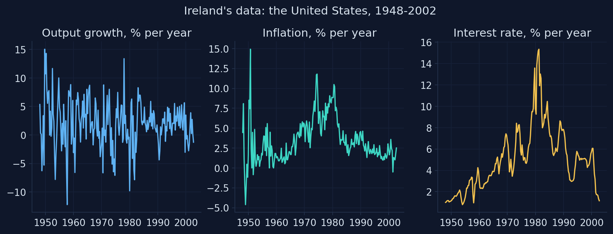

[Data: Ireland (2004), U.S. per-capita real GDP growth, GDP-deflator inflation and the three-month Treasury bill rate, 1948Q1–2002Q4 (Snowdrop's file `gpr_1948.csv`). Chart: Appendix D, Section D.11.]{.source-line}

::: {.notes}
Three panels, in percent per year: output growth (very volatile, especially before 1960), inflation (the hump of the 1970s), the interest rate (rising to its peak around 1980–81, then falling).
:::

## 220 quarters with the Great Inflation and the Volcker disinflation in the middle

::: {.incremental}
- 1948Q1–2002Q4: [220]{.key} quarters; Ireland's own sample ends one quarter later
- averages: output growth [1.94%]{.key}, inflation [3.43%]{.key}, interest rate [5.00%]{.key} a year
- the model uses each series as a **deviation from its mean** (the `obs_` columns), because it describes fluctuations around a steady state
:::

[We observe three series; the model must explain all three with four shocks.]{.takeaway .fragment}

::: {.notes}
The file has two versions of each series: obsg, obspie, obsr are the raw quarterly rates; obs_g, obs_pie, obs_r subtract the sample means. The averages are printed in the notebook at annual rates (400 × the quarterly mean).

There are no measurement errors (Ireland's choice), so the model must match the three series exactly, period by period: with three series and four shocks, it can.
:::

## The model file links the data to the model and lists what to estimate

```yaml
measurement_equations:
    - obs_g   = g   + res_obs_g
    - obs_pie = pie + res_obs_pie
    - obs_r   = r   + res_obs_r

estimated_parameters:
    # NAME,     START, LOWER, UPPER, PRIOR,      PRIOR MEAN, PRIOR S.D.
    - omega,    0.2,   1.e-7, 1,     normal_pdf, 0.20,       0.02
    - rhopie,   0.3,   1.e-7, 1,     normal_pdf, 0.30,       0.1
    - std_epsa, 0.0405, 1.e-7, 1,    normal_pdf, 0.03,       1.80
```

::: {.incremental}
- `measurement_equations`: the data columns equal model variables plus measurement errors (here with standard deviations of zero)
- `estimated_parameters`: name, **starting value**, **bounds**, and the **prior** (used only in the Bayesian part)
:::

::: {.notes}
Three of the twelve lines of estimated_parameters, with a header comment we added. The full list is in the notebook. Shock standard deviations are estimated too, as std_epsa and so on.

Maximum likelihood uses only the first four entries (name, start, lower, upper bound). The last three are the prior; we come back to them, and to their problems, later in this act.

The calibration block of the file holds Ireland's own estimates, and options sets the sample (range, and filter_range for the filter).
:::

## Read every label: the file names Ireland's shocks wrongly

::: {.mid-table}
| Symbol | The file's label | What it is in the equations |
|---------|----------------------------------|------------------------------|
| `a` | "Total Factor Productivity" | the **preference** shock |
| `e` | "Aggregate Technology" | the **cost-push** shock |
| `epsz` | "Shock to Output Gap" | the **technology** shock |
:::

[Labels only name charts, but wrong names mislead: the appendix fixes them in its copy, `ireland.yaml`, and says so.]{.check .fragment}

::: {.notes}
The fourth of the five gaps from Act I. A reader who trusted the labels would read the smoothed "Total Factor Productivity" chart as technology, when it is the preference shock. The equations are what count; read them before the labels.

The notebook fixes eight labels with a few lines of re.sub (regular-expression replacement) and writes ireland.yaml.
:::

## Estimation needs four settings when the model is read

```python
DATA = os.path.join(WORK, "gpr_1948.csv")
ireland = load_model("ireland.yaml", Solver="Klein", Filter="Durbin_Koopman", Smoother="Durbin_Koopman",
                     Prior="Equilibrium", measurement_file_path=DATA)
first_try, out = estimate(ireland, estimate_ML=True)
```

::: {.mid-table}
| Setting | What it does |
|------------------------------|-------------------------------------------------------------------------|
| `Solver="Klein"` | solves the linear model with the generalized Schur method (as IRIS does) |
| `Filter="Durbin_Koopman"` | the Kalman filter of Act IV; estimation works only with this one or `"Non_Diffuse_Filter"` |
| `Smoother="Durbin_Koopman"` | also computes the smoothed variables (without it, `estimate` fails at the end) |
| `Prior="Equilibrium"` | starts the filter from the long-run variance of the state |
:::

::: {.notes}
Careful with the word: Prior="Equilibrium" is the filter's starting point (Act IV's σ_e²/(1 − ρ²)), not a Bayesian prior.

estimate_ML=True maximizes the likelihood, starting from the second column of estimated_parameters. It takes about a minute locally and two in Colab.

The two failure modes in the right column are real: without a smoother, estimate stops with "TypeError: 'NoneType' object is not subscriptable"; with another filter, the estimation does not run correctly. Both are in the common-errors table at the end.
:::

## The optimizer starts from the file's rough values. Will it find Ireland's estimates?

[Snowdrop's file starts the search at $\omega = 0.2$, $\rho_\pi = 0.3$, $\rho_g = 0.2$, … Ireland published $\omega = 0.0617$, $\rho_\pi = 0.3597$, $\rho_g = 0.2536$.]{.question}

[Will maximum likelihood land on Ireland's numbers? If it does not, which run should you believe?]{.predict}

::: {.notes}
This is the hook from the start of the deck. Collect answers. Most students expect the optimizer to find "the" maximum wherever it starts.
:::

## Two starting points, two answers: the second fits the data better

```python
first_try, out = estimate(ireland, estimate_ML=True)              # from the file's rough values
ireland = load_model("ireland_start.yaml", Solver="Klein", Filter="Durbin_Koopman",
                     Smoother="Durbin_Koopman", Prior="Equilibrium", measurement_file_path=DATA)
ml, out_ml = estimate(ireland, estimate_ML=True)                  # from Ireland's published values
```

::: {.mid-table}
| | Iterations | $\omega$ | $\rho_\pi$ | $\rho_g$ | Log-likelihood |
|-------------------------------|:---:|:---:|:---:|:---:|:---:|
| First run: the file's starting values | 57 | 0.193 | 0.301 | 0.211 | 2646.66 |
| Second run: Ireland's values | 14 | [0.062]{.key} | [0.360]{.key} | [0.254]{.key} | [2648.47]{.key} |
| Ireland (2004), Table 1 | | 0.0617 | 0.3597 | 0.2536 | |
:::

[The first run stopped early: on a flat likelihood an optimizer can stop where it no longer finds improvements, and where that is can differ from computer to computer.]{.check .fragment}

::: {.notes}
ireland_start.yaml is ireland.yaml with Ireland's published estimates written into the starting-value column (a few lines of re.sub in the notebook).

Answer to the prediction: from the rough values, no. The second run stays at Ireland's numbers and reaches a higher log-likelihood (2648.47 vs 2646.66), so it is the better estimate: maximum likelihood means the HIGHEST likelihood.

Machine dependence: our Colab test of the first run stopped elsewhere again (ω ≈ 0.16), with a log-likelihood close to the second run's. Numerical details (the computer's linear-algebra library) change where a search stops on a flat surface. The second run gives 2648.47 everywhere.
:::

## Started from Ireland's values, our estimates match his Table 1 {.chart-figure}

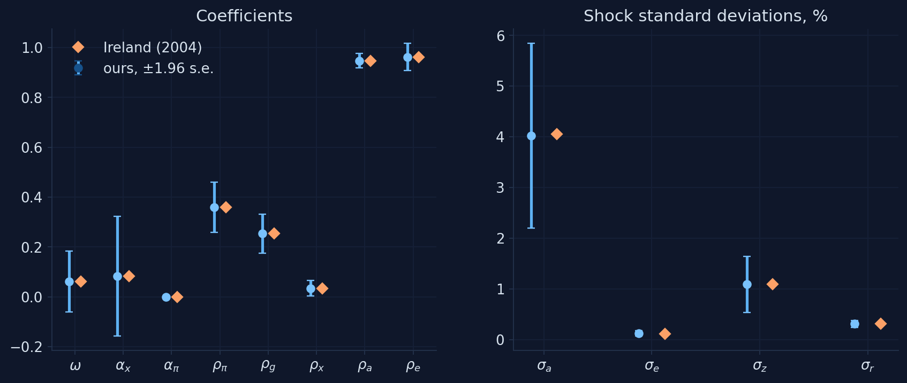

[Chart: our maximum likelihood estimates (Snowdrop, Klein solver, Durbin–Koopman filter) with ±1.96 standard errors, next to Ireland (2004), Table 1; Appendix D, Section D.11.]{.source-line}

::: {.notes}
How to read it: left panel, the eight coefficients; right panel, the four shock standard deviations in percent. Blue dots with bars: our estimates and 95 percent intervals. Orange diamonds: Ireland's estimates.

Point at the wide bars of ω and α_x (weakly identified) and at α_π, a dot with no bar at zero.
:::

## Our estimates reproduce Ireland's almost to the last digit

::: {.dense-table}
| | $\omega$ | $\alpha_x$ | $\alpha_\pi$ | $\rho_\pi$ | $\rho_g$ | $\rho_x$ | $\rho_a$ | $\rho_e$ | $\sigma_a$ | $\sigma_e$ | $\sigma_z$ | $\sigma_r$ |
|----------------|:---:|:---:|:---:|:---:|:---:|:---:|:---:|:---:|:---:|:---:|:---:|:---:|
| Ireland (2004) | 0.0617 | 0.0836 | 0.0001 | 0.3597 | 0.2536 | 0.0347 | 0.9470 | 0.9625 | 0.0405 | 0.0012 | 0.0109 | 0.0031 |
| his s.e. | 0.0634 | 0.1139 | 0.0737 | 0.0469 | 0.0391 | 0.0152 | 0.0250 | 0.0248 | 0.0157 | 0.0003 | 0.0028 | 0.0003 |
| ours | 0.0619 | 0.0836 | 0.0000 | 0.3597 | 0.2536 | 0.0346 | 0.9470 | 0.9626 | 0.0402 | 0.0012 | 0.0109 | 0.0031 |
| our s.e. | 0.0627 | 0.1225 | [0.0000]{.key} | 0.0514 | 0.0396 | 0.0157 | 0.0149 | 0.0275 | 0.0093 | 0.0002 | 0.0028 | 0.0004 |
:::

[Most standard errors are close to Ireland's; two exceptions are worth understanding.]{.takeaway .fragment}

::: {.notes}
The notebook's comparison table (four decimals). The estimates agree to the fourth decimal for almost every parameter.

Standard errors: close for most; ρ_a and σ_a differ by a third or more. Numerical second derivatives are sensitive to the step size, and Ireland's sample has one more quarter. And α_π: next slide.
:::

## A parameter at its bound has no meaningful standard error

::: {.incremental}
- $\alpha_\pi$ sits at its **lower bound**, zero, and Snowdrop reports a standard error of [0]{.key}
- standard errors come from the **curvature** of the likelihood, computed by stepping a little to each side of the estimate
- at a bound one side is off limits, so the calculation **breaks down**
- Ireland reports 0.0737 for his estimate of zero, computed another way
:::

[A standard error of exactly zero is a warning sign, not a sign of precision.]{.check .fragment}

::: {.notes}
What it means economically: the data prefer a purely forward-looking Phillips curve (no weight on past inflation). That is itself a finding, but its uncertainty cannot be read off this table.

Bayesian estimation with a prior that puts no mass exactly at zero (a beta prior) moves α_π off the bound; we will see it later in this act.
:::

## A flat ridge: many parameter values fit the data almost equally well

::: {.incremental}
- the two runs can reach almost the same log-likelihood with **very different** $\omega$ and $\alpha_x$ (Colab: $\omega \approx 0.16$ instead of 0.06)
- Ireland's own standard errors say the same: 0.063 for $\omega = 0.062$; 0.114 for $\alpha_x = 0.084$
- such parameters are **weakly identified**: the data cannot tell them apart
:::

::: {.columns}
::: {.column width="33%"}
[**1. Start from several places**, including published estimates; keep the highest log-likelihood.]{.check}
:::
::: {.column width="33%"}
[**2. Read the standard errors:** one as large as its estimate means "barely identified".]{.check}
:::
::: {.column width="34%"}
[**3. Know your software:** Snowdrop sets the filter's start once, from the starting values.]{.check}
:::
:::

::: {.notes}
Picture the likelihood as a mountain range: a weakly identified parameter is a direction along which the ridge is flat. An optimizer walking uphill reaches the ridge and stops wherever the slope becomes too small to measure.

Habit 3: Prior="Equilibrium" computes the filter's starting variance once, at the starting values, before the search begins. So the likelihood itself depends a little on where you start: one more reason to start near the answer.

Bayesian estimation is the other standard remedy: a prior adds curvature exactly where the likelihood is flat.
:::

## The optimizer's answer is where it stopped, not necessarily the maximum

["The software found the maximum likelihood estimate."]{.myth}

[It found a point where it stopped improving. From the file's starting values it stopped at **2646.66**; from Ireland's values the likelihood reaches **2648.47**.]{.fact .fragment}

::: {.notes}
Numerical optimizers find local maxima (or stop on flat ground) and report success. "Converged" means the steps became small, not that the answer is global. Always compare runs from different starting points.
:::

## The estimates describe a Fed that reacts to inflation and growth

::: {.incremental}
- the rule responds strongly to inflation ($\rho_\pi \approx$ [0.36]{.key}) and output growth ($\rho_g \approx$ [0.25]{.key}), little to the gap ($\rho_x \approx 0.03$); in a rule written in changes, these responses **accumulate**
- preference and cost-push shocks are very **persistent**: $\rho_a$ and $\rho_e$ near 0.95
- the backward-looking weights $\alpha_x$ and $\alpha_\pi$ are small: the data prefer **forward-looking** IS and Phillips curves
:::

::: {.notes}
Reading the policy rule: if inflation rises by 1 point and stays there, the rate rises by 0.36 points this quarter, and again next quarter, and so on. Over a year that is about 1.4 points: more than one for one, consistent with the Taylor principle and with determinacy.

The persistence of the shocks: much of the slow movement in the data is attributed to slow-moving shocks rather than to slow-moving behavior (small α's). This trade-off between persistence in shocks and in behavior is a recurring theme in DSGE estimation.
:::

## What does the estimated model say happened in the 1970s and early 1980s?

[Using the whole sample, the filter's smoother estimates the variables we never observe. What should the cost-push shock and the output gap show around the oil shocks and the Volcker disinflation?]{.question}

::: {.notes}
Remind the room: the smoother uses all 220 quarters for each estimate, unlike the filter, which uses only data up to each quarter.

Hint for the cost-push shock: it enters the Phillips curve with a minus sign, so an inflationary cost shock is a fall in e_t.
:::

## The model reads U.S. history through its shocks {.chart-figure}

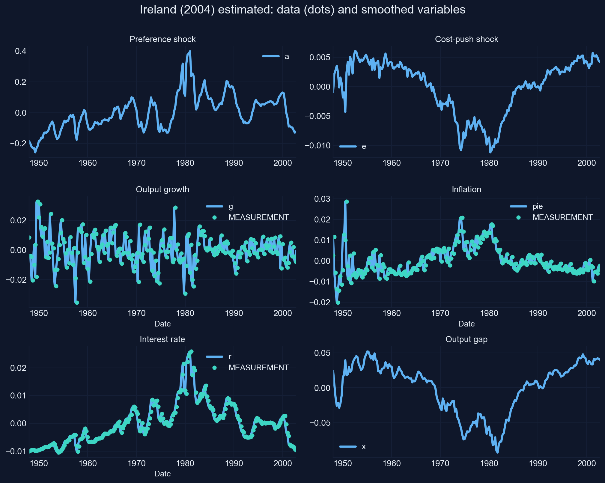

[Chart: Snowdrop's `plot` (restyled) of the smoothed variables of Ireland's model at our maximum likelihood estimates, with the data (dots); Appendix D, Section D.11.]{.source-line}

::: {.notes}
Six panels: output growth, inflation, the interest rate (each with the data as dots, matched exactly because there is no measurement error), then the output gap, the preference shock and the cost-push shock, which we never observe.

Point at the cost-push panel in 1974 and 1979–80, and at the output gap in the early 1980s.
:::

## Oil shocks, a Volcker recession, and a quarter of the cycle from technology

::: {.incremental}
- the cost-push shock **falls sharply in 1974 and 1979–80**: with its minus sign, these are inflationary cost shocks, the two oil shocks
- the output gap is **deeply negative in the early 1980s**, when the Fed raised rates to bring inflation down
- in Ireland's variance decomposition (his Table 2), technology explains **about a quarter** of output growth's forecast-error variance, monetary policy **more than a third**
:::

[Technology shocks are part of the U.S. business cycle, not all of it: Ireland's answer to his question.]{.takeaway .fragment}

::: {.notes}
A large positive preference shock (strong demand) pushed the other way in the early 1980s.

The variance decomposition is Ireland's, not computed in the appendix: it splits the uncertainty of forecasts of output growth by the shock that causes it. Preference and cost-push shocks explain the rest.

Policy reading: the same data that an RBC economist reads as technology, a New Keynesian model reads as a mix of demand, cost and policy shocks. The model you choose shapes the story you tell, which is why estimated models are compared on their fit (the likelihood) and their plausibility.
:::

## Bayes' rule: the posterior is the likelihood times the prior

$$p(\theta\mid y)\;\propto\;p(y\mid\theta)\,p(\theta) \qquad\Longleftrightarrow\qquad \log p(\theta\mid y)=\log L(\theta)+\log p(\theta)+\text{constant}$$

::: {.incremental}
- the **prior** $p(\theta)$ sums up outside evidence before seeing the data
- the **likelihood** $p(y\mid\theta)$ is Act IV's, from the Kalman filter
- the **posterior mode** maximizes the sum: maximum likelihood plus one term, the log of the prior
- example prior for a persistence: a **beta** distribution (it lives between 0 and 1) with mean $m = 0.5$ and s.d. $s = 0.15$: shapes $mk$ and $(1-m)k$ with $k = m(1-m)/s^2 - 1 = 10.1$
:::

::: {.notes}
Equation (D.30). "∝" means "proportional to": the constant that makes the posterior integrate to one does not change where its peak is.

The beta's two shape parameters from a mean and a standard deviation: k = 0.25/0.0225 − 1 = 10.11, so both shapes are 5.06. stats.beta.logpdf(x, a, b) in SciPy is the log of its density.

Back to the AR(1) of Act IV, with only 40 observations, and an economist who believes shocks fade fast: prior mean 0.5, s.d. 0.15.
:::

## A prior says 0.5, the data say 0.815. Where does the posterior land?

[With the first 40 observations, the maximum likelihood estimate of $\rho$ is 0.815. The prior is a beta with mean 0.5 and s.d. 0.15. The truth is 0.9.]{.question}

[Guess the posterior mode. Halfway between, at about 0.66? Closer to the data? Closer to the prior?]{.predict}

::: {.notes}
Ask: which is more precise here, the prior (s.d. 0.15) or the likelihood with 40 observations? From Act IV, 50 observations gave a standard error of 0.081, so 40 give a bit more: the likelihood is narrower than the prior.
:::

## The posterior lies between the prior and the likelihood {.chart-figure}

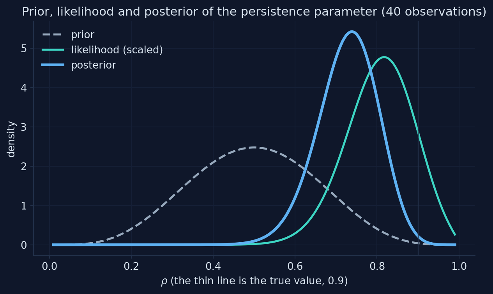

[Chart: prior (beta, mean 0.5, s.d. 0.15), likelihood and posterior of $\rho$ for the first 40 simulated observations, equation (D.30); Appendix D, Section D.12.]{.source-line}

::: {.notes}
How to read it: ρ on the horizontal axis; densities on the vertical axis (the likelihood is scaled to integrate to one, so all three can share the axis). Dashed gray: prior. Teal: likelihood. Blue: posterior. The thin line marks the truth, 0.9.
:::

## The posterior leans toward the more precise source

::: {.incremental}
- maximum likelihood [0.815]{.key}, prior mean [0.5]{.key}, posterior mode [0.740]{.key}
- the likelihood is narrower than the prior, so the data **win most of the argument**
- the prior still pulls the mode down from 0.815
- with more data the likelihood narrows and the prior matters less; where the likelihood is **flat**, the prior **decides**
:::

::: {.notes}
Answer to the prediction: 0.740, closer to the data than halfway (0.66).

The posterior is also narrower than either the prior or the likelihood alone: two sources of information add up.

The last bullet sets up Ireland's model: ω and α_x were weakly identified (flat likelihood). A prior there will decide the estimate.
:::

## What if the prior were tighter, or flat?

[Change the prior's standard deviation from 0.15 to 0.05, then to a flat prior. Where does the posterior mode go?]{.question}

[Predict the mode for a very tight prior (s.d. 0.05) and for a flat one.]{.predict}

::: {.notes}
A flat prior (every value between 0 and 1 equally likely) adds nothing: the posterior mode should equal the maximum likelihood estimate.
:::

## A tight prior drags the estimate; a flat prior leaves it to the data {.live-figure}

<script src="plots/plot6.js"></script>
<div class="live-plot" data-fig="plot6"></div>

[Mini-model built for this deck from equation (D.30) of [Appendix D](https://quarcs-lab.github.io/macro102-site/notebooks/appD-dsge-modeling-with-python.html): the notebook's first 40 observations and beta priors with mean 0.5.]{.source-line}

::: {.notes}
How to read it: the same chart as before, live. The likelihood (green) never changes. The slider sets the prior's standard deviation; the title reports the posterior mode.

Do live:
1. s.d. 0.15: the notebook's case, mode 0.740.
2. s.d. 0.05: the prior is a spike at 0.5, and the posterior mode falls to 0.565.
3. Flat: the prior is a horizontal line, and the posterior coincides with the likelihood (0.815).
:::

## The tighter the prior, the more it decides

::: {.mid-table}
| Prior s.d. | 0.05 | 0.10 | 0.15 | 0.20 | 0.25 | flat |
|-----------------------------|:-----:|:-----:|:-----:|:-----:|:-----:|:-----:|
| Posterior mode of $\rho$ | [0.565]{.key} | 0.670 | 0.740 | 0.780 | 0.805 | [0.815]{.key} |
:::

[A prior is a statement of confidence: the more confident it is, the more the result reflects it rather than the data.]{.takeaway .fragment}

::: {.notes}
Answer to the prediction: 0.565 with s.d. 0.05; 0.815 (the maximum likelihood estimate) with a flat prior.

The lesson for reading Bayesian DSGE studies: look at the prior table. A tight prior on a weakly identified parameter turns the "estimate" into the author's assumption.
:::

## The file's priors are all normal: the posterior mode in one call

```python
ireland = load_model("ireland_start.yaml", Solver="Klein", Filter="Durbin_Koopman",
                     Smoother="Durbin_Koopman", Prior="Equilibrium", measurement_file_path=DATA)
post_file, out_post = estimate(ireland, estimate_Posterior=True)
```

::: {.mid-table}
| | $\omega$ | $\alpha_x$ | $\rho_\pi$ | $\rho_g$ | $\rho_x$ | $\sigma_a$ |
|-------------------------------|:---:|:---:|:---:|:---:|:---:|:---:|
| prior (normal): mean, s.d. | 0.20, 0.02 | 0.10, 0.05 | 0.30, 0.10 | 0.30, 0.10 | 0.25, 0.0625 | 0.03, 1.80 |
| maximum likelihood | 0.062 | 0.084 | 0.360 | 0.254 | 0.035 | 0.040 |
| posterior mode | [0.155]{.key} | 0.110 | 0.348 | 0.276 | 0.070 | [0.025]{.key} |
:::

::: {.notes}
estimate_Posterior=True maximizes log-likelihood plus log-prior, starting from the same values as the maximum likelihood run. Six of the twelve parameters shown; the notebook prints all of them, with posterior standard errors.

The value of the objective at the mode is 2640.56 (log-likelihood plus log-prior). It is not comparable with the maximum likelihood value, because it includes the prior densities.
:::

## Where do the posterior modes land, relative to the priors and the ML estimates?

[For each parameter, compare three things: the prior's shape, the maximum likelihood estimate, and the posterior mode.]{.question}

[Which parameter do you expect the prior to move most: one with a precise likelihood, or a weakly identified one like $\omega$?]{.predict}

::: {.notes}
Students who followed the AR(1) example should say ω: a flat likelihood plus a tight prior (s.d. 0.02 around 0.2).
:::

## The file's normal priors, the ML estimates and the posterior modes {.chart-figure}

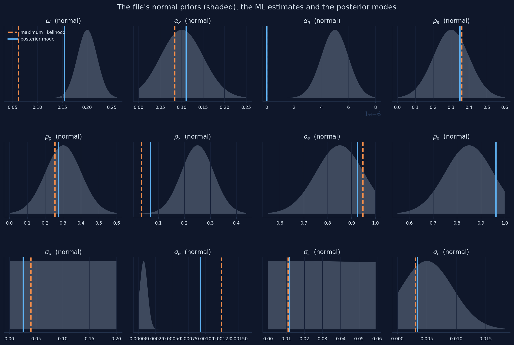

[Chart: Snowdrop's prior densities (`pdf`) from the file `Ireland2004.yaml`, with our ML estimates (dashed) and posterior modes (solid); Appendix D, Section D.12.]{.source-line}

::: {.notes}
Twelve panels, one per parameter. Shaded: the prior density as estimate() evaluates it. Dashed rust: maximum likelihood estimate. Solid blue: posterior mode.

Snowdrop draws prior-versus-posterior charts only for MCMC, so the appendix draws these from Snowdrop's own pdf function.

Point at ω (the posterior mode sits deep inside a narrow prior, far from the ML line), at α_π (a prior squeezed at zero) and at σ_a (a prior so wide it looks flat).
:::

## A tight prior decided ω; a flat one decided nothing

::: {.incremental}
- the prior for $\omega$, normal with s.d. 0.02 around 0.2, pulls it from [0.062]{.key} to [0.155]{.key}
- the prior for $\alpha_\pi$ has mean 0.000005 and s.d. 0.000001: it **nails** $\alpha_\pi$ at zero before any data are seen
- the prior for $\sigma_a$ (s.d. 1.8) is flat over every plausible value, yet $\sigma_a$ falls from 0.040 to 0.025, because $\omega$ moved
:::

[Some of the file's priors are very tight and some very loose: neither choice is explained, and both shape the results.]{.takeaway .fragment}

::: {.notes}
Answer to the prediction: ω moves most, as expected.

Normal priors also put probability on negative values and, for persistence parameters, on values above one, which the model rules out (the bounds then cut the distribution off). The next slides replace them with the shapes DSGE studies usually use.
:::

## Match the prior's shape to the parameter's range

::: {.mid-table}
| Parameters | Range | Usual prior | Our choice (mean, s.d.) |
|------------------------------------------|---------------|------------------|----------------------------------------|
| $\omega$, $\alpha_x$, $\alpha_\pi$, $\rho_a$, $\rho_e$ | between 0 and 1 | **beta** | $\omega$ (0.2, 0.1); $\alpha_x$, $\alpha_\pi$ (0.1, 0.05); $\rho_a$, $\rho_e$ (0.85, 0.1) |
| $\rho_\pi$, $\rho_g$, $\rho_x$ | positive | **gamma** | $\rho_\pi$, $\rho_g$ (0.3, 0.1); $\rho_x$ (0.1, 0.05) |
| $\sigma_a$, $\sigma_e$, $\sigma_z$, $\sigma_r$ | positive, possibly large | **inverse gamma** | mean = s.d. = 0.03, 0.002, 0.01, 0.003 |
:::

[The same mean for $\omega$ (0.2) as the file, but five times wider: the data get a say.]{.takeaway .fragment}

::: {.notes}
This is the convention of Smets and Wouters (2007) and most Bayesian DSGE studies: beta for parameters between 0 and 1, gamma for positive coefficients, inverse gamma for standard deviations (it has a long right tail, so large shocks are not ruled out).

The set builds on the one in Snowdrop's own file distributions.py.
:::

## From a mean and a standard deviation to each distribution's parameters

- **beta:** $k = m(1-m)/s^2 - 1$; shapes $mk$ and $(1-m)k$
- **gamma:** shape $m^2/s^2$, scale $s^2/m$
- **inverse gamma:** use `inv_gamma1_pdf`, the version Dynare uses

```yaml
estimated_parameters:
  - omega,    0.0617, 1.e-7, 1,   beta_pdf,       0.20, 0.10
  - rhopie,   0.3597, 1.e-7, 1,   gamma_pdf,      0.30, 0.10
  - std_epsa, 0.0405, 1.e-7, 0.2, inv_gamma1_pdf, 0.03, 0.03
```

[In this version, `inv_gamma_pdf` and `inv_gamma2_pdf` turn the mean and s.d. into the wrong distribution: plot every prior you use.]{.check .fragment}

::: {.notes}
Snowdrop takes the mean and standard deviation from the file and computes each distribution's own parameters. Example: the gamma prior for ρ_π with mean 0.3 and s.d. 0.1 has shape 9 and scale 0.033.

The fifth gap from Act I: two of the three inverse-gamma variants mis-handle their inputs, so a prior written as "mean 0.03" is not centred there. The chart on the next slides (plotting each prior from Snowdrop's own density function) is how to catch it.

One more detail: a beta prior has almost no density at zero, so α_π starts at 0.05 instead of its ML value 0. The notebook writes the twelve lines into ireland_conventional.yaml.
:::

## With wider, better-shaped priors, how far do the posterior modes move?

[Estimate the posterior mode again with the conventional priors. Compare each mode with the ML estimate and with the prior.]{.question}

[Where will $\omega$ land now: near the ML 0.06, the prior mean 0.2, or in between? Will $\alpha_\pi$ stay at zero?]{.predict}

::: {.notes}
Give the room a minute with the previous slide's table: the ω prior is now beta(0.2, 0.1), five times wider than the file's.
:::

## Conventional priors, the ML estimates and the posterior modes {.chart-figure}

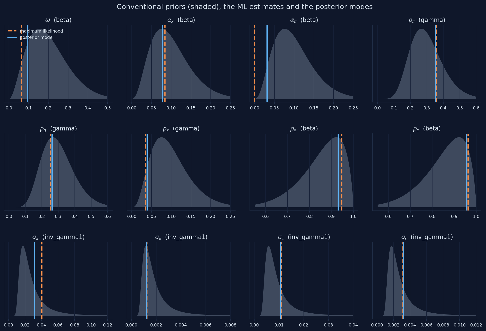

[Chart: our conventional priors (beta, gamma, inverse gamma) from Snowdrop's `pdf`, with our ML estimates (dashed) and posterior modes (solid); Appendix D, Section D.12.]{.source-line}

::: {.notes}
The same layout as before. Now every prior lives on the parameter's own range: the betas between 0 and 1, gammas and inverse gammas on positive values, with long right tails.

Point at ω (the posterior mode lands between the ML line and the prior's peak) and α_π (no longer at zero).
:::

## Three columns of estimates: who decided, the data or the prior?

::: {.dense-table}
| | $\omega$ | $\alpha_x$ | $\alpha_\pi$ | $\rho_\pi$ | $\rho_g$ | $\rho_x$ | $\rho_a$ | $\rho_e$ | $\sigma_a$ | $\sigma_e$ | $\sigma_z$ | $\sigma_r$ |
|------------------------------|:---:|:---:|:---:|:---:|:---:|:---:|:---:|:---:|:---:|:---:|:---:|:---:|
| maximum likelihood | 0.062 | 0.084 | 0.000 | 0.360 | 0.254 | 0.035 | 0.947 | 0.963 | 0.040 | 0.0012 | 0.011 | 0.0031 |
| posterior, file's priors | 0.155 | 0.110 | 0.000 | 0.348 | 0.276 | 0.070 | 0.925 | 0.963 | 0.025 | 0.0009 | 0.012 | 0.0034 |
| posterior, conventional | [0.094]{.key} | 0.078 | [0.031]{.key} | 0.353 | 0.262 | 0.039 | 0.930 | 0.955 | 0.031 | 0.0012 | 0.011 | 0.0032 |
| posterior s.e. / prior s.d. | 0.50 | [0.88]{.key} | 0.38 | 0.40 | 0.37 | 0.24 | 0.17 | 0.24 | 0.19 | [0.10]{.key} | 0.21 | 0.11 |
:::

[A small ratio means the data were informative; a ratio near one means the data said little, and the prior decided.]{.takeaway .fragment}

::: {.notes}
The last row compares the uncertainty after seeing the data (the posterior standard error, conventional priors) with the uncertainty before (the prior standard deviation).

Answer to the prediction: ω lands at 0.094, between the ML estimate (0.062) and the prior mean (0.2); α_π moves off its bound to 0.031.
:::

## Where the data are silent, the prior speaks, and it can move other parameters

::: {.incremental}
- **informative data:** the policy responses $\rho_\pi$, $\rho_g$ barely move; for the shocks and their persistence, the posterior is **a quarter of the prior's width or less**
- **silent data:** for $\alpha_x$ the ratio is [0.88]{.key}: the posterior is hardly narrower than the prior
- **spillovers:** when the file's prior pushes $\omega$ up, $\sigma_a$ falls from 0.040 to 0.025: the data pin down a **combination** of the two
:::

[Always report the priors and compare the posterior with them: a careless prior can decide a result that looks like a finding.]{.takeaway .fragment}

::: {.notes}
Ratios 0.10–0.24 for the persistence parameters and the shock standard deviations.

Spillovers: ω and σ_a both shape how preference shocks enter the model (through the IS curve and the output gap), so the likelihood constrains a combination of them. Push one with a prior and the other adjusts to keep the fit.

The appendix's Your turn for D.12: a tight gamma prior on ρ_π (mean 0.5, s.d. 0.05) pulls ρ_π from about 0.35 to about 0.41, halfway to the prior mean, with a posterior standard error of about 0.03: prior and data both carry information.
:::

## With 220 quarters of data, the prior still matters for some parameters

["With a long sample, the prior washes out; Bayesian and ML estimates are the same."]{.myth}

[Only where the likelihood is curved. Along a flat ridge the prior decides at any sample size: with the file's priors $\omega$ is **0.155**, with conventional priors **0.094**, by ML **0.062**.]{.fact .fragment}

::: {.notes}
The "prior washes out" result is true for parameters the data identify well (the shock standard deviations here). For weakly identified parameters, more data of the same kind may help little, because the ridge stays flat.

Fernández-Villaverde and Guerrón-Quintana (2021) discuss identification problems in estimated DSGE models.
:::

## Act V formula sheet: estimating a DSGE model {.formula-sheet}

| Idea | Formula / rule | In Snowdrop |
|---------------------------|------------------------------------------------------|----------------------------------------------|
| Read the model | `Solver="Klein"`, `Filter="Durbin_Koopman"`, `Smoother="Durbin_Koopman"`, `Prior="Equilibrium"` | `importModel(..., measurement_file_path=...)` |
| Maximum likelihood | $\widehat{\theta} = \arg\max \log L(\theta)$ | `estimate(model, estimate_ML=True)` |
| Several starting points | keep the run with the highest log-likelihood | starting values in `estimated_parameters` |
| At a bound | the standard error is not meaningful | — |
| Bayes' rule | $\log p(\theta\mid y) = \log L(\theta) + \log p(\theta) + c$ | `estimate(model, estimate_Posterior=True)` |
| Beta prior | $k = m(1-m)/s^2 - 1$; shapes $mk$, $(1-m)k$ | `beta_pdf, m, s` |
| Gamma prior | shape $m^2/s^2$, scale $s^2/m$ | `gamma_pdf, m, s` |
| Inverse gamma | Dynare's version | `inv_gamma1_pdf, m, s` |
| Who decided | posterior s.e. / prior s.d.: small = data, near 1 = prior | compare the tables |

::: {.notes}
A summary to photograph. Quick check: "Two runs give different estimates. Which do you report?" (The one with the higher log-likelihood, after trying more starting points.) "What does a ratio of 0.88 tell you?" (The data said almost nothing; the prior decided.)
:::

## Going further: sample the whole posterior, and smooth the shocks

::: {.columns}
::: {.column width="50%"}
### Markov chain Monte Carlo
- report the **whole posterior**, not just its mode
- the **emcee** sampler (Goodman and Weare, 2010) or adaptive Metropolis–Hastings
- `SamplingMethod="emcee"`, then `estimate(..., sample=True)`
- runs take **hours**; check convergence
:::
::: {.column width="50%"}
### The Kalman smoother
- `estimate` also returns the smoothed **shocks**, quarter by quarter
- rebuild history shock by shock: how much of 1980–82 was **policy**?
- start from `kalman_filter` and `plotDecomposition(..., isKF=True)`
:::
:::

::: {.notes}
Both are left out of the appendix on purpose (user decision): they are the natural next steps.

MCMC draws a sequence of parameter values whose distribution approaches the posterior; with Plot=True Snowdrop draws prior and posterior densities and a corner plot of the draws. Herbst and Schorfheide (2016) explain how to check convergence and how many draws are enough.

A historical decomposition is the contribution chart of Act III applied to the data: each quarter's output growth split into the parts due to each shock.
:::

## Bigger models wait in the package, and Snowdrop reads other formats

::: {.mid-table}
| Where (in `supplements/`) | What | Why look |
|--------------------------------|-------------------------------------------------------------|-----------------------------------------|
| `models/COVID19/ert_model.yaml` | the paper's epidemic model (Eichenbaum, Rebelo and Trabandt) | 64 equations, solved by homotopy |
| `models/COVID19/sw_model.yaml` | Smets and Wouters (2007) | the estimated responses of Chapter 15 |
| `models/COVID19/gsw_model.yaml` | the Galí–Smets–Wouters model applied to the lockdowns | a modern medium-scale model |
| `models/MPAF/model.mod`, `model.yaml` | the IMF's basic Quarterly Projection Model, in Dynare and Snowdrop form | compare two toolboxes on one model |
| `docs/UserGuide.pdf`, `docs/NumericalAlgorithms.pdf` | every option; the solvers and filters | the real documentation |
:::

[Read a big model's file first; then simulate it with the tools of Act III. Other Python projects exist too, for example `dolo` and `pydsge`.]{.takeaway .fragment}

::: {.notes}
The paper's epidemic model runs from snowdrop/src/epidemic/ert.py with its data in supplements/data/COVID19. importModel also reads Dynare (.mod) and IRIS model files, so models from the literature can be tried without rewriting them.
:::

## Re-estimate Ireland on today's data in five steps

::: {.incremental}
1. download `GDPC1`, `CNP16OV`, `GDPDEF`, `TB3MS` from FRED (Appendix B)
2. average the monthly series by quarter
3. per-capita growth and inflation (log differences); quarterly rate = annual / 400
4. subtract the means; save `Date`, `obs_g`, `obs_pie`, `obs_r` as a CSV
5. set `range` and `filter_range`; pass the file as `measurement_file_path`
:::

[Two warnings: from 2009 to 2015 the rate was stuck at **zero**, which a linear rule cannot describe; the pandemic quarters of 2020 are huge **outliers**.]{.check .fragment}

::: {.notes}
A good term project: compare the estimates for 1948–2002 with those for a sample that ends in 2008 or 2019, and discuss which parameters move. The zero lower bound and the 2020 outliers are exactly the "big nonlinear events" where Act III said linear methods struggle.
:::

## Common errors, part 1: installing, files and solving

::: {.dense-table}
| What you see | Why | What to do |
|-----------------------------------------------|-----------------------------------------------------------|-----------------------------------------------|
| `ModuleNotFoundError: No module named 'snowdrop'` | Colab forgets installed packages when the runtime restarts | run the install cell again |
| pip tries to build NumPy 1.26 and fails | the install cell lost its `--no-deps` | install exactly as in the setup slides |
| `FileNotFoundError` for a file you just wrote | importing Snowdrop (or its estimation module) moved Python into its folder | `os.chdir(WORK)` |
| a variable named `pi` gives odd results | it clashes with the constant $\pi$ | rename it (`infl`, `pie`) |
| `run(..., irf=True)` fails for a nonlinear model | a limitation of this version | simulate with and without the shock and subtract |
| a simulation drifts with no shock | the starting values are not the steady state | steady state by formula; check residuals of 0.000 |
| random histories look too smooth | Snowdrop anticipates all future shocks by default | `anticipate=False` |
| a plausible-looking path | ABLR leaves out exogenous paths in this version | `checkSolution`; use LBJ |
:::

::: {.notes}
The appendix's table of common errors, first half. Each row was met while building the appendix. Ask students to keep this slide open while they work through the notebook.
:::

## Common errors, part 2: estimating

::: {.dense-table}
| What you see | Why | What to do |
|-----------------------------------------------|-----------------------------------------------------------|-----------------------------------------------|
| nonsense estimates, or "Model calibration failed" | the filter does not support estimation, or a start lies outside its bounds | `Filter="Durbin_Koopman"`; check the bounds |
| `TypeError: 'NoneType' object is not subscriptable` at the end of `estimate` | no smoother was chosen | `Smoother="Durbin_Koopman"` |
| a second estimation lists the `std_` parameters twice | Snowdrop keeps a list between runs | clear `est_shocks_names` (our `estimate` helper does); read the model again |
| estimates change from run to run | the likelihood is flat in some directions | several starting points; keep the highest log-likelihood |
| an inverse-gamma prior with the wrong mean | `inv_gamma_pdf` and `inv_gamma2_pdf` mis-handle their inputs | `inv_gamma1_pdf`; plot every prior |
| `algorithm="..."` changes nothing | Snowdrop uses L-BFGS-B when it computes standard errors | nothing to do |
:::

::: {.notes}
Second half of the appendix's table. The last row is a quirk, not an error: the option is accepted and ignored.
:::

## Why learn DSGE models if they missed the 2008 crisis?

[A skeptic says: "The DSGE models central banks used before 2008 had no banks and no financial crises. Their core assumptions (rational expectations, representative households) are the problem, so learning to estimate them is learning to be wrong precisely."]{.objection}

. . .

[Reply: the criticism of the pre-2008 models is fair and contested in its reach. Defenders show that models now include financial frictions and the zero lower bound (Christiano, Eichenbaum and Trabandt, 2018); critics argue the core assumptions still fail (Stiglitz, 2018); a middle view keeps DSGE models as one tool among several (Blanchard, 2018; Lindé, 2018). Either way, what this deck practices (writing a model down, solving it, confronting it with data and checking every result) is how you find out what a model gets wrong.]{.rebuttal}

::: {.notes}
Present both sides fairly; this is a live debate among macroeconomists, and the policy students should know it.

- Christiano, Eichenbaum and Trabandt (2018, Journal of Economic Perspectives) defend DSGE models and describe how post-crisis models added financial frictions, the zero lower bound and heterogeneity.
- Stiglitz (2018, Oxford Review of Economic Policy) argues that the core assumptions (rational expectations, representative agents, the focus on small shocks around a steady state) are what failed.
- Blanchard (2018, same issue) argues for several classes of models side by side: foundational, DSGE, policy, toy and forecasting models.
- Lindé (2018, same issue) argues DSGE models remain useful for policy analysis, provided they are extended with financial frictions and nonlinearities.

Connect to the deck: Act III showed where linear methods fail (big shocks), and Act V showed where data are silent (flat ridges). Knowing the tools is what lets you see those limits.
:::

## What to remember from this appendix

::: {.incremental}
- **I.** A DSGE model is a list of equations from choices, markets, shocks and policy rules; **solving** it means finding decision rules or a whole path
- **II.** With expectations, many paths satisfy the equations; **Blanchard–Kahn** says when exactly one stays bounded, and **Newton's method** finds it
- **III.** Snowdrop turns a **YAML** file into simulations: it reproduced Chapter 13 exactly, the paper's Fig. 1, and the RBC model's responses, but only checks caught its gaps
- **IV.** The **Kalman filter** turns a state-space model into a **likelihood**; its peak is the estimate and its curvature the precision
- **V.** Ireland's estimates were reproduced only from a second starting point; **priors** decide where the likelihood is flat, so report them
:::

::: {.notes}
One takeaway per act, in the order of the mind map's branches. Ask students which one surprised them most.
:::

## {.recap background-image="figures/mindmap.webp" background-size="contain" background-color="#0f172a"}

::: {.notes}
Walk the five branches in a minute each, clockwise from the top left: Ideas and tools; Solving with expectations; Estimating Ireland (bottom); From model to data; Simulating three models. Then the thesis on the next slide.
:::

## Solve for the one stable path, let the data speak through the filter, let priors speak only where the data are silent, and check every result {.closing background-color="#2d8659"}

[Open the Appendix D notebook in Colab and run every model yourself]{.act}

::: {.notes}
The thesis of the appendix and of the mind map. The habit that runs through it: check every result, against a case you can solve by hand, against the residuals of the equations, against a second starting point, against the published numbers. Research software is powerful, and like any tool it is only as reliable as the checks you run on it.
:::

## Sources: figures, data and software {.sources}

::: {.sources-list}
- **Charts by hand (inflation and the cost shock; stable and exploding paths; the convex term; impulse responses; nonlinearity; the Kalman filter; the log-likelihood; prior, likelihood and posterior).** Our computations in [Appendix D](https://quarcs-lab.github.io/macro102-site/notebooks/appD-dsge-modeling-with-python.html), Sections D.4, D.7–D.10, D.12.
- **Snowdrop's charts (AS/AD events 1–3; RBC after a technology shock; ten random histories; Ireland's smoothed variables).** Snowdrop's `plot`, restyled in the book's colors; Appendix D, Sections D.6, D.8, D.11.
- **Replication of the paper's Fig. 1.** Snowdrop's `plotDecomposition`; Goumilevski and Otterson (2025), Fig. 1; Appendix D, Section D.7.
- **Ireland's data.** U.S. per-capita real GDP growth, GDP-deflator inflation and the three-month Treasury bill rate, 1948Q1–2002Q4, from Ireland (2004), as shipped with Snowdrop (`supplements/data/gpr_1948.csv`).
- **Estimates and priors charts.** Our maximum likelihood and posterior-mode estimates with Snowdrop; Ireland (2004), Table 1; priors from Snowdrop's `pdf`; Appendix D, Sections D.11–D.12.
- **Live mini-models (six).** Built for this deck from equations (D.1)–(D.4), (D.7)–(D.10), (D.17)–(D.22) and (D.30) of Appendix D, with the notebook's parameters and random seeds; they reproduce the notebook's printed numbers.
- **Software.** Snowdrop, commit 47a63b2 of 3 October 2026, [github.com/gumilevskij/Framework](https://github.com/gumilevskij/Framework) (GNU GPL); model files `JLMP98.yaml`, `RBC.yaml`, `RBC1.yaml`, `Ireland2004.yaml`.
- **Book appendix.** [Data Science and Macroeconomic Models, Appendix D: DSGE Modeling with Python](https://quarcs-lab.github.io/macro102-site/notebooks/appD-dsge-modeling-with-python.html).
:::

## Sources: research cited (A–H) {.sources}

::: {.sources-list}
- Blanchard, O. (2018). On the future of macroeconomic models. *Oxford Review of Economic Policy* 34(1–2), 43–54.
- Blanchard, O. J., and Kahn, C. M. (1980). The solution of linear difference models under rational expectations. *Econometrica* 48(5), 1305–1311.
- Burgess, S., et al. (2013). The Bank of England's forecasting platform: COMPASS, MAPS, EASE and the suite of models. Bank of England Working Paper 471.
- Christiano, L. J., Eichenbaum, M. S., and Trabandt, M. (2018). On DSGE models. *Journal of Economic Perspectives* 32(3), 113–140.
- Christoffel, K., Coenen, G., and Warne, A. (2008). The New Area-Wide Model of the euro area. ECB Working Paper 944.
- Clarida, R., Galí, J., and Gertler, M. (2000). Monetary policy rules and macroeconomic stability. *Quarterly Journal of Economics* 115(1), 147–180.
- Del Negro, M., et al. (2013). The FRBNY DSGE model. Federal Reserve Bank of New York Staff Report 647.
- Durbin, J., and Koopman, S. J. (2012). *Time Series Analysis by State Space Methods*, 2nd ed. Oxford University Press.
- Eichenbaum, M., Rebelo, S., and Trabandt, M. (2021). The macroeconomics of epidemics. *Review of Financial Studies* 34(11), 5149–5187.
- Fernández-Villaverde, J., and Guerrón-Quintana, P. A. (2021). Estimating DSGE models: recent advances and future challenges. *Annual Review of Economics* 13, 229–252.
- Frisch, R. (1933). Propagation problems and impulse problems in dynamic economics. In *Economic Essays in Honour of Gustav Cassel*. Allen and Unwin.
- Galí, J. (2015). *Monetary Policy, Inflation, and the Business Cycle*, 2nd ed. Princeton University Press.
- Goodman, J., and Weare, J. (2010). Ensemble samplers with affine invariance. *Communications in Applied Mathematics and Computational Science* 5(1), 65–80.
- Goumilevski, A., and Otterson, J. (2025). Snowdrop: Python package for DSGE modeling. *Journal of Open Source Software* 10(112), 8197. [doi:10.21105/joss.08197](https://doi.org/10.21105/joss.08197)
- Hamilton, J. D. (1994). *Time Series Analysis*. Princeton University Press.
- Herbst, E. P., and Schorfheide, F. (2016). *Bayesian Estimation of DSGE Models*. Princeton University Press.
:::

## Sources: research cited (I–Z) {.sources}

::: {.sources-list}
- Ireland, P. N. (2004). Technology shocks in the New Keynesian model. *Review of Economics and Statistics* 86(4), 923–936.
- Juillard, M., Laxton, D., McAdam, P., and Pioro, H. (1998). An algorithm competition: first-order iterations versus Newton-based techniques. *Journal of Economic Dynamics and Control* 22(8–9), 1291–1318.
- Klein, P. (2000). Using the generalized Schur form to solve a multivariate linear rational expectations model. *Journal of Economic Dynamics and Control* 24(10), 1405–1423.
- Kumhof, M., Laxton, D., Muir, D., and Mursula, S. (2010). The Global Integrated Monetary and Fiscal Model (GIMF): theoretical structure. IMF Working Paper 10/34.
- Laxton, D., Meredith, G., and Rose, D. (1995). Asymmetric effects of economic activity on inflation: evidence and policy implications. *IMF Staff Papers* 42(2), 344–374.
- Lindé, J. (2018). DSGE models: still useful in policy analysis? *Oxford Review of Economic Policy* 34(1–2), 269–286.
- Lucas, R. E. (1976). Econometric policy evaluation: a critique. *Carnegie-Rochester Conference Series on Public Policy* 1, 19–46.
- Smets, F., and Wouters, R. (2007). Shocks and frictions in US business cycles: a Bayesian DSGE approach. *American Economic Review* 97(3), 586–606.
- Stiglitz, J. E. (2018). Where modern macroeconomics went wrong. *Oxford Review of Economic Policy* 34(1–2), 70–106.
- **Textbook.** Jones, C. I. (2024). [*Macroeconomics*, 6th ed.](https://wwnorton.com/books/9781324063612) W. W. Norton (Chapters 12, 13, 15–17, which this appendix builds on).
:::
