## Chapter 15 showed five charts from an estimated model, and could not redraw them

[$-0.20 \to -0.35$]{.bignum}
[GDP after a 1-point rise in the funds rate, in percent: at once, and a year later. Jones (2024) reads about $-0.2$ and $-0.33$ off the Smets–Wouters chart.]{.bignum-label}

. . .

[This deck solves the Smets–Wouters (2007) model in Python and recomputes those charts: same shapes, almost the same numbers. Getting there takes a solver that does not lie, a model file read with care, and the right units.]{.comment}

::: {.notes}
Open with the gap Chapter 15 left. Its notebook could recompute the small labor-market and sticky-price models, but the five charts from the estimated Smets–Wouters model (monetary policy, TFP, government purchases, financial friction) were "not recomputed": they come from a model with 14 equations, 7 shocks and 36 estimated parameters.

The number on the slide is computed in the Appendix I notebook (Section I.6): GDP falls by 0.195 percent in the quarter of the shock and by 0.354 percent in quarter 4. The textbook reads about −0.2 and about −0.33 off its chart.

Ask the room: if you had the model file and a Python package, how would you know that your chart is right? Collect answers; the deck returns to this question again and again (check the residuals, check the units, check the numbers against the paper).
:::

## Four questions, from equations to experiments

::: {.incremental}
- **I. The model, read with care:** what do the 14 equations say, and what does the model file get wrong?
- **II. Solving and checking:** how do we solve it, and how do we know the solution is right?
- **III. Chapter 15's figures recomputed:** monetary policy, TFP, government purchases, a financial friction
- **IV. Which frictions matter?** switch frictions off one at a time and see what changes
:::

[Each block of the model: intuition → equation → its line in the model file → its link to Chapter 15.]{.takeaway .fragment}

::: {.notes}
The four acts are the four branches of the mind map on the title slide. A closing block follows: a Devil's advocate, the common errors, where to go further, and the takeaways.

How the deck works:
- PREDICT cards (blue) come before every impulse response: write down a sign and a shape first.
- CHECK IT cards (teal): a test that a result is right.
- COMMON MISTAKE (red) and IN FACT (green).
- Code panels show the notebook's own code (shortened); OUTPUT panels what it printed.
- Five charts are live: a menu over the seven shocks and four sliders over parameters.

Prerequisites: Chapter 15 and Appendix H (Sections H.1–H.7). Chapters 11–13 for the IS curve, the Phillips curve and the Taylor rule.
:::

## Appendix H built the tools; this appendix uses them on the model central banks use

::: {.columns}
::: {.column width="50%"}
### From Appendix H
- a **model file** in YAML: symbols, equations, values
- **solving** = finding decision rules; Blanchard–Kahn
- Snowdrop: `importModel`, `run`, `checkSolution`
- check every result
:::
::: {.column width="50%"}
### New in Appendix I
- a research model with **14 equations** and **7 shocks**
- a model file that differs from its paper
- a solver that returns a **wrong** answer
- shock **units** to translate before comparing
:::
:::

::: {.notes}
A short bridge for students who did Appendix H. The three models there (AS/AD, JLMP98, RBC, then Ireland 2004) had at most four equations; this one has 37 lines in its file (13 for the sticky economy, 11 for the flexible copy, 9 for shocks, 4 growth rates).

Students who skipped Appendix H: the only ideas needed are "a model file lists the equations", "solving gives decision rules", and "a residual is how far an equation is from holding".
:::

## Setup: Snowdrop at a fixed version, and the model file that ships with it

```python
# Snowdrop at the commit of 3 October 2026, without its old NumPy/SciPy pins
%pip install -q --no-deps "https://github.com/gumilevskij/Framework/archive/47a63b2b780e1876898229c09f7f1e8644462692.tar.gz"
%pip install -q --no-deps particles==0.4 "ruamel.yaml==0.17.21" ruamel.yaml.clib

SUPP = os.path.abspath(os.path.join(os.path.dirname(snowdrop.src.__file__), "..", "..", "supplements"))
SW_FILE = os.path.join(SUPP, "models", "COVID19", "sw_model.yaml")
shutil.copy(SW_FILE, WORK)
```

::: {.output}
```
Size: 19421 bytes, 432 lines
```
:::

::: {.notes}
The same install as Appendix H: a fixed commit, installed without its dependency pins, which would downgrade NumPy and SciPy in Colab. About 20 seconds.

The model file sits in the package's COVID-19 examples folder: its authors used it as the starting point of a pandemic study. That history explains why its numbers differ from the paper (Act I, end).

The notebook also sets a work folder, blocks the GPU library (sys.modules["cupy"] = None) and moves back to its folder after importing Snowdrop, exactly as in Appendix H.3.
:::

# The model, read with care {.divider background-color="#3498db"}

[Act I]{.act}

## Smets and Wouters put all of Chapter 15's pieces into one estimated model

::: {.cards}
::: {.card}
**Households**

like consumption with **habits** (they compare it with last quarter's), dislike work, and set wages that are **sticky**
:::
::: {.card .violet}
**Firms**

rent capital, choose how hard to run it (**utilization**), pay to change investment fast (**adjustment costs**), set **sticky** prices
:::
::: {.card .green}
**Central bank**

sets the interest rate with a **Taylor rule** that looks at inflation and the output gap
:::
::: {.card .amber}
**Seven shocks**

TFP, risk premium, government purchases, investment efficiency, monetary policy, price and wage markups
:::
:::

[Estimated on seven U.S. series, 1966–2004, with the Bayesian method of Appendix H.12.]{.takeaway .fragment}

::: {.notes}
Chapter 15 answered one question at a time: TFP in a Solow model, a labor market with labor supply and demand, sticky wages, sticky prices. Each piece took "consumption as given". Smets and Wouters (2007) put everything in one system, building on Christiano, Eichenbaum and Evans (2005).

The seven observed series: growth of GDP, consumption, investment and the real wage; hours worked; inflation; the federal funds rate.

We do not re-estimate. We take their posterior mode (Table 1 of the paper) and study what the model says. "Estimated" matters for the interpretation: every friction's strength was chosen by the data, not by the modeler.
:::

## Every variable is a percent deviation from the growth path

::: {.incremental}
- $y_t = 0.5$: GDP is **0.5 percent above its trend** in quarter $t$ (the balanced growth path of Ch. 5)
- inflation $\pi_t$ and the interest rate $r_t$: percentage points **per quarter**; × 4 for annual rates
- $E_t x_{t+1}$: what people expect today for next quarter, a **rational** (model-consistent) forecast
- each equation: a **weighted average** of a few variables, weights built from deep parameters
:::

[Log-linear means: first-order conditions approximated around the growth path, with the growth rules of Appendix C.5.]{.takeaway .fragment}

::: {.notes}
This is the single most important convention of the deck: units. Every response we compute is a percent deviation from trend, and the two rates are quarterly in the model. We report them × 4, as the textbook does. Act II comes back to this: a factor of 4 is the most common mistake when comparing responses.

The log-linear equations are what you get from the households' and firms' optimality conditions (Chapter 15's labor supply and labor demand are two of them) after a first-order approximation. The deck does not derive them: Section I.13 of the appendix says where to find the derivations.
:::

## How to read an impulse response

::: {.incremental}
- the horizontal axis: **quarters after the shock**; the shock hits in quarter 1, nothing else ever happens
- the vertical axis: the **difference** from the path without the shock (percent, or points at an annual rate)
- the zero line is "no effect"; a line that returns to zero means the effect has died out
- read three things: the **sign**, the **timing** of the largest effect, and how **long** it lasts
:::

[Every chart in Acts III and IV is read this way: sign, peak, persistence.]{.takeaway .fragment}

::: {.notes}
Chapter 15 introduced impulse responses; this slide fixes the reading routine for the rest of the deck. Ask students to apply it out loud on the first chart of Act III.

A frequent confusion: the vertical axis is not the level of GDP but its deviation from the no-shock path. "−0.35" means GDP is 0.35 percent lower than it would otherwise have been, not that GDP growth is −0.35 percent.
:::

## Sixteen deep parameters, with Smets and Wouters' estimates

::: {.dense-table}
| Symbol | Meaning | File name | Estimate |
|-------------|-----------------------------------------------------------------|---------------------|------------------|
| $\varphi$ | investment adjustment cost | `csadjcost` | 5.49 |
| $\sigma_c$ | risk aversion ($1/\sigma_c$: intertemporal substitution) | `csigma` | 1.40 |
| $h$ | habit: weight of last quarter's consumption | `chabb` | 0.71 |
| $\xi_w$, $\xi_p$ | Calvo: share of wages / prices **not** reset in a quarter | `cprobw`, `cprobp` | 0.74, 0.66 |
| $\sigma_l$ | inverse Frisch elasticity of labor supply | `csigl` | 1.92 |
| $\iota_w$, $\iota_p$ | indexation of wages / prices to past inflation | `cindw`, `cindp` | 0.59, 0.23 |
| $\psi$ | cost of changing utilization (0 to 1) | `czcap` | 0.55 |
| $\Phi$ | fixed costs: 1 + their share of output | `cfc` | 1.61 |
| $r_\pi$, $r_y$, $r_{\Delta y}$ | Taylor rule: inflation, output gap, its change | `crpi`, `cry`, `crdy` | 2.03, 0.08, 0.22 |
| $\rho$ | interest-rate smoothing | `crr` | 0.82 |
| $\alpha$ | capital share | `calfa` | 0.19 |
:::

::: {.notes}
The table to keep open during Act I. Each equation that follows uses a few of these.

Also fixed rather than estimated: depreciation δ = 0.025 per quarter (ctou), the wage markup λw = 1.5, government purchases at 18 percent of GDP, and the curvature of goods and labor markets εp = εw = 10. Trend growth γ̄ = 0.43 percent a quarter (1.73 percent a year), and β̄ = 0.16 for the discount factor.

Quick reading of the Calvo numbers: ξp = 0.66 means two thirds of prices are not reset in a given quarter, so a price lasts 1/(1 − 0.66) ≈ 3 quarters on average. Wages last about 4 quarters.
:::

## Calvo in one number: how long does a price or a wage last?

$$\text{average duration} = \frac{1}{1-\xi} \text{ quarters}$$

::: {.mid-table}
| | Share **not** reset each quarter | Average duration |
|--------------------|------------------------------|--------------------------|
| prices, $\xi_p = 0.66$ | two thirds | about **3 quarters** |
| wages, $\xi_w = 0.74$ | three quarters | about **4 quarters** |
:::

[The estimates were chosen by the data: wages are stickier than prices.]{.takeaway .fragment}

::: {.notes}
1/(1 − 0.6563) = 2.9 quarters; 1/(1 − 0.7375) = 3.8 quarters.

The Calvo device: each quarter, a random share 1 − ξ of firms (or households, for wages) may reset. Those that cannot reset index to past inflation (ιp, ιw). Nobody knows how long their price will last, so those who reset look ahead: that is where expected inflation enters the Phillips curves.

Act IV moves both: ξp from 0.66 to 0.1, and ξw from 0.74 to 0.3.
:::

## Five blocks, fourteen equations

::: {.mid-table}
| Block | Equations | What it decides | Chapter 15 link |
|------------|---------------------------------------------------------|------------------------------------|---------------------------|
| Demand | resource constraint, consumption, investment, value of capital | how GDP is spent | $Y = C + I + G$, Euler (Ch. 16) |
| Supply | production, utilization, capital accumulation, demand for capital | how GDP is produced | Cobb–Douglas, Solow |
| Prices | marginal cost, Phillips curve | inflation | sticky prices |
| Wages | marginal rate of substitution, wage Phillips curve | the real wage | labor supply, sticky wages |
| Policy | Taylor rule on the output gap | the interest rate | Ch. 12 rule |
:::

[Plus seven shock processes and a flexible-price copy of the real side, used to measure potential output.]{.takeaway .fragment}

::: {.notes}
The map of Act I and the first branch of the mind map ("14 equations in 5 blocks"). Read each row: the block, its equations, what it pins down, and where students met the idea before.

The file has 37 equations in all: 13 for the sticky economy (it plugs the wage markup into the wage equation, so the paper's 14 become 13 lines), 11 for the flexible copy, 9 for the shock processes and 4 that define growth rates. Snowdrop solves them all at once.
:::

## Demand (1): GDP is consumption, investment, purchases and the cost of utilization

::: {.eqpanel}
$$y_t = c_y\,c_t + i_y\,i_t + z_y\,z_t + \varepsilon^g_t \tag{I.1}$$
:::

::: {.incremental}
- the national income identity $Y = C + I + G$ in percent deviations: each part weighted by its **share of GDP**
- $c_y \approx 0.65$, $i_y \approx 0.17$; $z_y z_t$: what it costs to run capital harder
- the spending shock $\varepsilon^g_t$ is measured in **percent of GDP**
:::

```yaml
y = ccy*c+ciy*inve+g + crkky*zcap
```

::: {.notes}
Students know this identity from Chapter 2. The only new term is the cost of utilization: running machines harder uses up resources.

The shares come from the model's steady state, which Snowdrop computes from the deep parameters when it reads the file: ccy = 0.6469, ciy = 0.1731 (printed in the notebook, I.4). Close to U.S. data.

Units of g: a shock of 1 means purchases rise by 1 percent of GDP, about 5.5 percent of purchases themselves (purchases are 18 percent of GDP). That matters in Act III, when we compute the multiplier.
:::

## Demand (2): consumption leans on last quarter's, next quarter's, and the real rate

::: {.eqpanel}
$$c_t = c_1\,c_{t-1} + (1-c_1)\,E_t c_{t+1} + c_2\,(l_t - E_t l_{t+1}) - c_3\,(r_t - E_t\pi_{t+1} + \varepsilon^b_t) \tag{I.2}$$
:::

$$c_1 = \frac{h/\gamma}{1+h/\gamma} = 0.415 \qquad\qquad c_3 = \frac{1-h/\gamma}{\sigma_c\,(1+h/\gamma)} = 0.122$$

[A higher real rate $r_t - E_t\pi_{t+1}$ makes saving more attractive, so people consume less today.]{.takeaway .fragment}

::: {.notes}
Read the equation term by term:
- c1 c_{t−1}: habits. Last quarter's consumption pulls today's.
- (1 − c1) E_t c_{t+1}: the permanent-income Euler equation of Chapter 16. Without habits (h = 0), c1 = 0 and consumption today equals expected consumption tomorrow, less the real-rate term.
- c2 (l − E l): a small link between consumption and hours, because utility does not separate them when σc ≠ 1.
- c3 (real rate + risk premium): the interest-rate channel.

The two numbers are printed in the notebook (I.3). c3 = 0.122 means: a 1-point rise in the quarterly real rate lowers consumption by only 0.12 percent on impact, before the effects that build up through expected future consumption.
:::

## Habits make consumption sluggish, and less sensitive to the interest rate

::: {.columns}
::: {.column width="50%"}
### Without habits ($h = 0$)
- $c_1 = 0$: no pull from the past
- $c_3 = 1/\sigma_c = 0.72$
- consumption jumps at once when rates move
:::
::: {.column width="50%"}
### With $h = 0.71$
- $c_1 = 0.415$: the past pulls
- $c_3 = 0.122$
- consumption moves slowly and in a **hump**
:::
:::

[Act IV tests this: with weaker habits, consumption falls more, and sooner, after a monetary tightening.]{.takeaway .fragment}

::: {.notes}
1/σc = 1/1.3952 = 0.717. With habits, the same real rate moves consumption about six times less on impact.

Why a hump: households dislike changing consumption fast relative to what they are used to, so they adjust a little each quarter.

Habits were added to these models (Christiano, Eichenbaum and Evans 2005) precisely because the data show hump-shaped consumption responses to monetary shocks.
:::

## The risk premium: a wedge between the funds rate and the rate households face

::: {.incremental}
- $\varepsilon^b_t$ is added to the real rate in (I.2): households borrow and save at **more** than the funds rate
- it is the **financial friction** of the textbook's last Smets–Wouters chart
- the file writes it as $b_t = -c_3\,\varepsilon^b_t$, with a plus sign: a **rise** in the premium is a **negative** `b`
:::

```yaml
c = (chabb/cgamma)/(1+chabb/cgamma)*c(-1) + (1/(1+chabb/cgamma))*c(+1) + ...*(lab-lab(+1))
    - (1-chabb/cgamma)/(csigma*(1+chabb/cgamma))*(r-pinf(+1)) + b
```

::: {.notes}
Read the file's line against (I.2). The coefficient on (r − pinf(+1)) is exactly c3. The risk premium does not appear multiplied by c3: the file folds c3 into the shock and calls the product b, and adds it instead of subtracting it.

So b = −c3 εb. A rise in the premium of x points per quarter is a shock b = −c3 x = −0.122 x. Act III needs this to compare with the textbook (the dashed and solid lines of the financial-friction chart).

The file's own header warns about the rescaling; the sign is something you find by reading the equation.
:::

## Demand (3): investment rises with the value of capital, slowly

::: {.eqpanel}
$$i_t = \frac{1}{1+\bar{\beta}\gamma}\left(i_{t-1} + \bar{\beta}\gamma\,E_t i_{t+1} + \frac{1}{\gamma^2\varphi}\,q_t\right) + \varepsilon^i_t \tag{I.3}$$
:::

::: {.incremental}
- $q_t$: the **value of installed capital** (Tobin's $q$, Ch. 17)
- adjustment cost $\varphi = 5.49$: the larger it is, the less investment reacts to $q_t$
- $i_{t-1}$ and $E_t i_{t+1}$: firms spread changes in investment over time
- $\varepsilon^i_t$: the **investment-specific** shock (how efficiently investment goods become capital)
:::

```yaml
inve = (1/(1+cbetabar*cgamma))*(inve(-1) + cbetabar*cgamma*inve(1)+(1/(cgamma**2*csadjcost))*pk) + qs
```

::: {.notes}
β̄γ = 0.9924 × 1.0043 ≈ 0.997, so 1/(1 + β̄γ) ≈ 0.5: today's investment is about the average of last quarter's and next quarter's, plus a small q term.

The coefficient on q is 1/(γ²φ(1 + β̄γ)) ≈ 1/(5.49 × 2.0) ≈ 0.09: a 1 percent rise in the value of capital raises investment by only about 0.09 percent at once. That is what an adjustment cost means.

Act IV moves φ from 2 to 10 with a slider and watches investment.
:::

## Demand (4): the value of capital falls when the real rate rises

::: {.eqpanel}
$$q_t = -(r_t - E_t\pi_{t+1} + \varepsilon^b_t) + q_1\,E_t r^k_{t+1} + (1-q_1)\,E_t q_{t+1} \tag{I.4}$$
:::

::: {.incremental}
- owning capital pays its rental rate $r^k$ and its resale value; a bond pays the real rate
- **arbitrage**: the two must pay the same, so a higher real rate lowers $q_t$
- $q_1 = r^k_*/(r^k_* + 1 - \delta)$: the share of rent in the return on capital
:::

[Real rate ↑ → value of capital ↓ → investment ↓ through (I.3): the investment channel of the IS curve (Ch. 11).]{.takeaway .fragment}

::: {.notes}
This is an asset-pricing equation. Rolling it forward, q_t is the expected discounted sum of future rental rates minus future real rates. So the whole expected path of rates matters, not just today's rate. That is why interest-rate smoothing matters so much in Act IV.

The risk premium also enters here: a financial friction raises the cost of funds for capital too.

File: pk = -r+pinf(1) + (1/c3)*b + (crk/(crk+(1-ctou)))*rk(1) + ((1-ctou)/(crk+(1-ctou)))*pk(1). Note the (1/c3)*b: with b = −c3 εb, (1/c3) b = −εb, exactly the −εb of (I.4). Dividing by c3 undoes the rescaling.
:::

## Supply (1): Cobb–Douglas production with fixed costs

::: {.eqpanel}
$$y_t = \Phi\left(\alpha\,k^s_t + (1-\alpha)\,l_t + \varepsilon^a_t\right) \tag{I.5}$$
:::

::: {.incremental}
- capital services $k^s_t$ and hours $l_t$, with the capital share $\alpha = 0.19$, as in Chapters 4 and 15
- $\varepsilon^a_t$: **TFP**, Chapter 15's $\bar{A}$, in percent
- $\Phi = 1.61 > 1$: output must also cover **fixed costs**, so 1 percent more inputs give more than 1 percent more output
:::

```yaml
y = cfc*(calfa*k+(1-calfa)*lab +a)
```

::: {.notes}
The log-linear version of Y = A K^α L^(1−α) minus a fixed cost. With fixed costs, the percent change of output is Φ times the percent change of "gross" output.

Consequence: a 1 percent TFP shock raises output by Φ = 1.61 percent if inputs did not move. In Act III, GDP rises by 0.73 percent at once after a 1 percent TFP shock: less than 1.61 because hours fall at first.

Note the capital share 0.19: lower than the usual one third, because of the fixed costs and the way the model treats capital income.
:::

## Supply (2): firms can run their capital harder before they have more of it

::: {.eqpanel}
$$k^s_t = k_{t-1} + z_t \qquad\qquad z_t = \frac{1-\psi}{\psi}\,r^k_t \qquad\qquad r^k_t = w_t + l_t - k^s_t$$
:::

::: {.incremental}
- **capital services** = installed stock × how intensively it runs (utilization $z_t$)
- firms run capital harder when renting it pays more; $\psi = 0.55$ sets how costly that is
- cost minimization fixes what firms spend on capital relative to labor
:::

[Utilization lets output respond to shocks before the capital stock moves.]{.takeaway .fragment}

::: {.notes}
Files: k = kp(-1)+zcap; zcap = (1/(czcap/(1-czcap)))*rk; rk = w+lab-k.

The third equation: with Cobb–Douglas, spending on capital (r^k K) over spending on labor (W L) is a constant, α/(1 − α). In logs: r^k + k = w + l, rearranged.

In Act III, after a monetary tightening GDP falls 0.35 percent at the trough but hours only 0.23 percent: the difference is lower utilization (−0.14 percent in quarter 4, printed in the notebook's IRF table).
:::

## Supply (3): capital accumulates as in the Solow model

::: {.eqpanel}
$$k_t = (1-i_k)\,k_{t-1} + i_k\,i_t + i_k\,(1+\bar{\beta}\gamma)\,\gamma^2\varphi\,\varepsilon^i_t \tag{I.6}$$
:::

::: {.incremental}
- $i_k = 1 - (1-\delta)/\gamma = 0.029$: the investment–capital ratio per quarter
- the law of motion of capital of **Chapter 5**, in percent deviations
- the last term adds the investment-specific shock
:::

[The paper has the factor $(1+\bar{\beta}\gamma)$; the file does not. More on that in two slides.]{.takeaway .fragment}

::: {.notes}
cikbar = 0.0292 is printed in the notebook (derived values).

Read it as the Solow model: K_{t+1} = (1 − δ) K_t + I_t, divided by trend growth and log-linearized. Only 3 percent of the capital stock is new each quarter, so capital moves slowly: in Act III it peaks about seven years after a TFP shock.

The investment-specific shock enters twice: in (I.3), where it raises investment, and here, where it makes each unit of investment produce more capital.
:::

## Prices: the New Keynesian Phillips curve

::: {.eqpanel}
$$mc_t = \alpha\,r^k_t + (1-\alpha)\,w_t - \varepsilon^a_t \tag{I.7}$$

$$\pi_t = \frac{1}{1+\bar{\beta}\gamma\iota_p}\left(\bar{\beta}\gamma\,E_t\pi_{t+1} + \iota_p\,\pi_{t-1} + \kappa_p\,mc_t\right) + \varepsilon^p_t \tag{I.8}$$
:::

::: {.incremental}
- marginal cost: a weighted average of the rental rate and the real wage, **less TFP**
- each quarter a firm resets its price with probability $1-\xi_p$; the others index to past inflation ($\iota_p$)
- $\varepsilon^p_t$: the **price markup** shock
:::

::: {.notes}
A firm that can reset looks ahead, because its price may be stuck for a while: hence E_t π_{t+1}. Firms that cannot reset raise their price with past inflation: hence ι_p π_{t−1}.

The slope κp (next slide) sets how strongly marginal cost moves inflation.

Files: mc = calfa*rk+(1-calfa)*w - a and pinf = (1/(1+cbetabar*cgamma*cindp))*(cbetabar*cgamma*pinf(1) + cindp*pinf(-1) + kappa_p*mc) + spinf (the file writes κp out in full).

Note that TFP lowers marginal cost directly: in Act III, inflation falls by 0.48 points at once after a TFP shock.
:::

## The same Phillips curve as Chapter 13, with expectations and a slope set by stickiness

::: {.columns}
::: {.column width="50%"}
### Chapter 13
$$\pi_t = \pi_{t-1} + \bar{\nu}\,\widetilde{Y}_t + \bar{o}$$

- past inflation
- the output gap
- a shock $\bar{o}$
:::
::: {.column width="50%"}
### Smets–Wouters
$$\kappa_p = \frac{(1-\xi_p)(1-\bar{\beta}\gamma\xi_p)}{\xi_p\left((\Phi-1)\varepsilon_p + 1\right)}$$

- past inflation (indexation)
- **marginal cost**
- the markup shock $\varepsilon^p$
- and **expected** inflation
:::
:::

[Sticky prices ($\xi_p$ near 1) make $\kappa_p$ small: marginal cost moves prices only slowly.]{.takeaway .fragment}

::: {.notes}
Put the two side by side and match the terms. The new ingredient is expected inflation: firms that reset prices look ahead.

The slope: with ξp → 1 (prices never reset), κp → 0. With ξp → 0, κp grows large and inflation tracks marginal cost almost one for one.

Act IV's first slider moves ξp from 0.1 to 0.8 after a TFP shock.
:::

## Wages (1): the marginal rate of substitution is Chapter 15's labor supply curve

::: {.eqpanel}
$$mrs_t = \sigma_l\,l_t + \frac{1}{1-h/\gamma}\left(c_t - \frac{h}{\gamma}\,c_{t-1}\right) \tag{I.9}$$
:::

::: {.incremental}
- the wage at which a household is **just willing** to work one more hour
- more hours → leisure is more valuable ($\sigma_l l_t$)
- more consumption → extra income is less valuable: labor supply shifts **in** when consumption rises
:::

[The wealth effect on labor supply of Chapter 15, written as one equation.]{.takeaway .fragment}

::: {.notes}
σl = 1.92, the inverse of the Frisch elasticity: hours respond to the wage with an elasticity of about 0.5, holding consumption fixed.

The consumption term uses habit-adjusted consumption, c_t − (h/γ) c_{t−1}.

This equation explains two results of Act III: hours fall at first after a TFP shock (households feel richer and consume more), and hours rise after a government purchases shock (households feel poorer, future taxes).
:::

## Wages (2): sticky wages close the gap to the MRS only slowly

::: {.eqpanel}
$$\begin{aligned} w_t = {} & w_1\,w_{t-1} + (1-w_1)\left(E_t w_{t+1} + E_t\pi_{t+1}\right) - w_2\,\pi_t + w_3\,\pi_{t-1} \\ & + \kappa_w\,(mrs_t - w_t) + \varepsilon^w_t \end{aligned} \tag{I.10}$$
:::

::: {.incremental}
- $-w_2\,\pi_t$: the **nominal** wage moves slowly, so the real wage falls when inflation rises
- $\kappa_w(mrs_t - w_t)$: the labor market is **off** its labor supply curve for a while
- $\xi_w \to 0$: $\kappa_w$ becomes very large and the real wage stays on the labor supply curve
- $\varepsilon^w_t$: the **wage markup** shock
:::

::: {.notes}
Weights: w1 = 1/(1 + β̄γ) ≈ 0.5, w2 = (1 + β̄γ ιw)/(1 + β̄γ), w3 = ιw/(1 + β̄γ). κw has the same form as κp, with ξw and the wage markup.

Read it as Chapter 15's sticky wage. There, the nominal wage was fixed for a period, so a monetary expansion lowered the real wage and raised employment. Here every household resets its wage with probability 1 − ξw = 0.26 a quarter.

Act IV: with more flexible wages (ξw = 0.3), a monetary tightening lowers the real wage by 0.43 percent instead of 0.14.
:::

## Policy: a Taylor rule on the output gap, with smoothing

::: {.eqpanel}
$$\begin{aligned} r_t = {} & \rho\,r_{t-1} + (1-\rho)\left(r_\pi\,\pi_t + r_y\,(y_t - y^p_t)\right) \\ & + r_{\Delta y}\left[(y_t - y^p_t) - (y_{t-1} - y^p_{t-1})\right] + \varepsilon^r_t \end{aligned} \tag{I.11}$$
:::

::: {.incremental}
- **smoothing** $\rho = 0.82$: the rate moves only partway toward its target each quarter
- the **output gap** compares GDP with $y^p_t$: GDP of the same economy with **flexible** prices and wages
- it also responds to the **change** in the gap ($r_{\Delta y} = 0.22$)
- $\varepsilon^r_t$: the **monetary policy shock**, the part of the rate the rule does not explain
:::

::: {.notes}
Compare with the Chapter 12 rule: the rate responds to inflation and output. Three changes: smoothing, a model-based output gap, and a response to its change.

Long-run response to inflation: rπ = 2.03, well above 1 (the Taylor principle). Response to the gap: small, 0.08.

File: r = crpi*(1-crr)*pinf + cry*(1-crr)*(y-yf) + crdy*(y-yf-y(-1)+yf(-1)) + crr*r(-1) + ms. The yf in the file is the flexible-price GDP of the next slide.
:::

## Potential output is GDP in a flexible-price copy of the same economy

::: {.columns}
::: {.column width="50%"}
### The flexible economy
- equations (I.1)–(I.6) again, for `yf`, `cf`, `labf`, `wf`, …
- marginal cost fixed; the real wage **equals** the MRS
- the same seven shocks
:::
::: {.column width="50%"}
### What it keeps
- habits
- investment adjustment costs
- variable utilization
:::
:::

[It removes the **nominal** frictions only, which makes it a ready-made experiment for Act IV.]{.takeaway .fragment}

::: {.notes}
This is the meaning of "potential output" from Chapter 9, made precise: what GDP would be if prices and wages were flexible, given the same shocks.

Students often assume potential output is a smooth trend. Here it moves with every real shock: after a TFP shock potential output rises at once.

In Act IV, the flexible economy answers a Chapter 15 question: do hours fall after a TFP shock only because prices are sticky? (No: hours fall by 0.43 percent in the flexible economy too.)
:::

## "Potential output is a smooth trend"

["Potential output is a smooth trend line through GDP."]{.myth}

[In this model, potential output is GDP of the flexible economy, and it moves with every real shock: after a TFP shock it rises at once. The output gap $y_t - y^p_t$ can shrink while GDP rises.]{.fact .fragment}

::: {.notes}
Chapter 9 measured potential output with a smooth trend (a filter). The model's definition is different: what GDP would be with flexible prices and wages, given today's shocks.

Policy consequence: after a TFP shock, GDP rises, but potential output rises more, so the output gap is negative and the Taylor rule eases. A central bank using a smooth trend would tighten instead. This is one reason output gaps are contested in practice.
:::

## Shocks: seven AR(1) processes, two with a moving-average twist

::: {.eqpanel}
$$\varepsilon^x_t = \rho_x\,\varepsilon^x_{t-1} + \eta^x_t \tag{I.12}$$
:::

::: {.mid-table}
| Shock | Persistence | Note |
|--------------------------|------------------|------------------------------------------------------------|
| TFP | $\rho_a = 0.96$ | half-life 16.5 quarters: Chapter 15's "4 years" |
| Government purchases | $\rho_g = 0.98$ | also moves with TFP surprises, $\rho_{ga} = 0.53$ |
| Risk premium | $\rho_b = 0.18$ | dies out fast |
| Monetary policy | $\rho_r = 0.13$ | dies out fast |
| Price / wage markups | $0.90$ / $0.97$ | plus a moving-average term: $-\mu\,\eta_{t-1}$ |
:::

::: {.notes}
η is a surprise; ρ sets how long the shock lasts. The same process as Chapter 15's equation (1).

The half-life is printed in the notebook: log(0.5)/log(0.9588) = 16.5 quarters.

The spending process moves with TFP surprises because the model counts net exports in G, and in the data they move with productivity. So a TFP shock of 1 percent also raises purchases by 0.53 percent of GDP.

The moving-average term on the markups lets a markup surprise fade fast even though the process is persistent.
:::

## Act I in one table: the equations to know {.formula-sheet}

| Block | Equation | Key parameter (estimate) |
|------------------|------------------------------------------------------------------------------|---------------------------|
| Resource constraint | $y = c_y c + i_y i + z_y z + \varepsilon^g$ | $c_y = 0.65$, $i_y = 0.17$ |
| Consumption | $c_t$ from $c_{t-1}$, $E_t c_{t+1}$ and the real rate + premium | habit $h = 0.71$ |
| Investment | $i_t$ from $i_{t-1}$, $E_t i_{t+1}$ and $q_t$ | adjustment cost $\varphi = 5.49$ |
| Value of capital | $q_t$: future rents less real rates | $\delta = 0.025$ |
| Production | $y = \Phi(\alpha k^s + (1-\alpha) l + \varepsilon^a)$ | $\Phi = 1.61$, $\alpha = 0.19$ |
| Price Phillips curve | $\pi_t$ from $E_t\pi_{t+1}$, $\pi_{t-1}$, marginal cost | Calvo $\xi_p = 0.66$ |
| Wage Phillips curve | $w_t$ closes the gap to the MRS slowly | Calvo $\xi_w = 0.74$ |
| Taylor rule | $r_t$ from $r_{t-1}$, $\pi_t$, $y_t - y^p_t$ | $\rho = 0.82$, $r_\pi = 2.03$ |

::: {.notes}
A summary to photograph before the second half of Act I: reading the model file.

Quick round: ask a student which parameter makes consumption hump-shaped (h), which one makes investment slow (φ), and which one makes inflation react little to marginal cost (ξp). These are the three sliders of Act IV.
:::

## The model file comes from a COVID-19 project, not from the paper

[A model file in a package is research software: written for one project, shared, and not checked against your purposes. Read it before you trust it.]{.comment}

::: {.incremental}
- its header: it follows the published replication files, **updated by Pfeifer**
- it **rescales** the risk premium ($b = c_3 \times$ the paper's shock, with a flipped sign)
- it notes that equation (8) of the paper is coded **without** the factor $(1+\bar{\beta}\gamma)$
- some priors in the code differ from the paper's tables
:::

::: {.notes}
The file's header is printed in the notebook (I.4). Its authors wrote it for exactly this purpose: to warn users. Four things in the header, and four more found by reading the rest.

The equation-(8) slip was noticed by Del Negro and Schorfheide (2012). The published code has the same slip, so the published estimates were computed with it.

Also: the file has Windows line endings (\r\n). Harmless here, but the notebook normalizes them before editing the text.
:::

## Every one of its 29 values differs from the published estimates

::: {.dense-table}
| Parameter | In the file | Smets–Wouters estimate |
|----------------------------|-------------|------------------------|
| `csadjcost` ($\varphi$) | 6.01 | 5.49 |
| `chabb` ($h$) | 0.64 | 0.71 |
| `cprobp` ($\xi_p$) | 0.60 | 0.66 |
| `cindp` ($\iota_p$) | 0.47 | 0.23 |
| `crpi` ($r_\pi$) | 1.49 | 2.03 |
| `constebeta` ($\bar{\beta}$) | 0.742 | 0.161 |
| `crhoa` ($\rho_a$) | 0.998 | 0.959 |
| `crhob` ($\rho_b$) | 0.58 | 0.18 |
| `crhoms`, `crhopinf`, `crhow`, `cmap`, `cmaw` | 0 | 0.13, 0.90, 0.97, 0.74, 0.89 |
:::

[29 of 29 differ: the file is the starting point of another project, not a copy of the paper.]{.takeaway .fragment}

::: {.notes}
A selection of the notebook's full comparison table (I.4), which prints all 29.

The last row is telling: the file's authors switched off the two markup processes and the persistence of the monetary shock. Fine for their project; wrong for reproducing the paper.

Act IV (the closing experiment) shows the consequence: with the file's numbers, a monetary shock lowers GDP by 0.59 percent at the trough instead of 0.35.
:::

## Three more things to know before using the file

::: {.incremental}
- **The discount factor is set twice.** `constebeta` = 0.742 gives $\beta = 0.9926$, but the file also sets `cbeta: 0.9995`
- **The growth rates start at the trend**, although they are deviations: residuals of 0.398 in four equations
- **The estimation block does not load:** no starting-value column, a typo `BETA_PD`, so `importModel` stops
:::

::: {.output}
```
cbeta in the file: 0.9995   1/(1+constebeta/100) = 0.9926
A line of the estimation block: crhoms,     0.01,.9999,BETA_PD.5,0.20
```
:::

::: {.notes}
Each one is found by reading, not by running.

The error message when you load the file as shipped: "could not convert string to float: 'inv_gamma_pdf'". It points at the estimation block, not at the line with the typo, so it is confusing. We do not estimate, so we remove the block.

The growth rates dy, dc, dinve, dw: the file gives them the starting value "ctrend", but in the model's equations they are deviations from trend, so their steady state is 0. Snowdrop's report shows the residuals; we set them to 0.
:::

## The missing factor: what Del Negro and Schorfheide found

::: {.columns}
::: {.column width="50%"}
### The paper, equation (8)
$$\ldots + i_k\,(1+\bar{\beta}\gamma)\,\gamma^2\varphi\,\varepsilon^i_t$$
:::
::: {.column width="50%"}
### The file (and the published code)
$$\ldots + i_k\,\gamma^2\varphi\,\varepsilon^i_t$$
:::
:::

```python
FIX = [("cikbar*cgamma**2*csadjcost*qs",
        "cikbar*(1+cbetabar*cgamma)*cgamma**2*csadjcost*qs"),          # sticky economy
       ("(cikbar)*(cgamma**2*csadjcost)*qs",
        "(cikbar)*(1+cbetabar*cgamma)*(cgamma**2*csadjcost)*qs")]       # flexible economy
```

[We restore the factor in both economies. It multiplies only the investment-specific shock, so only that shock's responses change, by about 2 percent.]{.takeaway .fragment}

::: {.notes}
The factor (1 + β̄γ) ≈ 2, so the coded shock enters capital accumulation with half the weight the paper writes down.

Why the fix changes so little: the estimates were computed with the slip, so the estimated size of the investment shock partly absorbs it. The notebook (I.12) prints the investment response at its peak: 3.129 percent corrected, 3.169 as published; GDP 0.581 against 0.569. Every other shock's responses are identical.

Lesson for students: a code slip in a published model is not unusual. Replication files are where you find it.
:::

## Our corrected copy: write the file from a dictionary, for any parameter values

```python
def write_sw(values=None, fixed=True, file="sw_ours.yaml"):
    d = yaml.safe_load(text)
    d.pop("estimated_parameters")                      # Snowdrop cannot read it
    d["calibration"].update(SW_MODE)                   # the published estimates
    d["calibration"]["cbeta"] = "1/(1+constebeta/100)" # beta follows constebeta
    for name in ["dy", "dc", "dinve", "dw"]:
        d["calibration"][name] = 0                     # deviations start at 0
    d["calibration"].update(values or {})              # our own changes, if any
    if fixed:                                          # restore (1 + beta*gamma) in (I.6)
        ...
    yaml.safe_dump(d, open(os.path.join(WORK, file), "w"), sort_keys=False, width=10_000)

def load_sw(values=None, fixed=True, solver="AndersonMoore", file="sw_ours.yaml"):
    model, report = quietly(driver.importModel, fname=write_sw(values, fixed, file), Solver=solver)
    return model
```

::: {.notes}
Five changes, all in one function: the published estimates, β linked to constebeta, growth rates starting at 0, no estimation block, the corrected equation. The `...` stands for the text replacement of the previous slide, with an assert that each replacement happens exactly once.

SW_MODE is a dictionary of the 29 values from the paper's posterior mode (the replication's mode file, usmodel_mode.mat), typed into the notebook.

Why write a new file for each change instead of changing a parameter in the loaded model: next slide.
:::

## Change a parameter by writing the file again, not by editing the loaded model

[Snowdrop computes the derived values (`cbetabar`, `ccy`, `ciy`, `crkky`, `cikbar`) **once**, when it reads the file.]{.comment}

::: {.output}
```
37 variables, 7 shocks, 41 parameters
Derived values: {'cbetabar': 0.9924, 'ccy': 0.6469, 'ciy': 0.1731, 'crkky': 0.1928, 'cikbar': 0.0292}
```
:::

["I changed `chabb` in the loaded model, so habits changed everywhere."]{.myth .fragment}

[The weights $c_1$, $c_3$ and the steady-state shares were computed from the old value. Write the file again: `load_sw({"chabb": 0.4})`.]{.fact .fragment}

::: {.notes}
A trap that produces no error message: the model solves, the chart looks fine, and the answer mixes old and new parameter values.

This is why every experiment in Act IV calls load_sw with a dictionary of changes. Each call writes a new YAML file and reads it again: a fraction of a second for this model.
:::

# Solving and checking {.divider background-color="#8e44ad"}

[Act II]{.act}

## Solving the model means finding its decision rules

[Every variable today as a **linear** function of the state (last quarter's variables) and today's shocks, with the Blanchard–Kahn condition checking that exactly one stable solution exists.]{.comment}

$$\underset{\text{37 variables today}}{x_t} \;=\; \underset{\text{decision rules}}{F}\; \underset{\text{last quarter}}{x_{t-1}} \;+\; \underset{\text{impact}}{G}\; \underset{\text{7 shocks}}{\eta_t}$$

[Snowdrop finds $F$ and $G$ for a linear model in a fraction of a second. It has several solvers, and they do **not** all agree.]{.takeaway .fragment}

::: {.notes}
Recall Appendix H.4: with expectations in the equations, many paths satisfy them; Blanchard–Kahn says when exactly one stays bounded. The decision rule has no expectations in it: it is a plain formula in things known today.

Once F and G are known, an impulse response is just repeated multiplication: x_1 = G η, x_2 = F x_1, x_3 = F x_2, and so on.

Snowdrop's linear solvers: Anderson–Moore, Binder–Pesaran, Klein, Villemot (Dynare's method). In Appendix H we used Klein for Ireland's model without trouble.
:::

## From decision rules to an impulse response, step by step

[Step 1. The shock hits in quarter 1: $x_1 = G\,\eta$ (one entry of $\eta$ is the shock, the others are 0).]{.step}

[Step 2. No more shocks: $x_2 = F\,x_1$, $\;x_3 = F\,x_2$, …]{.step}

[Step 3. Read one entry of $x_t$, quarter by quarter: that is the impulse response of one variable.]{.step}

$$x_t = F^{\,t-1}\,G\,\eta$$

[Stable solution: every root of $F$ inside the unit circle, so $F^{\,t-1} \to 0$ and every response returns to zero.]{.takeaway .fragment}

::: {.notes}
The same steps as Appendix H's one-equation model, now with 37 variables: F is a 37 × 37 matrix.

Snowdrop's run does exactly this when we give it one shock in period 1 (model.options["periods"] = [1]).

Why responses can be hump-shaped although F only multiplies: with lags of several variables feeding each other, a product of matrices can first grow, then shrink. The hump in consumption comes from habits (c_{t−1}) interacting with slowly moving rates.
:::

## Four solvers, one model: which answer do you trust?

[We solve the same model, with the same parameters, with Klein's solver (Appendix H's choice for Ireland) and with Anderson–Moore's. Both return a solution without an error message.]{.question}

[Both charts of consumption after a monetary tightening look smooth and plausible. How would you decide which one is right, without knowing the answer?]{.predict}

::: {.notes}
Let students propose tests. Good answers: put the solution back into the equations (residuals); compare with the published figure; try a third solver; solve a special case by hand.

The habit of Appendix H: check every result. Next slide: the residual test.
:::

## Put the solution back into every equation: only one solver passes

::: {.output}
```
                largest residual  consumption, quarter 4
Anderson-Moore      1.249001e-15               -0.349709
Klein               2.061187e-02               -0.030078
```
:::

::: {.incremental}
- Anderson–Moore: residuals of $10^{-15}$, rounding error
- Klein: residuals of **0.02**, and a consumption response **a tenth** of the right one
- Binder–Pesaran agrees with Anderson–Moore; Villemot's solver finds no solution here
:::

[The Klein chart looks fine. Only the residuals show that it is wrong.]{.check .fragment}

::: {.notes}
Snowdrop's checkSolution puts a simulated path back into every equation and returns the residuals. A correct solution leaves only rounding error.

A residual of 0.02 sounds small, but the responses themselves are of order 0.1–0.5: the error is of the same size as the answer.

Why Klein fails here: we did not track it down; this version of Snowdrop's Klein routine does not handle this model (it worked for Ireland's). For students: you do not need to know why a solver fails to know that it failed. (Villemot stops Python with "unable to find solution"; LBJ and ABLR fall back to Villemot.)
:::

## The residual check in code

```python
def max_residual(model, shock, size):
    """The largest equation residual along a simulated path."""
    shocks = model.symbols["shocks"]
    values = [0.0] * len(shocks); values[shocks.index(shock)] = size
    model.options["periods"] = [1]; model.options["shock_values"] = [values]
    (y, dates), report = quietly(driver.run, model=model, Plot=False)
    errors = checkSolution(model, periods=model.options["periods"], y=np.asarray(y))
    return float(np.max(np.abs(np.asarray(errors))))

sw_klein = load_sw(solver="Klein", file="sw_klein.yaml")
```

::: {.notes}
Three Snowdrop calls: importModel (inside load_sw), run (simulate one shock in period 1) and checkSolution (residuals). quietly is the notebook's helper that hides Snowdrop's printed messages.

The solver is chosen when the file is read: Solver="AndersonMoore" or "Klein" in importModel.
:::

## "Every solver solves the model; they differ only in speed"

["Every solver solves the model; they differ only in speed."]{.myth}

[A solver can return a wrong answer with no warning. Check the residuals of every new model, and compare with a published number when you have one.]{.fact .fragment}

::: {.notes}
The first branch of Act II in the mind map: "Anderson–Moore: residuals 10^−15; Klein: 0.02".

This is a general lesson about research software. Snowdrop is peer-reviewed (JOSS), widely capable, and still has a routine that fails silently on one model. The same is true of any package. The two checks of this deck: the residuals (internal), and Jones's printed numbers (external).
:::

## Units: rates are quarterly in the model, annual in the textbook

::: {.columns}
::: {.column width="50%"}
### In the model
- $\pi_t$, $r_t$: points **per quarter**
- a shock $\eta^r = 0.25$ raises the rate by 0.25 points a quarter
:::
::: {.column width="50%"}
### In the textbook
- inflation and the funds rate at an **annual** rate
- "a 1 percentage point rise in the funds rate"
:::
:::

[1 point a year = **0.25** a quarter. So the textbook's monetary shock is $\eta^r = 0.25$, and we report $\pi$ and $r$ × 4.]{.takeaway .fragment}

::: {.notes}
The second branch of Act II in the mind map.

Smets and Wouters' estimated typical size of a monetary surprise is 0.24 (SW_SD["em"]): almost exactly one point at an annual rate.

The other textbook shocks: TFP +1 percent is η^a = 1; government purchases +1 percent is η^g = 1, which in this model means 1 percent of GDP (Act III shows that this reading reproduces the textbook's multiplier). The financial friction needs the file's rescaling (Act III).
:::

## An impulse response, in the textbook's units

```python
ANNUAL = ["pinf", "r"]                                  # quarterly rates: multiply by 4

def irf(model, shock, size, T=40):
    """Response to a shock of `size` in quarter 1, for T quarters, in the textbook's units."""
    shocks = model.symbols["shocks"]
    values = [0.0] * len(shocks)
    values[shocks.index(shock)] = size
    model.options["periods"] = [1]                     # the shock hits in period 1 only
    model.options["shock_values"] = [values]
    (y, dates), report = quietly(driver.run, model=model, Plot=False)
    table = pd.DataFrame(np.asarray(y)[1:T + 1], columns=model.symbols["variables"])
    for name in ANNUAL:
        table[name] = 4 * table[name]
    ...
    return table

mp = irf(sw, "em", 0.25)
```

::: {.notes}
One function for every chart in the deck. It gives one shock in quarter 1 and returns a table with one row per quarter and one column per variable, renamed (GDP, consumption, investment, hours, real wage, inflation, interest rate, utilization, capital, and the flexible economy's GDP and hours).

Row 0 of Snowdrop's result is the steady state before the shock, so [1:T + 1] keeps quarters 1 to T.

The `...` renames the columns and sets the index to the quarter.
:::

## The first impulse response, as a table

::: {.output}
```
           GDP  consumption  investment  hours  real wage  inflation  interest rate  utilization
quarter
1       -0.195       -0.197      -0.308 -0.132     -0.036     -0.165          0.752       -0.076
2       -0.303       -0.303      -0.481 -0.201     -0.073     -0.198          0.551       -0.120
3       -0.348       -0.346      -0.561 -0.228     -0.103     -0.197          0.329       -0.140
4       -0.354       -0.350      -0.580 -0.228     -0.123     -0.186          0.173       -0.142
8       -0.234       -0.229      -0.406 -0.138     -0.134     -0.118         -0.049       -0.081
20      -0.009       -0.027       0.003  0.010     -0.034     -0.004         -0.006        0.039
```
:::

[Read a column down: one variable, quarter by quarter. That column is the impulse response.]{.takeaway .fragment}

::: {.notes}
The third branch of Act II: "Impulse response: one shock, quarter by quarter".

Ask the room to read three things off the table before any chart:
1. GDP is lowest in quarter 4 (−0.354).
2. The funds rate rises by 0.75 points, not 1: the Taylor rule responds at once to lower inflation and output and offsets part of the shock.
3. By quarter 8 the rate is slightly below normal while GDP is still down: the rule is easing.

Everything in Act III is a chart of columns like these.
:::

## "A 1-point policy shock raises the funds rate by 1 point"

["A 1-point policy shock raises the funds rate by 1 point."]{.myth}

[The rule is part of the model: inflation and the output gap fall at once, and the rule offsets part of the shock. The rate rises by **0.75** points in quarter 1 and 0.33 in quarter 3.]{.fact .fragment}

::: {.notes}
From the first impulse-response table. The "shock" is the part of the rate that the rule does not explain, not the total change in the rate.

The same idea is in the empirical literature: a monetary shock is a surprise relative to a rule, and the observed rate moves by less (or more) than the surprise, depending on the economy's response.
:::

## Act II in one table: solving and checking {.formula-sheet}

| Idea | What it means here |
|------------------------|--------------------------------------------------------------------------------|
| Decision rules | $x_t = F x_{t-1} + G \eta_t$: no expectations left |
| Solver | Anderson–Moore (residuals $10^{-15}$); not Klein (0.02) for this model |
| Residual check | `checkSolution`: put the path back into every equation |
| Monetary shock | $\eta^r = 0.25$ = 1 point at an annual rate |
| Annual rates | inflation and the funds rate × 4 |
| TFP, purchases | $\eta^a = 1$ (1 percent); $\eta^g = 1$ (1 percent **of GDP**) |
| Risk premium | file's `b` $= -c_3\,\varepsilon^b$ |
| Impulse response | `irf(model, shock, size)`: one shock in quarter 1, a table by quarter |

::: {.notes}
A summary to photograph. Before Act III, ask: why might two students get impulse responses four times apart? (One reported quarterly rates, the other annual.)
:::

# Chapter 15's figures recomputed {.divider background-color="#2d8659"}

[Act III]{.act}

## What does a 1-point rise in the funds rate do to GDP?

[The funds rate rises by 1 percentage point (annual rate) in quarter 1, and the surprise dies out fast ($\rho_r = 0.13$). The rule keeps the rate high through smoothing.]{.question}

[Sketch GDP over 20 quarters. Does it fall most at once or later? By roughly how much? When is it back to normal?]{.predict}

::: {.notes}
Give the room 30 seconds. Most students draw the biggest fall at once, since the shock is biggest at once. The model says otherwise: the trough comes a year later.

Remind them of Chapter 15's adjustment-cost rule (its equation (1) with partial adjustment): it produced delayed peaks.
:::

## GDP falls 0.20 percent at once and 0.35 percent a year later {.chart-figure}

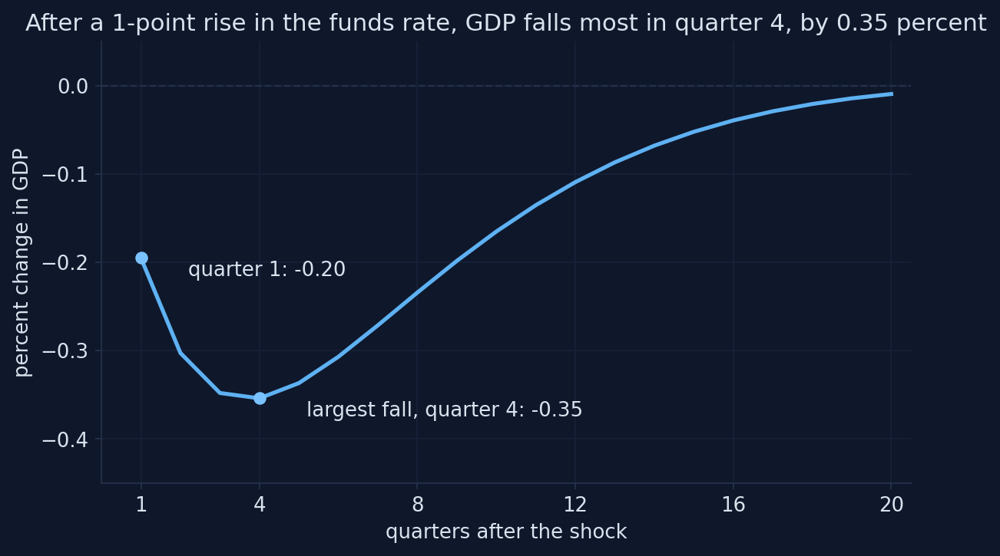

[Adapted from Fig. 15.9 in Jones (2024), based on Smets and Wouters (2007); computed with Snowdrop's model file and the published estimates. Appendix I, Section I.6.]{.source-line}

::: {.notes}
How to read it: quarters after the shock on the horizontal axis; percent deviation of GDP from trend on the vertical. The two dots mark quarter 1 and the trough.

Point at the trough: quarter 4, −0.35. Then the slow recovery: after five years the effect is −0.01.

Click the chart to zoom.
:::

## The model reproduces the textbook's three numbers

::: {.mid-table}
| | Jones (2024) | This model |
|----------------------------------|------------------|----------------------|
| GDP in quarter 1 (%) | about −0.2 | **−0.20** |
| largest fall (%) | about −0.33 | **−0.35** |
| quarter of the largest fall | 3 to 4 | **4** |
| after 5 years | mostly gone | −0.01 (quarter 20) |
:::

[Three sources of the delayed trough: habits slow consumption, adjustment costs slow investment, and smoothing keeps the rate high for several quarters.]{.takeaway .fragment}

::: {.notes}
The table is printed by the notebook (I.6). The textbook's numbers are read off its chart; ours are computed.

The small gap (−0.35 against −0.33) is within what you can read off a printed chart.

Act IV tests the three sources one at a time: habits (consumption), adjustment costs (investment), smoothing (everything).
:::

## Predict the other three: consumption, hours, inflation

[Same shock. GDP falls 0.35 percent at the trough.]{.question}

[Does consumption fall more or less than GDP? Hours more or less than GDP? How large is the fall in inflation, and how long does it last?]{.predict}

::: {.notes}
Hints if the room is stuck: consumption is 65 percent of GDP; capital can be run less intensively; prices are sticky.

A common guess: consumption falls less than GDP (it is smoothed). In this model it falls about as much.
:::

## Consumption falls as much as GDP; hours less; inflation by 0.2 points {.chart-figure}

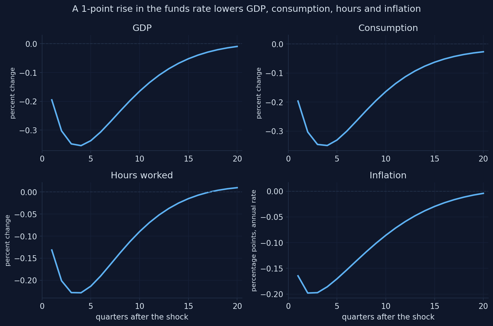

[Adapted from Fig. 15.10 in Jones (2024), based on Smets and Wouters (2007); computed with Snowdrop's model file and the published estimates. Appendix I, Section I.6.]{.source-line}

::: {.notes}
How to read it: four panels, the same 20 quarters. Inflation is in percentage points at an annual rate.

Point at:
- GDP and consumption: almost the same curve, trough −0.35 in quarter 4.
- Hours: trough −0.23. The gap with GDP is lower capacity utilization (−0.14 in quarter 4).
- Inflation: down by up to 0.20 points, below −0.15 for six quarters.
:::

## Reading the monetary shock

::: {.incremental}
- consumption: [−0.35]{.key} at the trough, the same as GDP
- hours: [−0.23]{.key}: part of the fall in output comes from **lower utilization**
- inflation: [−0.20]{.key} points, below −0.15 for six quarters (the textbook: about two years)
- the funds rate rises by only [0.75]{.key} points: the rule offsets part of the shock
:::

[Jones explains the large consumption response by adjustment costs. Act IV finds that, in this model, **habits** matter more.]{.takeaway .fragment}

::: {.notes}
Numbers printed by the notebook (I.6): "Largest fall: GDP −0.35%, consumption −0.35%, hours −0.23%, inflation −0.20 points"; "Quarters in which inflation is below −0.15 points: 6"; "The funds rate itself rises by 0.75 points in quarter 1, 0.33 in quarter 3".

The last point is a nice puzzle for students: a "1-point shock" does not raise the rate by 1 point, because the rule is part of the model.
:::

## A more persistent surprise almost doubles the fall in GDP

[Raise the persistence of the policy surprise from 0.13 to 0.5: `load_sw({"crhoms": 0.5})`.]{.comment}

::: {.incremental}
- the largest fall in GDP: about [−0.65]{.key} percent, still in quarter 4
- people expect the tightening to last, so long-term real rates rise more
- (I.2) and (I.4) look at the **whole** expected path of rates
:::

[This is why central banks care about forward guidance (Ch. 13): the expected path of rates moves spending, not just today's rate.]{.takeaway .fragment}

::: {.notes}
From the appendix's first Your-turn task (I.6), whose answer prints the largest fall and its quarter.

Policy link for the public-policy students: announcing that rates will stay high for longer is itself a policy tool. The model makes it concrete: the same first-quarter surprise, a different expected path, twice the effect.
:::

## What does a 1 percent rise in TFP do to GDP and hours?

[TFP rises 1 percent in quarter 1 and fades slowly ($\rho_a = 0.96$, a half-life of 16.5 quarters).]{.question}

[Does GDP rise by more or less than 1 percent? Do hours rise or fall at first? Does inflation rise or fall?]{.predict}

::: {.notes}
Chapter 15's labor-market model said: higher TFP raises labor demand, so hours rise. With sticky prices it said: demand rises slowly, so firms need fewer workers at first, and hours fall. Ask which story students expect to win in the estimated model.
:::

## GDP rises more than TFP, but hours fall at first {.chart-figure}

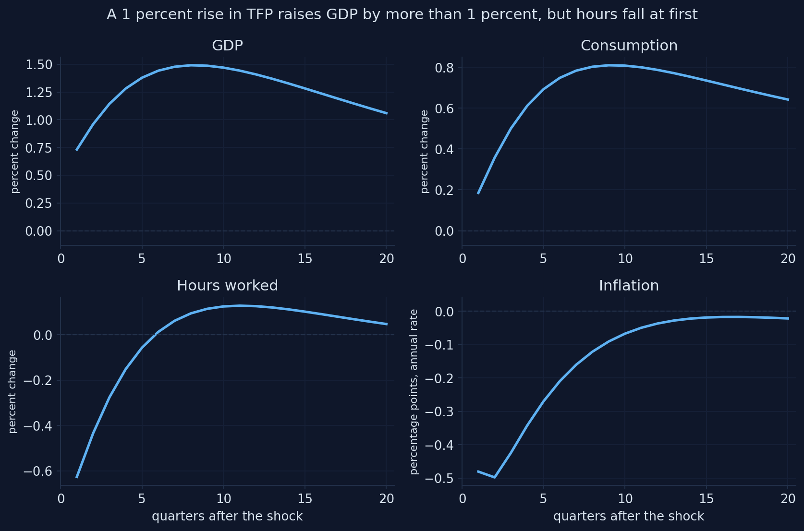

[Adapted from Fig. 15.11 in Jones (2024), based on Smets and Wouters (2007); computed with Snowdrop's model file and the published estimates. Appendix I, Section I.7.]{.source-line}

::: {.notes}
How to read it: four panels, 20 quarters.

Point at:
- GDP: 0.73 at once, peak 1.49 in quarter 8.
- Consumption: 0.19 at once, peak 0.81.
- Hours: −0.63 at once, first positive in quarter 6.
- Inflation: −0.48 points at once.
:::

## Every pattern of the textbook, with the same sizes

::: {.incremental}
- GDP peaks at [1.49]{.key} percent in quarter 8: **more** than the 1 percent rise in TFP, because capital accumulates
- consumption rises about half as much (peak [0.81]{.key}): households smooth it
- hours **fall** by [0.63]{.key} percent at first, and turn positive only in quarter 6
- inflation falls by [0.48]{.key} points: higher TFP lowers marginal cost (I.7)
:::

[The fall in hours is the puzzle of Chapter 15. Act IV asks how much of it is due to sticky prices.]{.takeaway .fragment}

::: {.notes}
Numbers printed by the notebook (I.7): "GDP: 0.73% at once, largest 1.49% in quarter 8"; "Consumption: 0.19% at once, largest 0.81%"; "Hours: −0.63% at once; first above zero in quarter 6"; "Inflation: −0.48 points at once".

The capital accumulation story is the Solow model's (Chapter 5): investment rises by almost 3 percent at its peak.

Also: a 1 percent TFP shock raises government purchases by 0.53 percent of GDP, through the spending process (ρga). That adds a little to GDP.
:::

## Over ten years, capital keeps GDP up while TFP fades {.chart-figure}

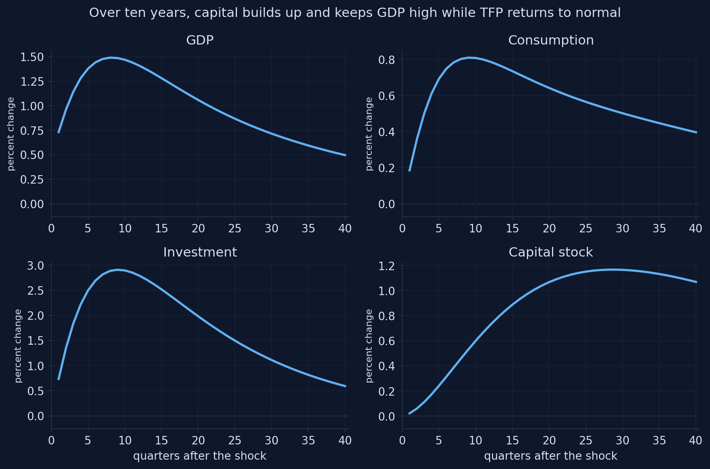

[Computed with Snowdrop's model file and the estimates of Smets and Wouters (2007); related to Chapter 15 of Jones (2024). Appendix I, Section I.7.]{.source-line}

::: {.notes}
How to read it: 40 quarters now; GDP, consumption, investment and the capital stock.

Point at: investment peaks at almost 3 percent after two years; the capital stock builds up slowly and peaks after about seven years. After ten years TFP is back to a fifth of its first rise (0.96^40 ≈ 0.19), but capital is still well above trend and keeps GDP and consumption up.

This is the Solow model's transition dynamics inside a business-cycle model.
:::

## A nearly permanent TFP rise still lowers hours at first

[Set `crhoa` = 0.99: the gain in TFP almost never fades.]{.comment}

::: {.incremental}
- hours still fall by almost [0.6]{.key} percent at first, and stay close to zero for years
- households are richer, so they want to consume more **and work less** (the wealth effect, I.9)
- with habits, adjustment costs and sticky prices, demand still rises slowly
- consumption now rises much more: the gain in income is more permanent
:::

::: {.notes}
From the appendix's Your-turn task in I.7. Connect to Chapter 16: consumption depends on lifetime income, so a permanent gain raises it more.

The fall in hours is not a quirk of a short-lived shock: it comes from the wealth effect on labor supply plus slow demand.
:::

## What does a rise in government purchases do to consumption?

[Purchases rise by 1 percent of GDP in quarter 1 and fade very slowly ($\rho_g = 0.98$).]{.question}

[Is the multiplier above or below 1? Does consumption rise (more income) or fall? Do hours rise or fall?]{.predict}

::: {.notes}
Two stories compete. Keynesian: more spending → more income → more consumption, a multiplier above 1. Chapter 15's labor-market model: the government's purchases must be paid with taxes, households feel poorer, they consume less and work more.

Ask for a show of hands: multiplier above 1 or below?
:::

## Purchases raise GDP and hours, and crowd out consumption {.chart-figure}

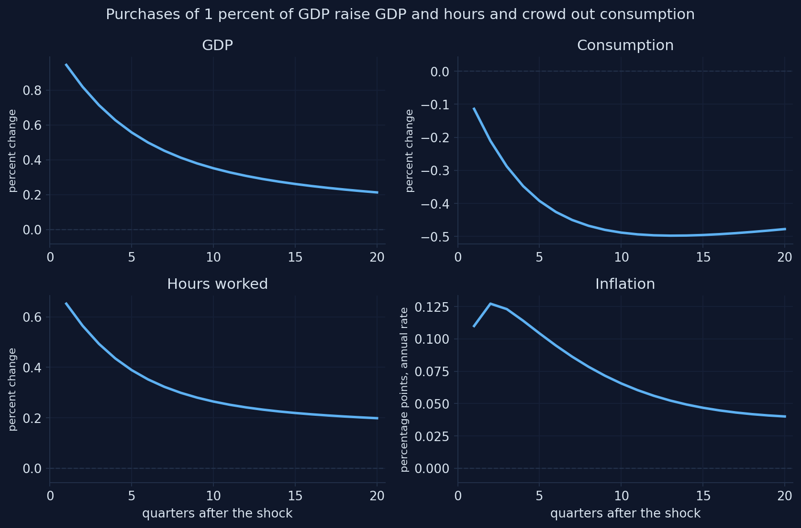

[Adapted from Fig. 15.12 in Jones (2024), based on Smets and Wouters (2007); computed with Snowdrop's model file and the published estimates. Appendix I, Section I.8.]{.source-line}

::: {.notes}
How to read it: four panels, 20 quarters. The shock is in percent of GDP, so the GDP response in quarter 1 is the impact multiplier.

Point at: GDP +0.94 at once and declining; consumption −0.11 at once, falling steadily to −0.50; hours up; inflation at most 0.13 points.
:::

## The multiplier is 0.94 on impact, and falls as consumption is crowded out

::: {.columns}
::: {.column width="45%"}
::: {.output}
```
Multiplier over  1 quarters: 0.94
Multiplier over  4 quarters: 0.80
Multiplier over  8 quarters: 0.68
Multiplier over 20 quarters: 0.52
```
:::
:::
::: {.column width="55%"}
- close to the textbook's "around 1" in the short run
- **cumulative** multipliers add up GDP and purchases over several quarters
- consumption falls: future taxes make households poorer (Ch. 15)
- hours rise: poorer households work more
:::
:::

::: {.notes}
Numbers printed by the notebook (I.8). The cumulative multiplier over N quarters is the sum of the GDP responses divided by the sum of the purchases responses.

For the policy students: estimated multipliers are contested and depend on monetary policy, the state of the economy and how the spending is financed. In this model, with an active Taylor rule and Ricardian households, the multiplier is about 1 at most. Models with constrained households or a central bank stuck at zero give larger multipliers. Do not present 0.94 as "the" multiplier.

Your-turn in the appendix: with short-lived spending (crhog = 0.5), consumption no longer falls and the impact multiplier rises to about 1.1: a short rise costs little in lifetime taxes.
:::

## "More government purchases mean more consumption"

["Government purchases raise consumption, so the multiplier must be above 1."]{.myth}

[Here consumption **falls** (to −0.50 percent): the wealth effect of future taxes crowds it out, and the multiplier stays below 1.]{.fact .fragment}

::: {.notes}
The Keynesian-cross intuition (Chapter 11) says more income, more consumption. In this model households look at lifetime wealth: persistent purchases mean higher future taxes, so they consume less and work more.

The multiplier is not a constant of nature: it depends on how long the spending lasts (next slide), on monetary policy, and on whether households can borrow.
:::

## Short-lived spending crowds out less

[Make the spending rise short-lived: `crhog` = 0.5 instead of 0.98.]{.comment}

::: {.incremental}
- a short rise costs little in lifetime taxes, so the **wealth effect** is small
- consumption no longer falls: it even rises a little with the extra income from work
- the impact multiplier rises to about [1.1]{.key}
:::

[What matters for consumption is lifetime wealth (Ch. 16): persistent spending crowds out more.]{.takeaway .fragment}

::: {.notes}
From the appendix's Your-turn task in I.8.

Policy link: temporary stimulus (for example, a one-year program) and permanent spending increases have different multipliers in this model. The debate on fiscal multipliers in the data is open; the model shows one mechanism, the wealth effect of future taxes.
:::

## What does a rise in the risk premium do?

[Households now borrow and save at a rate **above** the funds rate: the financial friction of the textbook's last Smets–Wouters chart. The wedge dies out fast ($\rho_b = 0.18$).]{.question}

[Which variable falls most: GDP, consumption, hours or inflation? Compared with a monetary tightening, are the effects larger at once or later?]{.predict}

::: {.notes}
The risk premium enters the consumption Euler equation (I.2) and the value of capital (I.4) next to the real rate. So it acts like a monetary tightening aimed directly at households, without the policy rate rising.

Prediction to hope for: consumption falls most, and at once, because the wedge enters consumption directly and dies out fast.
:::

## A higher risk premium lowers consumption most {.chart-figure}

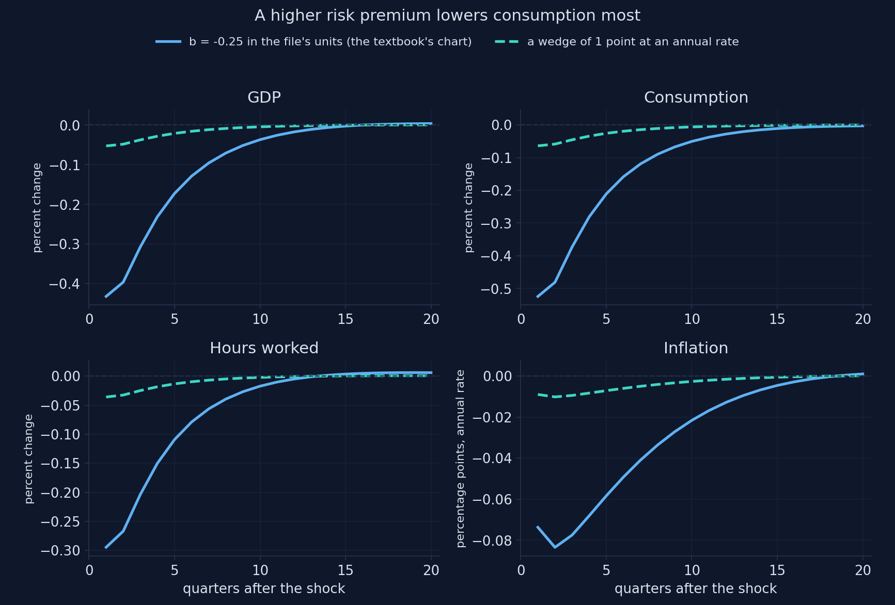

[Adapted from Fig. 15.13 in Jones (2024), based on Smets and Wouters (2007); computed with Snowdrop's model file and the published estimates. Appendix I, Section I.9.]{.source-line}

::: {.notes}
How to read it: two lines. Solid: a shock of −0.25 to the file's b, which reproduces the textbook's chart. Dashed: what the textbook's caption describes, a wedge of 1 point at an annual rate (b = −0.25 c3).

Point at the solid line: consumption falls most, about half a percent, GDP a little less, and everything is largest at once. Then at the dashed line: about eight times smaller.
:::

## Units matter: the textbook's chart is a wedge of 8 points a year, not 1

::: {.mid-table}
| | Jones (2024), read off the chart | $b = -0.25$ (solid) | 1-point wedge (dashed) |
|-----------------------|---------------------|-----------------|-------------------|
| GDP (%) | −0.47 | −0.43 | −0.05 |
| consumption (%) | −0.55 | −0.52 | −0.06 |
| hours (%) | −0.31 | −0.29 | −0.04 |
| inflation (points) | −0.12 | −0.07 | −0.01 |
:::

[$b = -0.25$ is a wedge of $0.25/c_3 = 2.05$ points per quarter, 8.2 at an annual rate. The shape matches; the caption's "1 point" does not.]{.takeaway .fragment}

::: {.notes}
Table printed by the notebook (I.9). The textbook's numbers are read off its chart at the trough.

Why the gap: the file rescales the shock by c3 = 0.122 (Act I). A shock of 0.25 in the file's units is 0.25/0.122 = 2.05 points per quarter in the paper's units. The textbook's chart matches that size, not the "1 point" of its caption.

Our responses fade slightly faster, and inflation falls a little less, than in the printed chart; the textbook does not say which version of the model or estimates it plotted.

Your-turn in the appendix: with a persistent wedge (crhob = 0.7), a 1-point wedge lowers GDP by about 0.19 percent, almost four times more. Persistence turns a small wedge into a recession: the reason models built after 2008 put financial frictions at their center (Chapter 14).
:::

## A persistent wedge turns a small premium into a recession

[Give the 1-point wedge again, but let it last: `crhob` = 0.7 instead of 0.18.]{.comment}

::: {.incremental}
- GDP now falls by about [0.19]{.key} percent, with a trough in quarter 3
- almost **four times** more than with the estimated persistence
- about half the effect of a monetary surprise of the same size
:::

[Financial crises are not short-lived: the reason models built after 2008 (Ch. 14) put financial frictions at their center.]{.takeaway .fragment}

::: {.notes}
From the appendix's Your-turn task in I.9.

Persistence works through the Euler equations again: a wedge expected to last raises the whole path of the rates households face.

Policy link: a persistent rise in credit spreads (as in 2008) is a recession-sized shock even if the spread itself is modest, which is why central banks responded to spreads with credit facilities, not only rate cuts.
:::

## The same direction as a monetary shock, a different timing

::: {.columns}
::: {.column width="50%"}
### Risk premium
- hits consumption **directly**
- dies out fast ($\rho_b = 0.18$)
- effects largest **at once**
:::
::: {.column width="50%"}
### Monetary policy
- works through a **smoothed** policy rate
- the rate stays high for a year
- effects build up to a trough in **quarter 4**
:::
:::

[Both raise the rate households face, so both lower consumption, GDP, hours and inflation.]{.takeaway .fragment}

::: {.notes}
A comparison that tests whether students understood the role of smoothing. Ask: if the central bank did not smooth (ρ = 0), which shock's timing would the monetary shock look like? (The risk premium's: largest at once and gone fast. Act IV's last slider shows it.)
:::

## A shock the textbook does not show: investment becomes more efficient

[An investment-specific shock: each unit of investment goods turns into more capital (a typical, 1 s.d. surprise).]{.question}

[Does it look like a supply shock (output up, inflation down) or a demand shock (output up, inflation up)? What happens to consumption at first?]{.predict}

::: {.notes}
The tempting answer: a technology shock, so supply-like, like TFP. The model says demand-like in the short run: it raises the demand for investment goods before it raises capacity.
:::

## More efficient investment raises investment and GDP {.chart-figure}

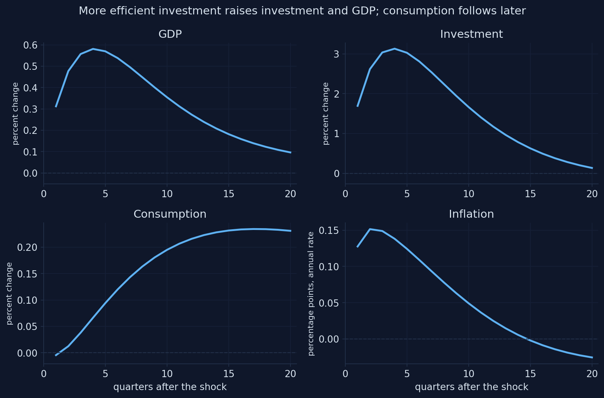

[Computed with Snowdrop's model file and the estimates of Smets and Wouters (2007); a typical (1 s.d.) shock; related to Chapter 15 of Jones (2024). Appendix I, Section I.10.]{.source-line}

::: {.notes}
A shock the textbook does not show. Its size: Smets and Wouters' estimated standard deviation, a typical surprise.

Point at: investment +3 percent at its peak, GDP +0.6, hours up, inflation slightly up. In the short run it looks like a demand shock: more efficient investment raises the demand for investment goods before it raises capacity. Consumption barely moves at first, because the higher real interest rate makes saving attractive; it rises later, when the extra capital pays off.
:::

## Seven shocks, one menu: compare their shapes {.live-figure}

<script src="plots/plot1.js"></script>
<div class="live-plot" data-fig="plot1"></div>

[Computed for this deck with the notebook's model file, the estimates of Smets and Wouters (2007) and its functions `load_sw` and `irf` (20 quarters; the book's units). [Appendix I](https://quarcs-lab.github.io/macro102-site/notebooks/appI-the-dsge-model-of-smets-and-wouters.html).]{.source-line}

::: {.notes}
How to read it: four panels (GDP, consumption, hours, inflation at an annual rate); one button per shock. The axes rescale with each shock, so read the numbers, not the heights.

Do live:
1. Monetary: the hump, trough in quarter 4.
2. TFP: GDP up, hours down at first, inflation down.
3. Government purchases: GDP and hours up, consumption down.
4. Financial friction: everything largest at once.
5. Investment-specific: GDP and hours up, inflation slightly up.
6. Price markup and wage markup: inflation up, GDP down (the next act opens with them).

Ask: which shocks move GDP and inflation in the same direction (demand-like), and which in opposite directions (supply-like)? Demand-like: monetary, purchases, financial friction, investment-specific. Supply-like: TFP and the two markups.
:::

## Demand-like and supply-like shocks, from the first quarter

::: {.mid-table}
| Shock | GDP, quarter 1 | Inflation, quarter 1 | Type |
|---------------------------------|---------------|------------------|--------------|
| monetary tightening | −0.20 | −0.16 | demand |
| government purchases | +0.94 | +0.11 | demand |
| risk premium (the textbook's chart) | −0.43 | −0.07 | demand |
| investment-specific (1 s.d.) | +0.31 | +0.13 | demand |
| TFP | +0.73 | −0.48 | supply |
| price markup (1 s.d.) | −0.11 | +0.97 | supply |
| wage markup (1 s.d.) | −0.04 | +0.51 | supply |
:::

[Demand shocks move output and inflation together; supply shocks move them apart and force the central bank to choose.]{.takeaway .fragment}

::: {.notes}
Numbers from the live chart's data (the notebook's irf, quarter 1; inflation in points at an annual rate).

The distinction is Chapter 13's AS/AD logic, now in an estimated model. The central bank can offset demand shocks without a trade-off; supply shocks create one (the markup slide in Act IV).
:::

## Act III in one table: Chapter 15's charts, recomputed {.formula-sheet}

| Shock (textbook size) | Model shock | Key numbers | Jones (2024) |
|----------------------------------|------------------------|---------------------------------------------------|------------------------|
| Funds rate +1 point | $\eta^r = 0.25$ | GDP −0.20 → −0.35 (q4); inflation −0.20 | −0.2 → −0.33 (q3–4) |
| TFP +1 percent | $\eta^a = 1$ | GDP peak 1.49 (q8); hours −0.63 at first | GDP peak above 1; hours fall |
| Purchases +1 percent | $\eta^g = 1$ (of GDP) | multiplier 0.94; consumption to −0.50 | multiplier around 1 |
| Financial friction | $b = -0.25$ | consumption −0.52, GDP −0.43 | −0.55, −0.47 |
| Investment-specific | 1 s.d. | investment +3, GDP +0.6 | not shown |

::: {.notes}
A summary to photograph. The third branch of the mind map.

The financial-friction row is the one with a units story: the textbook's chart is a wedge of 8.2 points a year in the paper's units, not the 1 point of its caption.

Before Act IV, ask: each pattern has a story in Chapter 15 (sticky prices for hours, adjustment costs for consumption, the rule for the hump). How could we test which story is right inside this model? (Change one parameter, solve again, compare.)
:::

# Which frictions matter? {.divider background-color="#b9770e"}

[Act IV]{.act}

## An experiment: change one parameter, solve again, compare

```python
def experiment(parameter, values, shock, size):
    """Impulse responses to one shock for several values of one parameter."""
    runs = []
    for j, value in enumerate(values):
        model = load_sw({parameter: value}, file="sw_experiment.yaml")
        label = f"{parameter} = {value}"
        runs.append((label, irf(model, shock, size)))
    return runs

runs = experiment("cprobp", [0.6563, 0.5, 0.3, 0.1], "ea", 1.0)
```

[Chapter 15 explained each pattern with **one** friction. In a model with all frictions at once, we can test those explanations.]{.takeaway .fragment}

::: {.notes}
Shortened from the notebook (I.11), which also stores a color and line style for each run.

Each call of load_sw writes a new file and reads it again, so the derived values are recomputed (Act I's trap).

Three explanations from Chapter 15 to test:
1. Sticky prices make hours fall after a TFP shock.
2. Sticky wages make the real wage move against employment after a monetary shock.
3. Investment adjustment costs make consumption fall a lot after a monetary tightening.
:::

## If prices were less sticky, would hours still fall after a TFP shock?

[The Calvo parameter $\xi_p$ falls from its estimate, 0.66 (a price lasts about 3 quarters), to 0.1 (prices reset almost every quarter).]{.question}

[Chapter 15 blames the fall in hours on sticky prices. With $\xi_p = 0.1$, do hours rise at once, fall less, or fall as much?]{.predict}

::: {.notes}
The textbook's logic: with sticky prices, demand rises slowly after a TFP shock, and firms with higher productivity need fewer workers to meet it. If that were the whole story, hours should rise when prices are flexible.

Ask for a show of hands before the chart.
:::

## Less sticky prices raise GDP faster, but hours still fall at first {.chart-figure}

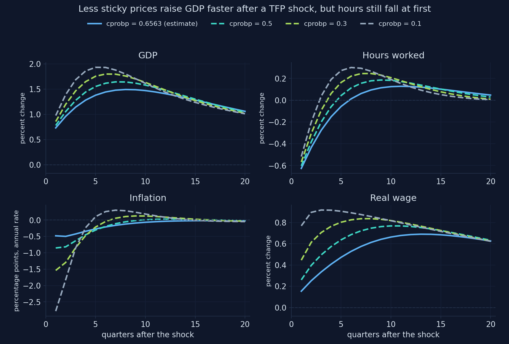

[Computed with Snowdrop's model file and the estimates of Smets and Wouters (2007); related to Fig. 10 of Chapter 15. Appendix I, Section I.11.]{.source-line}

::: {.notes}
How to read it: four values of ξp; solid = the estimate, dashed = less sticky prices. Panels: GDP, hours, inflation, real wage.

Point at the hours panel: every line starts below zero. Less sticky prices make the fall smaller, not positive.
:::

## Hours fall even in the model's flexible economy

::: {.mid-table}
| | Largest GDP | Hours in quarter 1 |
|------------------------------|-------------|---------------------|
| $\xi_p = 0.66$ (estimate) | 1.49 | **−0.63** |
| $\xi_p = 0.5$ | 1.64 | −0.60 |
| $\xi_p = 0.3$ | 1.80 | −0.57 |
| $\xi_p = 0.1$ | 1.93 | −0.52 |
| flexible prices **and** wages | 1.59 | **−0.43** |
:::

[Sticky prices make the fall in hours larger, but they are not its only cause.]{.takeaway .fragment}

::: {.notes}
Table printed by the notebook (I.11). The last row is the flexible economy that the model carries along to measure potential output (Act I): flexible prices and wages, but still habits, adjustment costs and utilization.

Why hours still fall: with habits and adjustment costs, demand also rises slowly in a flexible economy, and a richer household wants to work less (I.9).

The first branch of Act IV in the mind map: "Hours fall after TFP even with flexible prices: −0.43".
:::

## Move the Calvo parameter yourself {.live-figure}

<script src="plots/plot2.js"></script>
<div class="live-plot" data-fig="plot2"></div>

[Computed for this deck with the notebook's model file, the estimates of Smets and Wouters (2007) and its functions `load_sw` and `irf` (a TFP shock of 1 percent; dotted: the model's flexible economy). [Appendix I](https://quarcs-lab.github.io/macro102-site/notebooks/appI-the-dsge-model-of-smets-and-wouters.html).]{.source-line}

::: {.notes}
How to read it: the slider sets ξp; amber is hours, blue is GDP; dashed gray lines are the estimate; dotted lavender is hours in the flexible economy (the same at every step). The title reports hours in quarter 1 and the GDP peak.

Do live:
1. Start at the estimate (0.66): hours −0.63.
2. Move to 0.1: hours −0.52, GDP rises faster and higher.
3. Move to 0.8: hours −0.64, GDP slower.

Ask: at which ξp do hours rise at once? (None. The dotted line, the flexible economy, still starts at −0.43.)
:::

## Hours stop falling only when the real frictions are weak too

::: {.mid-table}
| | Largest GDP | Hours, quarter 1 | Hours, quarter 2 |
|------------------------------------------------|-------------|------------------|------------------|
| estimated model | 1.49 | −0.63 | −0.43 |
| flexible prices and wages | 1.65 | −0.54 | −0.27 |
| … and weak habits and adjustment costs | 1.83 | **−0.15** | **+0.07** |
:::

[The textbook's simple labor market, with no habits and no adjustment costs, is close to the last row.]{.takeaway .fragment}

::: {.notes}
Table printed by the notebook (I.11). "Flexible" here: cprobp = 0.1, cprobw = 0.3. "Weak real frictions": chabb = 0.1, csadjcost = 2.

Your-turn in the appendix: one friction at a time. Each change on its own leaves a fall in hours in the first quarter; weak habits do the most (about −0.3 instead of −0.6), flexible prices less, low adjustment costs almost nothing. The frictions reinforce each other.

Which frictions are strong in the real economy is what estimation decides; whether hours fall after a TFP shock in the data is still debated, as the textbook notes.
:::

## One friction at a time: none removes the fall in hours on its own

::: {.mid-table}
| Change (TFP shock) | Hours in quarter 1 |
|---------------------------------------|--------------------------|
| estimated model | −0.63 |
| weak habits only ($h = 0.1$) | about −0.3: the most |
| flexible prices only ($\xi_p = 0.1$) | −0.52 |
| low adjustment costs only ($\varphi = 2$) | almost unchanged |
| all of them weak | −0.15, positive from quarter 2 |
:::

[The frictions reinforce each other: demand rises slowly when **any** of them is strong.]{.takeaway .fragment}

::: {.notes}
From the appendix's Your-turn task in I.11 (approximate values as stated in its answer) and the printed tables.

This is the core of the thesis: no single friction explains the pattern. When students hear "sticky prices explain X", ask: in which model, and with which other frictions switched on?
:::

## Sticky prices are not the whole story behind the fall in hours

["Hours fall after a TFP shock because prices are sticky; with flexible prices they would rise."]{.myth}

[In the estimated model, hours fall with flexible prices and wages too (−0.43). Habits and adjustment costs slow demand, and the wealth effect lowers labor supply.]{.fact .fragment}

::: {.notes}
A misconception the textbook's simple models invite: each one isolates one friction, so students attribute each pattern to one cause.

The broader lesson: in a model with many frictions, the "cause" of a pattern is often several frictions together. That is the thesis of the deck.
:::

## If wages were less sticky, what would a tightening do to the real wage?

[The Calvo wage parameter $\xi_w$ falls from 0.74 to 0.5 and 0.3. The shock is a monetary tightening.]{.question}

[Does the real wage fall more or less? Do GDP and hours fall more or less?]{.predict}

::: {.notes}
Chapter 15, Fig. 7: with sticky nominal wages and flexible prices, a tightening raises the real wage. Here prices are sticky too, so the answer is not obvious. Let students argue both ways.
:::

## Flexible wages: inflation and the real wage fall more {.chart-figure}

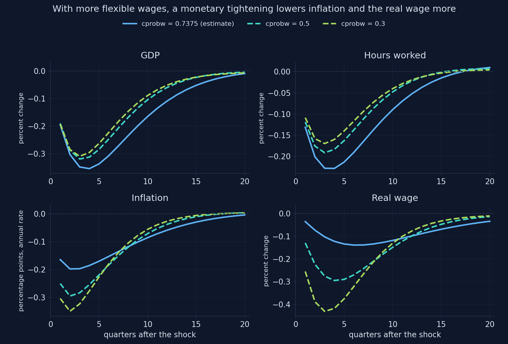

[Computed with Snowdrop's model file and the estimates of Smets and Wouters (2007); related to Figs. 6 and 7 of Chapter 15. Appendix I, Section I.11.]{.source-line}

::: {.notes}
How to read it: three values of the Calvo wage parameter ξw: 0.74 (estimate), 0.5, 0.3. Panels: GDP, hours, inflation, real wage.

Point at the real-wage panel: the lowest point is −0.14 at the estimate, −0.43 with ξw = 0.3.
:::

## Flexible wages move prices; sticky wages move quantities

::: {.mid-table}
| | GDP | Hours | Inflation | Real wage |
|-------------------------------|-------|-------|-----------|-----------|
| $\xi_w = 0.74$ (estimate) | −0.35 | −0.23 | −0.20 | −0.14 |
| $\xi_w = 0.5$ | −0.32 | −0.19 | −0.30 | −0.29 |
| $\xi_w = 0.3$ | −0.31 | −0.17 | −0.35 | −0.43 |
:::

[With prices sticky too, the real wage falls **with** employment here, unlike Chapter 15's sticky-wage-only case: both nominal frictions together decide its sign.]{.takeaway .fragment}

::: {.notes}
Largest responses within 20 quarters, printed by the notebook (I.11).

Mechanism: more flexible wages → the real wage falls more → marginal cost (I.7) and inflation fall more → the economy adjusts through prices rather than quantities, so GDP and hours fall a little less.

Link to Chapter 15, Fig. 7: with sticky wages only, a monetary tightening raises the real wage and lowers employment (countercyclical real wage). Here prices are sticky too, so the real wage falls a little.
:::

## Which friction drives the fall in consumption after a tightening?

[Jones (2024) points to investment adjustment costs. We lower the adjustment cost $\varphi$ from 5.49 to 2, and the habit $h$ from 0.71 to 0.1, one at a time.]{.question}

[Which change moves the **consumption** response more: weaker adjustment costs or weaker habits? Which moves **investment** more?]{.predict}

::: {.notes}
Let students reason from Act I: habits enter the consumption Euler equation (I.2) through c1 and c3; adjustment costs enter the investment Euler equation (I.3) through 1/(γ²φ).

A natural prediction from the equations: habits → consumption, φ → investment. Next slides check it.
:::

## Weaker habits make consumption fall more, and sooner {.chart-figure}

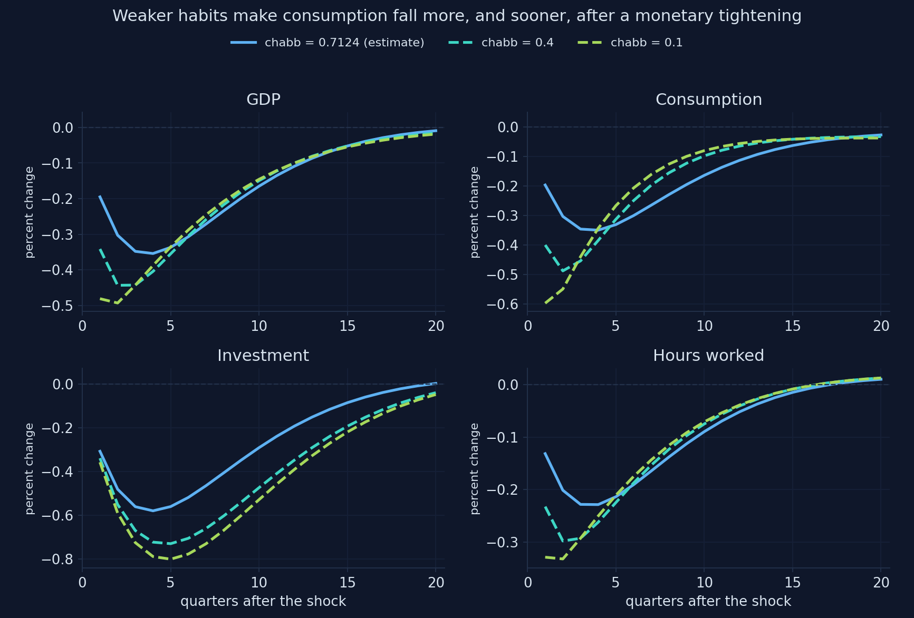

[Computed with Snowdrop's model file and the estimates of Smets and Wouters (2007); related to Chapter 15 of Jones (2024). Appendix I, Section I.11.]{.source-line}

::: {.notes}
How to read it: three values of h: 0.71 (estimate), 0.4, 0.1. Panels: GDP, consumption, investment, hours.

Point at the consumption panel: with h = 0.1 consumption falls about 0.6 percent at once and its trough comes at once; at the estimate it falls 0.2 at once and its trough comes after a year.
:::

## Move the habit parameter {.live-figure}

<script src="plots/plot3.js"></script>
<div class="live-plot" data-fig="plot3"></div>

[Computed for this deck with the notebook's model file, the estimates of Smets and Wouters (2007) and its functions `load_sw` and `irf` (a monetary shock of 1 point at an annual rate). [Appendix I](https://quarcs-lab.github.io/macro102-site/notebooks/appI-the-dsge-model-of-smets-and-wouters.html).]{.source-line}

::: {.notes}
How to read it: the slider sets h; green is consumption, blue is GDP; dashed gray lines are the estimate. The title reports consumption at once and its lowest point.

Do live:
1. Estimate (0.71): consumption lowest −0.35 in quarter 4: a hump.
2. h = 0.1: lowest −0.60, at once: no hump.
3. h = 0.85: lowest −0.27, later.

The hump in consumption comes from habits: the equation's c1 term.
:::

## Move the adjustment cost {.live-figure}

<script src="plots/plot4.js"></script>
<div class="live-plot" data-fig="plot4"></div>

[Computed for this deck with the notebook's model file, the estimates of Smets and Wouters (2007) and its functions `load_sw` and `irf` (a monetary shock of 1 point at an annual rate). [Appendix I](https://quarcs-lab.github.io/macro102-site/notebooks/appI-the-dsge-model-of-smets-and-wouters.html).]{.source-line}

::: {.notes}
How to read it: the slider sets φ; rose is investment, green is consumption; dashed gray lines are the estimate. The title reports the lowest points of both.

Do live:
1. Estimate (5.5): investment −0.58, consumption −0.35.
2. φ = 2: investment −1.08, almost twice as much; consumption still −0.35.
3. φ = 10: investment −0.38; consumption still −0.35.

The consumption line barely moves with φ. Adjustment costs shape investment, not consumption.
:::

## Habits shape consumption; adjustment costs shape investment

::: {.mid-table}
| | GDP | Consumption | Investment |
|-------------------------------|-------|-------------|------------|
| estimate ($\varphi = 5.49$, $h = 0.71$) | −0.35 | −0.35 | −0.58 |
| $\varphi = 2$ | −0.45 | −0.35 | −1.08 |
| $\varphi = 10$ | −0.32 | −0.35 | −0.38 |
| $h = 0.4$ | −0.44 | −0.49 | −0.73 |
| $h = 0.1$ | −0.49 | −0.60 | −0.80 |
:::

[Consumption falls about as much as GDP because GDP falls **less**: investment is held back by its costs, and utilization absorbs part of the shock.]{.takeaway .fragment}

::: {.notes}
Largest falls within 20 quarters, printed by the notebook (I.11).

The second branch of Act IV in the mind map.

So the textbook's explanation (adjustment costs make consumption fall a lot) does not hold in this model: φ changes the investment response a lot and the consumption trough not at all. What makes consumption's fall similar to GDP's is that GDP falls less than you might expect.
:::

## Why does a short-lived policy surprise move GDP for two years?

[The monetary surprise dies out in a quarter ($\rho_r = 0.13$), yet GDP is lowest after a year. The Taylor rule smooths the rate with $\rho = 0.82$.]{.question}

[Without smoothing ($\rho = 0$), how large would the fall in GDP be: about the same, half, or much smaller?]{.predict}

::: {.notes}
The hint: (I.2) and (I.4) depend on the whole expected path of real rates. With smoothing, a surprise today means a high rate for several quarters.
:::

## Without smoothing, a policy surprise is over in a quarter {.chart-figure}

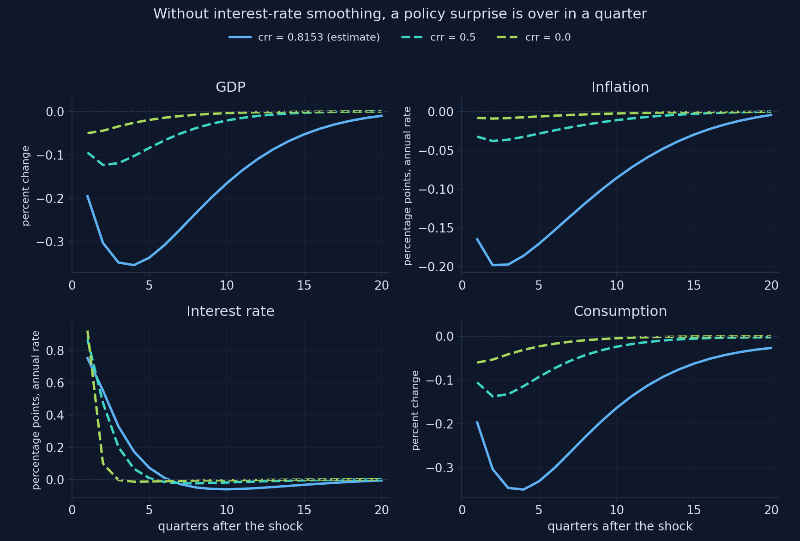

[Computed with Snowdrop's model file and the estimates of Smets and Wouters (2007); related to Chapters 12 and 13 of Jones (2024). Appendix I, Section I.11.]{.source-line}

::: {.notes}
How to read it: three values of ρ: 0.82 (estimate), 0.5, 0. Panels: GDP, inflation, the interest rate, consumption.

Point at the interest-rate panel: without smoothing the rate is back to normal in the next quarter. Then at GDP: the fall shrinks to about 0.05.
:::

## Move the smoothing parameter {.live-figure}

<script src="plots/plot5.js"></script>
<div class="live-plot" data-fig="plot5"></div>

[Computed for this deck with the notebook's model file, the estimates of Smets and Wouters (2007) and its functions `load_sw` and `irf` (a monetary shock of 1 point at an annual rate). [Appendix I](https://quarcs-lab.github.io/macro102-site/notebooks/appI-the-dsge-model-of-smets-and-wouters.html).]{.source-line}

::: {.notes}
How to read it: the slider sets ρ; amber is the interest rate (points, annual), blue is GDP; dashed gray lines are the estimate. The title reports the lowest GDP and the rate in quarter 4.

Do live:
1. ρ = 0: GDP lowest −0.05.
2. ρ = 0.5: −0.12. ρ = 0.7: −0.22.
3. Estimate (0.82): −0.35.
4. ρ = 0.9: −0.59.

The effect grows fast as ρ approaches 1: the expected path of rates gets longer.
:::

## Smoothing carries the policy surprise; a stronger inflation response dampens it

::: {.mid-table}
| | Largest fall in GDP | Largest fall in inflation |
|------------------------------|---------------------|---------------------------|
| estimate ($\rho = 0.82$, $r_\pi = 2.03$) | −0.35 | −0.20 |
| $\rho = 0.5$ | −0.12 | −0.04 |
| $\rho = 0$ | −0.05 | −0.01 |
| $r_\pi = 1.5$ | −0.41 | −0.26 |
| $r_\pi = 3$ | −0.30 | −0.14 |
:::

[It is the **expected path** of rates, not one quarter's rate, that moves consumption and investment.]{.takeaway .fragment}

::: {.notes}
Printed by the notebook (I.11). The third branch of Act IV in the mind map.

A stronger response to inflation makes the falls smaller: people know the bank will push inflation back hard, so it moves less in the first place, and the bank needs to do less.
:::

## What does a rise in firms' markups do?

[A typical price markup surprise, and a typical wage markup surprise (1 s.d. each). The central bank follows its Taylor rule.]{.question}

[What happens to inflation and to GDP? Which of the two shocks lasts longer, given $\rho_p = 0.90$ with a large moving-average term and $\rho_w = 0.97$?]{.predict}

::: {.notes}
Students should recognize Chapter 13's cost shock ō. The persistence question is a good test: the moving-average term (μp = 0.74) makes the price markup fade fast despite ρp = 0.90.
:::

## Markup shocks raise inflation and lower output: Chapter 13's cost shocks {.chart-figure}

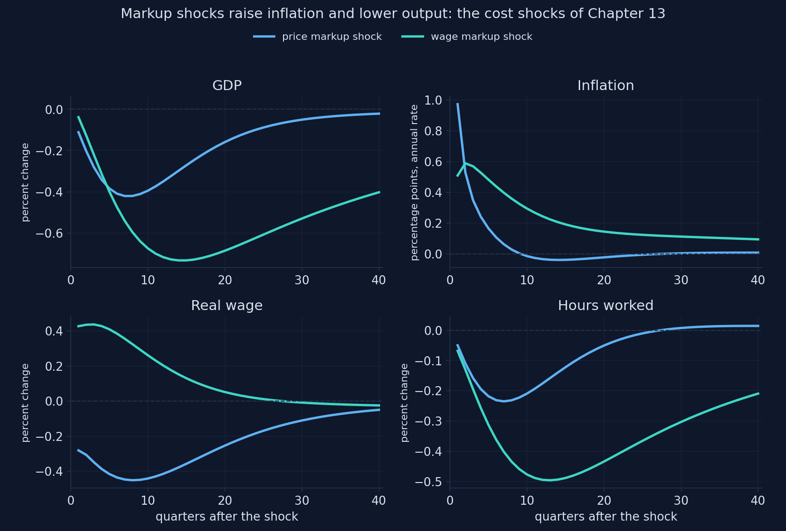

[Computed with Snowdrop's model file and the estimates of Smets and Wouters (2007); typical (1 s.d.) shocks; related to Chapter 13 of Jones (2024). Appendix I, Section I.10.]{.source-line}

::: {.notes}
How to read it: two shocks on one chart. Blue: price markup; teal: wage markup. Typical surprise sizes (estimated standard deviations), since the textbook gives none.

Point at inflation: the price markup raises it by about 1 point at once and it is back within two years; the wage markup raises it less but for much longer. Then at GDP: both lower it, the wage markup for many years.
:::

## Two supply shocks with different lives

::: {.columns}
::: {.column width="50%"}
### Price markup
- inflation up about **1 point** at once
- back to normal within two years
- the real wage **falls**: prices rise faster than wages
:::
::: {.column width="50%"}
### Wage markup
- raises the real wage
- lasts much longer ($\rho_w = 0.97$)
- lowers GDP and hours **for years**
:::
:::

[In Smets and Wouters' variance decompositions, markup shocks explain most movements of inflation, and the wage markup a large part of output at long horizons.]{.takeaway .fragment}

::: {.notes}
Both are the inflation shocks ō of Chapter 13: inflation rises, the Taylor rule raises the rate, GDP and hours fall.

The fourth branch of Act IV in the mind map: "Markup shocks: inflation up, output down".

The variance-decomposition statement comes from Smets and Wouters (2007); the appendix cites it, we did not recompute it.
:::

## Fighting a markup shock: a stronger response lowers inflation and costs output

[The central bank chooses how hard to fight the inflation of a price markup shock: `crpi` = 1.5 or 3.]{.comment}

::: {.incremental}
- a stronger response lowers inflation a little
- and costs **more** output
- with a supply shock, the central bank cannot stabilize both
:::

[The trade-off of Chapter 13's Phillips curve, inside an estimated model.]{.takeaway .fragment}

::: {.notes}
From the appendix's Your-turn task in I.10.

Policy discussion for the public-policy students: after 2021, central banks faced exactly this choice with energy and supply-chain shocks. The model frames it; it does not answer it. The answer depends on how much weight society puts on inflation versus output, and on how persistent the shock is.
:::

## The file's own numbers make a monetary shock almost twice as strong {.chart-figure}

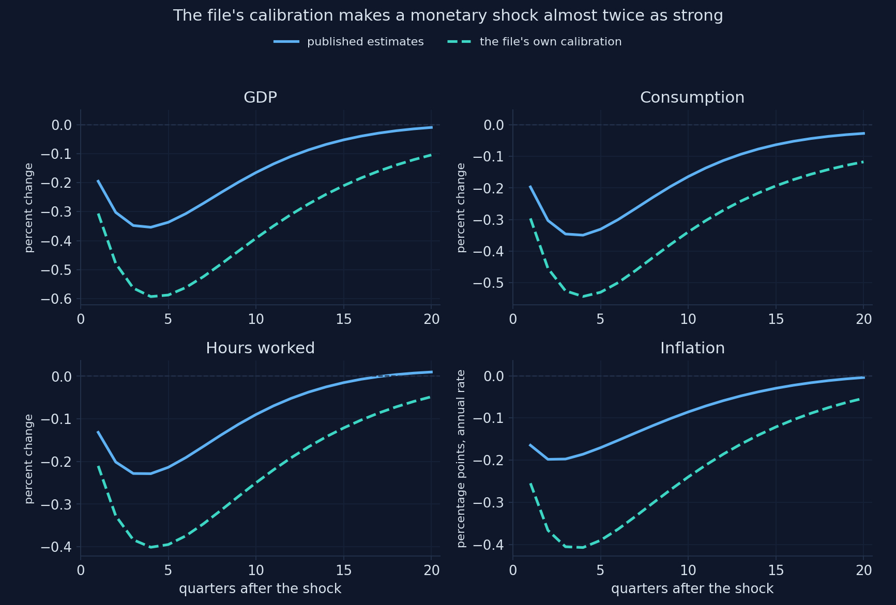

[Computed with Snowdrop's model file, its own calibration and the estimates of Smets and Wouters (2007); related to Chapter 15 of Jones (2024). Appendix I, Section I.12.]{.source-line}

::: {.notes}
How to read it: solid = the published estimates; dashed = the file's own calibration (with the corrected equation). Same shock, same equations.

Point at GDP: −0.35 against −0.59. Inflation: −0.20 against −0.41.
:::

## The corrected equation barely matters; the numbers matter a lot

::: {.mid-table}
| | GDP after monetary | Inflation after monetary | Investment after investment shock |
|------------------------------------|--------|--------|--------|
| estimates, corrected (I.6) | −0.354 | −0.198 | 3.129 |
| estimates, as published | −0.354 | −0.198 | 3.169 |
| file's calibration, corrected | **−0.593** | **−0.407** | 3.391 |
:::

[A file with the right equations and the wrong numbers gives confident, wrong answers. Compare its numbers with the source it claims to follow.]{.takeaway .fragment}

::: {.notes}
Printed by the notebook (I.12): largest responses within 20 quarters.

The corrected equation (I.6) multiplies only the investment-specific shock, so only that column changes, by about 1 percent here (3.129 against 3.169). The calibration changes everything: the monetary shock is 1.7 times stronger.

Back to the Act I branch: "The file differs from the paper: 29 of 29 values; one equation corrected".
:::

## The frictions work together

::: {.cards}
::: {.card}
**Hours after TFP**

fall with sticky prices, fall less with flexible prices, stop falling only when habits and adjustment costs are weak too
:::
::: {.card .green}
**Consumption after a tightening**

shaped by habits; adjustment costs move investment instead
:::
::: {.card .amber}
**The size of a policy surprise**

carried by smoothing: without it, GDP falls 0.05, not 0.35
:::
::: {.card .rose}
**Supply shocks**

markups raise inflation and lower output; the rule trades one off against the other
:::
:::

[No single friction explains the patterns of Chapter 15.]{.takeaway .fragment}

::: {.notes}
The synthesis of Act IV and the last sentence of the thesis.

Ask students to pick one Chapter 15 explanation and say how the estimated model qualifies it.
:::

## Act IV in one table: the experiments {.formula-sheet}

| Experiment | Change | Result |
|-------------------------------|--------------------------------|--------------------------------------------------------------|
| Sticky prices, TFP shock | $\xi_p$: 0.66 → 0.1 | hours −0.63 → −0.52; flexible economy −0.43 |
| All frictions weak, TFP | + $h = 0.1$, $\varphi = 2$ | hours −0.15 at first, positive from quarter 2 |
| Sticky wages, monetary | $\xi_w$: 0.74 → 0.3 | real wage −0.14 → −0.43; inflation −0.20 → −0.35 |
| Habits, monetary | $h$: 0.71 → 0.1 | consumption −0.35 → −0.60, at once |
| Adjustment costs, monetary | $\varphi$: 5.49 → 2 | investment −0.58 → −1.08; consumption unchanged |
| Smoothing, monetary | $\rho$: 0.82 → 0 | GDP −0.35 → −0.05 |
| File's calibration, monetary | all 29 values | GDP −0.35 → −0.59 |

::: {.notes}
A summary to photograph. Every number is printed in the notebook's Section I.11 or I.12.
:::

## "With seven shocks and dozens of frictions, the model can fit anything"

[A skeptic says: "Smets and Wouters let the data choose seven shocks and many frictions. Of course the model fits. But some 'shocks', like the wage markup shock that drives output at long horizons, have no clear meaning, so the model's stories about causes cannot be trusted for policy."]{.objection}

. . .

[Reply: the criticism is serious and contested. Chari, Kehoe and McGrattan (2009) argue that several shocks are not structural, so policy conclusions are fragile. Del Negro, Schorfheide, Smets and Wouters (2007) test the model against less restricted versions and find its fit good but not perfect, with clear signs of misspecification. Defenders reply that each friction is disciplined by evidence (Christiano, Eichenbaum and Trabandt, 2018). What this deck practiced (switching frictions off and watching what changes) is how you find out which conclusions depend on which assumptions.]{.rebuttal}

::: {.notes}
Present both sides fairly; this is a live debate.

- Chari, Kehoe and McGrattan (2009, AEJ: Macroeconomics) argue that New Keynesian models like Smets–Wouters are "not yet useful for policy analysis": some shocks (notably the wage markup shock) are hard to interpret and could be other things (for example, changes in labor supply), with different policy implications.
- Del Negro, Schorfheide, Smets and Wouters (2007, Journal of Business and Economic Statistics) compare the model with a less restricted vector autoregression around it (DSGE-VAR) and find that the model's restrictions are useful but not exactly right.
- Christiano, Eichenbaum and Trabandt (2018, Journal of Economic Perspectives) defend the approach and describe how later models added financial frictions and other features.

Connect to Act IV: the experiments showed that conclusions about causes (why hours fall, why consumption falls) depend on frictions whose strength the data chose. That is both the model's strength and the skeptic's point.
:::

## Common errors, and how to fix them

::: {.dense-table}
| What you see | Why | What to do |
|--------------------------------------------|----------------------------------------------------|--------------------------------------------|
| `could not convert string to float: 'inv_gamma_pdf'` | the estimation block's layout | remove the block, as `write_sw` does |
| a plausible chart, residual 0.02 | Klein fails on this model | `Solver="AndersonMoore"`; check residuals |
| "unable to find solution" | Villemot fails on this model | Anderson–Moore or Binder–Pesaran |
| a parameter change has no effect | derived values computed at import | write the file again: `load_sw({...})` |
| risk premium: wrong sign or size | the file's `b` is $-c_3\varepsilon^b$ | a rise of $x$ points is `b` $= -c_3 x$ |
| responses 4 times off | rates are quarterly in the model | × 4 for annual rates, as `irf` does |
| a crash after setting a Calvo parameter to 0 or 1 | $\xi$ is in a denominator | values strictly between 0 and 1 |
:::

::: {.notes}
The appendix's table (I.13), for students who open the notebook.

Each row was met in this deck: rows 1 and 4 in Act I, rows 2, 3 and 6 in Act II, row 5 in Act III. The last row: κp and κw divide by ξ, so ξ = 0 gives a division by zero; ξ = 1 makes the slope 0 and prices never move.
:::

## Go further: estimate it, derive it, and see where it is used

::: {.columns}
::: {.column width="50%"}
### Estimate
- the steps of Appendix H.11–H.12: seven series, measurement equations, priors, `estimate`
- the data: the replication files, or FRED (Appendix B)
- 36 parameters and a flat likelihood in some directions: a long run
:::
::: {.column width="50%"}
### Derive and use
- the derivations: Smets and Wouters (2007) and its online appendix; Galí (2015); Del Negro and Schorfheide (2012)
- why each friction: Christiano, Eichenbaum and Evans (2005)
- a euro-area version (Smets and Wouters, 2003); the New York Fed's model (Del Negro et al., 2013)
:::
:::

::: {.notes}
The appendix's Section I.13, plus pointers to where models of this family are used.

Christiano, Eichenbaum and Evans (2005) chose the frictions to match the responses of the U.S. economy to a monetary shock estimated without a model (a VAR). That is why the Smets–Wouters monetary responses look so much like the data.

Smets and Wouters first estimated the model on euro-area data (2003, Journal of the European Economic Association); the U.S. version (2007) is the one Chapter 15 uses. The FRBNY DSGE model (Del Negro et al., 2013) builds on it, adding financial frictions.
:::

## What to remember from this appendix

::: {.incremental}
- **I.** The Smets–Wouters model is **14 log-linear equations in 5 blocks**; each one extends a Chapter 15 idea, and the model file differs from the paper in its numbers, one equation and one shock's units
- **II.** Snowdrop solves it in a fraction of a second, but only **checking the residuals** showed that one solver was wrong; rates are quarterly, so units need care
- **III.** With the published estimates, the model reproduces the textbook's **monetary, TFP and purchases** charts almost number for number, and the financial-friction chart once its units are understood
- **IV.** The frictions **work together**: hours fall after TFP even with flexible prices; habits shape consumption, adjustment costs investment; smoothing carries policy surprises
:::

::: {.notes}
One takeaway per act, in the order of the mind map's branches. Ask students which one surprised them most.
:::

## {.recap background-image="figures/mindmap.webp" background-size="contain" background-color="#0f172a"}

::: {.notes}
Walk the four branches in a minute each: The model, read with care (top left); Solving and checking (top right); Chapter 15's figures recomputed (bottom left); Which frictions matter? (bottom right). Then the thesis on the next slide.
:::

## The model joins Chapter 15's pieces and reproduces its charts, once the solver, the file and the units are checked; no single friction explains the patterns {.closing background-color="#2d8659"}

[Open the Appendix I notebook in Colab and run every experiment yourself]{.act}

::: {.notes}
The thesis of the appendix and of the mind map. The Smets–Wouters model joins all the pieces of Chapter 15 in one estimated system, and with the published estimates it reproduces the textbook's impulse responses almost number for number. Getting there took care: a solver that gave wrong answers, a model file with other numbers and a corrected equation, and shock units to translate. Experiments then show that the frictions work together.
:::

## Sources: figures, model and software {.sources}

::: {.sources-list}
- **Recomputed textbook charts (monetary policy: GDP and four panels; TFP; government purchases; financial friction).** Adapted from Figs. 15.9–15.13 in Jones (2024), based on Smets and Wouters (2007); computed with Snowdrop's model file and the published estimates; [Appendix I](https://quarcs-lab.github.io/macro102-site/notebooks/appI-the-dsge-model-of-smets-and-wouters.html), Sections I.6–I.9.
- **Other charts (TFP over ten years; investment-specific and markup shocks; the four friction experiments; the file's calibration).** Our computations in Appendix I, Sections I.7 and I.10–I.12.
- **Live charts (five).** Built for this deck with the notebook's functions `load_sw` and `irf`; they reproduce the notebook's printed numbers.
- **Parameters.** The posterior mode of Smets and Wouters (2007, Table 1), from the mode file of Pfeifer's replication ([github.com/JohannesPfeifer/DSGE_mod](https://github.com/JohannesPfeifer/DSGE_mod)).
- **Model file.** `supplements/models/COVID19/sw_model.yaml` in Snowdrop, with the equation-(8) factor restored (Del Negro and Schorfheide, 2012).
- **Software.** Snowdrop, commit 47a63b2 of 3 October 2026, [github.com/gumilevskij/Framework](https://github.com/gumilevskij/Framework) (GNU GPL).
- **Book appendix.** [Data Science and Macroeconomic Models, Appendix I: The DSGE Model of Smets and Wouters](https://quarcs-lab.github.io/macro102-site/notebooks/appI-the-dsge-model-of-smets-and-wouters.html).
:::

## Sources: research cited {.sources}

::: {.sources-list}
- Chari, V. V., Kehoe, P. J., and McGrattan, E. R. (2009). New Keynesian models: not yet useful for policy analysis. *American Economic Journal: Macroeconomics* 1(1), 242–266.
- Christiano, L. J., Eichenbaum, M., and Evans, C. L. (2005). Nominal rigidities and the dynamic effects of a shock to monetary policy. *Journal of Political Economy* 113(1), 1–45.
- Christiano, L. J., Eichenbaum, M. S., and Trabandt, M. (2018). On DSGE models. *Journal of Economic Perspectives* 32(3), 113–140.
- Del Negro, M., and Schorfheide, F. (2012). Notes on New-Keynesian models. Unpublished notes, cited in the header of the model file.
- Del Negro, M., Schorfheide, F., Smets, F., and Wouters, R. (2007). On the fit of New Keynesian models. *Journal of Business and Economic Statistics* 25(2), 123–143.
- Del Negro, M., et al. (2013). The FRBNY DSGE model. Federal Reserve Bank of New York Staff Report 647.
- Galí, J. (2015). *Monetary Policy, Inflation, and the Business Cycle*, 2nd ed. Princeton University Press.
- Goumilevski, A., and Otterson, J. (2025). Snowdrop: Python package for DSGE modeling. *Journal of Open Source Software* 10(112), 8197. [doi:10.21105/joss.08197](https://doi.org/10.21105/joss.08197)
- Smets, F., and Wouters, R. (2003). An estimated dynamic stochastic general equilibrium model of the euro area. *Journal of the European Economic Association* 1(5), 1123–1175.
- Smets, F., and Wouters, R. (2007). Shocks and frictions in US business cycles: a Bayesian DSGE approach. *American Economic Review* 97(3), 586–606. [doi:10.1257/aer.97.3.586](https://doi.org/10.1257/aer.97.3.586)
- **Textbook.** Jones, C. I. (2024). [*Macroeconomics*, 6th ed.](https://wwnorton.com/books/9781324063612) W. W. Norton (Chapter 15, and Chapters 5, 11–13, 16–17 for the pieces).
:::
